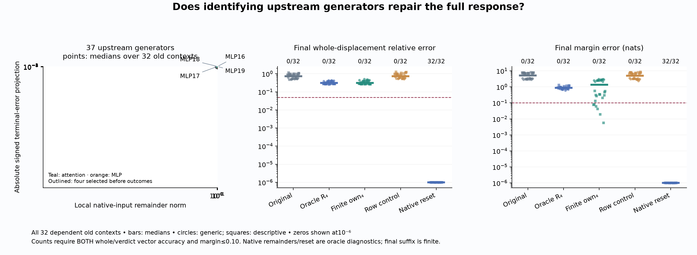

# Counterfactual Traces

**Can we predict a transformer's response to an input edit from one observed computation?**

This project investigates **Question B**: why changing an input Boolean generates a particular residual-stream displacement, and whether identifying the operations that generate and propagate it lets us forecast the native residual and verdict from the **False computation and known edit**.

The starting puzzle is small: an explicitly irrelevant Boolean in a supplied completion prefix changes a later verdict's conditional preference. The preferred answer can stay the same while its score margin moves substantially. We trace that dependency, retaining failed explanations and numerical checks alongside supported results.

**Status: open.** There are qualified local results and useful causal repairs. An accurate general False-only forecast of the full native response has not been demonstrated.

[Latest local result](docs/analysis/239-generator-curvature-result.md) · [Upstream causal test](docs/analysis/238-upstream-generators-result.md) · [Reproduce](research/README.md) · [Experiments](docs/EXPERIMENTS.md) · [Research notes](docs/RESEARCH-NOTES.md)

## Latest: identifying upstream generators helps, but does not close the forecast

Experiment238 separates newly generated local approximation errors from errors inherited through the original affine transport. Its audited ranking selects **MLPs16–19** before intervention outcomes. Recomputing those operations at the forecast's own changing inputs lowers median final margin error from **5.15 to1.34 nats**, and whole-displacement error from **72.3% to31.6%**. Full native-response accuracy still passes **0/32**. Supplying the four oracle native-input remainders also fails0/32. [All cases, controls and numerical qualification](docs/analysis/238-upstream-generators-result.md).



Experiment239 tests an explicit local formula for why the native and forecast input states generate different corrections. A finite-normalization/quadratic-SiLU model passes the local contrast criterion in **32/32 at MLP17 and MLP18**, **0/32 at MLP16**, and **21/32 at MLP19**. The complete four-site account fails. At MLP16, its remaining error is concentrated at the first receiving row; an exact posthoc SiLU-tail identity accounts for the omitted mathematical term. Concentration uses the observed error and has not been validated as a target-blind sparse mechanism. [Full result, formulas and limits](docs/analysis/239-generator-curvature-result.md).

All declared238/239 numerical checks pass. Original237/237b bridge failures remain preserved. Both new studies use32 old dependent contexts and one pinned checkpoint;239 receives native input directions as oracle diagnostics. It does not predict those directions or establish final behavioral accuracy.

## What the earlier tests established

- **The conditional preference dependency can be hidden by an unchanged answer.** Failed grounding controls prevent interpreting it as disabling a competent verifier.
- **Local gate–up interactions matter.** The225b–227b causal sequence separates sign control, new mixing and downstream propagation; a scalar margin explanation can still fail the vector test. [Earlier results](results/README.md).
- **One early attention update can be forecast.** The234 rule passes a whole local displacement test in32/32 fresh pairs at1.52% median error, under its declared exact-first-block/source-computation budget. [Fresh local test](docs/analysis/234-source-key-value-result.md).
- **Those local accounts do not compose automatically.** The228 whole-response forecast fails all32 fresh cases. The235–237 diagnostics identify wrong incoming states and further late attention errors. [Complete failed forecast](docs/analysis/228-false-only-alignment-result.md) · [Late primitive test and numerical caveats](docs/analysis/237-late-attention-result.md).

Source-token states were computed from the known edit before native True measurement. They are declared component work, not leaked future states. Unknown native receiving states remain oracle diagnostics. [Information-budget clarification](docs/analysis/238-information-budget.md).

## Quick start

Verify every release, source seal and retained historical record without a model:

```sh
python -S research/boolean_coupling/reproduce_curvature.py --verify-only --history --plan
```

For an actual reproduction, follow the [environment setup](research/README.md), then:

```sh
python research/boolean_coupling/reproduce_curvature.py --run --out runs/my-reproduction
```

This regenerates the fixed public-input prerequisites and both new studies. Reuse existing arrays with the documented `--input-238` or `--input-237` options. The complete prerequisite chain requires the recorded Apple Silicon/MPS environment;239 alone uses CPU calculations and the cached checkpoint. Every output directory must be new. Unexpected failures stop and retain logs. Repeating old examples is retrospective replication, not fresh confirmation.

GitHub checks verify evidence integrity, syntax and lint. They do **not** execute the model experiments or establish independent scientific replication.

## Repository guide

- [Research guide](research/README.md): environment, commands, computation and information budgets.
- [Experiment index](docs/EXPERIMENTS.md): protocols, reports and preserved failures.
- [Research notes](docs/RESEARCH-NOTES.md): which explanations changed and why.
- [Question B](docs/QUESTION-B.md): the unresolved prediction problem and claim boundaries.
- [Results](results/README.md): every case, controls, audits, logs and array inventories.
- [Historical evidence](evidence/HISTORY.md): earlier diagnostics and superseded claims.
- [Contributing](CONTRIBUTING.md): numerical standards and how to publish a reviewable result.

Developed with substantial AI assistance. Separate auditors are code paths in this investigation, not an independent research team. No learned circuit, novelty priority or general verifier-shutdown result is established. The repository remains private at its owner's request; article drafts and large arrays are excluded. Code has an [MIT license](LICENSE); upstream checkpoints retain their own terms.
