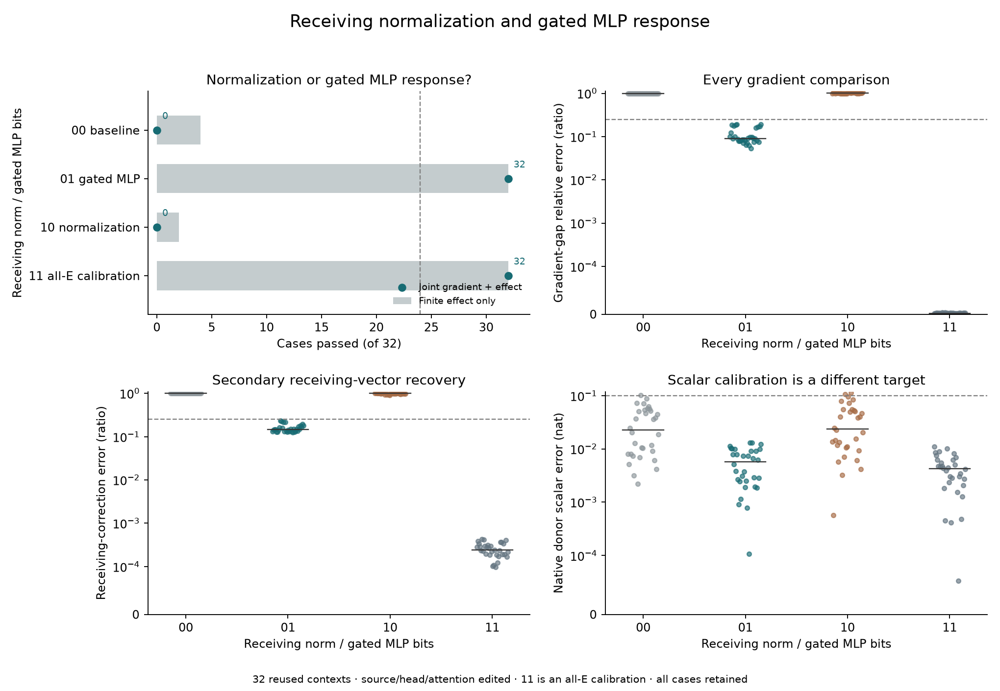
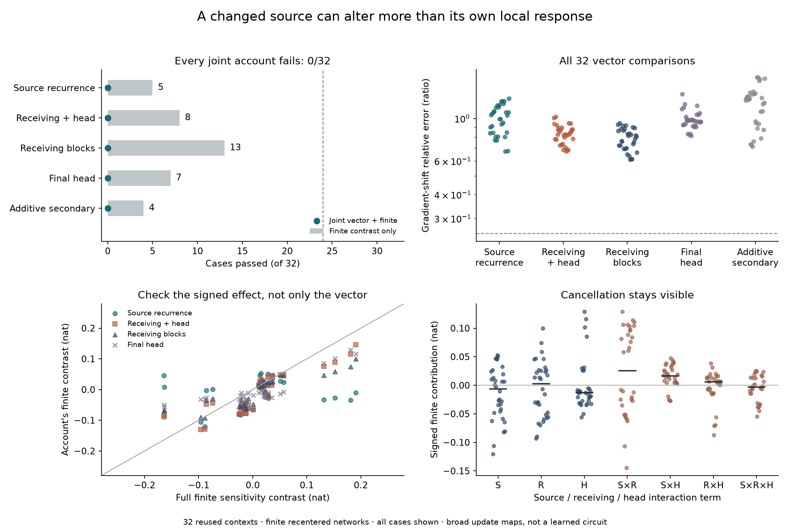
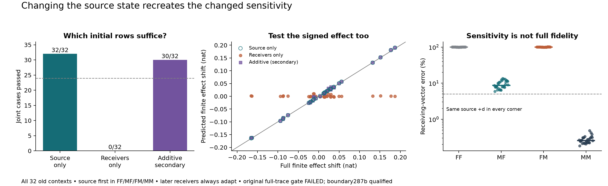

# Counterfactual Traces

**Can we predict a transformer's response to an input edit from one observed computation?**

A Boolean declared irrelevant can change a later verdict's conditional score
without changing its preferred answer. This repository investigates **Question B**:
which nonlinear operations generate and propagate that displacement, and whether
we can predict the native residual and verdict from the **False computation,
known edit and weights**.

The general question remains open. We have bounded prediction successes and
causal constraints in one small checkpoint and related synthetic tasks. Historical
grounding controls failed; this is not a demonstration of disabling a competent
verifier. Unpublished article drafts are excluded.

## Latest: receiving gated MLP response accounts for the remaining sensitivity gap

The edited attention interface alone fails **0/32** retained contexts. With that
interface supplied, restoring the receiving gated MLP response recovers the
remaining gradient and finite-effect contrast in **32/32**, eight per layout.
Restoring receiving normalization response alone gives **0/32**.

The gated-MLP account also passes the conditional receiving-correction vector
test 32/32, at a 25% tolerance. Only 16 remaining finite contrasts are material.
These are retrospective finite response-map interventions with edited source,
attention and head anchors supplied. They do not identify individual neurons,
separate SiLU from multiplication, or predict complete native vectors under a
compact budget. **General Question B remains open.**

[Positive result and scope](docs/analysis/290-receiving-nonlinearity.md) ·
[Failed attention account](docs/analysis/289-attention-interface.md) ·
[Reproduce both](research/README.md#attention-and-receiving-response-289290)

## Earlier: source and receiving response maps must be composed

Changing the initial source can seed a changed sensitivity. But changing only
the source's later local response maps does not reproduce it: **0/32** retained
contexts. Changing receiving/transmission and head maps alone also gives **0/32**,
as does adding the two separate effects. The final head alone fails too.

These are finite modified computations with the same edited baseline trajectory;
their derivatives pass **4,384 required checks**. Seven narrow coordinate
diagnostics remain failed under the declared cached replay bounds. The mixed
response matters here, but it does not identify a learned circuit or yield a
compact native predictor. General Question B remains open.

[What the response-map test rules out](docs/analysis/288-source-receiver-tangent-routing.md) ·
[Evidence](results/tangent-routing-288/README.md) ·
[Reproduce](research/README.md#source-and-receiving-response-maps-288)

## Earlier: the initial source state seeds a changed sensitivity

Changing only the source row after block 1 recreates the measured sensitivity
shift in **32/32 old contexts**. Changing only the other incoming rows passes
**0/32**. Later source and receiving computations remain fully adaptive. This
locates a sufficient initial change for a particular contrast, not a learned circuit.

The distinction matters: the source-only state predicts which small corrections
matter to the verdict, but passes **0/32 complete native-response tests**. Supplying
both source and receiving states passes 32/32 under this substantial finite budget.

**Numerical caveat:** the original audit fails **1/3,072** required checks. A separate,
posthoc qualification passes all 128 boundary-adjoint and 1,152 projected checks
at the original tolerances. The intermediate failure and all 160 original raw
coordinate failures stay failed. Both gradient implementations give the same
scientific classifications under that narrower boundary scope.

[Result and interpretation](docs/analysis/287-source-receiver-readout.md) ·
[All evidence](results/source-receiver-readout-287/README.md) ·
[Reproduce](research/README.md#source-and-receiving-initial-states-287)

## What the earlier tests establish

- **Source generation:** False-state activation curvature predicts one native
  source write on fresh literals and across four prefix layouts. Most of its
  direction transfers from historical donors, but six donor score margins fail.
  The stronger repair claim remains failed, 15/32.
  [Native transfer](docs/analysis/285-native-structure.md).
- **Changed importance:** the ordinary False gradient misses all six large donor
  margin errors; the edited forecast's gradient predicts them. Direct component
  interventions support the difference. This is retrospective scalar evidence
  with a finite suffix and reverse pass.
  [Sensitivity test](docs/analysis/286-state-dependent-readout.md).
- **Limits of composition:** extending a successful first-source approximation
  uniformly across all source layers fails 0/32 complete-response tests.
  Targeted product repairs restore behavior but fail stronger local explanations.
  [Composition](docs/analysis/280-source-composition.md) ·
  [Product interventions](docs/analysis/281-source2-products.md).
- **A conditional correction account:** evaluating the normalized gate/up response
  around a carried state predicts an attention modulation on fresh examples.
  Its added margin effect stays below the materiality guard; it is not shown
  necessary for the native verdict.
  [Fresh result and controls](docs/analysis/284-carried-state-response.md).
- **A concrete cost baseline:** for these late edits, reusing the False prefix KV
  cache and finitely recomputing the affected suffix passes 32/32 old cases.
  Measured marginal speedup is 2.94× on the test Mac. This standard causal reuse
  executes all affected operations; it is not a learned mechanism.
  [Baseline and raw numerical limits](docs/analysis/272-research-review-and-causal-baseline.md).

## Read, reproduce or contribute

[Question B and current claims](docs/QUESTION-B.md) ·
[Reproduction commands](research/README.md) ·
[Experiment index](docs/EXPERIMENTS.md) ·
[Working explanations](docs/RESEARCH-NOTES.md) ·
[Evidence index](results/README.md) · [Contributing](CONTRIBUTING.md)

Code, exact protocols, scalar records, failed controls, array inventories and
plotting scripts are public. Weights and large activation arrays are omitted;
commands regenerate them from public inputs. CI checks source seals and published
arithmetic, **not independent model replication**. Fresh forecasts are explicitly
sealed before native True measurements; retrospective diagnostics are labeled.
No novelty-priority, complete learned-circuit or general efficiency claim follows.
