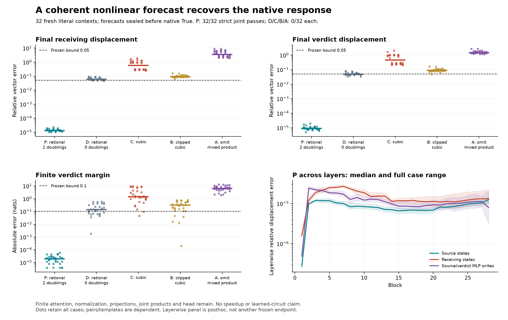
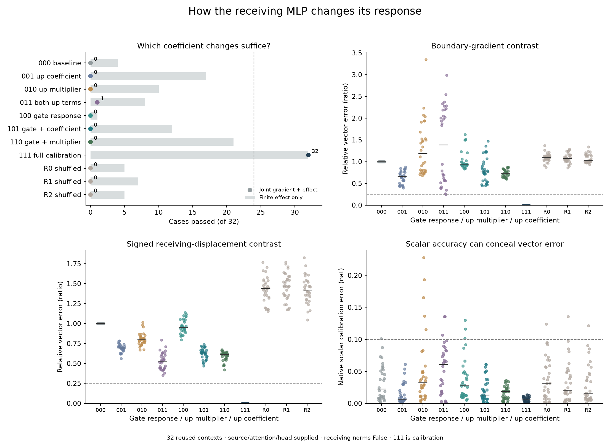

# Counterfactual Traces

**Can we predict a transformer's response to an input edit from one observed computation?**

A Boolean declared irrelevant can change a later verdict's conditional score
without changing its preferred answer. This repository investigates **Question B**:
which nonlinear operations generate and propagate that displacement, and whether
we can predict the native residual and verdict from the **False computation,
known edit and weights**.

The general question remains open. We have bounded prediction successes and
causal constraints in one small checkpoint and related synthetic tasks. Historical
grounding controls failed; this is not a demonstration of disabling a competent
verifier. Unpublished article drafts are excluded.

## Latest: selected message positions fit a scalar contrast, but miss the vectors

At eight retained native inputs, adding/removing the message changes from the
schema-chosen positions passes **0/8** complete conditional tests; their union
also passes0/8. The chosen positions pass the scalar component in all four
descriptive cases, while missing their residual vectors. Five effects are
material; all eight cases remain denominator. This rejects the tested position
account and does not explain the full native Boolean response.

Native terminal replay is exact.1,424 required checks pass under the declared
boundary, while **160/160 narrow coordinate diagnostics remain failed**. A
separately frozen720-check CPU64 contrast review leaves all decisions unchanged.
No full transformer forward, historical pipeline replay or private article push.

[Result and scope](docs/analysis/298-context-messages.md) ·
[Evidence](results/context-messages-298/README.md) ·
[Reproduce](research/README.md#context-messages-298)

## Earlier: context selection retains more, but neither query route is sufficient

On32 new inputs sealed before native measurement, query adaptation restricted
to source attention allocation or to selection among other positions each passes
**0/32** complete native tests. Both sufficient accounts fail. Context selection
nevertheless gives16.44% median receiving-vector error versus46.11% for source
allocation alone, and.504nat margin error versus2.562nats.

At preselected native inputs, context selection also carries most of the local
query-induced write's signed projection. Those local measurements are not final
verdict percentages or full-vector accuracy. All39,368 required checks and288
raw-logit diagnostics pass for this run; previous numerical failures remain.
No learned circuit, compact predictor or general Question B solution is claimed.

[Native result and remaining question](docs/analysis/297-query-routes.md) ·
[All evidence](results/query-routes-297/README.md) ·
[Reproduce](research/README.md#query-routes-297)

## Earlier: query orientation recovers more, but both sufficient accounts fail

On32 new inputs sealed before native measurement, magnitude-only queries pass
**0/32**, direction-only **1/32**, frozen queries and matched random turns **0/32**
complete native tests. Both population hypotheses fail. Direction-only nevertheless
reduces median receiving-vector error from47.44% to6.45%, and margin error
from2.419 to.119nats. A favorable median is not complete native accuracy.

All39,704 required checks pass; **56/168 original raw-logit diagnostics remain
failed** under the predeclared probability/output qualification. The progress-only
296b continuation preserves the original stop and exact replay. Dense finite
source/keys/values/MLPs/head remain, and current queries are still computed.
No compact predictor, learned circuit or general Question B solution is claimed.

[Native result and remaining question](docs/analysis/296-query-geometry.md) ·
[All evidence](results/query-geometry-296/README.md) ·
[Reproduce](research/README.md#query-geometry-296)

## Earlier: actual drive helps; this local diagnostic line is now closed

The fixed endpoint-driven rule passes **40/48** local vector tests but fails
the frozen source-group threshold (16/24). Even a target-fitted endpoint line
fails (41/48, source17/24). Midpoint and Simpson pass48/48; shuffled drive0/48.
All **936** numerical checks pass. These are supplied P gate/up endpoints on
eight old contexts, not native forecasts or learned-circuit identification.

The [research reassessment](docs/analysis/research-direction-review-295.md) finds real
native constraints alongside drift toward explaining approximation errors.
The frozen stopping rule closes the endpoint/path diagnostic sequence here.
General Question B remains open; no new global repair or parameter sweep follows.

[Result](docs/analysis/295-finite-drive.md) ·
[All evidence](results/finite-drive-295/README.md) ·
[Reproduce](research/README.md#finite-drive-295)

## Earlier: response change improves every saved probe, but fails the frozen tests

At identical supplied P inputs, a rank-32 range derived from the change in
MLP response has lower vector error than both endpoint ranges at **48/48**
probes. Median error is 38.4% lower than the better endpoint range. This
weaker comparison is descriptive: the frozen twofold criterion passes only
**8/48** and the complete-vector criterion **0/48**. Both hypotheses fail.

All **1,824** numerical checks pass. These are eight old contexts, source and
verdict rows at blocks 1/15/28, with endpoint states and target writes supplied.
No new model forward, native prediction or causal repair ran. The result narrows
which directions are useful; it does not identify a learned circuit or solve
Question B. Existing failures and the293c qualification remain in view.

[Result and limits](docs/analysis/294-response-change.md) ·
[All evidence](results/response-change-294/README.md) ·
[Reproduce](research/README.md#response-change-294)

## Earlier: the tested response-range compression fails

293 restricts each nonlinear MLP write to 32 directions derived from the local
learned response, while retaining its False-linear component. Both the fixed
False range and adaptive range pass **0/8 native and 0/4 schema-contrast tests**;
the full control passes 8/8 and 4/4. At identical control inputs the adaptive
range leaves about 91% median nonlinear-write error.

This rejects the particular basis construction, not all small subspaces or a
compact predictor in general. It remains a dense, retrospective diagnostic.
**293c qualification:** a baseline/condition naming collision invalidated the
original science tables. The corrected comparisons restore immutable False
arrays, preserve every candidate, and add explicit namespace checks. Original
records and the storage stop remain visible. Question B remains open.

[Qualified result and next distinction](docs/analysis/293-response-subspace.md) ·
[Evidence and invalid original records](results/response-subspace-293/README.md) ·
[Reproduce](research/README.md#response-subspace-293)

## Earlier: a coherent nonlinear update predicts the full native response

292 forecasts all affected source and receiving activations from one False
observation, the known Boolean edit and its own evolving states. The fixed
rational activation update with joint gate/up products passes all 32 native
vector/margin tests and all 32 trajectory tests on fresh literals. Maximum
margin error is 0.0000573 nat. Cubic, clipped cubic, coarse rational and
product-affine controls each pass 0/32 strict native tests.

This is an expensive constructive forecast: attention, normalization, learned
projections, products and head remain finite. It is partly an alternate accurate
implementation of a known primitive, not a compact learned-circuit explanation.
The looser product-effect test also passes inaccurate controls. All 76,128
pre-native and 96 native numerical checks pass; old failures remain failed.
General Question B remains open.

[Result, controls and budget](docs/analysis/292-joint-gate-forecast.md) ·
[Sealed evidence](results/joint-gate-292/README.md) ·
[Reproduce](research/README.md#joint-gate-292)

## Earlier: a scalar fit can conceal a wrong receiving response

291 separates the receiving MLP's gate response, up multiplier and gate
coefficient on the up path. No single change or pair meets the frozen
population criterion; the best partial condition passes 1/32, below the finite
materiality guard. Every partial receiving-vector account passes 0/32.

Yet the up-path coefficient alone passes all 32 native scalar calibrations and
flags all six old large errors, with no false positives. Its median gradient
and receiving-vector errors are 65% and 69%. Scalar accuracy does not establish
a correct internal response. The full restoration is calibration, not a new
mechanism. These are old contexts with edited source/attention/head supplied;
Question B remains open.

[Result, signed accounting and limits](docs/analysis/291-receiving-coefficients.md) ·
[All cases](results/receiving-coefficients-291/README.md) ·
[Reproduce](research/README.md#receiving-coefficients-291)

## Earlier: receiving gated MLP response accounts for the remaining sensitivity gap

The edited attention interface alone fails **0/32** retained contexts. With that
interface supplied, restoring the receiving gated MLP response recovers the
remaining gradient and finite-effect contrast in **32/32**, eight per layout.
Restoring receiving normalization response alone gives **0/32**.

The gated-MLP account also passes the conditional receiving-correction vector
test 32/32, at a 25% tolerance. Only 16 remaining finite contrasts are material.
These are retrospective finite response-map interventions with edited source,
attention and head anchors supplied. They do not identify individual neurons,
separate SiLU from multiplication, or predict complete native vectors under a
compact budget. **General Question B remains open.**

[Positive result and scope](docs/analysis/290-receiving-nonlinearity.md) ·
[Failed attention account](docs/analysis/289-attention-interface.md) ·
[Reproduce both](research/README.md#attention-and-receiving-response-289290)

## Earlier: source and receiving response maps must be composed

Changing the initial source can seed a changed sensitivity. But changing only
the source's later local response maps does not reproduce it: **0/32** retained
contexts. Changing receiving/transmission and head maps alone also gives **0/32**,
as does adding the two separate effects. The final head alone fails too.

These are finite modified computations with the same edited baseline trajectory;
their derivatives pass **4,384 required checks**. Seven narrow coordinate
diagnostics remain failed under the declared cached replay bounds. The mixed
response matters here, but it does not identify a learned circuit or yield a
compact native predictor. General Question B remains open.

[What the response-map test rules out](docs/analysis/288-source-receiver-tangent-routing.md) ·
[Evidence](results/tangent-routing-288/README.md) ·
[Reproduce](research/README.md#source-and-receiving-response-maps-288)

## Earlier: the initial source state seeds a changed sensitivity

Changing only the source row after block 1 recreates the measured sensitivity
shift in **32/32 old contexts**. Changing only the other incoming rows passes
**0/32**. Later source and receiving computations remain fully adaptive. This
locates a sufficient initial change for a particular contrast, not a learned circuit.

The distinction matters: the source-only state predicts which small corrections
matter to the verdict, but passes **0/32 complete native-response tests**. Supplying
both source and receiving states passes 32/32 under this substantial finite budget.

**Numerical caveat:** the original audit fails **1/3,072** required checks. A separate,
posthoc qualification passes all 128 boundary-adjoint and 1,152 projected checks
at the original tolerances. The intermediate failure and all 160 original raw
coordinate failures stay failed. Both gradient implementations give the same
scientific classifications under that narrower boundary scope.

[Result and interpretation](docs/analysis/287-source-receiver-readout.md) ·
[All evidence](results/source-receiver-readout-287/README.md) ·
[Reproduce](research/README.md#source-and-receiving-initial-states-287)

## What the earlier tests establish

- **Source generation:** False-state activation curvature predicts one native
  source write on fresh literals and across four prefix layouts. Most of its
  direction transfers from historical donors, but six donor score margins fail.
  The stronger repair claim remains failed, 15/32.
  [Native transfer](docs/analysis/285-native-structure.md).
- **Changed importance:** the ordinary False gradient misses all six large donor
  margin errors; the edited forecast's gradient predicts them. Direct component
  interventions support the difference. This is retrospective scalar evidence
  with a finite suffix and reverse pass.
  [Sensitivity test](docs/analysis/286-state-dependent-readout.md).
- **Limits of composition:** extending a successful first-source approximation
  uniformly across all source layers fails 0/32 complete-response tests.
  Targeted product repairs restore behavior but fail stronger local explanations.
  [Composition](docs/analysis/280-source-composition.md) ·
  [Product interventions](docs/analysis/281-source2-products.md).
- **A conditional correction account:** evaluating the normalized gate/up response
  around a carried state predicts an attention modulation on fresh examples.
  Its added margin effect stays below the materiality guard; it is not shown
  necessary for the native verdict.
  [Fresh result and controls](docs/analysis/284-carried-state-response.md).
- **A concrete cost baseline:** for these late edits, reusing the False prefix KV
  cache and finitely recomputing the affected suffix passes 32/32 old cases.
  Measured marginal speedup is 2.94× on the test Mac. This standard causal reuse
  executes all affected operations; it is not a learned mechanism.
  [Baseline and raw numerical limits](docs/analysis/272-research-review-and-causal-baseline.md).

## Read, reproduce or contribute

[Question B and current claims](docs/QUESTION-B.md) ·
[Reproduction commands](research/README.md) ·
[Experiment index](docs/EXPERIMENTS.md) ·
[Working explanations](docs/RESEARCH-NOTES.md) ·
[Evidence index](results/README.md) · [Contributing](CONTRIBUTING.md)

Code, exact protocols, scalar records, failed controls, array inventories and
plotting scripts are public. Weights and large activation arrays are omitted;
commands regenerate them from public inputs. CI checks source seals and published
arithmetic, **not independent model replication**. Fresh forecasts are explicitly
sealed before native True measurements; retrospective diagnostics are labeled.
No novelty-priority, complete learned-circuit or general efficiency claim follows.
