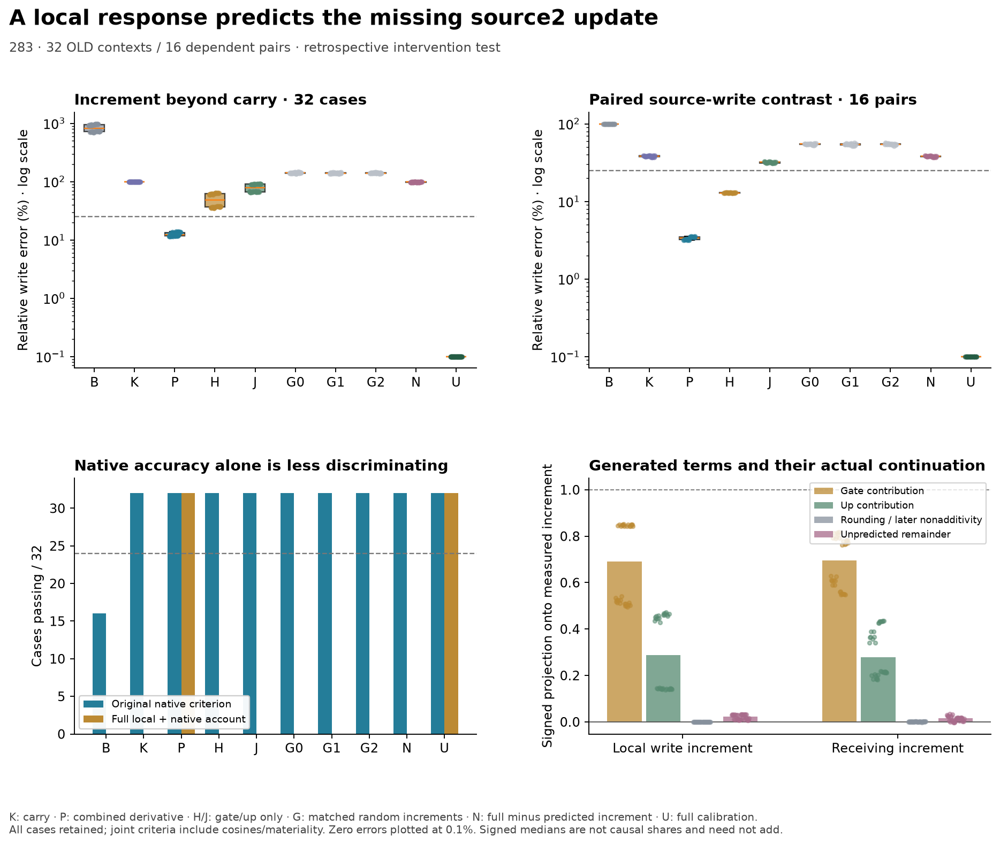
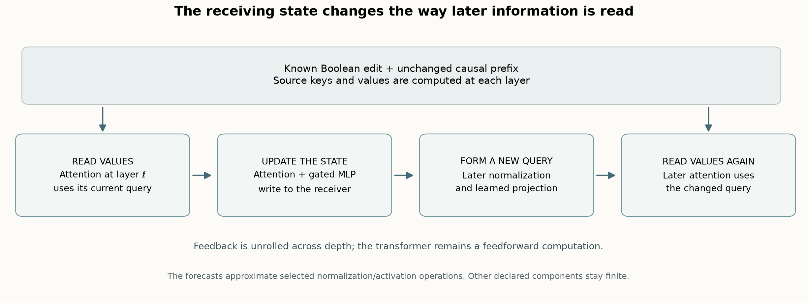
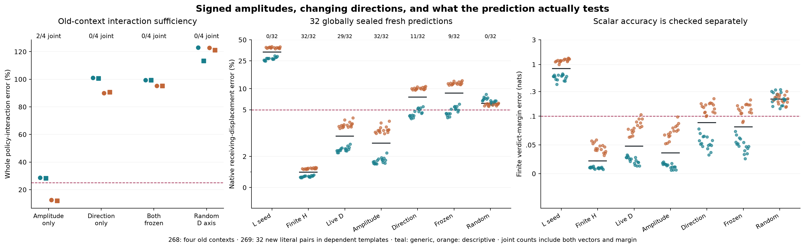
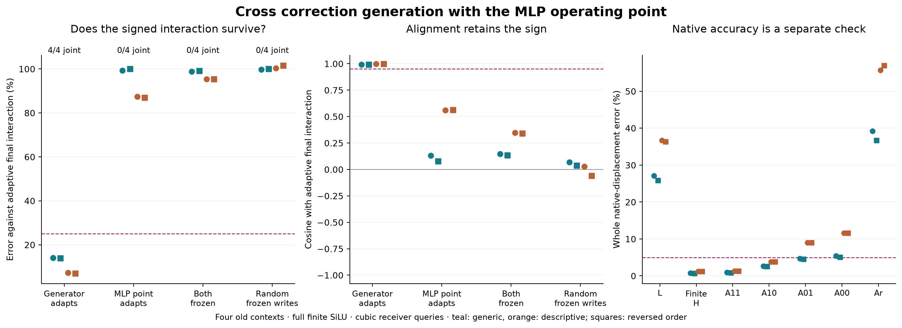
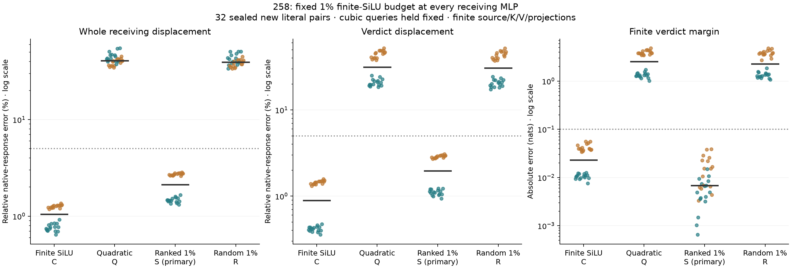

# Counterfactual Traces

**Can we predict a transformer's response to an input edit from one observed computation?**

This project investigates **Question B**: why a Boolean input edit generates a
particular residual-stream displacement, and whether the operations generating
and propagating it let us forecast native residual and verdict from the **False
computation, known edit and model weights**.

**Current answer: a tested local generator and a conditional correction account;
the broader mechanism remains open.** The latest rule predicts how
attention modulates the correction at the second source MLP's carried input. Its
frozen rule passes **32/32 old joint cases**, including all 16 dependent schema
pairs, then **32/32 fresh literal contexts** with forecasts publicly sealed before
native measurement. Gate-only, up-only and matched random increments fail the conditional
local-increment test, although they already pass the original native-response
criterion. The added increment has no margin effect reaching the frozen .02-nat
guard, even under full calibration; it is not shown necessary for the native
verdict. [Exact target, interventions and numerical limits](docs/analysis/283-carried-state-response.md).

The fresh result meets every schema/order stratum **8/8** and paired local
contrast **16/16**. Original native accuracy alone still does not select the finer
account, and all strict incremental/removal behavioral accounts remain 0/32
because their margin effects are below the frozen materiality guard. A posthoc
same-schema cross-literal donor vector also passes the local tolerance in 32/32
old and 30/32 fresh cases without rescaling; cross-schema donors pass 0/32. The own
rule is more precise, but case-specific vectors are not shown necessary.
[Fresh outcomes, controls and limits](docs/analysis/284-carried-state-response.md).

The original native run's storage stop and two zero-forward continuation failures
remain preserved. A third qualified continuation reproduced all 17 completed
arrays and metadata exactly before measuring the remaining 15. The unchanged
native audit and separate continuation wrapper pass; forecast seals and criteria
remain unchanged.

At the first source MLP, an earlier rule using activation curvature measured at the False
state predicts the changed write and its original final response in **32/32 fresh
literal contexts**. Its preregistered joint criterion passes **29/32**; three cases
have effects below the materiality cutoff and remain failures. The quadratic
control also passes. All forecasts were public before native True measurements.
[Prediction, every failure and exact budget](docs/analysis/279-source-activation-forecast.md).

The preceding primitive interventions explain why correcting normalization alone
was insufficient: it worsened receiving-vector error in all 32 old cases when the
gate–up product stayed linear, but improved it in all 32 when multiplication could
respond. The missing joint operand change contributes a particular residual vector.
The normalization-only primary still **fails 0/32**.
[Interventions and signed effects](docs/analysis/278-source-mlp-primitives.md).

This is one local part of generation, not an identified learned circuit or a
compact whole-network predictor. First attention, normalization, projections,
multiplication and all 27 later blocks remain finite. Fresh literals share
synthetic templates; historical grounding controls failed. No reliable-verifier
shutdown or novelty-priority claim follows.

The next composition test **fails 0/32** when cubic is applied at all 28 source
MLPs, even with receiving computation finite. The first new failure appears at
source MLP2, including at its native input. Removing one largest local discrepancy
also fails to restore the full response. The first-site success survives; the
uniform extension does not. [Composition test, source-error split and retained
numerical failures](docs/analysis/280-source-composition.md).

A targeted source-MLP2 test then selects 90 coordinates without native-target
information. Two fixed rules recover the original response in **32/32 old
contexts**, versus16/32 for two-site cubic. But the primary reconstruction of
the missing write and its actual effect **fails0/32**. Signed geometry explains
why both can hold: the omitted effect is small relative to the complete native
displacement, and the two masks' differences persist downstream. The rectifier
selector misses a smooth SiLU term; this is a known-function identity, not a
learned circuit or fresh confirmation. [Product interventions, every failed
account and numerical qualifications](docs/analysis/281-source2-products.md).

The next causal test separates the state carried from block1 from the new
attention2 write. The carry-derived correction recovers the native response and
missing write/effect32/32, but misses every paired schema-write contrast: the
primary still fails0/32. The attention-only correction is tiny; its mixed response
around the carried state matters for that local contrast. The latest 283 test
predicts that modulation at the carried operating point; it does not retroactively
pass 282's failed carry-only primary. [Carry/read test, all failures and qualified
numerical scope](docs/analysis/282-source2-gate-origin.md).

For the late Boolean edits in this setup, retaining one False prefix KV cache
and recomputing the affected suffix passes 32/32 old native-response cases.
It uses at most 3.59% of full learned matrix MACs and is 2.94× faster in the
measured marginal calls on this Mac. This is standard causal reuse, with all
affected operations finite. It is a reference computation, not a learned circuit.

Earlier cubic-query/selective-SiLU and fixed-axis rules still have their sealed
fresh-literal successes. The new [research review](docs/analysis/272-research-review-and-causal-baseline.md)
separates those predictions from intervention-policy explanations and establishes
a concrete baseline for the next computation budget.

[Start here](docs/READING-GUIDE.md) · [Latest qualified result](docs/analysis/283-carried-state-response.md) ·
[Fresh prediction](docs/analysis/284-carried-state-response.md) ·
[Cost baseline](docs/analysis/272-research-review-and-causal-baseline.md) ·
[Question B](docs/QUESTION-B.md) · [Reproduce](research/README.md) ·
[Experiment index](docs/EXPERIMENTS.md) · [Research notes](docs/RESEARCH-NOTES.md)

## New to this project?

The [reading guide](docs/READING-GUIDE.md) defines the task, residual displacement,
query feedback, finite versus approximate computation, and how to inspect a claim.
Follow its six-test path before the full chronological experiment index.

For the current research edge, read [283](docs/analysis/283-carried-state-response.md)
before [284's sealed fresh test](docs/analysis/284-carried-state-response.md).
They distinguish conditional local prediction, actual native behavior and
materiality limits. [Reproduction commands](research/README.md#carried-state-response-283284)
include the declared finite budget and the exact-replay continuation requirement.





## The shared backbone still matters

Two new causal tests clarify the successful forecast's remaining cost. Removing
its common MLP backbone's gate and cross remainders leaves only 2/4 old-context
native passes. Supplying the successful forecast's correction amplitudes and
receiving queries together leaves 94% median error in the missing vector effect;
that explanation passes 0/4. Other receiving-state paths remain unresolved.
These are retrospective boundaries, not new confirmation or a learned circuit.

[Result and exact budget](docs/analysis/270-271-backbone-curvature-and-feedback.md) ·
[Every case and numerical caveat](results/backbone-feedback-270-271/README.md)

## A fixed-direction correction passes a fresh prediction test

An alternative forecast caches its correction directions and local MLP
operating points from an extra approximate L run, then updates only **two
signed correction amplitudes per receiving row and layer**. It passes the
unchanged residual/verdict/margin criterion on **32/32 new literal pairs**,
with 2.85% median whole error and .03618-nat margin error. All predictions and
their numerical qualification were publicly sealed before native measurements.
Random D directions pass 0/32; fixed amplitudes with live directions pass 11/32.

The stronger claim that amplitudes alone preserve the old policy interaction
fails 2/4. Prediction and interaction explanation are separate tests. The
common backbone and substantial finite learned computation remain; no speedup
or learned circuit is established. [All cases, budgets and retained failures](docs/analysis/268-269-amplitudes-directions-and-prediction.md).



## Where the changing-state dependence appears

A finite MLP factorial separates two dependencies. Allowing normalization
correction vectors to change while freezing their local MLP operating point
preserves the signed final policy interaction in **4/4 old contexts**. Freezing
the vectors while allowing the operating point to adapt passes **0/4**. Median
interaction-vector errors are 10.6% and 93.3%, respectively; both frozen and
matched random frozen writes also fail. All neurons use finite SiLU.

The successful variant also passes native-response accuracy 4/4, with 3.2%
median whole-displacement error. The common backbone and attention still adapt;
the frozen operating point comes from an extra approximate forecast. This is
a conditional causal constraint, not a fresh predictor or identified circuit.
[Crossed interventions, every case and numerical limits](docs/analysis/267-correction-field-feedback.md).



## What the local removal test showed

Removing the pointwise MLP interaction at every receiving layer leaves the
final interaction intact, slightly stronger in all four old contexts. The
forecasts still match the native response within the original criterion.
The immediate local effect does not explain the contrast across evolving states.

A finite-SiLU control catches a separate limitation: the adaptive sparse rule
passes 0/177 eligible local interaction checks, while sharing a mask across
corners passes 175/177. Accurate trajectories need not preserve these local
counterfactual contrasts. This constrains interpretation of the approximation;
it does not invalidate the earlier forecast result or identify a native circuit.
[Direct interventions, finite control and qualifications](docs/analysis/265-266-local-mixing-and-state-feedback.md).

## What nonlinear MLP normalization adds

A deeper retrospective intervention finds that replacing MLP input
normalization by its False tangent raises whole-displacement error from 2.06%
to 32.08% on four old contexts. Restoring normalization to only the gate branch
or only the up branch is insufficient. A simple energy correction gets the
vectors within tolerance but misses the verdict margin in two cases. The
smaller normalization term has a different final vector effect on different
backgrounds. This narrows the generation mechanism; it does not establish a
learned circuit or solve general Question B. Original numerical failures remain
failed, with the public Float32 scope explicitly qualified.
[All interventions, signed effects and limitations](docs/analysis/261-264-mlp-normalization-origin.md).

## What the sparse forecast establishes

An earlier single-site SiLU repair worked locally but could not predict the
native response from its inaccurate incoming state. After obtaining an accurate
query-feedback rule, we apply the same target-blind activation rule at every
receiving MLP, using only each forecast's own evolving state.

The primary ranked 1% rule has **2.13% median whole-displacement error**,
**1.96% verdict-displacement error** and **.00678-nat margin error**. It passes
8/8 cases in every schema/order stratum. Quadratic SiLU everywhere leaves
**40.79%** median whole error and passes 0/32. A row-count-matched random 1%
restoration leaves **39.53%** and passes 0/32. The finite-SiLU reference passes 32/32
at 1.05% whole error. Every forecast was publicly sealed before native True
measurement. [All cases, method and budget](docs/analysis/258-receiver-mlp-result.md).



The mask ranks an analytical SiLU remainder bound times current up magnitude
and down-column norm. It uses no native True gates, final readout or observed
remainder. A separate **retrospective** comparison finds that dropping the
bound weakens local capture; dropping column norm changes little at the 24
saved witness inputs. Cubic gate-displacement magnitude also performs similarly
locally, so the full bound is not shown uniquely necessary. These simpler rules
have not been validated as fresh global forecasts.
[Score-factor diagnostic](docs/analysis/259-silu-score-factors-result.md).
A subsequent [energy diagnostic](docs/analysis/260-silu-energy-concentration-result.md)
finds the original mask contains at least 90% of individual omitted-write energy
in 20/24 whole-input witnesses, before cross-neuron cancellation. Verdict-local
capture is less uniform (16/24). This does not predict the upstream gate changes.

## The numerical boundary matters

The original 258 CPU64 whole-down-projection audit **failed**. Before any native
measurement, a separately frozen 258b qualification required exact public
Float32 replay at the original full-sequence shape, while retaining every
failed CPU64 check at its original tolerance. All other component and behavioral
criteria stayed fixed. The qualified final audit passes 20,016 checks; raw
whole-down and projection/rotary/QK coordinate failures remain published as
failures. This is not independent whole-model real-arithmetic reconstruction,
and it does not resolve older whole-block derivative disagreements.
[Numerical revision](docs/experiments/258b-matched-projection-qualification.md).

## How the evidence led here

- **An unchanged answer can hide dependence.** An explicitly irrelevant Boolean
  in a supplied prefix changes the later Boolean's conditional score margin.
  Failed grounding controls prevent a competent-verifier-shutdown claim.
- **Local accounts did not compose.** Several primitive interventions explained
  a local vector or scalar effect but failed final residual and verdict tests.
  Accurate incoming states matter. [Local SiLU boundary](docs/analysis/240-target-blind-silu-result.md).
- **Continued source reads matter.** Defined native source-value clamps remove
  most signed verdict response, but static receiving attention still fails to
  predict it. [Source communication](docs/analysis/250b-native-source-communication-result.md).
- **Receiver query feedback is consequential.** Predicting its normalization
  curvature first closes a declared full-response forecast with correction
  passes, then with one local cubic-rule pass. [Single-pass result](docs/analysis/256-local-query-curvature-result.md).
- **A small adaptive beyond-quadratic SiLU budget can compose with that rule.**
  The latest test moves beyond a conditional one-site repair, while retaining
  the other declared finite operations. [258](docs/analysis/258-receiver-mlp-result.md).

These experiments use one pinned small Qwen checkpoint and dependent synthetic
templates. New literals are useful held-out cases, not independent tasks or
cross-model replication. The learned source/receiving computation, necessity
of the remaining finite operations, generalization and useful compute savings
remain open. No novelty-priority or learned-feature claim is established.

## Quick start

Verify every release, source seal and retained historical record without a model:

```sh
python -S research/boolean_coupling/reproduce_receiver_mlp.py --verify-only --history --plan
python -S research/boolean_coupling/verify_reader_guide.py
```

For an actual numerical reproduction, follow the [environment setup](research/README.md), then:

```sh
python research/boolean_coupling/reproduce_receiver_mlp.py --run --offline --out runs/my-258-reproduction
```

The wrapper executes the published258 rule, the explicit258b qualification,
pre-native sealing, native/control measurements and separate final audit. It
never pushes Git. Repeating published literals is numerical replication, not
fresh confirmation. It requires the pinned Apple Silicon/MPS environment;
use a new output directory. Individual scientific stages ran in this release;
a separate full wrapper replay has not been executed. GitHub CI checks evidence
integrity, syntax and lint, **not** the model experiments.

[Research guide](research/README.md) gives exact commands, component budgets,
retrospective259 prerequisites, previous wrappers and numerical qualifications.

## Repository guide

- [Question B](docs/QUESTION-B.md): current answer and remaining gaps.
- [Experiment index](docs/EXPERIMENTS.md): protocols, reports and preserved failures.
- [Research notes](docs/RESEARCH-NOTES.md): explanations that changed and why.
- [Results](results/README.md): every case, controls, audits, logs and array inventories.
- [Historical evidence](evidence/HISTORY.md): qualified older diagnostics and invalidated claims.
- [Contributing](CONTRIBUTING.md): numerical and publication standards.

Developed with substantial AI assistance. Separate auditors are code paths in
this investigation, not an independent research team. Unpublished article drafts,
large activation arrays and private working context are excluded. Older PR
discussions remain in a separate private archive. Code has an [MIT license](LICENSE);
upstream checkpoints retain their own terms.
