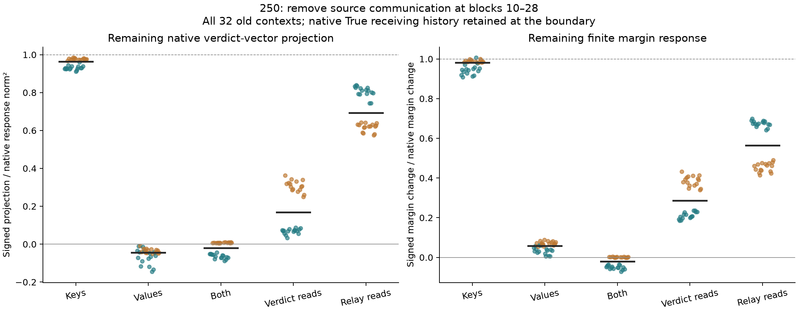
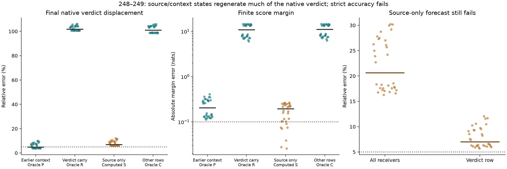
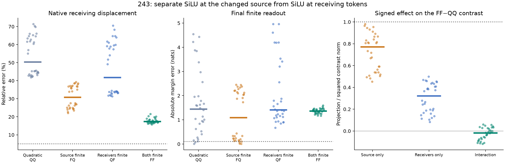
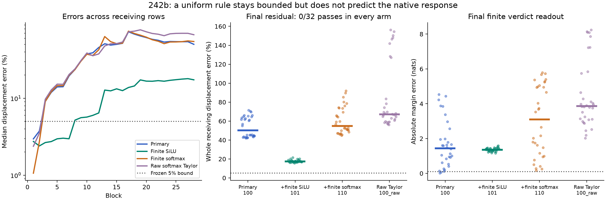
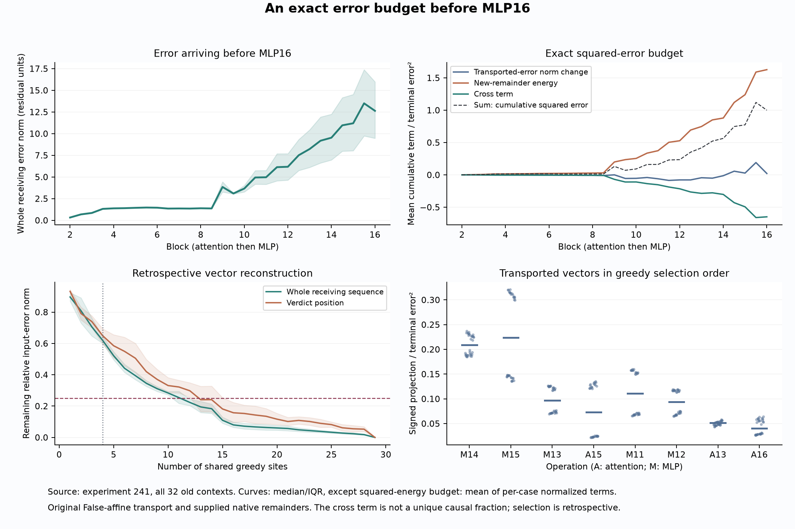
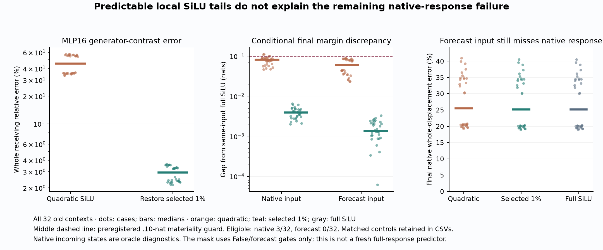

# Counterfactual Traces

**Can we predict a transformer's response to an input edit from one observed computation?**

This project investigates **Question B**: why changing an input Boolean generates a particular residual-stream displacement, and whether identifying the operations that generate and propagate it lets us forecast the native residual and verdict from the **False computation and known edit**.

The starting puzzle is small: an explicitly irrelevant Boolean in a supplied completion prefix changes a later verdict's conditional preference. The preferred answer can stay the same while its score margin moves substantially. We trace that dependency, retaining failed explanations and numerical checks alongside supported results.

**Status: open.** There are qualified local results and useful causal repairs. An accurate general False-only forecast of the full native response has not been demonstrated.

[Latest native communication test](docs/analysis/250b-native-source-communication-result.md) · [Upstream causal test](docs/analysis/238-upstream-generators-result.md) · [Reproduce](research/README.md) · [Experiments](docs/EXPERIMENTS.md) · [Research notes](docs/RESEARCH-NOTES.md)

## Latest: continued source values sustain most of the native response

A finite primitive intervention removes source keys and/or values only during later receiving attention reads, preserving the source's own computation. Removing both removes at least90% of the signed native verdict projection **and** margin response in **32/32 old contexts**. Removing keys alone leaves96.3% of the verdict projection; removing values leaves−4.4%, although a sizeable orthogonal displacement remains. Direct verdict reads matter more than intermediate reads; both contribute and their effects interact.

Native/zero-clamp replays and a separate source-boundary identity are exact. The CPU64 witness/head audit passes. The original250 witness-selection/count failure is retained; the separately frozen250b correction qualifies all32 completed cases without changing outputs or criteria. This is retrospective necessity under defined clamps, not a False-only predictor or learned circuit. **Question B remains open.** [All cases, methods, budget and limits](docs/analysis/250b-native-source-communication-result.md).



## Earlier: native context reads matter more than a carried verdict state

The new tests target the **actual native Boolean response**, rather than the earlier approximation-policy interaction. Before block10, True earlier context with a False verdict state reaches **4.9% verdict-vector error**; a True verdict state with False context has **101.8% error**. The context-only arm still misses the score bound. [Native carry/read test](docs/analysis/248-native-carry-read-result.md).

A source-only algorithm computes the edited Boolean's state from one False computation and the known edit, then lets the finite suffix regenerate receiving states. It reaches **7.0% verdict error**, **20.6% whole receiving error** and **.194-nat margin error**. It passes **0/32** under the unchanged joint criterion. Earlier receiving states alone, with the source kept False, do not recover the response. [Source regeneration, budget, controls and limits](docs/analysis/249-source-regeneration-result.md).

This narrows the native causal question to later source/context communication and the residual dependence on earlier receiving history. The250b interventions now separate direct source reads from reads into intermediate rows; precise prospective prediction remains unresolved. There is no speedup, learned circuit or full answer to Question B. The source computation uses substantial dense model work; these are old contexts, not fresh confirmation.



## Earlier: a large local jump is not the final mechanism

With native attention, experiment244 finds that243's specific interaction does not transfer quantitatively (0/32). The regional interaction remains substantial. Experiment245 removes the first tiny attention interaction and finds almost no final effect.

The observed block9 jump has a more specific local account: a state-sensitive SiLU approximation discrepancy predicts the whole receiving-product interaction in **32/32** cases at **2.44% median error**, but the verdict-row account passes **0/32**. Directly removing it leaves the final interaction largely intact. Explaining a large pooled local vector did not identify the behavioral bottleneck. [Matched-input decomposition, direct primitive interventions and limits](docs/analysis/246b-block9-origin-result.md).

These are retrospective policy-interaction diagnostics, not a native False-only predictor or learned circuit. All numerical audits pass within their stated scope; original implementation/scoring failures remain preserved. **Question B remains open.**


## Earlier: source and receiver SiLU both matter

Experiment 243 separates finite SiLU at the changed Boolean from finite SiLU at receiving tokens. Source-only reduces median native residual error **50.3% → 30.8%**; receiver-only reaches **41.8%**; both reach **17.4%**. Neither region alone reproduces their combined effect, and its interaction vector has a median norm of **35.8%** of that effect. Every arm still has **0/32** full native-response passes.

The two old endpoints, zero-edit controls and regional causality checks replay exactly. These are retrospective primitive interventions on 32 existing contexts, not a fresh predictor or learned circuit. The numerical audit passes; the original scorer's missing zero-count metadata failure remains preserved. [All cases, signed vectors and limits](docs/analysis/243-source-receiver-silu-result.md).



## Earlier: a uniform primitive rule fails on fresh inputs

Experiment 242b freezes the same operation rule across all 28 blocks, generating every counterfactual state from one False computation and the known edit. All 256 forecasts were sealed and pushed before the 32 native True runs. The primary rule keeps RMS normalization and products finite, with a positive quadratic attention tilt and quadratic SiLU. It passes **0/32** full-response cases, at **50.3%** median residual error and **1.44 nats** margin error.

Keeping SiLU finite lowers residual error to **17.4%**, but still passes **0/32**. All affine-normalization arms hit frozen instability limits. Stability, local numerical qualification and final accuracy are different requirements. Source-token errors also grow, so this does not isolate receiving-state normalization or a learned circuit. [All arms, checks and limits](docs/analysis/242b-uniform-primitive-families-result.md).



## Earlier: a four-operation account fails; transport also changes cancellation

Experiment 241 transports every earlier local error vector to the input before MLP16. Four sites selected by the predeclared greedy rule pass **0/32** input-error reconstruction cases; the first sufficient prefix of that ordering uses **16 of 29 operations**. This rejects that four-site account, not every possible compact mechanism. New local errors partly oppose inherited error in all 32 cases.

A small net transport-energy change hides two larger effects: reduced individual-vector energy and weaker mutual cancellation. Both signs hold in 32/32 old contexts. These are qualified retrospective error-budget results, not primitive causal attribution or a solved native-response forecast. [Full vectors, geometry, checks and limits](docs/analysis/241-before-mlp16-vectors-result.md).



## The preceding local SiLU test

Experiment 240 selects 1% of MLP16 activation coordinates using only False and forecast gates, before reading native inputs. Direct restoration recovers the missing whole-sequence SiLU contrast in **32/32** old contexts and reduces the original generator-contrast error **45.2% → 2.94%**. But only **3/32** native-input cases and **0/32** forecast-input cases exceed the frozen behavioral materiality guard. Even a fully finite continuation from the forecast input leaves **25.2% native displacement error and 1.09 nats margin error**. This explains a conditional local approximation failure; it does not predict the unknown native incoming state. [Full result and limits](docs/analysis/240-target-blind-silu-result.md).



## How the upstream test led here

Experiment 238 separates newly generated local approximation errors from errors inherited through the original affine transport. Its audited ranking selects **MLPs 16–19** before intervention outcomes. Recomputing those operations at the forecast's own changing inputs lowers median final margin error from **5.15 to 1.34 nats**, and whole-displacement error from **72.3% to 31.6%**. Full native-response accuracy still passes **0/32**. Supplying the four oracle native-input remainders also passes 0/32. [All cases, controls and numerical qualification](docs/analysis/238-upstream-generators-result.md).


Experiment 239 tests an explicit local formula for why the native and forecast input states generate different corrections. A finite-normalization/quadratic-SiLU model passes the local contrast criterion in **32/32 at MLP17 and MLP18**, **0/32 at MLP16**, and **21/32 at MLP19**. The complete four-site account fails. At MLP16, its remaining error is concentrated at the first receiving row; an exact posthoc SiLU-tail identity accounts for the omitted mathematical term. That concentration uses the observed error; 240 above supplies a separate target-blind intervention test. [Full result, formulas and limits](docs/analysis/239-generator-curvature-result.md).

All declared238/239 numerical checks pass. Original237/237b bridge failures remain preserved. Both new studies use32 old dependent contexts and one pinned checkpoint;239 receives native input directions as oracle diagnostics. It does not predict those directions or establish final behavioral accuracy.

## What the earlier tests established

- **The conditional preference dependency can be hidden by an unchanged answer.** Failed grounding controls prevent interpreting it as disabling a competent verifier.
- **Local gate–up interactions matter.** The225b–227b causal sequence separates sign control, new mixing and downstream propagation; a scalar margin explanation can still fail the vector test. [Earlier results](results/README.md).
- **One early attention update can be forecast.** The234 rule passes a whole local displacement test in 32/32 fresh pairs at 1.52% median error, under its declared exact-first-block/source-computation budget. [Fresh local test](docs/analysis/234-source-key-value-result.md).
- **Those local accounts do not compose automatically.** The228 whole-response forecast fails all 32 fresh cases. The235–237 diagnostics identify wrong incoming states and further late attention errors. [Complete failed forecast](docs/analysis/228-false-only-alignment-result.md) · [Late primitive test and numerical caveats](docs/analysis/237-late-attention-result.md).

Source-token states were computed from the known edit before native True measurement. They are declared component work, not leaked future states. Unknown native receiving states remain oracle diagnostics. [Information-budget clarification](docs/analysis/238-information-budget.md).

## Quick start

Verify every release, source seal and retained historical record without a model:

```sh
python -S research/boolean_coupling/reproduce_communication.py --verify-only --history --plan
```

For an actual reproduction, follow the [environment setup](research/README.md), then:

```sh
python research/boolean_coupling/reproduce_communication.py --run --out runs/my-reproduction
```

This regenerates the242b prerequisite and the qualified250b communication test, explicitly retaining the original count-only failure. Add `--input-242 runs/existing-242b` to reuse a prerequisite. The unchanged `reproduce_native.py` reproduces247–249, with matching prerequisite reuse options. The unchanged `reproduce_mixing.py` reproduces the earlier244–246b diagnostics. Repeating these already observed literals is numerical replication, not fresh confirmation. The pinned Apple Silicon/MPS environment is required. Every output directory must be new, and unexpected failures stop with logs preserved.

The earlier `reproduce_early.py` wrapper remains available for studies through 241. See the [research guide](research/README.md) for its prerequisite reuse options and stricter archived-array checks.

GitHub checks verify evidence integrity, syntax and lint. They do **not** execute the model experiments or establish independent scientific replication.

## Repository guide

- [Research guide](research/README.md): environment, commands, computation and information budgets.
- [Experiment index](docs/EXPERIMENTS.md): protocols, reports and preserved failures.
- [Research notes](docs/RESEARCH-NOTES.md): which explanations changed and why.
- [Question B](docs/QUESTION-B.md): the unresolved prediction problem and claim boundaries.
- [Results](results/README.md): every case, controls, audits, logs and array inventories.
- [Historical evidence](evidence/HISTORY.md): earlier diagnostics and superseded claims.
- [Contributing](CONTRIBUTING.md): numerical standards and how to publish a reviewable result.

Developed with substantial AI assistance. Separate auditors are code paths in this investigation, not an independent research team. No learned circuit, novelty priority or general verifier-shutdown result is established. This public repository contains the verified Question B code and experiment history. Unpublished article drafts and large arrays are excluded; older PR discussions remain in a separate private archive. Code has an [MIT license](LICENSE); upstream checkpoints retain their own terms.
