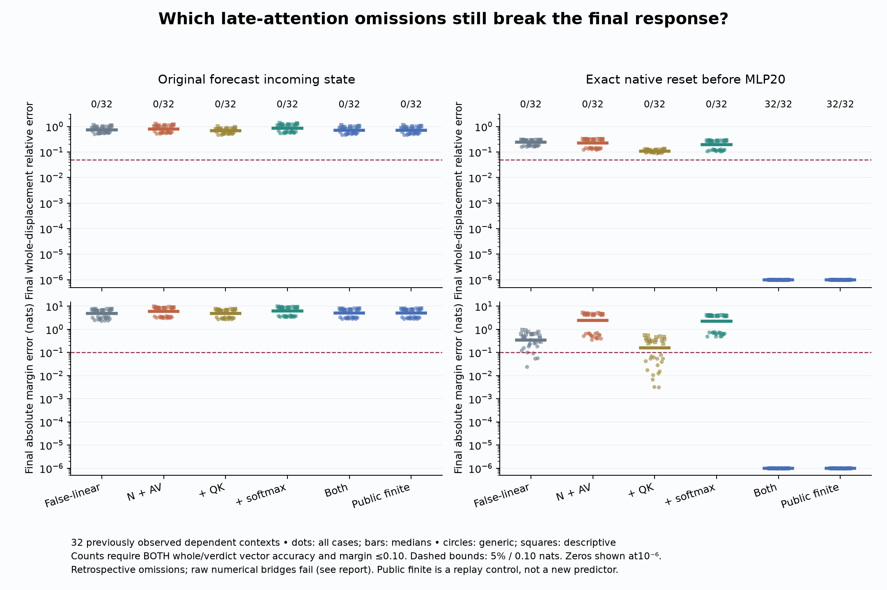
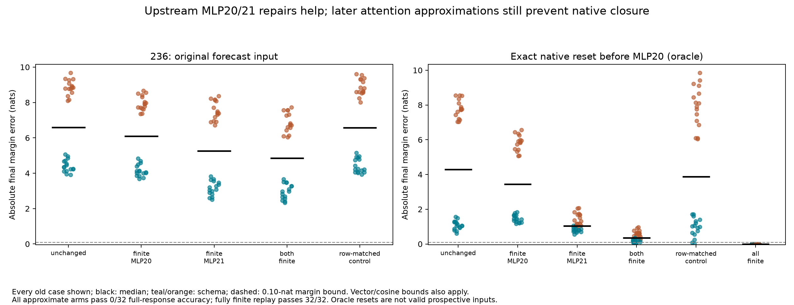
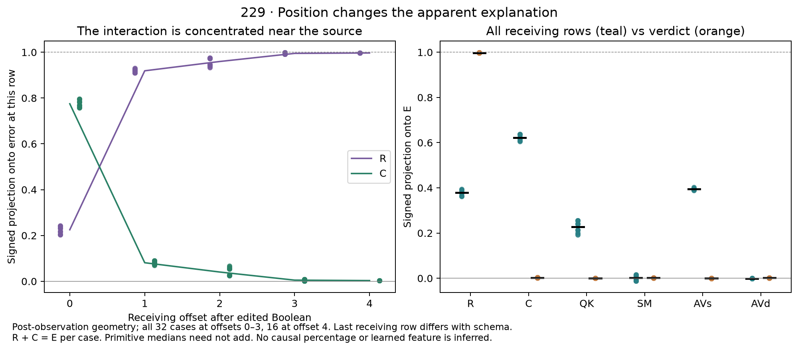

# Counterfactual Traces

**Can we predict a transformer's response to an input edit from one observed computation?**

This project investigates **Question B**: why changing an input Boolean generates a particular residual-stream displacement, and whether identifying the operations that generate and propagate it lets us forecast the native response from the **False state and known edit alone**.

The starting puzzle is small: an explicitly irrelevant Boolean in a supplied completion prefix changes a later verdict's conditional preference. The preferred answer can stay the same while its score margin moves substantially. We follow that dependency through the computation, keeping failed explanations alongside the ones supported by interventions.

**Status: open.** There are qualified local causal results. A general False-only forecast of the native response has not been demonstrated.

[Latest findings](docs/analysis/237-late-attention-result.md) · [Reproduce](research/README.md) · [Experiments](docs/EXPERIMENTS.md) · [Research notes](docs/RESEARCH-NOTES.md) · [Open question](docs/QUESTION-B.md)

## Latest: the missing attention response changes with depth

The late-attention primitive diagnostic restores query–key interaction and softmax singly and together. With an exact native reset before MLP20, QK restoration helps but leaves **10.8%** median final whole-displacement error; neither selective policy passes the full-response criterion in any of the 32 old cases. Fixed-input vectors shift from a larger QK contribution at attention21 to a larger softmax contribution at23. These are operation-defined effects, not learned features. [Complete result and signed effects](docs/analysis/237-late-attention-result.md).

Even evaluating **all** late operations finitely from the ordinary inaccurate input leaves **72.3%** error and **5.15 nats** margin error. A late correction alone cannot repair the earlier carry. The native-reset fully finite result is exact, as a replay control.

**Numerical qualification is partial:** 237 failed its original final bridge; 237b's independent audit also stopped on one Float64 MLP bridge. The complete diagnostic retains that failure among 25,120 checks. All attention graph/derivative checks and 1,536 Float32 MLP reconstructions pass; 1,920 same-backend MLP replays are exact. Neither later check converts a failed original bound into a pass. This is retrospective diagnosis, not a successful new predictor.



## Earlier: the local accounts do not yet compose into a final prediction

Experiment 235 accounts for every write error in the failed whole-response forecast. The largest discrepancies occur at MLPs 20–23, but MLP22/23 were already finite: their roughly 25-unit write errors come almost entirely from inaccurate incoming states. [Complete error budget and finite conditional split](docs/analysis/235-global-error-result.md).

Experiment 236 then repairs MLP20/21 inside the actual forecast, letting later states change. Median final margin error improves from **6.59 to 4.85 nats**, yet the full-response criterion passes **0/32**. Even an exact native reset before MLP20 leaves **0.344 nats** and **24.4%** final whole-receiving displacement error when only attention 21–24 remains approximate. The fully finite control recovers the native result exactly. Earlier carry errors matter, and the later attention approximations are still insufficient. [All branches, controls and qualification](docs/analysis/236-upstream-factorial-result.md).



These are retrospective tests on 32 previously observed, dependent contexts. They identify two remaining dependencies without supplying a successful predictor or learned circuit. The [earlier 234 rule](docs/analysis/234-source-key-value-result.md) still predicts one attention-2 displacement in 32/32 fresh pairs at 1.52% median error, under its declared exact-first-block budget. That local success does not establish final-response prediction.

## Earlier diagnostic: the first error has different sources at different positions

Experiment 229 starts at an exact incoming state before attention 2. Receiver-only curvature accounts for the first **verdict-position** discrepancy in **32/32** old contexts; source–receiver interaction does so in **0/32**. Across the full receiving sequence, that interaction is substantial and concentrated near the source. Direct attention-primitive interventions and separate numerical reconstruction qualify this distinction.

With the remaining network run finitely, the isolated early error produces only **0.0073 nats** median margin error. Every case is below the frozen behavioral materiality guard. This does not explain 228's much larger full-forecast failure, identify the primitive source of receiver curvature, or solve Question B. Read the [complete retrospective result](docs/analysis/229-first-attention-generator-result.md).



## Earlier whole-response forecast: a useful hypothesis fails

Experiment 228 sealed 96 forecasts before measuring 32 new native True targets. Finite receiving MLP22/23 updates improve every case against both controls, but achieve **0/32** passes on the signed gate/up alignment criterion and **0/32** on the stronger final-response criterion. Median parent relative error remains **0.750**, against a **0.25** bound.

The first-block receiving displacement is exact in all 32 cases. The next attention update already has **14.3%** median relative error. This narrows the first forecast discrepancy without identifying its responsible primitive or solving the full native response. Read the [qualified negative result](docs/analysis/228-false-only-alignment-result.md).

## What the earlier causal tests established

1. **The local interaction controls the tested sign reversal.** At MLP23, experiment 225b separates a gate–up interaction K from a baseline shift B. K reverses the sign in 32/32 old contexts; B alone does so in 0/32. The stricter quantitative K-only account still fails overall.
2. **The next MLP generates a consequential magnitude interaction.** In 226b, removing newly generated mixing at MLP24 lowers the descriptive median margin gap from **0.246 to 0.065 nats** and passes both margin and vector criteria in **16/16** descriptive contexts. Final normalization alone is insufficient.
3. **Explaining the margin is easier than explaining the vector.** In 227b, removing the gate/up cross-product halves the margin gap in **16/16** descriptive cases but meets the combined vector/margin criterion in **0/16**. Only removing the combined mixed term passes both. Some normalization and later MLP contributions partly counteract the gap.


The figure shows every descriptive case; bars are medians. These are previously observed, dependent synthetic examples of one pinned Qwen2.5-1.5B-Instruct checkpoint. The tested primitive decomposition is order-dependent. It does not identify learned features or a circuit.

**Numerical limits remain visible.** In 227b, 31/32 raw final-coordinate comparisons to a differently placed intervention fail the original bound, although the two-score bridge passes. Two raw ideal-write comparisons also fail. Arithmetic-accounted closure does not turn those failures into passes. Read the [full report](docs/analysis/227b-mlp24-mixed-primitives-result.md) before generalizing the result.

## Quick start

Verify every current release and the retained historical evidence without a model:

```sh
python research/boolean_coupling/reproduce_late.py --verify-only --history --plan
```

For an actual run, follow the [environment setup](research/README.md), then:

```sh
python research/boolean_coupling/reproduce_late.py --run --out runs/my-reproduction
```

This regenerates the fixed 228 reference, then 235/236 and the late-attention diagnostic. It preserves the original failed numerical audit before completing all unchanged-bound checks and the separate public replay; pipeline completion does not mean every check passed. It reuses the original fixed contexts, so it is not fresh confirmation. The [research guide](research/README.md) separately reproduces 230 and the earlier causal sequence from public inputs. Execution requires the recorded Apple Silicon/MPS environment and a pinned public checkpoint; no API key or private activation archive is needed. Every output directory must be new. Logs, source seals, controls and failed checks stay with the run.

GitHub checks cover evidence integrity, Python syntax and lint. They do **not** execute the model experiments or independently replicate the scientific findings.

## Find your way around

- **[Research guide](research/README.md)** — setup, complete pipeline, code map and computation budget.
- **[Experiment index](docs/EXPERIMENTS.md)** — protocols, reports, audits and preserved failed attempts.
- **[Research notes](docs/RESEARCH-NOTES.md)** — working explanations, what changed, and what remains puzzling.
- **[Results](results/README.md)** — every case, numerical limits, original logs and release manifests.
- **[Historical evidence](evidence/HISTORY.md)** — earlier experiments, superseded claims and qualified diagnostics.
- **[Contributing](CONTRIBUTING.md)** — scientific standards, checks and how to publish a new result.

Developed with substantial AI assistance. The separate auditors are code paths in this investigation, not an independent research team. Grounding controls failed, so these results do not demonstrate disabling a competent verifier. Article drafts and large activation arrays are excluded. Code is released under the [MIT license](LICENSE); upstream checkpoints keep their own terms.
