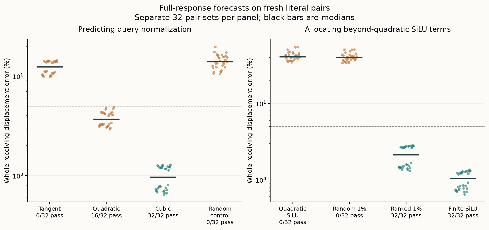

# Start here: what was predicted, and what remains unexplained

This guide defines the setup and connects each claim to its evidence. It
distinguishes tested prediction from the mechanistic questions still open.

## The smallest useful description of the task

The model receives a passage, a question, a proposed answer and instructions
for a structured verdict. We supply a completion prefix containing an earlier
Boolean declared irrelevant to correctness. Two versions differ only in that
Boolean. We measure the later Boolean's conditional token scores.

The favored Boolean can stay unchanged while its score margin changes. The
starting observation is conditional dependence, not verified correctness:
grounding controls failed. Supplied prefixes and fixed candidate tokens are
not unrestricted free generation. Field/schema and ordering variants are in
the [tokenized fixtures](../research/boolean_coupling/cases258.json).

## Vocabulary used throughout

- **False / True computation:** ordinary model runs with the earlier input bit
  false or true. These names do not refer to whether the answer is correct.
- **Source:** the position of the changed bit. Its unchanged causal prefix lets
  us compute edited source states from the known edit without future receiver states.
- **Receiver:** a position strictly after the bit. The verdict is the last receiver.
- **Residual stream:** the vector state to which attention and MLPs add writes.
- **Native:** the ordinary edited model computation used as the comparison target.
- **Displacement:** edited residual minus False residual. The full-vector metric
  flattens all receiving positions at the final block; it is not an accuracy rate.
- **Margin:** the logit of the fixed `true` token minus that of the fixed `false`
  token. A change is in nats; it is not calibrated correctness or a task score.
- **Finite operation:** evaluate the operation at the forecast's current input,
  rather than truncating its change at a chosen Taylor order. This can be costly.
- **False-only forecast:** no observed native True receiving state is used.
  It can still do substantial edit-specific component computation with model weights.

## The computational dependency

Attention writes change receiving states. Those states change queries in later
layers, which change later value weighting. MLP normalization, gates and products
also transform the displacement. This is a feedforward computation unrolled
across depth, not recurrence inside a transformer block. The architecture permits
the dependency; its existence alone is not a novelty claim.

## Follow the decisive tests, rather than the experiment numbers

1. **Is the effect merely carried in the verdict state?**
   [Native carry/read tests](analysis/248-native-carry-read-result.md) and
   [source-value clamps](analysis/250b-native-source-communication-result.md)
   show continued context/source communication matters under defined interventions.
   These are retrospective causal constraints, not fresh forecasts.
2. **Can a fixed receiver read the changed source accurately?**
   [Crossed query/key forecasts](analysis/252-source-driven-attention-result.md)
   fail. Query adaptation improves the vector substantially; accuracy still fails.
3. **What does a first-order query rule miss?**
   [The tangent test](analysis/253-query-generation-result.md) fails; predicting
   [RMSNorm curvature from earlier forecasts](analysis/254-predicted-query-curvature-result.md)
   passes, at the cost of extra trajectories.
4. **Are those extra trajectories necessary in this budget?**
   [A local cubic query rule](analysis/256-local-query-curvature-result.md)
   passes on a separate fresh literal set with one forecast trajectory.
5. **Must receiving SiLU remain finite everywhere?**
   [The fixed 1% rule](analysis/258-receiver-mlp-result.md) passes; quadratic
   everywhere and matched random selection fail. Other declared components stay finite.
6. **Why does that local selection work?**
   [Ranking-factor comparisons](analysis/259-silu-score-factors-result.md) and
   [individual write-energy accounting](analysis/260-silu-energy-concentration-result.md)
   provide retrospective evidence. They do not predict the upstream gate edits
   or freshly validate the simpler ranking variants.

Each panel uses its own fresh 32-pair set. Points are complete-case outcomes,
black bars are medians, and dashed lines show the 5% whole-vector bound. Pass
counts additionally require verdict-vector error ≤5%, both cosines ≥.99, native
norms ≥.001 and margin error ≤.10 nats. A low point in this plot alone is not a
joint success. There is one checkpoint and dependent synthetic templates;
fresh literals do not establish a new task distribution or independent replication.

## The budget is part of the result

The latest primary uses cubic receiver-query normalization and restores finite
SiLU at a ranked 1% of receiving neuron/position coordinates in each layer.
Remaining SiLU coordinates use a quadratic approximation. Source/prefix,
receiver keys/values, softmax, MLP input RMSNorm, learned projections, products
and final head remain finite at internally generated states.

The code evaluates full public SiLU before hook replacement. Therefore 1% is
an activation-approximation budget, not a measured reduction in runtime, model
weights, attention computation or neurons required by the task.

The general [Question B](QUESTION-B.md) asks for a useful smaller-budget account
of how the learned computation generates the displacement. The current rule
does not identify that learned generator or a compact circuit.

## How to audit a claim

Start with a readable report, then its linked protocol, all-case CSV and audit.
For258, read the explicit [258b numerical qualification](experiments/258b-matched-projection-qualification.md)
alongside the successful outcome. Its original CPU64 whole-down projection
check failed. Exact full-sequence-shape public Float32 replays qualify a narrower
comparison; the raw failures remain failures. Earlier whole-block derivative
disagreements are unresolved. Passing CI verifies evidence integrity, not a
new model run or independent replication.

[Reproduction guide](../research/README.md) gives the pinned environment and
commands. [Experiment index](EXPERIMENTS.md) retains the unsuccessful paths and
qualified old diagnostics. [Research notes](RESEARCH-NOTES.md) explain why the
working account changed. Large arrays are regenerated locally; public inventories
bind their original hashes. No private article or activation service is required.
