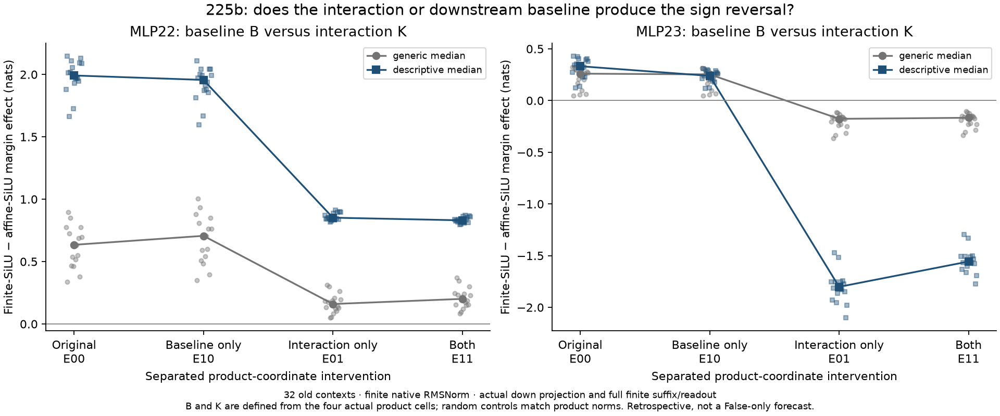
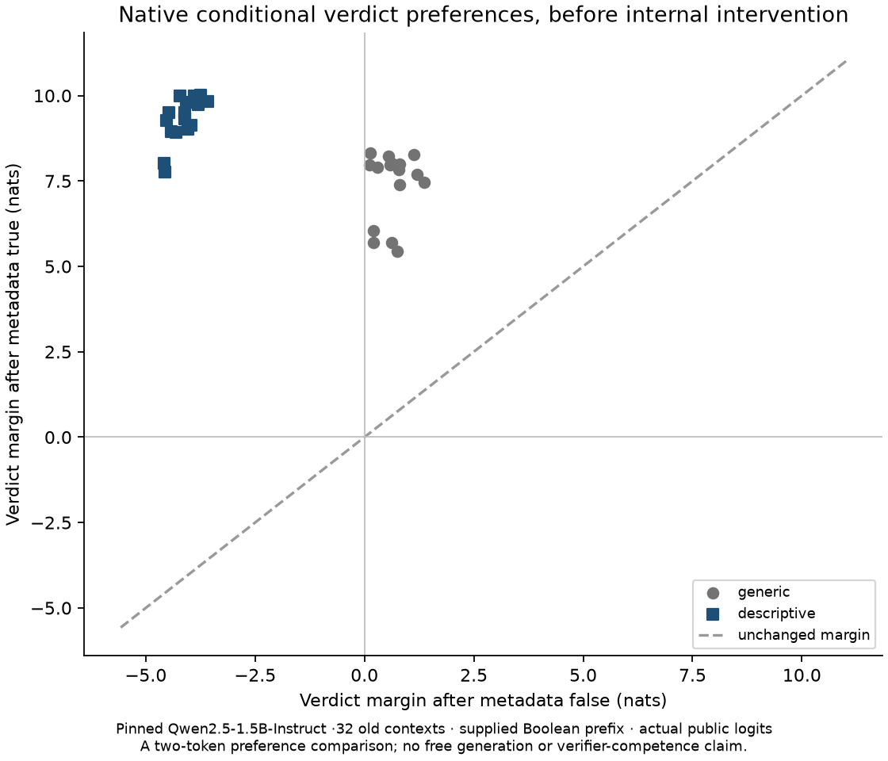

# The local interaction controls the tested sign reversal; the baseline matters quantitatively

225b separates the two changes confounded by 224b's SiLU/product factorial. At MLP23, retaining the product baseline shift B but removing interaction K restores a positive SiLU margin effect in 32/32 contexts. Adding K without B reverses it in 32/32. B alone reverses it in 0/32. Both K-edge magnitudes beat the corresponding product-norm-matched random effects in 32/32; random controls reverse the sign in 0/32 cases in either direction. At MLP22, neither separated condition reverses the positive SiLU effect in any case.

This supports a local causal account of the sign in the specified interventions. **The frozen whole quantitative account fails:** K-only passes 16/32, all generic, with 8/8 in each generic order stratum and 0/8 in both descriptive strata. B-only passes 0/32. No thresholds were relaxed. The contexts are old, dependent synthetic templates; this is retrospective, not fresh confirmation or a False-only counterfactual forecast.

## Defined comparison

Regenerate ordinary False/True states from exact public token sequences using pinned Qwen2.5-1.5B-Instruct revision 989aa7980e4cf806f80c7fef2b1adb7bc71aa306, MPS Float32/eager. Hold native input RMSNorm finite. At one site at a time, obtain the four actual receiving product arrays for SiLU/product affine/affine, finite/affine, affine/finite and finite/finite.

In CPU64 define p=p00, A=p10−p00, B=p01−p00 and K=p11−p01−p10+p00. T includes the actual public down projection, residual addition, all remaining full-sequence blocks and the finite final margin. The four conditional SiLU effects are:

    E00 = T(p+A) − T(p)
    E10 = T(p+B+A) − T(p+B)
    E01 = T(p+A+K) − T(p)
    E11 = T(p+B+A+K) − T(p+B).

Every intervention is installed in PRODUCT coordinates after the declared Float32 cast, before the actual public down projection. It is not a compensating write patch. Only receiving rows change. All following blocks and readout respond finitely; no later native state is inserted. All signed products, local writes and receiving trajectories are saved.

The original execution compared all 256 old corner continuations against 224b: maximum discrepancies are **zero** for product, write, final residual and scores. A new standalone reproduction needs only the published 32 prompt pairs and the checkpoint. Optional historical-reference checking adds no target state to the intervened computation.

## Results by schema

At 23, generic median E00/E10/E01/E11 are **+.26015 /+.25320 /−.17658 /−.16645 nats**. Descriptive medians are **+.33210 /+.23877 /−1.80149 /−1.55669**. Medians of different conditions need not subtract to the median paired contrast.

The K effect without B has paired median −.40871 nats generic and −2.09161 descriptive. With B present it is −.39125/−1.76296. B's effect on the interaction-bearing SiLU response has median +.01065 generic and +.24628 descriptive. It is therefore reasonable to attribute the tested direction reversal to K while rejecting a quantitatively complete K-only account. All 16 descriptive cases fail the strict effect-matching condition; the failure is not merely a sparse outlier.

At 22, generic median E00/E10/E01/E11 are +.63449/+.70654/+.16007/+.20114; descriptive 1.99187/1.95625/.85200/.83069. K reduces the positive response but does not overcome it. These comparisons do not identify a universal negative semantic feature or a learned circuit.

The complete [audit](../../results/baseline-interaction-225b/audit.json), [summary](../../results/baseline-interaction-225b/summary.json) and [case CSV](../../results/baseline-interaction-225b/cases.csv) retain every result, stratum and failed criterion.

## Native behavioral dependency remains separate

In the first generic fixture, changing only the supplied metadata Boolean moves the natural verdict margin from +.55231 to +8.22602 nats, a +7.67371 nat shift with the same preferred Boolean. Across these 32 old contexts, 16 preserve the preferred Boolean. These are conditional token preferences, not newly measured free generations. The example's preferred `true` is incorrect for its unsupported answer; earlier verifier-competence failures remain material.

## Numerical qualification, counters and preservation

The original 225 preflight checked bare-word tokenization against 895/830, which actually encode leading-space ` false`/` true`. It stopped before any ordinary or suffix forward. Its source, seal, design, failure record and actual traceback are preserved. The separately named 225b changes those two checks and artifact/source names only. Prompts, random seeds, intervention recipes, criteria and tolerances stay fixed.

Before new interventions, a separate NumPy audit passed **5,216 recorded controls** and validated **512 SiLU/product primitive-direction comparisons**, including repeated directions. Maximum public-AD discrepancy is 1.22864e −6 and promoted CPU64 FD discrepancy1.08805e −6 against 1e −4. Products, affine-node casts, independent down projections and finite heads are checked separately. The qualification seal precedes every new intervention call.

The intervention audit passes **3,488 recorded controls**. Independent down replay maximum is 6.55395e −5 against 1e −4 and finite-head replay8.09549e −6 against.005. The qualification-phase maxima are8.34655e −5/.00000944325, respectively. Original 224's failed coordinate bridge, old raw ideal-vector failures, qualified204 scope and the invalidity of replacement-agent conclusions remain unchanged. No old whole-block Jacobian is used or recertified. RMSNorm is finite here;225b makes no new RMS derivative claim.

Work:64 ordinary models,256 local corner MLPs,704 public down/suffix continuations,3,872 remaining public blocks,704 finite heads and 512 primitive-direction AD/FD comparisons. These are different compute units. Random proposed norms match in product coordinates within 1e −9 before installation casts; residual/readout norms are not also matched. The separate auditors are code paths in this investigation, not an independent team or second full model replication.

The immutable scientific sources, public prompt fixture, recorded runtime, protocol, actual logs and failed preflight are included in the release. Raw model weights and activation arrays remain local with sizes/hashes inventoried; the standalone runner regenerates them from public inputs. The original 2,868-file historical snapshot remains local; the repository bundle retains 2,867 files and withholds one unpublished article. Public file verification is not a model reproduction.

## What this answers

For the old native-input MLP23 conditions, the extra local product interaction is necessary for the observed negative SiLU effect at the shifted baseline, and sufficient to reverse the sign without that baseline shift. The downstream context modulates magnitude enough to defeat the stricter general quantitative account. This resolves the tested sign question conditionally, not all aspects of its magnitude or native origin.

Question B still asks why the Boolean edit endogenously creates the required receiving state and whether it can be forecast from False alone on fresh examples. That is not established. Nothing here identifies a learned semantic circuit, training origin, a competent-verifier deployment failure or novelty priority. This completed local diagnostic supports a concrete, bounded research post and a reproducible release; it does not warrant claiming the larger prediction problem solved.

See the [protocol](../experiments/225b-baseline-interaction-separation.md), [standalone code/reproduction guide](../../research/boolean_coupling/README.md).
