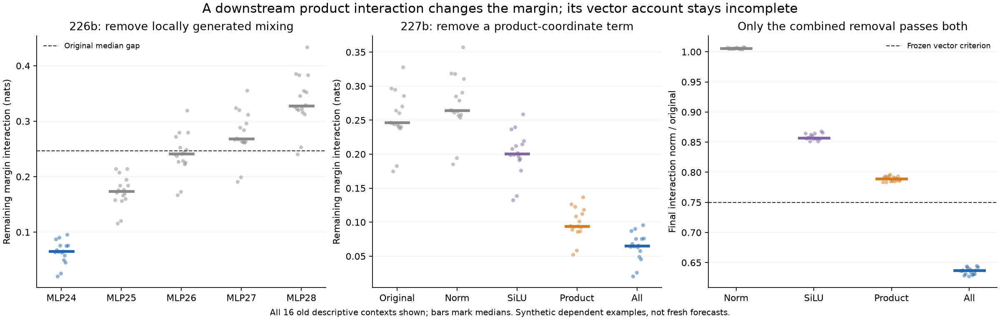

# A gate/up cross-product explains much of the margin gap, but not the full vector

The finite primitive test narrows 226b's MLP24 result. The gate/up cross-product term is the largest tested contributor to the descriptive margin gap: removing it reduces median W from **+.246279 to+.094124nats**, versus+.265594 for a product-norm-matched random edit. It halves the gap in 16/16 descriptive cases. It does **not** pass the frozen combined vector/margin account:0/16, because every case retains more than 75% of the original final interaction-vector norm. Median retained norm ratio is.78927.

Only removal of the full local mixed product passes the combined rule,16/16 including 8/8 in each field order. Thus a strong margin result is still insufficient to explain the residual displacement. This is a concrete limit on the simple multiplication-only story.

## Defined primitive interventions

Use the four actual post-attention states at MLP24 from 225b's p,p+A+K,p+B,p+B+A+K suffixes. They are synthetic factorial trajectories, not four ordinary native Boolean observations. Let xAdd=xB+xD-x0, with its declared Float32 cast. Execute the public MLP at that point, capturing normalized inputs, gates, up values, SiLU outputs, product and write.

Two local crossed computations isolate operation contributions in a fixed order:

* X replaces the normalized input by N(xB)+N(xD)-N(x0), then executes all remaining nodes finitely.
* Y uses that normalized input and replaces SiLU's output by phiB+phiD-phi0; up and multiplication remain finite.

In signed product coordinates:

    RN = pAdd-pX
    RS = pX-pY
    RP = pY-pB-pD+p0
    Rall = RN+RS+RP.

At the actual Both MLP24 state, subtract one term from its actual receiving product, apply the public down projection, and run the full finite suffix/head. Random edits match the removed term's norm in product coordinates, not residual or readout norm. Source/prefix rows stay unchanged. Sham and remove/reinsert controls replay native Both exactly.

This is an order-specific finite attribution. RN includes normalization's mixed response propagated through the MLP; RS measures SiLU mixing at the additive normalized input; RP is the remaining gate/up cross-product with recorded arithmetic. Reordering would change the allocation. These are not semantic features, unique causal percentages, or evidence of competing learned mechanisms.

## All signed results are retained

For the 16 descriptive contexts, removing RN raises median W to **+.264614nats** and worsens its absolute value16/16. Removing RS lowers W to **+.200695**, but halves it0/16. Removing RP lowers W to **+.094124** and halves it16/16. Removing all gives **+.065248** and passes both vector and margin criteria16/16. RS and RP each beat their matched random on both errors16/16, but neither meets the frozen joint magnitude requirements. RN meets neither.

Median final interaction-vector norm ratios for RN/RS/RP/all removal are **1.00565/.85687/.78927/.63674**. Separate medians are not additive fractions. Generic W is only+.010654nats; all 16 generic examples are below the .10 eligibility guard and remain reported. Their zero action counts are ineligibility, not evidence that their nonlinear operations are absent.

The emerging account of this particular magnitude failure is therefore: the MLP23 factorial supplies two displacements; their downstream coupling is strongly generated in MLP24; cross-multiplication carries much of its margin consequence, while SiLU mixing also matters for the vector. In this specified allocation normalization partly counteracts the gap, as do some later MLP interactions. This does not establish why the native Boolean edit originally creates the required displacements.

## Algebraic interpretation, explicitly posthoc

Ignoring the separately measured casts/projection arithmetic, RP is the known bilinear cross term:

    (phiB-phi0)*(uD-u0) + (phiD-phi0)*(uB-u0).

A saved-array posthoc check compares this with every actual RP array, retaining all signed coordinates. All 32 product-coordinate comparisons pass 1e-4; maximum8.079e-5. Independent product, normalized-projection, and SiLU-sum cast terms close the difference within 5.552e-17 at 1e-9. Median arithmetic-error norm divided by RP norm is.0002815. This qualifies the cross-product description, not a novel algebraic law, a learned circuit, or a prospective predictor.

## Numerical qualifications and failures

The separate NumPy audit passes 4,480 recorded checks, including reference replay, actual product installation, seeded controls, finite SiLU and finite head reconstruction. Maximum head error is7.913e-6 against.005. Independent checkpoint-based CPU64 forward checks add 608 comparisons:160 RMSNorm outputs and 224 each gate/up projections. Maximum errors are1.536e-6,1.361e-5 and 1.170e-5 against 1e-4. These are finite forward checks; no original whole-block derivative is used or recertified.

Two raw limitations remain explicit:

* **31/32** product-removal versus 226b post-addition-removal final-coordinate comparisons fail 1e-4; maximum **3.05176e-4**. Their maximum two-score difference is3.81470e-5 against.005. The computations enter at different arithmetic nodes; exact final-coordinate equivalence is not established.
* **2/32** raw mixed-write versus ideal down(Rall) comparisons fail 1e-4; maximum **1.08391e-4**. Independently recorded input-cast, down-projection and residual-addition arithmetic closes the local ledger within 1.363e-14. Those raw failures stay failures; this ledger does not certify the failed final bridge.

227 originally stopped at the second case's first failed final-coordinate bridge,1.37329e-4. That source/seal, first complete case, partial-run traceback and failure remain. Separately specified227b reports those same raw comparisons and their unchanged bound, while assessing its own directly executed product interventions. All other bounds, inputs, seeds and action criteria are unchanged. The result above is qualified at that narrower scope.

Work in completed227b:128 reference blocks,96 additional local MLPs,320 direct down projections,1,280 continuation blocks,320 finite heads. Additional validators use saved arrays/checkpoint tensors and zero model calls. The uncompleted227 cost is separate; its partial second-case arrays were not saved. Neither validators nor the independent auditor are a second research team or a fresh model replication.

## What remains open

Question B is still unsolved. These computations require previously observed factorial parents. They do not predict an unseen native True trajectory from False. A useful next upstream question is why the native incoming state produces the particular gate/up alignments that make these cross-products consequential. Before a fresh predictor is warranted, it needs an explicit update, a fixed computation budget and forecasts sealed before native True measurement. Repeating an output correction sweep would not supply that account.

The results distinguish the margin from the vector, local generation from transmission, and actual primitive interventions from coordinate-equivalence claims. That is progress in constraining the mechanism; it is not a complete origin explanation.

See the [protocol](../experiments/227b-mlp24-mixed-primitives.md), [runner](../../research/boolean_coupling/tail227b.py), [NumPy auditor](../../research/boolean_coupling/audit227b.py), [finite projection validator](../../research/boolean_coupling/validate227b.py), [posthoc algebra](../../research/boolean_coupling/describe227b.py), and [reproduction guide](../../results/mlp24-mixed-primitives-227b/README.md). The original study ran without browser or publication tools. This repository publishes its technical evidence; article drafts remain excluded.
