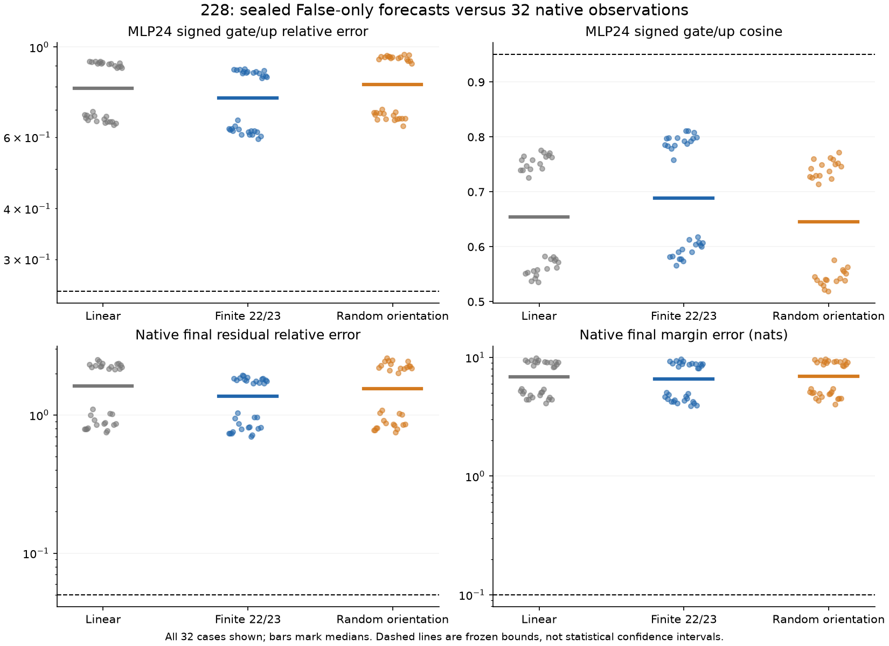
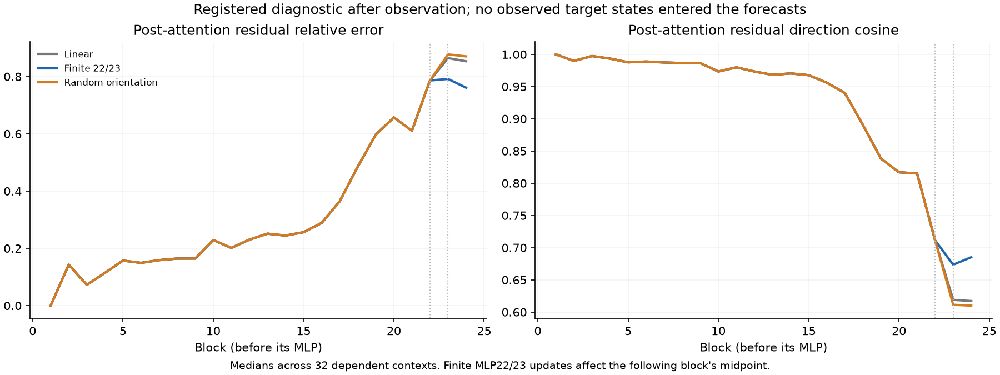

# Late nonlinear writes improve every case, but do not forecast the native alignment

**The frozen hypothesis fails: 0/32 primary alignment passes and 0/32 final-response passes.** Finite receiving MLP updates at 22/23 improve parent, final residual and margin errors against both controls in every case. The remaining errors are nevertheless large. These native writes' earlier causal importance does not make them a sufficient predictive generator under the declared transport rule.

The test used32 new prompt pairs from two literal families, crossing schema, order, assignment and target. All 64 full token hashes were absent from the available1,184-hash historical paired-input catalog. These are new literal instances of dependent synthetic templates, not a new task distribution or independent replication.

## What was predicted

Observe one ordinary full False computation per pair. Evaluate the known changed source finitely, transport receiving history using newly defined smooth CPU64 derivatives, and compare three fixed rules:

- **L:** source-finite, receiver-linear transport.
- **F:** the same rule, with finite receiving MLP updates at 22 and 23.
- **R:** at those sites, replace the candidate nonlinear correction's orientation by a seeded random receiving vector with the same norm at R's own incoming state.

At MLP24, every arm executes finite norm/gate/up/SiLU/MLP and the full finite remaining network and head. Primary targets are the signed pre-SiLU gate and up increments at the verdict position. No target is used to fit a gain, direction, site or coefficient. The exact information and computation budget is in the [protocol](../experiments/228-false-only-alignment.md).

This is a parameter-free surrogate with substantial counterfactual computation. The source encoder and tail are explicitly evaluated; neither is mechanistically compressed. It is not a cheap predictor requiring no counterfactual component evaluations.

## The prospective result

Median parent relative error / cosine / absolute final margin error:

- L: **.79115 / .65452 /6.88675nats**.
- F: **.74968 / .68831 /6.58846nats**.
- R: **.80760 / .64524 /6.96455nats**.

F improves all three errors against both L and R in 32/32 cases, including final residual relative error. It still meets neither the parent bounds nor the stronger native bounds in any case. Every schema/order stratum has0/8 passes. The primary rule required parent relative error<=.25, cosine>=.95 and improvement over both controls. The stronger final rule required residual relative error<=.05, cosine>=.99 and margin error<=.10nats. No bound was changed.

Median final residual relative errors are1.62361 for L,1.36347 for F and 1.54669 for R. Thus the failure is not merely one scalar tolerance just missing its threshold.

## Where the forecasts are already wrong

The registered post-observation trace shows substantial direction error before the selected finite writes. At the post-attention midpoint of block22—before MLP22 runs—the arms are identical and have median displacement cosine **.71125**. Restoring two late finite updates cannot reconstruct all the upstream state in this tested rule.

The exact registered Euclidean error split also distinguishes direction from magnitude. F's median parent norm ratio is.80430, yet its median parent cosine is.68831. The median per-case share of squared relative error in the orientation term is **.89726**. This is geometric error accounting, not a causal allocation between learned mechanisms or an oracle-rescaled prediction.

A further, explicitly post-observation identity check provides a cleaner first boundary. All arms' first-block receiving displacements match the later measured native displacement **exactly in all 32 cases**. That is expected because the first finite-source call at the embedding input computes that first block exactly. The next attention update is the first place receiver linearization is applied to a nonzero carried displacement.

At that second attention midpoint, median relative error is **.14310**. Median verdict-position error norm is.07466 against native displacement norm.52597, and median maximum coordinate error is.006553. The incoming first-block receiving state is exact; these initial errors are therefore generated by the tested second-attention approximation, rather than inherited from an earlier receiver forecast error. This does not identify an individual attention primitive, explain the later large discrepancy, or show which later errors are newly generated versus amplified.

## Qualification and ordering

All 96 forecasts and their recorded numerical checks were completed and sealed before any new ordinary full True forward. The frozen protocol/source/forecast manifest was also pushed and verified at GitHub commit `104b8e89765ef274a70d7a557f8240b7c71580bc` before target measurement. The separate qualification audit passed 21,888 recorded checks, including 4,320 independently reconstructed central differences. These counts overlap and include repeated early directions; they are not independent replications.

The declared transport functions promote checkpoint weights and calculations to CPU64 and remove intermediate Float32 casts. They are reanchored to actual MPS False endpoints. Maximum promoted False-primal discrepancy is **7.343e-5** and derivative/central-difference discrepancy **1.115e-8**, each against 1e-4. These qualify the declared maps, not the unresolved original Float32 whole-block Jacobian.

After observation, all 28 prefix hashes and the 24 computed source states match the native targets exactly. Native head replay maximum is5.872e-6 against.005; native gate/up reconstructions are within 1.410e-5/1.283e-5 against 1e-4. Forecast seals and all original source hashes remain unchanged.

Work:32 ordinary False and 32 later ordinary True models;768 finite-source blocks;4,320 smooth JVPs and 4,320 central differences (8,640 difference-endpoint function evaluations);192 zero skips;128 selected MLP calls;96 target MLPs;384 continuation blocks;96 finite forecast heads. The separate old-case preflight used one False model,47 primal comparisons and 94 JVP/FD comparisons. These are distinct compute units.

The original final scorer stopped on a metadata collision: literal family and layer were both named `block`. The separately named [228b reporting correction](../experiments/228b-reporting-correction.md) changes only that diagnostic key to `layer` and its docstring. Its source diff and hashes are preserved, with the original failure log. It changes no forecast, arithmetic, criterion or model call.

## The next mechanistic question

The attention2 boundary supplies an exact incoming state on which to ask a local question. Let A be its finite attention-plus-residual map, x the False state, s the known source change, d the exact first-block receiving displacement and J the declared receiving linear map. The missing response can be split algebraically into:

    A(x+s+d)-A(x+s)-Jd
      = [A(x+d)-A(x)-Jd]
      + [A(x+s+d)-A(x+s)-A(x+d)+A(x)].

The first bracket is a receiver-only finite remainder; the second is source–receiver interaction. **This split has not yet been executed.** The existing error trace cannot decide which dominates. Positionwise input normalization cannot itself create a cross term between changes on disjoint source and receiving rows, though it can contribute to the receiver-only remainder. Attention's mixing operations are a concrete next target if the cross term is substantial.

Question B remains open. This experiment rejects a particular late-write forecast and narrows a first local mismatch. It does not identify a learned circuit, establish novelty priority or demonstrate disabling a competent verifier. The [full cases, seals, failure record and reproduction guide](../../results/false-only-alignment-228/README.md) remain available; raw arrays and the article stay local.
