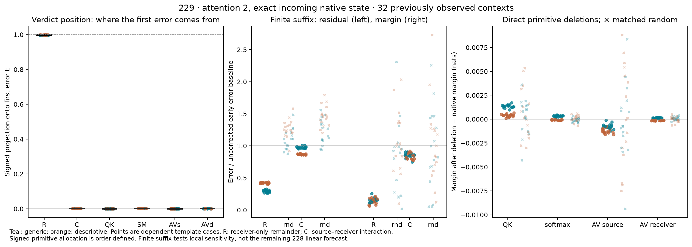

# 229: receiver curvature explains the first verdict-position discrepancy

**Qualified retrospective result. Question B remains open.** At the exact native
incoming state before attention 2, the receiver-only finite remainder R meets the
frozen local-account criterion in **32/32** previously observed contexts, including
8/8 in every schema/order stratum. Source–receiver interaction C meets it in 0/32.
This reverses the preceding working emphasis on a missing cross-source QK term
as the principal explanation of this first **verdict-position** error.

It does not identify which operation generates R. It also does not explain the
large final errors of 228's remaining linear transport.

## What was tested

The [protocol](../experiments/229-first-attention-generator.md) freezes one boundary:
after block 1, before attention 2. Study 228's first-block receiving displacement
is exact. The new test replays one ordinary False computation per context,
installs its recorded native source/receiving rows, and checks them against the
saved 228 targets. No ordinary True computation is newly run. These are 228's
already observed 32 dependent contexts, not a new forecast evaluation.

Four finite attention-plus-residual corners isolate

```
E = A(x+s+d) − A(x+s) − Jd = R + C
R = A(x+d) − A(x) − Jd
C = A(x+s+d) − A(x+s) − A(x+d) + A(x).
```

J is 228's declared smooth CPU64 receiving derivative at False. It is not the
old disputed Float32 whole-block derivative. Both public finite and promoted
smooth attention graphs are reconstructed and qualified separately.

## The answer depends on which rows are measured

At the verdict position, median E norm is **0.0746593**, against a native
displacement norm of **0.525968**. R has median norm **0.0745465**; C has median
norm **0.00335328**. Removing R leaves a median **4.54%** of E's norm, well below
the frozen 25% bound in all 32 cases. Removing C leaves **99.86%** in the median.

Median signed projections onto E are **0.997501 for R** and **0.002499 for C**.
These are dot-product accounting quantities, not variance explained or unique
causal percentages. The median R/C cosine is only **0.00482**; a small projection
share alone is not a sufficient description of a component's norm.

Across **all receiving rows**, the picture changes. R has median norm **0.197128**
and C **0.255264**. Their signed projections onto the concatenated error are
**0.378612** and **0.621388**. The first row after the source has median C share
**0.774940**. The interaction cannot be dismissed globally because it is small
at the verdict position. This position-resolved description is explicitly
post-observation; it does not add a new selection or success criterion.


## What the primitive interventions establish

C is partitioned by a fixed algebraic order into the direct cross-QK logit term
after finite softmax, softmax mixing beyond additive corner logits, and two
weight–value cross-products. The public graph is intervened on at logits,
probabilities or weighted context as appropriate, then uses the actual output
projection. Each signed actual write effect agrees with its separate smooth
vector within the unchanged 1e-4 coordinate tolerance.

For the concatenated receiving error, median signed projections are **0.226651**
for QK and **0.394840** for changed receiver probabilities acting on the changed
source values. Softmax-only mixing and source probability changes acting on
receiver values are much smaller in this allocation. Separate medians need not
sum. At the verdict position none of these C components accounts for the main
error; every individual local-account count is 0/32.

Thus attention's cross terms have a qualified operation-level accounting and
direct interventions here. The main verdict-position R still needs a primitive
diagnosis: receiver RMSNorm curvature, receiver QK curvature, finite softmax and
weight–value coupling have not been separated within R. A row-local RMSNorm
cannot create the disjoint-source/receiver cross term, but it can contribute to R.
Neither sign patterns nor this algebra identify learned features or a circuit.

## The early error has a small conditional margin effect

All remaining MLPs, blocks and the final normalization/readout run finitely.
The uncorrected early-error baseline has median final verdict residual-error
norm **0.195581** and absolute margin error **0.007288 nats**. Adding R lowers
these medians to **0.071104** and **0.001036**; adding C gives **0.178982** and
**0.006248**. The median *per-case* error ratios for R repair are **0.361** and
**0.145**. Matched random receiving-vector controls are retained for every case.

Crucially, every baseline margin error is between **0.005764 and 0.008377 nats**.
All 32 cases are below the frozen **0.10-nat materiality guard**. The registered
joint downstream success rule is therefore **ineligible in all 32**, not a
32-case failure or success. Small descriptive improvements do not become a
material behavioral result by relaxing the guard after observation.

The four direct primitive deletions also have small conditional margin effects:
median absolute changes range from **0.000141 to 0.000967 nats**. The signed
effects and their norm-matched random controls are in the complete outcome CSV.
These comparisons do not support a large behavioral-bottleneck claim.

Native replay and adding R+C both reproduce the saved native final residual and
scores **exactly** in all cases. That is a reconstruction control, not a
False-only forecast. This experiment uses an exact incoming native state and a
finite suffix; it does **not** intervene into 228's remaining linear transport.
It cannot exclude amplification of the early error by that different transport,
or determine which later blocks generate its large forecast errors.



## Numerical qualification and execution record

- 128 manual public attention corners match the actual public attention outputs
  **exactly**. False/native first-boundary replays and source midpoint replays
  are exact. Protected prefix rows stay exact under all continuations.
- Smooth CPU64/public attention write disagreement is at most **7.315e-6**.
  Public C versus the smooth primitive sum differs by at most **8.480e-6**;
  that rounding remainder is saved, not called another mechanism.
- All 96 used/sine/cosine JVP checks pass independent central differences at
  h=1e-5. Maximum discrepancy **1.582e-9** versus the fixed 1e-4 bound. The used
  Jd agrees with the original saved 228 tangent **exactly**.
- Separate NumPy reconstruction, explicit analytic norm/QK/softmax/AV derivatives,
  signed primitive vectors, controls and finite head give **1,440** passing checks.
  Analytic derivative/JVP maximum discrepancy is below 1e-9. Direct primitive
  write-effect comparisons have maximum error **4.409e-6** against 1e-4.
- Smooth primitive ledger closes within **1.358e-14**. Public primitive ledger
  error is at most **7.596e-6**; public logit identity error is **7.063e-5**,
  below the original 1e-4 bound. No tolerance was widened.

The original 229 bootstrap expected the wrong inherited audit-status word. Its
first 229b correction then expected individual checks where 228 stores aggregate
counts/maxima. Both stop before directory creation or model loading. Original
source, the intermediate 229b source and both logs are preserved. The corrected
[229b bootstrap](../experiments/229b-bootstrap-correction.md) changes only this
metadata gate and source inventory; the graph, data and scientific criteria stay
fixed. There were no failed model/primitive comparisons hidden by these corrections.

Actual main work: **32 ordinary False replays, zero new ordinary True calls,
128 public plus 128 manual attention corners, 128 primitive attention edits,
128 smooth corners, 96 JVP/FD comparisons (192 FD endpoints), 480 MLP2
continuations, 12,480 subsequent public blocks and 480 finite heads**. These are
distinct compute units. Stored native True arrays are retrospective inputs;
zero new True calls does not make this a False-only prediction.

## Implication for the next question

The cross-source interaction hypothesis is insufficient for the first verdict
error under the tested decomposition. Receiver-only curvature is now a precise
local target. Its internal primitive source remains open. Its effect also
depends strongly on position, and its isolated finite-suffix margin consequence
is too small for the preregistered behavioral claim. A later diagnostic should
separate the receiver-only operations before proposing a predictor, while
separately testing how error is propagated by the declared linear surrogate.

The earlier qualified 204 result, invalid replacement-agent conclusions,
original derivative disagreements, 224/227 raw failures and failed 228 forecasts
are unchanged. No browser or new literature review was used, no priority claim
is made, and no learned circuit or solution to Question B is established.

[All cases, qualification and reproduction](../../results/first-attention-generator-229/README.md)
· [Protocol](../experiments/229-first-attention-generator.md)
· [Updated research notes](../RESEARCH-NOTES.md)
