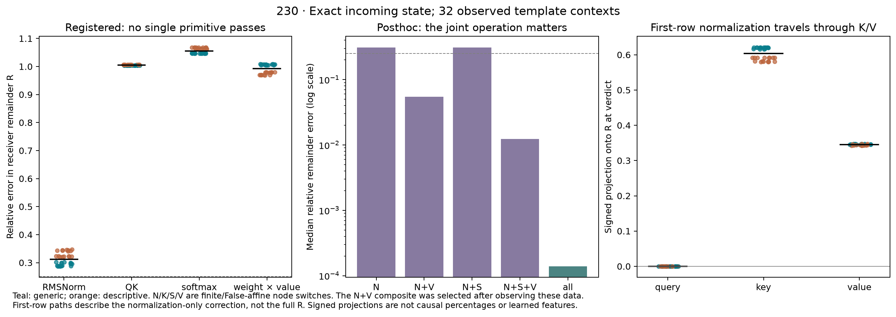

# 230: normalization is prominent, but its product background matters

**Qualified retrospective diagnostic; every registered single-primitive account
fails.** At the exact incoming state before attention 2, finite RMSNorm alone
leaves median **31.14%** vector error in the receiver-only remainder R. Its
direction is close (median cosine **0.95082**), but it fails the unchanged 25%
accuracy bound in **all 32** contexts. QK, softmax and probability–value
multiplication alone also fail in every case. No single primitive passes both
the registered sufficiency and finite-background necessity tests.

The [protocol](../experiments/230-receiver-curvature-primitives.md) runs all 16
finite/False-affine combinations of normalization N, QK K, softmax S and the
attention probability–value product V. It retains each signed factorial edge,
both public Float32 and smooth CPU64 vectors, and independent qualification.
These are 229's observed dependent template contexts, not fresh measurements.

## Location is narrower than the whole remainder

Under a fixed telescoping allocation, normalization's median signed projection
onto verdict R is **0.93683**. That number does not establish sufficiency. Its
contribution depends on the other operations' background; removing normalization
from the otherwise finite graph leaves a median **49.76%** of R's norm.

Within the *normalization-only, otherwise-affine* graph, the first row after the
source carries most of the normalization correction. Removing that row leaves
a median **9.23%** of the normalization-only effect; its restricted necessity
criterion passes 32/32, 8/8 in each stratum. The first-row correction still
fails to account for complete R in every case. These statements have different
targets and must not be conflated.

False-linear propagation of that first-row normalized-input correction has zero
query-path effect at the later verdict, as required by the row-local query
projection. Its key and value paths have median signed projections **0.60392**
and **0.34499** onto R. This is a qualified nonlocal attention relay of an
operation-defined correction, not a learned semantic feature or a circuit.

## The measured combination suggests a new hypothesis

An explicitly **post-observation** comparison of the already executed graphs
finds that N+V, with QK and softmax affine, reduces median remainder error to
**5.45%** (maximum **5.64%**). All 32 meet the old accuracy/cosine bounds. Adding
finite softmax gives **1.23%** median error. Finite QK without V does not rescue
the normalization-only account. These composite counts are descriptive reuse
of old bounds, not successes of the registered single-primitive hypotheses.



The N/V factorial interaction has a useful exact algebraic form. Write a for
the first-order normalized-input displacement and b for its finite RMSNorm
remainder. With QK and softmax affine, probability and value changes are linear
maps P' and V'. The N/V mixed term is

```
M = O[ P'(a)V'(b) + P'(b)V'(a) + P'(b)V'(b) ].
```

The separate NumPy expression matches the measured smooth four-cell interaction
within **1.351e-14**. However, **M alone worsens** the normalization-only error:
median remaining-error ratio **1.545**, and signed projection onto that missing
vector **−0.489**. The useful addition is the full product response in its
finite-normalization background, including the original product contribution
and this opposing interaction. It would be incorrect to identify M alone as
the missing mechanism. The three-term split is an algebraic identity; its
individual terms have not received separate causal removal tests.

This motivates the separately frozen [231 local forecast](../experiments/231-local-normalization-product-forecast.md).
It must risk failure on fresh inputs before the selected combination receives
a prospective interpretation.

## Qualification and compute

All public finite replays and protected prefixes match exactly. Smooth/public
endpoint and increment maximum differences are **6.211e-6** and **9.370e-6**,
below the unchanged 1e-4 bound. The smooth all-affine increment agrees with
229's saved Jd within **2.166e-14**. First-row path and row-partition identities
close within **1.688e-14**. The raw public/native-R rounding remainder is saved
and is at most **7.524e-6**; no raw comparison is replaced by an arithmetic ledger.

Every distinct used smooth affine-node direction is checked: **768** analytic/AD
and central-FD comparisons, with h=1e-5. There are **1,536** separate NumPy graph,
path, closure and saved-FD checks. No bounds changed, and no implementation or
numerical failure occurred in this run. These code paths are not an independent
research team and do not qualify the old disputed Float32 block derivatives.

Actual finite work: **zero ordinary models**, 64 public attention-module replays,
32 public and 32 smooth False anchors, and 608 public plus 608 smooth intervention
graphs. Saved native states are retrospective inputs. The FD checks add 1,536
endpoint evaluations; forward AD counts are separate from public module calls.
No final-head or suffix sweep is performed; 229 already bounds the isolated
finite-suffix margin effect. This experiment does not explain the full 228
forecast failure or establish a solution to Question B.

[Every case, edge and audit](../../results/receiver-curvature-230/README.md)
· [Protocol](../experiments/230-receiver-curvature-primitives.md)
