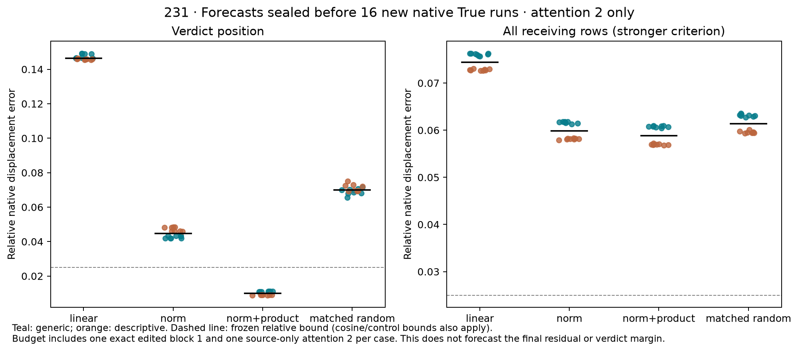

# 231: a local generator forecast passes; the whole sequence still fails

**The frozen verdict-position criterion passes in 16/16 fresh literal pairs,
4/4 in every schema/order stratum. The stronger whole-receiving-sequence
criterion passes in 0/16.** This predicts the native displacement immediately
after attention 2, not the final residual or verdict margin. Question B remains
open.

The selected normalization/product combination now has evidence beyond the
posthoc 230 cases: all 64 forecasts were independently qualified, globally
sealed, pushed and verified on GitHub at
`d4cf03e78bd08cfc5d3648293178f742c645faeb` **before any of the 16 ordinary native
True runs**. No parameters, thresholds or predictions changed after observation.

## What was predicted and what was computed exactly

The [protocol](../experiments/231-local-normalization-product-forecast.md)
permits one ordinary False computation, one exact finite known-edit block 1,
and one source-only finite attention-2 call per pair. The first block is actual
counterfactual component work; its generation is not explained or compressed
by this experiment. Its resulting full-sequence state agrees **exactly** with
the later independently observed native True first block in all 16 cases.

Receiving changes are transported with a False-state derivative plus a
normalization/product correction. In the receiver-only graph, RMSNorm and the
probability–value product are finite; QK and softmax are False-affine. The four
forecast arms are L (linear), N (normalization only), NV (normalization plus
product), and R (N plus a seeded random vector matching the additional product
correction's full receiving-space norm).

This is substantial counterfactual component arithmetic, including promoted
CPU64 graphs. It establishes neither a speedup nor a compact end-to-end
predictor. It tests whether a specified restricted computation retains this
local native response. Approximation success does not mean the actual model's
QK or softmax computation is linear.

## The local test succeeds on its original bounds

Median relative displacement errors at the verdict position are **14.63% L**,
**4.47% N**, **1.00% NV**, and **6.99% R**. NV's median cosine is **0.999957**.
Every NV case meets relative error <=2.5%, cosine >=0.995, the 0.001 native-norm
guard, and strict relative-error improvement over all three controls. The
registered whole-test rule required 12/16 plus 3/4 in each stratum; observed
counts are 16/16 and 4/4 in each.

The stronger concatenated-receiving criterion uses the same accuracy/cosine
bounds. Median NV relative error remains **5.88%** (L 7.44%, N 5.98%, R 6.14%),
and no case meets that criterion. A local forecast does not recover the complete
displacement entering the next sublayer. The source–receiver coupling identified
elsewhere in 229 is a plausible target for the remaining error, not an attribution
established by this experiment.

The 16 pairs use one new literal family crossed with schema, order, assignment
and target. All 32 complete token-sequence hashes are absent from the 1,248-entry
recorded catalog, but these remain dependent synthetic templates. They do not
establish a new-task, second-checkpoint or independent-team replication.

## How this changes the explanation

230 rules out a normalization-only explanation of R at the frozen bound.
The first receiving row carries most of that normalization correction, relayed
through its key and value pathways to the verdict. The product's finite response
in that normalized background supplies the missing vector structure. Its
normalization/product interaction alone is not sufficient and actually worsens
the normalization-only error in the old cases. Retaining the full joint product
response is the specific rule tested here.

This is a narrower and more testable account than naming normalization as the
dominant term from a signed projection. The prospective local result supports
the composite rule; it does not establish a unique mediation decomposition,
learned feature, recovered circuit, or explanation of the native source state.

The next unresolved mechanism question is whether evaluating receiving transport
in the known source-only context captures the missing source–receiver coupling.
The current derivative is anchored at the original False context even though
the source-only context is already computed. That is a new testable hypothesis,
not an executed or registered 232 result. No further sweep has been launched.

## Numerical checks and provenance

Before target observation, a separate NumPy implementation reconstructed the
False/source-only primals, Jd, both nonlinear corrections, random control and
all 64 forecasts: **304 passing checks**, maximum coordinate discrepancy
**4.611e-6** against the 1e-4 primal bound. Smooth forecast equations compare at
1e-9. There are 16 receiving JVP/FD comparisons and **112** distinct used local
affine-node derivative checks; analytic/AD agreement uses 1e-9 and FD uses 1e-4,
h=1e-5. All passing derivative witnesses are retained in the local arrays.

The global seal binds code, inputs, model weights, forecast arrays and metadata.
Observation timestamps follow that seal; all forecast hashes remain unchanged.
The separately saved GitHub verification receipt precedes observation and uses
the same experimental interpreter clock. Native first-block replay is exact in
all 16 cases. No implementation/numerical failure or tolerance change occurred
in this run. These are separate code paths within the same investigation, not
an independent team. Original whole-block derivative disagreements remain open.

Actual forecast work: 16 ordinary False models, 16 finite edited first blocks,
16 source-only attention-2 calls, 16 smooth False anchors, 48 intervention graphs,
and 128 total JVP/affine derivative comparisons (256 FD endpoints). Only after
the global seal are 16 ordinary True models run. These distinct compute units
must not be presented as zero-counterfactual computation.

No final-response prediction or behavioral materiality claim is tested here.
229's small isolated finite-suffix margin effects, 228's failed final forecasts,
204's qualified status, invalid replacement-agent conclusions and earlier raw
numerical failures remain unchanged. No browser or new literature review was
used and no novelty priority or learned-circuit claim is made.

[Cases, seals and reproduction](../../results/local-normalization-product-231/README.md)
· [Registered protocol](../experiments/231-local-normalization-product-forecast.md)
· [Preceding primitive result](230-receiver-curvature-result.md)
