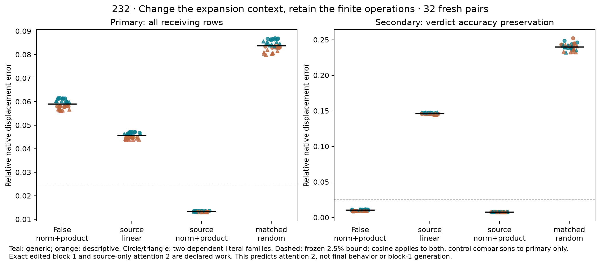

# 232: source-conditioned transport recovers the complete local displacement

**The preregistered all-receiving attention-2 criterion passes in 32/32 fresh
literal pairs, 8/8 in every schema/order stratum. Verdict-position accuracy is
preserved in 32/32.** Median whole-receiving relative error falls from **5.90%**
for the previous False-context normalization/product rule to **1.33%** for the
source-conditioned rule. This predicts one attention update, not final behavior.

All 128 forecasts are qualified, globally sealed, pushed and remotely verified
at `617668f58595024316e3327d36738479d4ee53ac` before any of the 32 ordinary
native True runs. The budget still includes an **exact edited first block and
one finite source-only attention-2 call** per pair, in addition to one ordinary
False computation. Extra CPU control graphs and derivatives are counted. This
does not explain the first block or establish a compact end-to-end predictor.

## The tested change is the expansion context

231 retains finite receiver RMSNorm and the attention probability–value product,
with QK and softmax False-affine. That local rule predicts the verdict-position
change but misses the whole receiving sequence. The source-only state S=x+s is
already computed; it contains the known changed Boolean row and False receiving
rows. It is a constructed mixed context, not the native full True state.

232 anchors receiving transport in this context. Its keys, values and probability
background differ from the original False background, so the same receiving
direction can have a different derivative. Independent direction caches and
numerical checks qualify both expansion points.

The four registered arms are:

- **FNV:** 231's original False-context normalization/product rule.
- **SL:** receiving transport linearized in the source-only context.
- **SNV:** the same finite normalization/product operations, now source-anchored.
- **R:** FNV plus a seeded random vector matching the full receiving-space norm
  of SNV−FNV. It matches global norm, not per-row norms or covariance.

The source-conditioned rule uses the actual public source-only primal plus a
smooth CPU64 increment, avoiding a false improvement from anchor rounding.
No native both-input attention-2 evaluation is used before the global seal.
The known edited first-block state is later checked against the native True
trajectory and matches **exactly** in every case.

## Registered results

At the whole receiving sequence, median relative errors are **5.901% FNV**,
**4.555% SL**, **1.331% SNV**, and **8.367% R**. SNV's median cosine is **0.999912**.
All 32 cases meet the frozen 2.5% error, 0.995 cosine and native-norm guard, and
strictly beat all three controls. The primary rule required 24/32 and 6/8 in
every stratum; observed counts are 32/32 and 8/8. Every control meets the raw
whole-receiving accuracy bounds in **0/32** cases.

At the verdict position, SNV's median error is **0.767%**, versus FNV **1.016%**,
SL **14.591%** and R **23.984%**. Both SNV and FNV meet the raw local accuracy
bounds in 32/32, and SL/R in 0/32. The secondary test preregistered accuracy
preservation, not a forced improvement over already accurate FNV. It passes
32/32 without rescuing or replacing the primary test.

The 32 pairs cross two new literal families, schema, order, assignment and target.
All 64 full token-sequence hashes are absent from the bounded 1,280-entry prior
catalog. They remain dependent synthetic templates in one pinned Qwen checkpoint,
not independent task or research-team replications.

## A retrospective recombination narrows what changed

The registered SNV rule changes both the receiving tangent and the nonlinear
correction's context. A **post-observation, model-free** diagnostic recombines
the already sealed components to distinguish them. This is not another
preregistered forecast arm or a native learned-circuit intervention.

Source-conditioned linear transport plus the **original False-context nonlinear
correction** meets the old accuracy bounds in 32/32, with **1.512%** median
whole-receiving error. Original False transport plus the source-context
nonlinear correction meets them in 0/32, with **5.781%** median error. Changing
the tangent is thus enough for this hybrid to meet the bound on these observed
cases; changing the nonlinear correction alone is not.

The tangent change has median signed projection **0.9604** onto FNV's missing
whole-receiving vector; the correction change contributes **0.0245**. These are
dot-product summaries, not unique causal percentages or explained variance.
Their exact additive identity closes with zero coordinate error. The hybrid
needs a new frozen test before it is presented as a prospective result.

This prevents overstating the explanation: the evidence does not require a
new context-specific nonlinear correction everywhere. It supports the registered
source-anchored rule, while the retrospective result suggests a more separable
account of state-dependent transport and the local nonlinear correction.

## Numerical qualification and information ordering

Before targets, the separate NumPy reconstruction checks both anchors, both
derivatives, both graph increments, the norm-matched control and all predictions:
**960 passing checks**, maximum coordinate discrepancy **8.600e-6** against
the unchanged 1e-4 primal bound. Forecast/derivative equations use 1e-9. Every
distinct affine direction is qualified separately at F and S: **384** analytic/
AD/FD comparisons, plus **64** receiving JVP/FD comparisons, h=1e-5. Total FD
endpoint evaluations: **896**. No tolerance or prediction changed after targets.

The original global seal binds sources, inputs, weights, forecasts and metadata.
The remote GitHub receipt uses the experimental interpreter clock and precedes
observation start; every target record follows that start and references the
same seal. All forecast hashes stay unchanged. Native first-block replay is
exact in all 32 cases. There are no implementation or numerical failures in
this run. The original disputed Float32 block derivatives remain unqualified.

Actual forecast work: 32 ordinary False models, 32 finite edited first blocks,
32 public source-only attention calls, 64 smooth anchor graphs and 128 smooth
intervention graphs, with the derivative work above. Only after the global seal
are 32 ordinary True models run. Local arithmetic is substantial; no speedup or
zero-counterfactual-computation claim is made.

## What this answers and what remains

The tested whole local displacement needs the changed source context as well
as the normalization/product approximation. A fixed False receiving tangent
misses coupling near the source, even when the nonlinear correction works at
the verdict. The prospective result makes that account more concrete than a
retrospective decomposition alone. It identifies a successful restricted local
computation under the declared budget, not a unique learned mechanism.

Generation of the edited first-block state is still computed exactly. Propagation
through MLP2 and the remaining network has not been forecast by this rule.
Replacing the actual QK/softmax operations with affine maps successfully here
does not make them intrinsically linear. Final residual/verdict prediction,
learned features/circuits, generality and priority are unresolved. Earlier 204,
224/227 numerical boundaries, failed 228 forecasts and grounding limits remain.

[Every case, seal and reproduction](../../results/source-conditioned-local-232/README.md)
· [Registered protocol](../experiments/232-source-conditioned-local-forecast.md)
· [Preceding local forecast](231-local-forecast-result.md)
