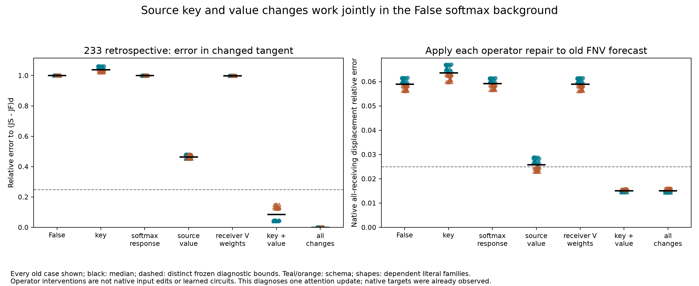

# 233: source key/value mixing accounts for most of the changed tangent

**Updating the source key and value operands together, while retaining the
False softmax background, accounts for the whole-receiving tangent change in
32/32 old cases.** Its median remaining error to (JS−JF)d is **8.58%**. Applied
to the old local forecast, the repair meets the native attention-2 accuracy and
row-matched-control criteria in **32/32**, at **1.513%** median relative error.
This is a qualified retrospective operator diagnostic, not a fresh forecast.

## What was separated

232 moved the receiving expansion point from False F to the constructed
source-only state S. The receiving input and direction d are identical at
both anchors. Their receiving normalization derivative is therefore identical.
Four attention derivative operands can nevertheless change:

- **K:** source keys in the query-direction logit response.
- **H:** the probability background defining the softmax Jacobian.
- **V:** the source values read by the probability derivative.
- **P:** probability weights transmitting receiving-value changes.

For H(p)u=p*(u−sum(p*u)), the 16 crossed maps are

```
T[a,b,c,e] = d + O[H(pb)(qdot Ka^T + q kdot^T) Vc + pe vdot].
```

Attention scaling is included. O has no bias on increments. 0000 recovers
JF*d; 1111 recovers JS*d. The source directional K/V changes are zero because
only receiving rows vary. Independent slots intentionally break relationships
that hold in native attention. They are defined local derivative interventions,
not four independently editable natural inputs or recovered learned features.

## Vector and intervention outcomes

Every single-slot account passes the frozen 25% relative-error criterion for
the changed whole-receiving tangent in **0/32** cases. Source value alone has
46.35% median transport error. Key alone has 103.98%; its direction alone does
not supply a sufficient repair.

The joint K/V operator (1010) leaves **8.58%** of the tangent-change norm in
median, passing **32/32**, 8/8 every stratum. Both softmax-Jacobian and
receiver-value probability backgrounds remain False. Adding their changes
improves tangent reconstruction further, but is unnecessary for this restricted
whole-receiving accuracy bound.

Applying each operator increment to FNV tests more than projection size. Whole
native-displacement errors are **5.90%** baseline, **6.36%** key-only,
**2.59%** value-only, **1.513%** joint K/V and **1.512%** full tangent change.
Raw/controlled local accuracy counts are **0/32**, **0/32**, **16/32**,
**32/32** and **32/32** respectively. The value-only passes are all descriptive
schemas. Omitting K from the full operator leaves 16/32 local passes; omitting
V leaves 0/32. These are restricted necessity comparisons within this family
of operator edits, not evidence for a unique native circuit.

The first receiving row carries most of the main terms. False-anchored
factorial signed projections onto the whole tangent change have medians
**0.6868 value**, **0.0443 key** and **0.2283 key–value interaction**. Their
vector norms are 0.1994, 0.1086 and 0.0808, against a 0.2596 tangent-change
norm. A relatively large key vector with a small signed projection illustrates
why component norm does not establish a useful repair. Factorial allocations
and separately taken medians are geometric accounting, not unique causal
percentages or fractions of explained variance.



At the verdict, the total tangent change is much smaller: median norm 0.00363.
The K/V operator leaves **47.85%** of that change unreconstructed and fails
its transport criterion in all 32, even while its resulting native verdict-row
prediction stays accurate. Baseline FNV was already within the native verdict
bound in every case. Do not generalize a pooled-vector account to each position.

## Explicitly exploratory follow-up

After observing the factorial, a model-free recombination removes its K/V
mixed term. It raises median whole native-displacement error from **1.513%**
to **2.438%**, leaving **18/32** within the old accuracy bounds. This additive
comparison is explicitly post-observation, not a registered 233 arm. It
motivates the separately frozen product-removal control in fresh experiment234.

## Numerical qualification and limits

The NumPy calculation is checked with separate Torch CPU64 local functions.
All **512** intervened derivatives and **64** full native attention derivatives
match AD and central FD at h=1e-5. There are **576 comparisons / 1,152 FD
endpoints**. Maximum recorded analytic/AD coordinate discrepancy is
**2.727e-15**; maximum AD/FD discrepancy is **1.498e-9**, within unchanged
1e-9 and 1e-4 bounds. Public-primal comparisons use the original 1e-4 bound.
All **7,584 recorded checks** pass; many are repeated control/equivalence checks,
not independent scientific observations.

No ordinary model or suffix is run. The auditor additionally evaluates 256
finite attention graphs and 1,536 hybrid graphs. All 32 saved 232 targets were
already observed; exact edited block1 remains supplied by computation. Old
Float32 derivative failures, qualified204, failed224/227 bridges and failed228
whole-response predictions remain unchanged. This identifies a useful local
operator account, not the upstream generator, final behavior or learned circuit.

[Protocol](../experiments/233-source-transport-primitives.md)
· [Every graph, component, witness and reproduction](../../results/source-transport-primitives-233/README.md)
· [Fresh test](234-source-key-value-result.md)
