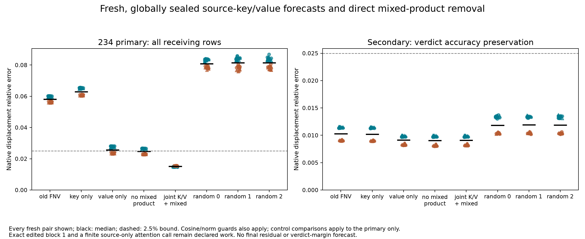

# 234: the selected key/value account forecasts fresh local displacements

**The frozen joint source-key/value rule passes the all-receiving attention-2
criterion in 32/32 fresh pairs, 8/8 every stratum.** Median relative error is
**1.520%**, versus **5.807%** for the original False-context rule. Verdict-row
accuracy is preserved in 32/32. This is a successful restricted local forecast,
not a final residual or verdict-margin prediction.

## A specific account replaces “the source context changed”

233's retrospective factorial selected changes to the source key and value
operands while retaining the False softmax Jacobian and False probability
weights for receiver-value transport. That yields three explicit increments:

```
key   = O[H(p)(qdot dK^T) V]
value = O[H(p)(qdot K^T + q kdot^T) dV]
mixed = O[H(p)(qdot dK^T) dV]
C = FNV + key + value + mixed.
```

Attention scaling is included. The source edit dK/dV is nonzero at the Boolean
row; dotted receiving directions come from the known edited first block.
The mixed term changes the value read by the source-key-dependent probability
tangent. It is a product in the specified forecast, not a named semantic feature.

All **256 predictions** were qualified, globally sealed, pushed and remotely
verified at `ab7234305bbab591820360c65198e3a0a207ee69` before any ordinary native
True target. Nothing was fitted or changed after those targets.

## Fresh outcomes and direct product removal

Whole-receiving median relative errors and raw accuracy counts are:

- FNV: **5.807%, 0/32**.
- Key only: **6.299%, 0/32**.
- Value only: **2.570%, 16/32**.
- Key + value with the mixed product removed: **2.472%, 16/32**.
- Joint key/value rule including the mixed product: **1.520%, 32/32**.
- Three independently seeded row-norm-matched controls: **8.090–8.149%, 0/32 each**.

C strictly beats all seven controls in every case, in addition to meeting the
2.5% relative-error, 0.995 cosine and native-norm bounds. The frozen whole
decision requires 24/32 and 6/8 per stratum; observed counts 32/32 and 8/8 pass.

Removing the mixed product worsens whole-receiving error in **32/32** fresh
cases. It does not make every forecast fail: 16 remain accurate. Its median
signed projection onto FNV's missing whole vector is **0.2371**. This number
is a geometric accounting quantity, not a causal percentage. The registered
comparison supplies prospective support for the mixed term's contribution to
the specified local predictor, without identifying a learned circuit.



The position boundary remains informative. At the verdict, C's median error
is **0.9083%**, compared with **0.9034%** after mixed-term removal. Removal
helps 16/32 verdict rows and worsens 16/32, while worsening all whole-sequence
forecasts. Every arm, including all three row-matched random controls, meets
the raw verdict accuracy bounds in 32/32. The secondary preservation criterion
therefore passes but does not discriminate the mechanism. Counting accurate
verdict rows alone would miss the tested vector improvement.

## Computation budget and numerical evidence

The candidate retains an **exact edited first block** and **one finite public
source-only attention-2 call**, in addition to one ordinary False computation.
Source K/V edits come from that known first-block source row. Its receiving
transport uses False H/P operands; the public source-only primal still contains
finite source-dependent probabilities. The result does not remove all source
softmax computation, explain block 1 or demonstrate a speedup.

Forecast work: 32 ordinary False, 32 edited blocks1, 32 public source attention
calls, 32 smooth False anchors, 64 intervention graphs and32 source-row K/V
calculations. Numerical qualification uses 192 distinct affine-node directions,
32 receiving JVPs,128 additional hybrid AD/FD comparisons and32 full-F AD/FD
comparisons: **384 comparisons,768 FD endpoints**. Separate Torch qualification
also evaluates160 finite attention graphs and384 hybrid graphs. The NumPy
auditor reconstructs 64 anchors. These are component computations, not extra
ordinary native models or an independent research team.

All **1,216 pre-target checks** pass; maximum coordinate discrepancy is
**6.716e-6**, within the unchanged 1e-4 public-primal bound. Analytic equations
retain 1e-9; central FD retains 1e-4 at h=1e-5 (largest additional hybrid/full-F
AD/FD error 1.528e-9). All forecasts and derivative witnesses are sealed before
targets. The later 32 native True computations exactly match the supplied
first block in every case. No numerical or implementation failure, tolerance
change or post-target forecast adjustment occurred.

## What this advances

The changed transport is no longer represented only as an opaque replacement
Jacobian. A specified source key/value product account, chosen on old cases,
survives a fresh frozen test with stronger row-matched controls and direct
mixed-product removal. It explains a useful restricted local computation.

These are 64 new full-token hashes absent the bounded 1,344-entry prior catalog,
still dependent synthetic templates in one pinned Qwen checkpoint. Generation
of block 1, propagation through MLP2 and later blocks, final residual/margin,
generality, priority and learned circuits remain open. Earlier derivative and
bridge failures, failed228 forecasts and grounding limits remain preserved.
Question B is not solved end to end.

[Protocol](../experiments/234-source-key-value-forecast.md)
· [Every case, seal, control and reproduction](../../results/source-key-value-234/README.md)
· [Retrospective primitive diagnosis](233-source-transport-result.md)
