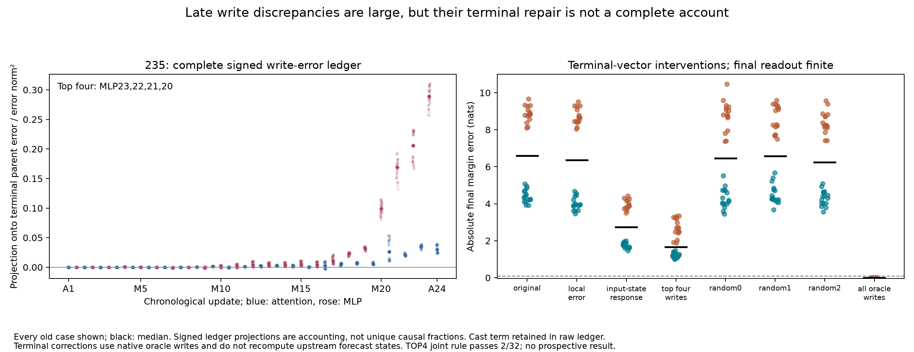

# 235: the biggest late write errors mostly reflect inaccurate inputs

**A complete error ledger identifies MLPs 20–23 as the four largest signed
contributors to the failed 228 forecast's parent error.** But the two largest,
MLPs 22/23, were already evaluated finitely. Their approximately 25-unit write
discrepancies come almost entirely from inaccurate incoming states, rather than
an unimplemented local nonlinear correction.

This is a retrospective diagnostic on all 32 already-observed 228 contexts.
It does not turn saved native writes into prospective inputs or solve Question B.

## Account for the complete failed forecast

For each of 24 attention and 23 MLP updates before the MLP24 input, compute the
native residual write minus the F forecast write. Across the common residual
coordinates, these 47 vectors plus the final input-cast term sum to the terminal
parent error. Complete-vector closure holds in every case, with maximum
coordinate discrepancy **2.665e-15** against the frozen 1e-9 bound.

This is telescoping bookkeeping, not proof of where the error originated. A
write can differ because its incoming state is wrong even if the operation is
computed exactly. Ranking by median signed projection onto the whole parent
error selects, in order, **MLP23, MLP22, MLP21, MLP20** before finite outcome measurements.
Median signed projections are **0.2892, 0.2056, 0.1689, 0.0989**. Separately taken
medians and geometric projections are not unique causal percentages.

The four terms do not reconstruct most of the vector accurately: subtracting
them leaves a median **62.0%** of the parent error norm. Large signed projections
alone would have overstated sufficiency. All 47 sites, cast term, positions and
individual cases remain in the ledger.

## Recompute the operations at their actual forecast inputs

At each selected site, run the same finite operation at the forecast input and
native input. Split the write discrepancy into local approximation error at
the forecast input, response to the different incoming states, and a replay
remainder. The input-cast convention is recorded explicitly.

At **MLP23**, median whole write-error norm is **25.50**. The local approximation
term is only **5.2e-6**; the input-state term has essentially all the discrepancy.
At **MLP22**, corresponding norms are **25.72** and **4.6e-6**. This follows the
actual failed algorithm: those two MLPs were already finite at their predicted
inputs. Re-evaluating their local formula cannot repair the state they receive.

At **MLP21**, local approximation error is material: median norm **13.32**,
against **19.34** for the input-state term and **24.20** total. At **MLP20**,
the norms are **7.46**, **17.11**, and **18.14**. Their signed local-error
projections onto the corresponding write errors are **0.3023** and **0.1362**.
These terms are conditional on the finite-at-forecast-input path, not a unique
decomposition of learned computation. Native finite replay is exact here.

## Test consequences with the final readout kept finite

Add selected ledger vectors at the original MLP24 input, then run the original
finite MLP24 and blocks 25–28 plus final norm/head. This is a **terminal-vector
intervention**, not an upstream repair: later forecast states are not recomputed.

The original median absolute margin error is **6.588 nats**. The four-term
terminal repair lowers it to **1.668**, and final verdict residual error from
**104.48 to 29.78**. Yet it passes the joint parent/vector/margin reduction rule
in only **2/32** eligible cases, failing the frozen whole criterion. One- and
two-term repairs pass 0/32.

Using only the four local approximation components gives **6.366 nats** median
margin error; using only their input-state components gives **2.747 nats**.
Neither passes the joint rule. Row-norm-matched random controls fail to reproduce
the four-term improvement. Complete oracle repair recovers the native parent,
final coordinates and scores exactly in all 32; original-F replay is exact too.
Those are reconstruction controls, not predictive results.

The small effect of adding local components *at the terminal state* does not
establish that correcting them upstream is ineffective. Upstream correction
changes what the later finite MLPs receive and write. Experiment 236 tests that
specific causal continuation with a two-block factorial and native-reset controls.

## Qualification and scope

All **1,664 independent audit checks** pass, including 256 NumPy finite-operation
reconstructions and 448 finite heads. Maximum selected-operation primal error
is **5.660e-5**, within the unchanged 1e-4 bound; exact identities use 1e-9 and
score bridges .005. Every saved original input/source/forecast and selection is
hashed. There is no new derivative attribution and no recertification of the
old Float32 Jacobian disagreements.

Actual work: 32 ordinary False, 0 ordinary True, 160 source-only attention calls,
256 local finite operations, 448 MLP24 interventions, 1792 continuation blocks,
448 heads. Targets are old, dependent synthetic contexts in one checkpoint.
Full readout remains finite. Learned features/circuits, priority, generality,
and a successful False-only native-response forecast remain unestablished.

[Frozen protocol](../experiments/235-global-forecast-error-budget.md)
· [All ledgers, splits, interventions and reproduction](../../results/global-error-budget-235/README.md)
· [Upstream continuation test](236-upstream-factorial-result.md)
