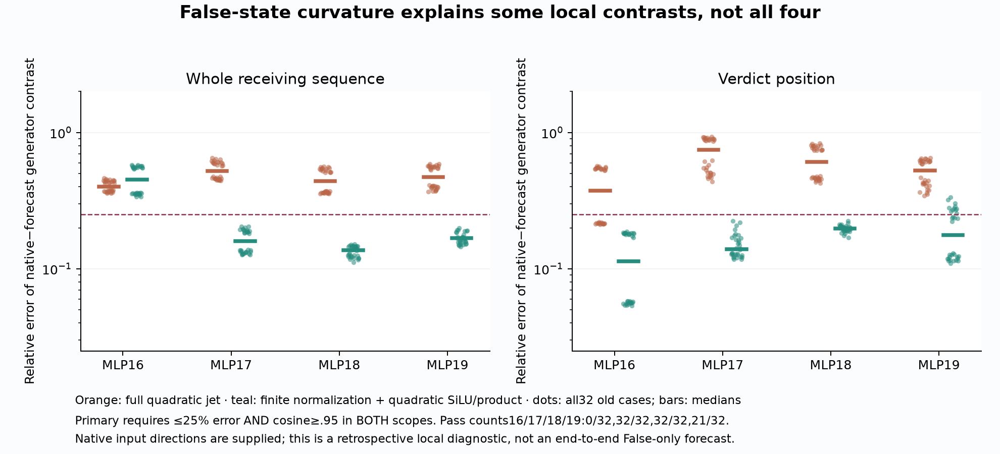

# 239: a local curvature account works at MLP17/18 and exposes a sharp MLP16 exception

**A False-anchored finite-normalization/quadratic-SiLU model explains the
native-versus-forecast generator contrast in32/32 cases at MLP17 and MLP18.**
It passes0/32 at MLP16 and21/32 at MLP19, so the registered four-site account
fails. The purely quadratic control passes0/32 at every site.

The most specific remaining pattern is positional. At MLP16, **99.897%** of the
joint model's remaining squared contrast error is at the first receiving row
(median), while only **.044%** is at the verdict. A posthoc exact identity
attributes the remaining mathematical error to the omitted higher-order SiLU
term. Its first-row/neuron concentration does not establish a learned circuit,
a target-blind sparse explanation or a final behavioral consequence.

These are retrospective local calculations under supplied native and forecast
input directions. They do not predict the native directions, repair238's
31.6% final error, or solve QuestionB. All declared numerical checks pass.

## Why this question followed238

238 traces local native-input remainders through the original False-affine
prefix and selects MLPs16–19 before intervention outcomes. Recomputing these
operations at their own forecast inputs helps substantially but fails full
accuracy. Their local correction vectors differ from native-input remainders.

The new question is whether that difference follows a predictable response
geometry in the False computation, rather than treating every native correction
as an arbitrary vector. For each of32 old contexts at all four fixed sites,
239 evaluates two formulas with the same checkpoint and False anchor.

## The two frozen formulas

The secondary control is the complete homogeneous quadratic Taylor coefficient
of the MLP. It includes second-order normalization, SiLU curvature and the
first-order gate–up product. Its coefficients agree with a separately evaluated
CPU64 Hessian action, so its failure is not a derivative implementation error.

The primary model normalizes each supplied input finitely, computes the resulting
gate/up changes dg,du, and uses the False gate's SiLU derivatives:

`phi_pred = phi0 + phi'_0 dg + .5 phi''_0 dg²`.

It multiplies by the complete changed up value and applies the down projection.
The residual relative to the False affine rule splits into declared normalization,
SiLU-quadratic and product terms. The product includes the cubic SiLU/up term.
Consequently this comparison changes both normalization treatment and retained
polynomial orders; it does **not** isolate normalization as the sole cause of
improvement over the full quadratic control.

Subtracting predictions at native and own inputs cancels the shared source-only
term. The Float32 installation correction is handled separately by the False
Jacobian. All components and signed projections remain in`components.csv`.
This allocation is mathematical, conditional on the defined background/order.

## Outcomes depend on both layer and receiving position

The primary criterion requires contrast relative error<=25% and cosine>=.95
at BOTH the whole receiving sequence and verdict, with24/32 and6/8 per stratum
at each of the four sites.

- **MLP16:**0/32 joint passes. Whole-sequence median error45.2%, cosine.959;
  verdict error11.4%, cosine.993. Whole scope passes0/32; verdict passes32/32.
- **MLP17:**32/32 joint passes,8/8 each stratum. Whole error15.9%, verdict13.9%.
- **MLP18:**32/32 joint passes,8/8 each stratum. Whole error13.7%, verdict19.8%.
- **MLP19:**21/32 joint passes. Whole error16.7%, verdict17.6%; whole scope
  passes32/32 but verdict only21/32. The latter includes all16 descriptive
  cases and only5/16 generic cases.

The complete four-site primary therefore has0/32 all-four passes. These local
bounds are looser than the full-response bound. A local pass must not be read
as5% accurate final prediction.

The full quadratic control fails at every site: whole errors39.9%,52.3%,44.1%,
47.1% at MLP16–19; verdict errors37.3%,74.6%,60.9%,52.9%. No site achieves the
registered joint rule. This rejects the simple quadratic explanation under the
supplied directions; it does not reject all False-state nonlinear prediction.

## What the exact omitted term says—and what it does not

After seeing the primary failure, a separate explicitly posthoc calculation
reconstructs its missing finite MLP term:

`[SiLU(g0+dg) - phi0 - phi'_0 dg - .5phi''_0 dg²] * (u0+du)`

followed by the down projection, and then native-minus-own subtraction. This
identity closes the mathematical model's remaining error within **8.59e-14**.
Its bridge to the saved public residual contrast is within **4.71e-5**, below
the original1e-4 bound in every comparison. Under this finite-normalization
background, no additional unknown MLP operation is needed to account for that
local formula error. That is algebraic accounting, not a new causal intervention.

At MLP16, the first receiving row contains99.897% median squared error, versus
.044% at the verdict. The largest1% of neuron-position contributions account
for99.0% of absolute projection mass and99.96% of signed projection onto the
missing vector. Contributions whose gate crosseszero in either supplied path
account for99.84% of that signed projection.

These concentration statistics use the **observed missing vector as a readout**
and exact supplied input directions. They are target-dependent, descriptive
and selected after the primary outcome. They cannot establish that a few neurons
predictably cause the behavioral dependency. Zero crossing is a scalar gate
regime, not a learned feature or hard switch. Direct neuron-product interventions
with a target-blind selection rule and finite final readout are still required
before interpreting this concentration as a causal sparse account.

The useful narrower question is now whether a rule derived from False gate
values and the forecast's own displacement can identify these higher-order
terms before seeing the native error—and whether correcting them improves the
actual final residual and margin. We have not run that test or claimed it passed.

## Numerical qualification and scope

All **3,328 separate audit comparisons** pass. The three primitive allocations
are reconstructed using independent Torch normalization derivatives and SiLU
JVPs, compared with the NumPy formulas at1e-9. All384 quadratic coefficient
vectors agree with nested-JVP Hessian actions to **2.33e-14** and central second
finite differences(h=3e-4) to **9.47e-7**, inside1e-4. The audit checks contrast
closures and retains every case, site and failed scientific hypothesis.

All **512 Float32 finite-MLP primal comparisons** pass1e-4, maximum **1.15e-5**.
All512 raw Float64 mathematical bridges also pass their original1e-4 bound;
no failure is hidden or reclassified. No new ordinary False/True model forward
is run. Component/Hessian/finite-difference work is explicitly additional
computation, not a speedup. The dataset remains32 dependent old contexts in one
pinned Qwen checkpoint; no fresh prediction or independent research-team
replication is claimed. Older derivative/bridge failures remain unchanged.

[All evidence and reproduction](../../results/generator-curvature-239/README.md)
· [Frozen protocol](../experiments/239-curvature-generator-contrast.md)
· [Formula implementation](../../research/boolean_coupling/curvature239.py)
· [Separate auditor](../../research/boolean_coupling/audit239.py)
· [Explicitly posthoc description](../../research/boolean_coupling/describe239.py)
