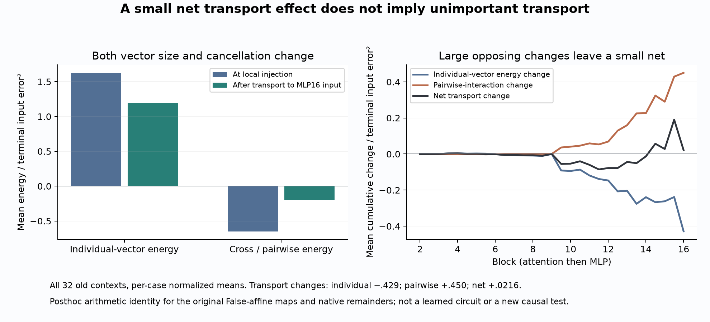

# 241: the missing input is distributed across error vectors that partly cancel

**The four-site explanation fails even when the true local errors are supplied.**
Under the predeclared shared greedy rule, four transported operation vectors
leave 61.9% median whole input-error norm unreconstructed and pass the joint
criterion in 0/32 cases. The first sufficient prefix of that ordering contains
16 of29 operations, passing32/32. This rejects the tested four-site account;
it does not prove that no other compact basis or state-dependent update exists.

The more informative pattern concerns transport. New local errors partly oppose
the inherited error. Yet a small net transport-energy contribution hides two
larger changes: transport reduces individual-vector energy while also weakening
their cancellation. This is a qualified retrospective description of the
**original False-affine predictor's error**, not an identified learned mechanism
of the native Boolean response. Question B remains open.

## Complete vectors, rather than another projection ranking

240 shows that exact computation after the forecast input before MLP16 still
misses the native final response.241 targets that input error. It retains all
29 operations from attention2 through attention16, including MLP2–15, in the 32
old 228 contexts. The initial post-block1 receiving prediction is exact under the
declared known-edit budget.

238 supplied qualified native-input remainders R and False Jacobians J. The
original forecast is affine before this boundary, so

`e_next = J e + R`.

241 explicitly propagates **every** remainder through each remaining original
J, retaining its full vector T at the MLP16 input. Their sum reconstructs the
raw input error to **2.78e-13** maximum coordinate discrepancy. Adding the
explicit known Float32 installation term reconstructs240's actual supplied
input error at the same bound. The cast has median norm 2.77e-6; it is not a
nonlinear generator.

All native R values are oracle diagnostic inputs. These are not predictions
from a single False computation. No new ordinary False/True forward is run.

## The compact four-site hypothesis fails

Protocol and all numerical/scoring code were frozen at `7f335d2`, before the new
transport calculations. The fixed rule greedily adds the operation minimizing
median whole-vector reconstruction error across the same old 32 cases, with
chronological ties. It fits observed vectors; it is not a target-blind selector.

The first four sites are **MLP14, MLP15, MLP13 and attention15**. They leave
median 61.9% whole and64.9% verdict-position input-error norm; cosines .785/.764.
The criterion requires relative error<=25% and cosine>=.95 in BOTH scopes,
24/32 overall and6/8 per schema/order stratum. Four sites pass **0/32**.
Eight sites also pass 0/32. Twelve pass 2/32; fifteen pass 18/32 and fail coverage.

The first sufficient prefix is **sixteen**, passing32/32 and8/8 in each stratum.
It leaves8.00% whole and15.75% verdict error, with cosines .9967/.9862.
All 29 vectors close exactly. These are errors in reconstructing the missing
input error, not the original5% bound for forecasting the full native response.

An explicitly post-observation observation is that these sixteen selected sites
happen to be the contiguous set **MLP8 through attention16**. The ordering was
not chosen by depth. This suggests a useful region for a future frozen test,
but does not establish that these blocks form a circuit or that this window
generalizes. The first sufficient prefix is not a globally optimal subset size.

## Newly generated error and inherited-error amplification are different terms

At each operation the exact squared-error increment is

`||e_next||² - ||e||² = (||J e||² - ||e||²) + ||R||² + 2<J e,R>`.

After per-case normalization by the final raw input error², the mean sums are:

- Transported-error norm change: **+.02156**.
- New-remainder energy: **+1.62681**.
- Interaction with inherited error: **−.64837**.
- Total: **1.00000**.

The interaction sum is negative in all 32 cases. The large local remainders
therefore do not simply add independent error energy: they partly oppose the
error already present. This defined decomposition does not identify unique
causal percentages or intentional self-repair.

MLP15 has the largest median net local increase, followed by MLP14. Attention9
also supplies a conspicuous earlier increase. These local energy rankings differ
from the full-vector greedy selection. Largest local norm, largest signed
projection and best vector reconstruction are different objectives.

## A small net transport effect hides substantial geometry changes

After the primary result, three explicitly posthoc, model-free calculations
audit the energy CSV, compare the terminal Gram matrix, and split transport
into its individual-vector and pairwise-interaction effects. These are algebraic
descriptions of the saved vectors, not new primitive interventions.

At injection, summed remainder energy is1.62681 in the normalized mean budget.
After transport, summed individual-vector energy is **1.19829**. Terminal
pairwise interactions sum to **−.19829**, giving total1. Their positive part
is+.46781 and negative part−.66610. The terminal interaction is negative in
all 32 cases; this establishes cancellation directly, rather than inferring it
from the sum of vector norms.

Transport's small+.02156 net effect decomposes into

`−.42853 individual-vector energy change + .45009 pairwise-interaction change`.

Both signs hold in all 32 cases. Transport damps the summed individual-vector
energy but makes net cancellation weaker. Calling transport unimportant from
its small net would be wrong. A shared linear map changes both norms and inner
products through its metric JᵀJ; this identity does not establish two learned
mechanisms or a discovered feature.

The descriptive depth split localizes large changes: attention16 contributes
−.1901 to individual energy and−.1690 net, whereas MLP15 contributes+.1390
to pairwise interaction and+.1627 net (normalized means). These identify
operation-level questions for a primitive test. They do not identify which
normalization, gate, product or attention primitive causes those effects.

## What this changes about Question B

The evidence now argues against explaining this failed predictor by just a few
portable additive correction vectors. Distributed local remainders and the
geometry of their transport both matter under this decomposition. It does not
follow that sixteen finite operation repairs are necessary: a better update
could change the later states and remainders, rather than injecting fixed oracle
vectors. That needs a new test.

The next mechanistic question is which nonlinear operation repeatedly generates
these missing terms, and which parts of the MLP/attention maps change their
alignment. RMSNorm geometry is a candidate, as are multiplicative gate/up and
query/key/value interactions. The present energy identities do not distinguish
them. Any claimed answer must first survive primitive interventions, then a
frozen own-state rule and fresh residual/verdict prediction. No correction sweep
or learned-circuit claim is justified by this ranking alone.

## Numerical qualification and reproducibility

All **6,592 runner comparisons** and **3,872 separate audit comparisons** pass.
All **13,920 used directional JVPs** get Torch central finite differences
(27,840 endpoints), maximum discrepancy **7.08e-9** under1e-4. Independent
analytic NumPy tangents agree within **4.31e-13** under1e-9. A further **27,840
independent NumPy finite endpoints** give maximum discrepancy **6.90e-9**.
Intermediate and terminal vector closure is at most2.78e-13 under1e-8.
False public primal bridges pass 1e-4, maximum 4.14e-5. The posthoc arithmetic
audits add3,712 energy,32 Gram and992 transport-metric identity checks, all passing.

Native/source/False inputs are bound to published228/238/240 array inventories,
and the installed input is exactly 240's saved forecast input. The fixed-array
runner requires those hashes. The reproduction wrapper can rebuild the fixed
prerequisite chain in its recorded environment; any array-hash mismatch stops.
Portable tolerance-based acceptance of different regenerated arrays is not
claimed by this release. Every used tangent, FD witness/hash and full terminal
component is retained locally; the repo inventories the large arrays.

The new work is CPU64 component/JVP/finite-endpoint arithmetic, not zero work or
a speedup. No new native observation, ordinary model forward, browser search or
paid model API call is used. All 32 contexts remain old and dependent, in one
checkpoint. Earlier Float32 derivative disagreements, failed bridges, failed
full-response forecasts and failed grounding controls remain unchanged.

[Frozen protocol](../experiments/241-before-mlp16-vectors.md) ·
[All cases, inventories and reproduction](../../results/before-mlp16-vectors-241/README.md) ·
[Complete-vector runner](../../research/boolean_coupling/vector241.py) ·
[Separate auditor](../../research/boolean_coupling/audit241.py)
