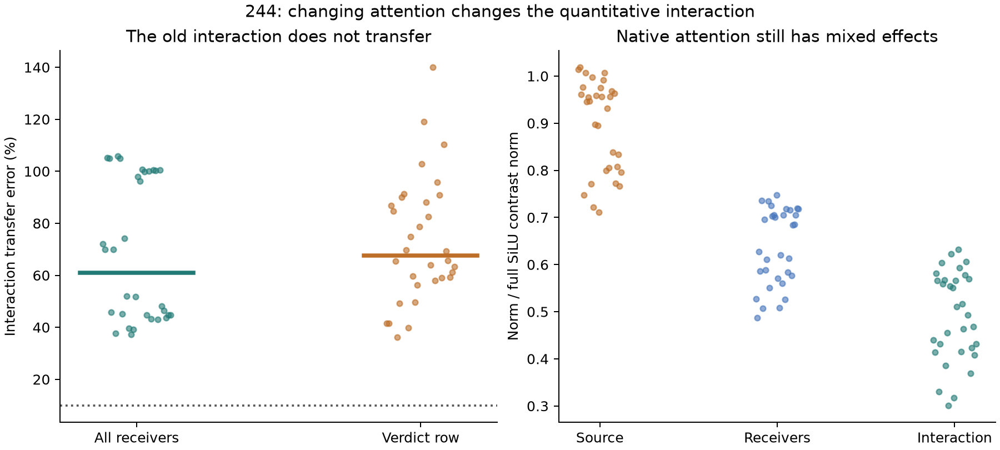

# 244: the earlier interaction does not transfer quantitatively to native attention

Replacing the attention approximation with public finite softmax changes the
regional SiLU interaction substantially. The frozen portability claim fails
**0/32**, with **60.9% median receiving-vector error**, cosine **.792**, and
**.540 nats** margin-interaction error. This constrains 243's interpretation;
it does not invalidate its qualified conditional result.

The native-attention regional interaction remains substantial: its median norm
is **50.1%** of the full FF-minus-QQ SiLU contrast. Source-only and receiver-only
accounts still fail. Its separately pooled signed projection is -.064; a small
projection is not a small vector or evidence of competing learned features.

QQ's native receiving-displacement error is54.7%, source-finite37.1%,
receiver-finite44.5%. FF replays native True **exactly**, at every block-tail
coordinate and both scores. FF is a full native computation and replay control,
not a successful forecast. The three approximations fail full native accuracy.

## Qualification and scope

160 complete forwards:32 zero-edit controls,96 modified regional forwards and
32 ordinary native True replays. QQ matches saved242b110 exactly; zero matches
False exactly. All prefix, source causal invariance and first-block delay checks
pass. Actual Q-SiLU rows retain CPU64 first/second AD/FD qualification and current
finite-SiLU primal checks. Final readout is finite, with separate CPU64 bridges.
No disputed full-block derivative is used or recertified.

Original scorer stops at an absent zero `distinct_directions` key in FF, which
installs no Taylor map. Original source and failure remain. Separately frozen
244b fixes only that metadata lookup and records both scorer hashes. No model
rerun, outcome rule or tolerance changed. The complete corrected audit passes.

This uses32 already observed dependent contexts and one pinned small model.
It identifies sensitivity of a defined regional policy contrast to attention,
not a learned circuit or a False-only account of the native Boolean response.
The next finite test examines where the interaction is first generated, with
an explicit materiality guard and direct primitive interventions.

[Protocol](../experiments/244-native-attention-regions.md) ·
[All cases, audit and preserved failure](../../results/native-attention-244/README.md)

