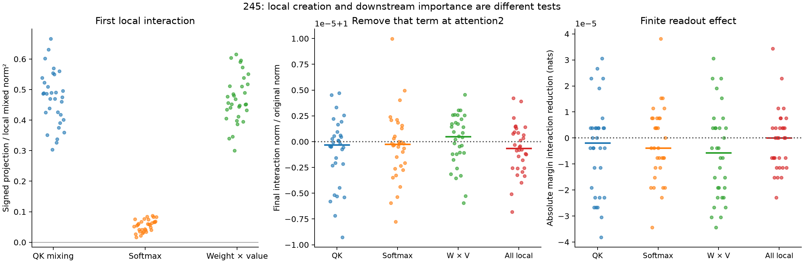

# 245: the first attention interaction is too small to explain the later one

The full incoming regional interaction before attention2 is exactly zero.
Source and receiver policy changes occupy disjoint rows. Finite attention can
therefore create a new mixed effect there without inheriting an earlier one.
But the measured first mixed weighted-value output is tiny: median norm
**3.92e-5**, maximum **5.09e-5** over all receiving rows; verdict median **4.46e-6**.
**Every case fails the preregistered .001 materiality guard.**

The primary weight/value-product account passes0/32. This should not be read as
a precise attribution contest between tiny terms: rounding has a median norm
of7.2% of the whole early interaction and26.2% at the verdict row. Absolute
finite arithmetic bridges pass, but they do not establish fine relative
precision for such small differences. Individual component fractions are
reported, not promoted to a learned mechanism.

## Direct removal tests

Separately remove the query-key, softmax and weight/value contributions, the
entire local interaction, and three norm-matched random directions, at the
actual attention primitive. Run the remaining network and readout finitely.
Removing the **entire** local mixed weighted-value vector leaves the final
regional interaction norm between **.9999932 and1.0000043** times its original
value. Final native margin changes by at most **3.44e-5 nats**; whole native
receiving-displacement error stays below **1.46e-5**.

Thus these interventions do not support an account in which this first tiny
mixed seed is the necessary origin of the large later interaction. This is a
bounded causal result for these interventions; it is not a theorem excluding
all amplification or later interaction generation. Matched controls and complete
case-level effects remain available.

## What this changes

The search should move to the first sizeable jump and separate new local mixing
from transmission of an existing mixed state. In244's observed profile, median
interaction norm grows from .02495 after block8 to1.02339 after block9. That is a
posthoc candidate, not a fresh forecast. It warrants a fixed-input decomposition
and primitive removals at that block, rather than an end-to-end correction sweep.

352 complete full forwards:128 regional replays (including32 ordinary native
FF controls) and224 primitive interventions. Extra local work:352 diagnostic
QK products,32 synthetic softmaxes,128 component value products and64 additional
intervention value products. All regional states/scores replay244 exactly.
Independent NumPy finite QK/softmax/value bridges, actual installation, untouched
source/prefix controls, Q-SiLU qualifications and final readout checks pass.
No block derivatives or native-response forecast are claimed. These32 observed
contexts and the regional policy comparison remain a restricted setup.

[Protocol](../experiments/245-first-mixing.md) ·
[All cases and audit](../../results/first-mixing-245/README.md)

