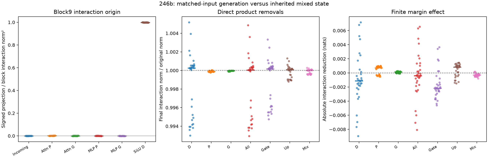

# 246b: the large block9 jump has a local SiLU account, not a final-verdict account

The receiving interaction norm in244 rises from median .02495 after block8 to
1.02339 after block9. We selected that block after observing the profile.
246b tests it with matched finite inputs and direct product interventions;
it is retrospective, not a fresh-context discovery.

## A local origin can be specified

Split the attention response into new mixing G at the additive parent and
transmission P of the existing mixed input. At the MLP, split the mixed product
into inherited P, finite new mixing G, and D: the change in the finite-minus-
quadratic SiLU discrepancy when the source-induced receiving state changes.
The protocol gives the exact finite formulas and retained rounding terms.

D predicts the **whole receiving-product interaction in32/32** cases within the
frozen vector bounds: median relative error **2.44%**, cosine **.999585**.
Its down-projected vector has median signed projection **.99865** onto the
whole block interaction. Incoming interaction, attention generation/transport
and the remaining MLP terms have much smaller projections in this allocation.
These are separately pooled medians, not percentages that must sum to one.

The D product itself splits into gate-discrepancy change, up change and their
product. Their median whole-product signed projections are .842, .057 and .098.
The formula uses actual receiving states and explicit residual rounding. It is
an arithmetic mechanism for this conditional contrast, not learned features.

## The verdict and intervention tests reject the broader explanation

D passes the **verdict-row local vector test in0/32 cases**, despite target norms
above the materiality guard in every case. Thus the joint local criterion fails;
the frozen primary also passes0/32. A whole-sequence fit hid the relevant
position's failure.

Remove D directly at the native FF MLP9 product, then run the suffix/readout
finitely. The median final interaction norm is **1.00026 times** its original
value; the verdict ratio is1.00229. Median absolute margin interaction worsens
by .00113 nats. Removing the entire local mixed product also leaves median
final interaction norm1.00005 times its original size.

Norm ratios alone can conceal a sideways effect. A separately labeled posthoc
full-vector check finds that removing D changes the final receiving vector by
a median **4.09% of the original interaction's norm**, range1.55%–9.76%.
Its median signed projection is -.000298. Native receiving-displacement error
is1.30% and native margin error .00179 nats in median. These are oracle removals,
not improved predictions. Three matched random edits and all gate/up/mixed
removals remain reported, including their larger or differently signed effects.

Posthoc position accounting places77.3% median D product energy in the first
receiving row (range38.0%–94.2%). This row is the comma after the changed Boolean
in all fixed fixtures. That does not establish a semantic feature or explain
training history. It helps explain why one pooled norm gave a misleading sense
that the verdict mechanism had been captured.

## What this rules out and what it does not

In this tested allocation, the block9 jump is primarily a newly generated
state-sensitive SiLU approximation discrepancy, rather than simple transport
of the incoming mixed vector. But removing that local discrepancy does not
recover the complete final regional interaction. This is not an answer to why
the native False-to-True Boolean response has its particular direction.

The next useful question concerns later generation and transmission at the
VERDICT position, with finite native attention and full signed vectors. Another
large pooled local error is insufficient evidence for a behavioral bottleneck.
No additional correction sweep follows from these failures.

## Numerical qualification and preserved failure

448 full forwards:128 regional replays (32 ordinary FF controls,96 modified),
320 direct primitive interventions. Additional component calls:32 finite
attention updates and96 finite MLPs. Regional states/scores, source/prefix
invariance and actual installations match exactly. The separate CPU64 finite
RMS/SiLU/product/down/head audit passes1696 checks, maximum absolute error
3.35e-5 under the original declared bounds. All actual Q-SiLU qualifications
are retained. Explicit residual rounding has median norm .016% of the block
interaction. No old full-block derivative is used or recertified.

Original246 stops in its first case, after four regional replays but before any
local intervention, because MPS does not implement Float64. Source, partial
arrays, log and failure remain preserved. 246b only moves the specified
Float64 additive-state sum to CPU before casting back. Same protocol, site,
thresholds and cases; no outcome was scored from246.

[Protocol](../experiments/246-block9-origin.md) ·
[Implementation correction](../experiments/246b-cpu-additive.md) ·
[Every case, audit, controls and failure](../../results/block9-origin-246b/README.md)

