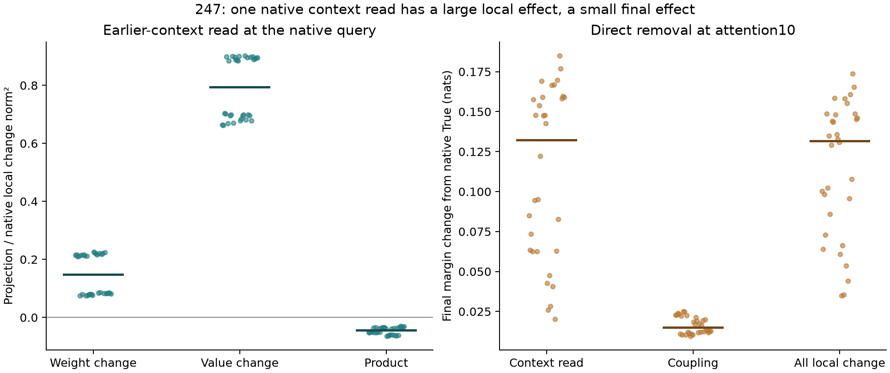

# 247: a native context read is locally important, but is not the whole response

This test returns to the **actual native False-to-True Boolean response**.
The preceding studies diagnosed approximation-policy interactions; those are
not interchangeable targets. Block 10 was selected retrospectively from the
regional verdict profile. All 32 contexts were already observed.

At attention 10, cross earlier-token context and the verdict token's incoming
state. The four parents use native False/True states as explicit oracles.
Holding the True verdict query fixed, the earlier-context effect has median
signed projection .897 onto the native attention-write difference. Its vector
reconstruction error is still 40.9%. The receiver/context coupling alone has
13.3% of the target norm and fails the local account in every case.

A finite decomposition of the earlier-context effect separates changed attention
weights, changed values, and their product. Their median signed projections
onto the complete native attention-write change are .148, .794 and -.044.
These are conditional arithmetic contributions, not causal percentages or
learned features. The weight term includes key/normalization/softmax changes;
it does not isolate softmax curvature alone.

Directly removing the entire native attention-write difference at this one
operation changes the final verdict displacement by a median 3.87% of the
native response norm and the margin by .132 nats. Removing only coupling changes
the verdict vector by .53% and margin by .015 nats. The native margin response
itself ranges from 5.95 to 14.53 nats across these fixtures. The frozen
coupling-only primary, local test and final causal criterion all pass **0/32**.

This is a useful boundary: a large local context read need not be the final
behavioral bottleneck. It leaves open whether the verdict already carries the
needed state or whether later attention supplies the information again. The
finite-suffix factorial in 248 tests that distinction.

All 384 full forwards finish: 32 native False, 32 native True, 320 primitive
interventions. There are 64 extra crossed-parent attention calls, 128 diagnostic
QK products and 96 component value products. Native states/scores replay exactly;
queries, installations and unchanged earlier rows pass exact checks. The separate
CPU64 QK/softmax/value/output/head audit passes **2,528 checks**, maximum absolute
error 1.27e-5. No whole-block derivatives are used or recertified. Oracle parent
states prevent treating this as a False-only prediction or a learned circuit.

[Protocol](../experiments/247-native-verdict-context.md) ·
[All cases and numerical evidence](../../results/native-verdict-context-247/README.md)

