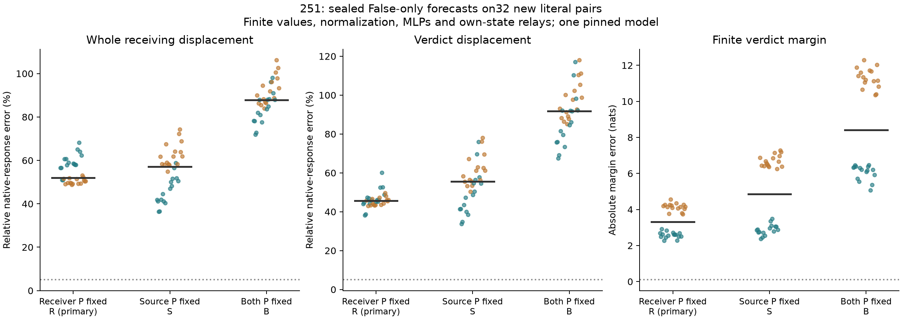

# Static receiver probabilities do not predict the native response

**Primary forecast: 0/32 joint successes.** Holding receiving
attention probabilities at their False values, while keeping source computation,
values, RMSNorm, MLPs, residual updates and relays finite, leaves52.00% median
whole-receiver displacement error,45.60% verdict error and3.319 nats margin error.
The source trajectory is exactly native True at every layer in every case.
Thus the failure cannot be attributed to an inaccurate source trajectory.

All32 predictions were globally sealed, separately pre-audited under the explicit
251b numerical boundary, and pushed to the public branch at
`0a56e15810c7f015749c3848f55df360d4939d75` before native True measurements.
The64 input hashes were absent from1,472 cataloged historical sequences.
These are new literals in old dependent synthetic templates, one pinned
Qwen2.5-1.5B-Instruct checkpoint, not fresh task families or independent replication.

## The crossed forecasts

R, the primary, freezes only receiving-query probabilities at all28 blocks.
S freezes only the source-query probabilities. B freezes both. All three use
only one ordinary False run, the known input edit, model weights and their
own evolving states. No unknown True receiving states or probabilities enter
their forecasts. Every final readout is finite and uses the full vocabulary head.

- **R, receiving probabilities fixed:**52.00% whole error,45.60% verdict error,
  3.319-nat margin error;0/32 joint successes. Native source replay is exact.
- **S, source probabilities fixed:**57.13% whole error,55.52% verdict error,
  4.860-nat margin error;0/32. Source states themselves are inaccurate.
- **B, both fixed:**87.91% whole error,91.80% verdict error,8.401-nat margin
  error;0/32. S and B source trajectories are identical exactly, as causality
  requires. Their receiver outcomes differ substantially.

All values are separately pooled medians. Every stratum has0/8 successes for
every arm. The unchanged primary requires both full-receiver and verdict
relative errors<=5%, cosines>=.99 and absolute margin error<=.10 nats.
The complete case table retains signed projections as well as errors.

Teal denotes generic-schema contexts, orange descriptive; black bars are
pooled medians. Each point is one dependent case. Threshold lines show the
vector and margin bounds; cosines are additionally required.

## What this says about the earlier value result

250b clamps source keys/values only in blocks10–28, preserving all earlier native
True receiving history. That showed a strong dependence on continued source
values and a smaller dependence on source-key changes in that late region.
It did not show that probabilities could remain fixed globally.251's R arm
tests that stronger claim directly and rejects it under the declared accuracy rule.

Nor can the source's own attention weights simply be frozen: the S arm changes
the source trajectory, so the values sent downstream become inaccurate.
This separates two requirements: generating the source state and using it in
later state-dependent attention. It does not yet identify which query/key
change produces the necessary routing adaptation.

There is a specific alternative to receiver feedback: a known source-key change
could alter weights even with all receiver queries/keys frozen. That is the
next252 hypothesis.251 alone cannot distinguish it from query/key changes
generated by the receivers themselves.

## Numerical qualification: a real boundary, not an unchanged pass

The original251 pre-audit failed its1e−4 raw-logit coordinate criterion, even
on native False and the exact zero replay. First-block scaled logits reach about
19,575; CPU64/MPSFloat32 raw differences reach .006614. Those failed checks remain
failed. A separately committed251b qualification instead requires the composed
CPU64 QK→masked-softmax→PV probabilities and installed outputs to agree within
the original1e−4 output tolerance, with exact cached-probability installations
and .005 finite-head bounds. No forecast or behavioral success criterion changed.

The qualification and all forecasts were frozen before native measurements.
The separate final auditor passes1,700 composed-output, installation, replay,
probability and finite-head checks, maximum error3.697e−5. It separately records
**28/84 raw-logit checks failing** their original1e−4 criterion. These are
different claims; do not call the original numerical protocol passed unchanged.
Witness coverage is four fixed schema/order contexts at blocks1/14/28, all7 arms.
This is not an independent full-forward reconstruction.

Every zero-edit False tail and score replays exactly. The post-seal oracle
control uses native True probabilities and reproduces every native True tail
and score exactly. That oracle is qualification, never a valid forecast.
All source/prefix causal checks pass. No derivatives are used; older whole-block
Jacobian disagreements are not resolved by this experiment.

## Budget, retained failures and scope

The completed run uses160 forecast-phase and64 native/control full forwards;
4,480 extra full PV products and84 extra witness QK products. All ordinary
QK/softmax calls still execute even when their outputs are replaced. There is
no speedup or compact-computation claim. Numerical audits are additional work.

An initial attempt stopped at the disk-space guard after computing the first
case's five forecast-phase forwards; its partial arrays, source, failure and
log are retained. The retry uses unchanged scientific code and fixtures.
Reproducible unused3B-checkpoint and package caches were removed to free space;
the active1.5B checkpoint, environments and every experiment artifact remain.
Failed pre-audit and guarded seal/measurement attempts are also preserved;
no native True data existed until the qualified public seal.

This rejects a specific static-probability forecast. It is not proof that every
efficient attention approximation fails, nor an identified learned circuit or
a complete answer to Question B.

[Original protocol](../experiments/251-fixed-receiver-attention.md)
· [251b numerical boundary](../experiments/251b-composed-attention-qualification.md)
· [Every case, seal and audit](../../results/fixed-receiver-attention-251/README.md)
