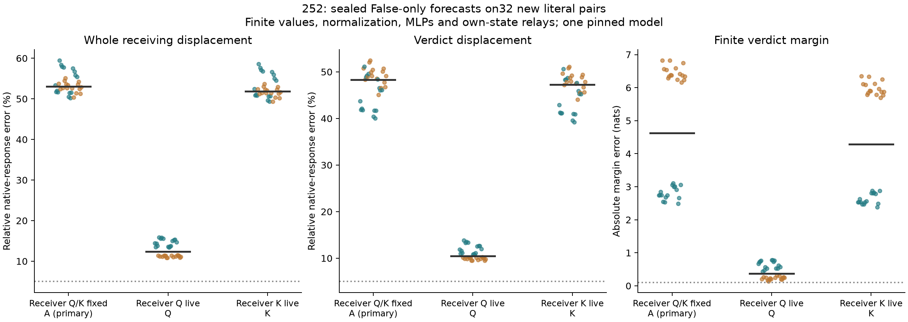

# Receiver query feedback recovers much more than key feedback

**Source-driven routing alone fails; adaptive receiver queries make the larger
difference.** With receiver queries and keys held at False, a known-edited source
and otherwise finite value/MLP computation leave53.07% median whole-displacement
error. Letting receiver queries adapt lowers it to12.40%; letting only receiver
keys adapt reaches51.82%. Every arm still has0/32 strict joint successes.
Question B remains open.

All32 new-literal forecasts were sealed, pre-audited and published at commit
`ea25c950f9622ea2418330f8b8fabe73642ff08c` before their native True measurements.
Their64 input hashes were absent from1,536 cataloged sequences. These are new
literals in the same dependent templates, on one pinned Qwen2.5-1.5B checkpoint.

## The alternative this tests

251b rejected fixed receiving attention probabilities. But changed source keys
could change those probabilities without any receiver query/key adaptation.
250b's late source-key clamp did not exclude an earlier source-key contribution.
252 tests that alternative without looking at native True receiving states.

All three forecasts start from the known True token edit and one ordinary False
computation. Prefix and source computation stay finite. Source keys/values are
therefore generated internally and, as checked after measurement, exactly match
native True at every layer. All receiver values, RMSNorms, MLPs, residual updates
and relay states evolve from their own forecast history.

- **A, primary:** False receiver queries and False receiver keys; live source
  key. Finite softmax can change routing from the source alone.
- **Q, secondary:** live receiver queries, False receiver keys; live source key.
- **K, secondary:** False receiver queries, live receiver keys; live source key.

Only receiving-query attention outputs are replaced. Prefix/source attention
outputs remain finite. There is no unknown True-state input and no derivatives.

## All outcomes, including the failures

Separately pooled medians across32 cases:

- A:53.07% whole error;48.34% verdict error;4.627-nat margin error.
- Q:12.40% whole error;10.43% verdict error;.372-nat margin error.
- K:51.82% whole error;47.30% verdict error;4.281-nat margin error.

Q's median whole/verdict cosines are .99244/.99469, and its signed verdict
projection is .98146 of the native response. That close direction and projection
still leave material vector/margin errors. They do not substitute for the
unchanged5% vector, .99 cosine, .10-nat margin criterion. A/Q/K each have0/32
joint successes and0/8 in every stratum. Q was a preregistered secondary, not
the primary A hypothesis.

Teal/orange denote generic/descriptive cases; black bars are pooled medians.
Every case is shown. The primary and secondaries share exactly the same input
pairs within252; comparisons between them are paired interventions, not
comparisons between251 and252 literal sets.

## A more concrete partial explanation

The receiver is not merely a fixed reader of the source's altered values.
New residual information changes its normalized query. That query changes how
it weights source/prefix/context values at later attention steps, whose writes
change subsequent residuals and queries again. The Q forecast keeps this
feedback while removing receiver-key adaptation; its improvement over A and K
supports its quantitative importance under these interventions.

The actual Q rule is explicit: receiver queries come from the forecast's own
`rotary(q_proj(RMSNorm(state)))`, keys before the source stay on the unchanged causal
prefix, the source key is computed from the known edit, receiver keys come from
the False cache, and all values/MLPs/readout remain finite. This is a stateful
nonlinear forecast, not a fixed linear readout or a hidden oracle trajectory.

This constrains the computation without identifying learned features. It also
does not prove that receiver-key effects are negligible: their omission leaves
the Q arm's remaining error, and restoring them changes the evolving queries
as well. The finite interaction T−Q−K+A is retained across all layers and scopes.
These are defined interventions with different internal histories, not unique
additive causal percentages.

## Qualification, budget and remaining work

Every zero-edit and current-QK native control replays every tail coordinate and
score exactly. Every A/Q/K source row equals native True exactly. The separate
auditor passes952 composed-output, exact-installation, replay and finite-head
checks, maximum error3.591e−5. Its fixed witness coverage is four schema/order
contexts at blocks1/14/28, all7 arms. It is not a full independent reconstruction.

The numerical boundary is declared before this experiment: composed CPU64
QK→softmax→PV probability/output tolerance1e−4, finite heads .005; raw-logit
checks are recorded separately.28/84 raw-logit checks fail their original
1e−4 absolute criterion, maximum .005373. They remain failed. This is the
same explicit output-level boundary as251b, not an unchanged raw-QK pass.

Budget:160 forecast-phase plus64 native/control full forwards;4,480 additional
QK, softmax and PV products **each**;84 witness QK products. The original finite
attention calls also execute. There is no speedup claim. Numerical audits are
additional work. All outcomes and array hashes remain available.

We now have evidence for a source-value channel whose downstream effect depends
substantially on receiver query feedback. What remains is to explain the
quantitative error left by the Q forecast and test a more economical account
of how query changes are generated. Full native-response prediction from a
useful smaller computation budget, generalization beyond these templates and
learned-circuit identification remain unestablished.

[Frozen protocol](../experiments/252-source-driven-attention.md)
· [Complete evidence](../../results/source-driven-attention-252/README.md)
· [Producer](../../research/boolean_coupling/attention252.py)
· [Separate auditor](../../research/boolean_coupling/audit252.py)
