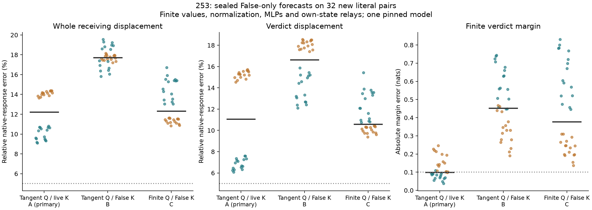

# A correct query tangent still misses the finite native displacement

The defined False-state RMSNorm tangent passes its independent numerical
checks, but its primary full-response forecast has **0/32 joint successes**.
With live receiver keys, median whole-displacement error is 12.21%, verdict
error 11.06% and margin error .0990 nats. Accurate local derivatives and a nearly
acceptable scalar margin do not establish full-vector counterfactual accuracy.

All 32 forecasts were sealed, pre-audited and publicly committed at
`dae0562d00f076e0c5e896c18111a402f8c28987` before native True measurements.
The 64 hashes were absent from 1,600 published catalog sequences. These are new
literal pairs in dependent templates on one pinned Qwen2.5-1.5B-Instruct model.

## What was predicted

For each receiving row and layer, False supplies residual x0, actual normalized input z0,
learned RMSNorm weight gamma and eps. At the forecast's own current residual
x0+d, predict the query-projector input as

`z_hat = z0 + gamma*(d/s0 - x0*mean(x0*d)/s0**3)`.

The model's ordinary query projection, bias and rotary map then act on z_hat.
Source queries remain finite; receiver values, keys unless clamped, MLPs,
softmax, residual updates and final head remain finite at their own states.
This uses no observed native True receiving state or oracle source input.

- **A, primary:** tangent query map, live receiver keys:12.21% whole error,
  11.06% verdict error, .0990-nat margin error.
- **B:** tangent queries and False receiver keys:17.72% whole error,
  16.63% verdict error, .4520-nat margin error.
- **C:** finite queries and False receiver keys:12.32% whole error,
  10.58% verdict error, .3772-nat margin error.

Every arm has 0/32 joint successes and 0/8 in every schema/order stratum. A's
median verdict signed projection is .99698 of the native response, while its
verdict cosine is .99334. That does not remove its 11.06% vector error. The
unchanged criterion requires whole AND verdict error <=5%, cosines >=.99 and
absolute margin error <=.10 nats. All values are separately pooled medians.

This is a controlled query-normalization intervention with different evolving
histories. A−T and B−C do not isolate unique learned features, nor do similar
norms establish the same displacement. The finite policy interaction T−A−C+B
is retained for every layer and scope.

## What is actually qualified

All zero-edit tails/scores replay False exactly; post-seal current-QK controls
replay native True exactly. Every forecast's source trajectory and first-block
tail are exactly native True. The later discrepancy is therefore not a wrong
source or initial-block explanation.

The separate auditor validates the declared smooth CPU64 RMSNorm tangent by
centered differences at 1e−3/1e−4 on actual forecast directions. The pre-native
maximum derivative discrepancy is 1.165e−7. This is not a certificate for
the cast-containing Float32 implementation's derivative or any whole-block
Jacobian; earlier disputes remain unresolved.

It also reconstructs the installed query input, public-weight query projection,
rotary factors, QK, masked softmax and PV. 1,372 composed-output, installation,
derivative, replay and finite-head checks pass; maximum passed-check error is
1.935e−5. Output tolerance stays 1e−4; finite-head bound .005. Witness coverage
is four fixed schema/order cases at blocks 1/14/28, all 7 arms, not a full
independent reconstruction of every layer/case.

Raw coordinate differences are deliberately separate: 84/252 raw projection,
rotary and scaled-QK checks fail their original 1e−4 absolute criteria; maximum
raw discrepancy .006614. They remain failed. The composed-output boundary
was declared before this experiment, not revised after its outcomes.

## Interpretation and budget

The tested tangent map is numerically sound as defined, yet omitting finite
query-normalization curvature changes the generated trajectory materially.
That curvature is RMSNorm geometry, not evidence of two opposing learned
mechanisms. The next question is whether its missing term can itself be
predicted from the approximate trajectory, rather than obtained from native
True states or the current pass's exact query normalization.

The completed study uses 160 forecast-phase plus64 native/control full forwards,
2,688 CPU64 tangent maps, 3,584 extra full QK/softmax/PV products each and 84
witness QK products. All original attention calls also execute; audits are
additional work. It does not provide a speedup or compact learned mechanism.

[Protocol](../experiments/253-query-generation.md)
· [Every case, derivative and raw-coordinate check](../../results/query-generation-253/README.md)
· [Producer](../../research/boolean_coupling/attention253.py)
· [Separate auditor](../../research/boolean_coupling/audit253.py)
