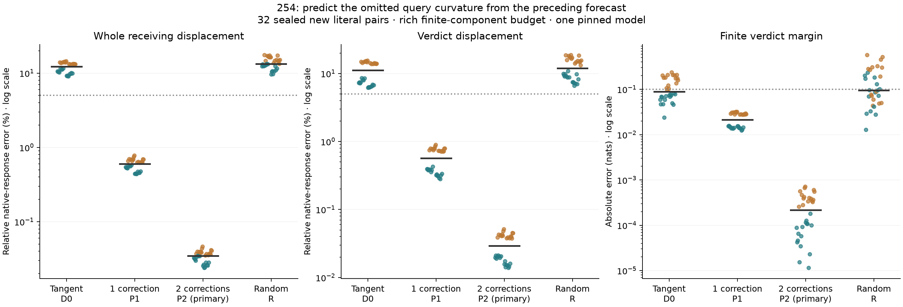

# Predicted query-curvature corrections close this full-response test

**The preregistered two-correction forecast passes 32/32 joint native-response
cases, including 8/8 in every schema/order stratum.** It predicts the whole
receiving displacement, verdict displacement and finite margin from one False
computation, the known edit, weights and its own preceding forecasts. No native
True receiving states enter any prediction. One correction also passes 32/32;
the tangent seed and matched random control both pass 0/32.

This closes the defined query-path forecasting test under a rich computation
budget. It is **not** a cheap counterfactual predictor, a learned circuit,
task-family generalization or a complete solution to Question B.

All 32 forecasts were sealed, separately pre-audited and publicly committed at
`d950e7b32333f957ec4aee2d11739cdc81b619d3` before native measurements. Their 64
input hashes were absent from 1,664 cataloged sequences. New literals reuse
dependent synthetic templates on one pinned Qwen2.5-1.5B checkpoint.

## The forecasted mechanism

253 replaced only receiver-query normalization by its False-state tangent.
The tangent was numerically correct as defined, but the finite trajectory was
wrong. 254 predicts the missing RMSNorm remainder instead of taking it from
native states or recomputing it at the current pass's receiver query.

Let f(x)=gamma*x/sqrt(mean(x²)+eps), x0 the False residual and J0 its smooth
RMSNorm derivative. A completed seed trajectory supplies receiving input xs.
Compute, for every layer and receiving row,

`E(seed) = f(xs)-f(x0)-J0*(xs-x0)`.

The next pass uses

`z_query = z0 + J0*(x_current-x0) + E(seed)`.

Its own residual, keys, values and MLPs continue to evolve. The curvature term
stays frozen from the preceding pass. Source/prefix computation remains finite
and causal, so source states are generated from the known edit rather than
supplied by an oracle. The zero-edit case has exactly zero remainder.

First D0 uses the tangent alone. P1 uses E(D0). Primary P2 uses E(P1).
Exactly two iterations were chosen before data, without fitting gains, selecting
layers/neurons or using native True trajectories. The random control R uses
directions matched to E(D0)'s norm separately per receiving row/layer.

## Outcomes

Separately pooled medians across 32 new pairs:

- **D0, tangent seed:** 12.30% whole-displacement error; 11.14% verdict error;
  .08922-nat margin error; 0/32 successes.
- **P1, one predicted correction:** .5988% whole error; .5667% verdict error;
  .02145-nat margin error; 32/32 successes.
- **P2, two predicted corrections, primary:** .03488% whole error; .02921%
  verdict error; .0002174-nat margin error; 32/32 successes.
- **R, norm-matched random correction:** 13.30% whole error; 12.00% verdict
  error; .09565-nat margin error; 0/32 successes.

The unchanged joint rule requires BOTH receiving/verdict relative errors <=5%,
cosines >=.99, native norms >=.001 and margin error <=.10 nats. P2's worst case
has .04620% whole error, .05119% verdict error and .0007096-nat margin error.
No primary outcome is rescued by reporting only a scalar margin. D0/R illustrate
why that distinction matters: their median margins look close to the bound
while their vectors are inaccurate.

Teal/orange denote generic/descriptive cases; black bars are pooled medians.
All axes are logarithmic; dotted lines mark the declared error bounds.
Every case is shown. The original linear-axis figure is retained alongside the
presentation-only revision and its source/data provenance. The matched random control matches input-remainder norms,
not query-projection effects or on-manifold validity. Its failure supports the
specific predicted correction, without assigning it semantic meaning.

## Why this can work

The query-normalization remainder is finite RMSNorm geometry, not two opposing
learned mechanisms. The current query needs a nonlinear correction, but a
coarse trajectory can already estimate that correction well enough to improve
the next trajectory. Updating the estimate once more reduces the remaining
error further. This is a fixed defect-correction scheme.

For this primitive, the sensitivity of the omitted remainder is
`J_RMS(x0+d)-J_RMS(x0)`. It can therefore be smaller than the derivative of
the complete normalized state near x0. The observed iteration is consistent
with that explanation. Two successful steps on these contexts are not a proof
of contraction, a universal stability theorem or a new principle of attention.

This extends the preceding source-value/query-feedback account: a nonlinear
query term omitted by the first-order surrogate is predictably consequential
after feedback, and its forecast can close the measured residual/margin gap
when the rest of the declared computation remains finite.

## Numerical qualification and controls

The separate auditor reconstructs every E(D0), E(P1) and seeded random control
from False coefficients and saved forecast inputs at all 28 blocks/cases. It
also qualifies the smooth tangent by CPU64 centered differences and reconstructs
the public-weight query projection, rotary map and composed attention output.
5,268 passed checks have maximum discrepancy 3.638e−5. Endpoint heads retain
.005 bounds; composed probabilities/outputs retain 1e−4. Witness coverage is
four fixed schema/order cases at blocks 1/14/28, all 8 arms, not an independent
full-forward reconstruction of every case/layer.

All forecast source trajectories and first-block tails match native True
exactly after measurement. Zero-edit False and current-QK True controls replay
all 28 tails and scores exactly. Native measurements begin only after the
global public forecast seal and remote proof.

Raw coordinate checks remain separate: 96/288 query-projection, rotary and
scaled-QK comparisons fail their original absolute 1e−4 criteria, maximum
.007185. None is relabeled passed. The composed-output boundary was declared
before this run. The smooth primitive tangent checks do not resolve older
Float32/whole-block derivative disagreements.

## Computation budget and what remains open

The completed experiment uses 192 forecast-phase and 64 native/control full
forwards, 4,480 CPU64 tangent maps, 1,792 seeded curvature-map evaluations,
1,792 extra full QK/softmax/PV products each and 96 witness QK products. The
scientific P2 algorithm itself uses one False pass, a tangent seed and two
correction passes. Zero/random/oracle arms are additional controls. Original
attention calls also execute; numerical audits are additional work.

This costs **more** than an ordinary edited forward. Keys, values, MLPs,
normalization outside the modified query branch and source computation remain
substantial finite model work. The experiment establishes that this particular
query correction can be predicted without native True measurements; it does
not explain all those remaining learned computations or replace them with a
compact single-state model. Question B's broader mechanistic and useful-budget
requirements therefore remain open despite the successful bounded forecast.

[Frozen protocol](../experiments/254-predicted-query-curvature.md)
· [Every outcome, source, check and receipt](../../results/predicted-query-curvature-254/README.md)
· [Producer](../../research/boolean_coupling/attention254.py)
· [Separate auditor](../../research/boolean_coupling/audit254.py)
