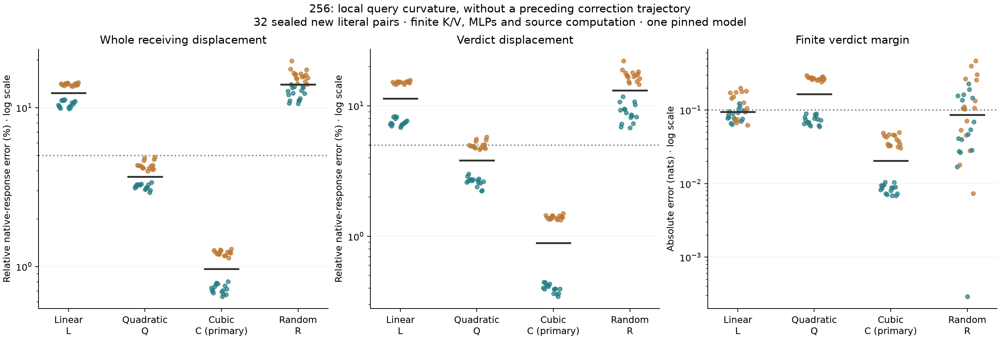

# One-pass cubic query curvature passes the full-response test

**The frozen cubic primary passes 32/32 native-response cases, 8/8 in every
schema/order stratum, without a preceding correction trajectory.** Median
whole-receiving displacement error is **0.9667%**, verdict error **0.8875%**
and finite margin error **0.02047 nats**. The forecast uses one False computation,
the known edit, weights and its own evolving states.

This removes 254's complete seed and correction trajectories from the query
account: three forecast passes become one. Substantial finite source, K/V and
MLP work remains. It does not establish a cheaper alternative to ordinary native
inference or solve Question B's learned generator and generalization questions.

## Why this test follows from 254–255

254 showed that the missing nonlinear query-normalization term can be predicted
from a previous approximate trajectory. 255 then supplied an exact two-scalar
RMSNorm identity and checked local Taylor approximations on already observed
states. Quadratic terms left 25.49% median local native-remainder error; cubic
terms left 5.37%. This retrospective result motivated **cubic C as the primary**
before any fresh model forwards. No secondary is promoted after outcomes.

For False residual x0, actual normalized input z0 and current forecast
displacement d, define s²=mean(x0²)+eps, a=mean(x0*d)/s² and b=mean(d²)/s².
At every receiving row/layer, C uses

`z_query = z0 + J0*d + Q2(d) + Q3(d)`

where

`Q2 = gamma/s * [(1.5*a²-.5*b)*x0-a*d]`

`Q3 = gamma/s * [(1.5*a*b-2.5*a³)*x0+(1.5*a²-.5*b)*d]`.

The current forecast generates d; no previous complete forecast or unknown
native True state supplies it. Source/prefix query inputs stay finite and
unchanged. Receiver K/V, softmax, MLPs, residual updates and head remain finite
at their own evolving states. Shared normalization still executes for K/V;
its current exact normalized input is not used as the polynomial query estimate.

These are ordinary Taylor coefficients of normalization, not learned features.
Their usefulness through the complete declared computation is the tested claim.

## All outcomes and the informative failure

Pooled case medians, all 32 new literal pairs retained:

- **L, tangent baseline:** 12.40% whole error; 11.41% verdict error;
  .09468-nat margin error; **0/32** joint successes.
- **Q, quadratic secondary:** 3.681% whole error; 3.810% verdict error;
  .16499-nat margin error; **16/32**, all generic cases. Every descriptive
  case fails. The overall preregistered rule fails.
- **C, cubic primary:** .9667% whole error; .8875% verdict error;
  .02047-nat margin error; **32/32**. Worst-case whole error is 1.287%,
  verdict error 1.496%, margin error .04959 nats.
- **R, random directional control:** 13.97% whole error; 13.16% verdict error;
  .08680-nat margin error; **0/32**.

The unchanged joint rule requires whole AND verdict error <=5%, cosine >=.99,
native norm >=.001 and margin error <=.10 nats, with >=24/32 overall and >=6/8
each schema/order stratum. C clears the rule; Q does not.

Teal/orange are generic/descriptive cases; black bars are pooled medians.
Axes are logarithmic; dotted lines mark error criteria. No displayed values
hit the declared plotting floor. R matches the quadratic term's norm at R's
own inputs separately per row/layer. It does not match C's combined correction,
projected query effects or manifold validity.

Quadratic correction improves the vector while worsening the median margin.
That is a concrete reason to retain both vector and behavioral criteria.
The added cubic term causally changes the forecast computation and recovers
both metrics, including its effects through subsequent state feedback. These
different evolving trajectories do not allocate unique learned path shares.

## A local convergence condition, checked after the outcomes

Along a fixed incoming displacement, smooth RMSNorm is
`gamma/s * (x0+t*d) * (1+2*a*t+b*t²)^(-1/2)`.
For nonzero d and positive eps, Cauchy–Schwarz gives a²<b. The quadratic's
complex roots therefore have modulus `1/sqrt(b)`. The local Taylor series
converges at the unit edit t=1 when b<1.
Here t scales a fixed local receiving vector; it is not the input-edit parameter
propagated through the complete transformer.

A separately source-bound, **posthoc, model-free** diagnostic checks every
saved receiving input. C's largest b is .220802, giving minimum series radius
**2.128**; all 32 cases are inside the unit-edit radius. Native inputs give
almost the same bound. This qualifies a local reason the Taylor expansion is
well behaved here; it is not a cubic truncation-error bound or a whole-network
stability theorem. Even the failed random arm's inputs satisfy this radius
condition, so the condition alone cannot explain final response accuracy.
All 4,320 Cauchy–Schwarz checks pass. [Complete diagnostic](../../results/local-query-curvature-256/local-radii.json).

## Seals, controls and numerical qualification

All forecasts and their separate pre-audit were globally sealed and publicly
committed at `03063206dfd2c0ba14196ffe6406d30e0f793717` before native True
measurements. The 64 input hashes were absent from 1,728 cataloged sequences.
Cerulean/umber literals still use dependent synthetic templates on one pinned
Qwen2.5-1.5B checkpoint; this is not task/checkpoint or independent-team replication.

Every forecast's complete source trajectory and first-block tail match native
True exactly after measurement. Zero-edit and current-QK native controls replay
every block tail and score exactly. The finite endpoint head is separately
reconstructed. There is no native receiving-state oracle in a forecast.

The separate auditor validates installed query inputs at every modified
case/arm/layer and compares all three polynomial coefficients with a generic
power-series recurrence. Fixed witnesses also qualify smooth RMSNorm first and
second directional derivatives, public-weight query projection, rotary and
composed attention probabilities/outputs. **20,560 declared checks pass**;
maximum passed discrepancy **3.636e-5**. Output bounds remain 1e-4 and finite
head bounds .005. Witness coverage is four fixed strata cases at blocks
1/14/28, all eight arms, not an independent whole-forward reconstruction.

The original raw projection/rotary/QK absolute checks remain separate:
**96/288 fail** their original 1e-4 bound, maximum **.007251**. They remain
failed. The composed-output boundary was declared before the run. Smooth
primitive derivative qualification does not recertify older Float32/whole-block
derivative disagreements.

## Computation and the remaining Question B

The primary scientific algorithm uses one ordinary False pass plus one C
forecast pass. The completed study including all controls uses 192 forecast
and 64 native/control full forwards, 4,480 CPU64 tangent maps, 2,688 quadratic
maps, 896 cubic maps, 1,792 extra full QK/softmax/PV products each, and 96
witness QK products. Numerical audits are additional work. This is not a
wall-clock speedup measurement or less computation than ordinary edited inference.

The query-path approximation no longer needs a complete prior trajectory to
meet the stated native-response accuracy. But finite source/value/MLP operations
still generate the particular d on which this local rule acts. Explaining or
replacing those learned computations under a useful budget remains the main
Question B. Extending Taylor order at this already qualified query primitive
would refine accuracy; it would not by itself answer that generator question.

[Frozen protocol](../experiments/256-local-query-curvature.md)
· [All cases, receipts and checks](../../results/local-query-curvature-256/README.md)
· [Producer](../../research/boolean_coupling/attention256.py)
· [Separate auditor](../../research/boolean_coupling/audit256.py)
