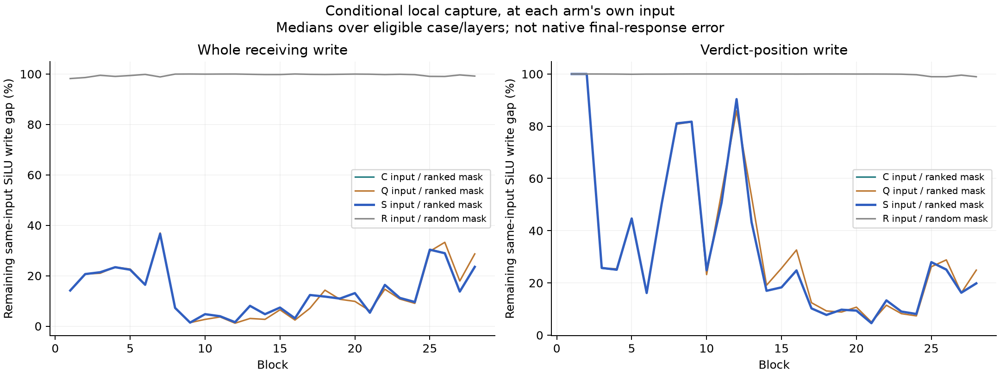

# A fixed 1% finite-SiLU rule forecasts the native response

**Result:** the preregistered primary passes the joint residual/verdict/margin
criterion in **32/32 new literal pairs**, including 8/8 in every schema/order
stratum. Quadratic SiLU everywhere passes 0/32; a row-count-matched random 1%
restoration also passes 0/32. This is a bounded prospective result under an
explicit component budget, qualified by the separately frozen **258b** numerical
boundary. The original numerical protocol did **not** pass unchanged.

[Protocol](../experiments/258-receiver-mlp-curvature.md) ·
[Numerical revision](../experiments/258b-matched-projection-qualification.md) ·
[Every case, checks and seals](../../results/receiver-mlp-curvature-258/README.md) ·
[Producer](../../research/boolean_coupling/mlp258.py)

## What this tests that the earlier local repair did not

Experiment240 recovered a missing SiLU contrast at one MLP, conditional on its
incoming state. Its forecast input was inaccurate and the local repair did not
predict the native response. Experiment256 subsequently supplied an accurate
query-feedback rule: a cubic RMSNorm update evaluated at the forecast's own
evolving inputs. Experiment258 holds that query rule fixed and applies the
same 1% activation-selection rule at **every receiving MLP**, from block1 onward.
No native receiving state or selected list of favorable layers is supplied.

The 32 pairs contain new indigo/vermilion literals: all64 complete token hashes
are absent from the catalog of1,792 earlier token sequences. They remain
dependent synthetic templates in one Qwen2.5-1.5B checkpoint, not32 independent
tasks or a cross-model replication.

## The frozen rule

Cache the actual False gate and SiLU activation. At each forecast MLP input,
compute its current gate and up value. Approximate SiLU by its False-anchored
quadratic. An analytical third-derivative bound gives a bound B on its local
beyond-quadratic remainder. Rank receiving neuron/position coordinates by

`B × abs(current up) × norm(down-projection column)`.

In each layer restore finite public SiLU on exactly `floor(.01*N)` ranked
coordinates; use the quadratic at the others. Stable tie handling is frozen.
The mask sees the False computation, the forecast's own gate/up values and
weights. It sees neither native True gates, actual omitted SiLU tails, a final
readout direction nor measured outcomes. Source and earlier causal-prefix rows
remain finite. The dynamic mask is not a fixed set of learned neurons.

The four forecast arms are:

- **S, primary:** ranked1% finite SiLU; quadratic at the remaining coordinates.
- **Q:** quadratic SiLU at every receiving coordinate.
- **R:** random1% finite SiLU, matching the ranked count separately in every row
  at R's own input; fixed case/layer/row seeds.
- **C:** finite SiLU everywhere, the cubic-query reference.

All retain finite source computation, receiving K/V, softmax, MLP input RMSNorm,
gate/up/down projections, gate–up products and final readout. Receiver query
RMSNorm alone uses the previously qualified cubic rule. Thus **the remaining
99% are quadratic, not linear**, and this is not a complete sparse transformer.

All forecasts and the qualified pre-audit were publicly committed in
[`0c834b9`](https://github.com/romrom-20/counterfactual-traces/commit/0c834b9d7cd65ac2a0eb8867ae456f696e52d8a6) before native True
measurements. The saved remote proof and per-case timestamps bind that order.
Native states were used afterward only to score the sealed forecasts.

## Native outcomes

Every arm is scored by the unchanged joint rule: whole receiving **and**
verdict displacement relative error≤5%, cosine≥.99, native norms≥.001, and
finite true-minus-false score-margin error≤.10nats. The registered aggregate
rule requires≥24/32 overall and≥6/8 in each stratum; C must also pass it.
All cases stay in the denominators.

- **S:32/32.** Median whole error **2.1253%**, verdict error **1.9586%**, margin
  error **.006781nats**. Worst errors:2.8351%,3.0666%,.03849nats.
- **Q:0/32.** Medians **40.7928%**,31.4020%,**2.5582nats**.
- **R:0/32.** Medians **39.5257%**,30.6979%,**2.2654nats**.
- **C:32/32.** Medians **1.0469%**,.8890%,**.02308nats**.

S's smaller scalar margin error than C does not establish a better model of
the displacement: its vector error is larger. Approximation errors can partly
compensate in a scalar readout. Do not interpret this as two competing learned
mechanisms or as evidence for an optimally selected mask.

Each point is a case; teal/orange distinguish generic/descriptive schema, black
bars are medians, dotted lines show error bounds. Axes are logarithmic; the
joint rule also includes cosine and native-norm guards, retained in the CSV.

## Signed local effects and actual interventions

At each arm's **own** MLP input, save the complete finite-minus-quadratic write
G, selected-coordinate contribution V and unselected contribution U. These are
full receiving vectors projected through the public learned down matrix.
V+U closes G within the unchanged1e-4 bound. S/R also install their products
before the actual down projection and continue the network. The native results
above therefore test the implemented interventions, beyond posthoc projections.

For S's eligible case/layers, the median remaining local whole-write gap is
**13.02%**; the median signed projection share is **.9834**. At the verdict row
they are20.85% and.9464. R leaves99.71% of the whole gap. A large parallel share
does not mean98% full-vector recovery: orthogonal error remains. These local
numbers concern the SiLU approximation gap at different evolving inputs, not
unique percentages of the native behavioral effect. Zero/ineligible vectors
remain recorded with an explicit1e-8 norm guard.

## Numerical qualification: preserve the original failure

The original pre-audit stops at a CPU64 whole-down-projection discrepancy of
**.0002710**, above the frozen1e-4 bound. Across72 forecast witnesses,24 fail
that bound, maximum **.000735865**. This affects ordinary False and zero-edit
controls as well. The original failure and source remain unchanged.

A separate primitive replay finds all72 **full-sequence-shape public Float32**
down projections exact. Even sliced receiving-row Float32 projections differ
by up to.000747681. This supports a shape-sensitive arithmetic boundary, not
the claim that the original CPU64 checks passed.

Before any native measurement,258b freezes exact matched-full-shape replay for
this whole-primal bridge and retains every CPU64 error at its original bound.
All other checks and behavioral criteria stay unchanged, including CPU64 signed
component bridges, independent SiLU derivatives/finite differences, masks,
installed products, cubic-query coefficients, composed attention and finite head.

The qualified final audit passes **20,016** checks, maximum absolute discrepancy
**6.039e-5**, and all96 matched-shape down replays are exact. Separate raw checks
remain **failed**:96/288 projection/rotary/QK comparisons (maximum.007185), and
32/96 CPU64 whole-down comparisons (maximum.000735865), both at1e-4. The audit
covers fixed witnesses at blocks1/14/28 in four contexts, plus live checks
throughout; it is not an independent full-model real-arithmetic reconstruction.
Older whole-block derivative disputes remain unresolved and are not used as a
new primitive attribution.

Zero-edit replays match False exactly in all28 tails and scores. Current-QK
native controls match True exactly. C/Q/S/R source trajectories match native
True exactly; C also matches its required first-block full receiving tail.
Q/S/R can differ there because they already modify the first receiving MLP.
No frozen instability guard fires.

## Budget and answer to Question B

S restores **361,088 of36,126,720** evaluated receiving coordinates: .999504%,
never more than1% in a layer. This is an activation-approximation budget.
Instrumented public SiLU still executes on all coordinates before hook
replacement; **no speedup is measured or claimed**.

The complete experiment uses192 forecast forwards and64 native/control
forwards;4,480 each query tangent/quadratic/cubic maps and SiLU selections;
8,960 SiLU finite-difference checks;896 False MLP anchors;14,336 extra receiving
down projections;1,792 extra full QK/softmax/PV each;96 witness QK calculations.
Column norms and independent audits are additional. The numerical investigation
adds144 public projections, the qualified pre-audit72 and final audit96.

The predictive part of Question B now has a stronger bounded answer: with
accurate query feedback and the other declared finite components, a fixed rule
can allocate a small beyond-quadratic SiLU budget from its **own** evolving
states and forecast native residual and verdict on these fresh literals.
Random allocation cannot substitute for that rule. This goes beyond the old
single-site conditional repair.

It does not identify the model's learned semantic generator, show that all
other finite operations are necessary, establish useful compute savings,
validate another template/checkpoint, or fully solve Question B. The separate
[259 score-factor diagnostic](259-silu-score-factors-result.md) asks what makes
the ranking effective locally; its simpler variants are not fresh global tests.
