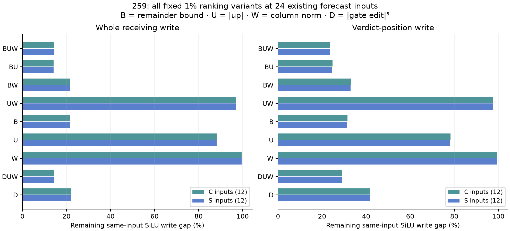

# What drives the successful mask's local ranking?

**Retrospective result:** dropping the SiLU remainder-bound factor sharply
weakens local recovery. Dropping the down-column norm has little effect in
these saved inputs. This constrains a possible explanation of258's mask; it
does not validate a simpler global forecast or identify learned features.

[Frozen diagnostic](../experiments/259-silu-score-factors.md) ·
[All432 records and checks](../../results/silu-score-factors-259/README.md) ·
[Code](../../research/boolean_coupling/score259.py)

After258's outcomes were known, freeze a model-free comparison on **all saved
C/S MLP witnesses**: four contexts, blocks1/14/28, two forecast arms,24 fixed
inputs. These are forecast receiving states, not24 independent tasks or the
complete32-context/all-layer population. No new model forward or native
measurement is performed. C/S block1 inputs coincide and are not independent.

At each identical input, apply nine prespecified ranking scores at the same
floor1% budget: BUW, BU, BW, UW, B, U, W, DUW and D. B is258's analytical
remainder bound, U=abs(current up), W=down-column norm, D=abs(gate edit)^3.
The actual SiLU tail is used only afterward to calculate each masked vector.
All local signed vectors, remaining-gap errors, mask overlaps and both whole
and verdict scopes are reported; no score is selected for a new global test.

## Results of the two frozen questions

Removing B leaves **.9705** median whole-gap-relative error, versus **.1435** for
BUW: **6.7644×** as much remaining error, exceeding the registered2× criterion.
Thus up magnitude and down-column norm alone do not find these large omitted
activation contributions.

Removing W, giving BU, adds at most.05 whole-gap-relative error in **24/24**
inputs, exceeding the registered18/24 criterion. Median BUW-mask overlap is
95.5% for C and95.4% for S. The small variation supplied by W is not required
for similar local capture in this witness set. This is not an equivalence test
on all layers or a fresh validation of BU.

Other prespecified comparisons keep the account honest. B alone leaves about
21.56% median whole-gap error; adding up magnitude lowers it to14.20%. U alone
leaves88.23%; W alone99.48%. Replacing B with D while retaining U/W leaves
14.53%, close to BUW's14.35%, with96.37% median mask overlap. The full interval
bound is therefore not shown uniquely necessary: much of this local selection
can be associated with the cubic gate-displacement scale. Its verdict-row
remaining error is worse (about29.0–29.2%, versus23.6–23.7% for BUW).

Bars show medians over12 existing inputs per arm, for every score in protocol
order. These are conditional local write-gap errors, not final native errors.
Complete per-input signed effects remain in the CSV, including norm guards.

## Checks and limits

All72 numerical checks pass, maximum **3.99134e-5** against1e-4 where applicable.
Original BUW masks reconstruct exactly; their saved component and complete
local gap agree within the original bounds. The calculation inherits258b's
component-projection qualification and does not repair its failed raw whole
CPU64 projection checks or the older derivative dispute.

The alternative masks are mathematical fixed-input diagnostics, not actual
new global neuron-product interventions. Their effects on evolving incoming
states, final residual and margin are unmeasured. These results motivate a
future frozen simpler-rule test on fresh inputs; they do not authorize another
unrestricted correction sweep or a claim that a fixed learned circuit was found.
