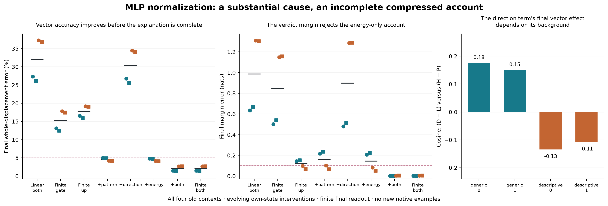

# What MLP normalization contributes to the counterfactual response

**A substantial part of the missing gate displacement comes from nonlinear
normalization of the receiving state. Correcting its largest local term is
still insufficient to explain the final verdict.** The gate and up branches
both matter under the tested intervention, and a term's final vector effect
changes with the background on which it is applied.

These are retrospective interventions on four old contexts, not fresh
confirmation, a compact predictor, or a solved Question B. The earlier
[32/32 fresh prediction result](258-receiver-mlp-result.md) remains the bounded
predictive result under its richer component budget.



All points are shown. Teal denotes generic schema, orange descriptive; circles
and squares distinguish the two orders. Black ticks are medians. Dashed lines
show the original vector and margin tolerances. Joint success also requires
verdict-vector error and cosine bounds. The right panel compares complete
effects through evolving states, not local features or same-input products.

## The gap this addresses

The successful sparse SiLU rule computes its gate changes using substantial
finite MLP computation. That leaves a generation question: is the gate change
mostly a linear projection of the receiving residual change, or does the
normalization before that projection create a consequential missing term?

We keep the qualified cubic-query and ranked 1% SiLU rules fixed, intervene on
MLP input normalization at all 28 layers, and let each arm evolve from its own
state. Source/prefix computation, K/V, softmax, learned projections, gate–up
products and final readout remain finite. Forecast arms receive the False
cache, known edit and weights, never an observed True receiving state. Native
and accurate-forecast states are additionally used for **retrospective local
diagnosis**, explicitly separate from those inputs.

The four witnesses are the first saved context in each schema/order stratum
of 258. All use the indigo template and one Qwen checkpoint. They are neither
four independent tasks nor a new test set. The unmodified finite-normalization
reference exactly replays the old sparse forecast, and ordinary False/True,
zero-edit and source/prefix controls replay exactly.

## A small local error is consequential globally

Replacing finite MLP input RMSNorm by its False-state tangent changes the
median whole-displacement error from **2.06% to 32.08%** on these four cases.
Its joint native vector/verdict/margin criterion passes **0/4**, versus **4/4**
for finite normalization. A cubic normalization approximation passes 2/4;
norm-matched random corrections pass 0/4. These outcomes do not imply that
increasing Taylor order is the scientific explanation.

The local calculation is more precise. At all 112 layer/context inputs in both
the native and accurate-forecast trajectories, first-order normalization leaves
about **13% median error in the complete gate displacement**. All 112 whole
inputs robustly reject the 5% local criterion even after accounting for the
measured arithmetic discrepancy. This is not an assertion that all of the
gate change is nonlinear, or that an inaccurate incoming forecast alone causes
the local failure. Selected 1% coordinates are less uniform: 37/112 pass the
local criterion. See [all local and global records](../../results/mlp-normalization-origin-261-264/mlp-input-bounded-261d/).

## What the normalization term actually does

For an ideal smooth RMSNorm, let the False receiving input be x₀, the current
displacement d, s² = mean(x₀²) + ε, a = mean(x₀d)/s², b = mean(d²)/s², and
ρ = (1 + 2a + b)⁻¹ᐟ². With f₀ = γx₀/s and v = γd/s,

    finite normalized displacement = (v − a f₀) + P + D
    P = (ρ − 1 + a) f₀
    D = (ρ − 1) v

The first parenthesis is the False tangent. P rescales the existing normalized
pattern; D rescales the projected new direction. The same decomposition passes
through either learned gate/up projection. This is ordinary normalization
geometry, not two learned mechanisms or newly discovered features. Actual
public False outputs anchor the interventions; the complete smooth
factorization has a separately measured Float32 rounding control below.

The existing-pattern term has about 97.7% median signed projection on the
complete gate curvature in these inputs. **That is not 97.7% vector accuracy.**
The predeclared baseline-only curvature account misses its accuracy/cosine
target: 98/112 whole inputs pass, below the required 90%, and only 62/112
forecast selected-coordinate inputs pass. Its primary hypothesis fails.

A secondary approximation E = −b f₀/2 uses displacement energy to rescale the
existing pattern. Adding E to the tangent predicts the complete whole gate
displacement within 5% at all 112 saved native and forecast inputs. That is a
local result, not permission to assume it composes into correct behavior.
[Exact factor records](../../results/mlp-normalization-origin-261-264/gate-curvature-factors-262/).

## Direct interventions reject the sufficient-small-term story

The next run freezes eleven arms, 44 full forwards in total. The decisive
contrasts are:

- **Finite normalization only at the gate input:** 0/4 joint passes,
  15.27% median whole error. The up branch keeps its tangent.
- **Finite normalization only at the up input:** 0/4, 17.80% whole error.
  The gate branch keeps its tangent. Its margin can be much closer while the
  vector remains wrong.
- **Tangent plus P in both branches:** 1/4 joint passes, 4.55% whole error.
- **Tangent plus D in both branches:** 0/4, 30.44% whole error.
- **Primary energy approximation E in both branches:** 2/4, 4.44% whole error.
  Both vector criteria pass in every case, but generic-schema margins miss by
  .208 and .225 nats, above the frozen .10-nat tolerance.
- **Tangent plus P and D in both branches:** 4/4, 2.06% whole error,
  .00216-nat median margin error. The finite reference also passes 4/4.

Thus correcting either branch alone is insufficient in this budget. Correcting
the dominant term supplies a large real improvement, but misses a smaller
behaviorally consequential component. The complete-factorization arm differs
from the finite reference by at most .00112% of native whole displacement and
.0000115 nats in the margin, passing all four predeclared rounding controls.
It approximately reconstructs the finite normalization already present in the
reference; it is not a new economical predictor.

The gate/up factorial has a nonzero full-vector interaction, retained in the
release. It does not support unique additive percentages of the native effect.
[All 32 outcome rows, failures and interactions](../../results/mlp-normalization-origin-261-264/normalization-branches-energy-263/).

## Why the dominant correction does not settle the behavior

The existing arms also cross the two normalization terms. Calling their
trajectories L, P, D and H, the effect of adding the direction term is D−L on
the linear background and H−P when the pattern correction is present. Their
difference is the exact global policy interaction H−P−D+L.

At the final verdict position, the two effect vectors have cosine **.176 and
.151** in the generic cases and **−.134 and −.107** in the descriptive cases.
The margin effect also changes: in the descriptive cases, .024 and .014 nats
alone become .106 and .072 nats when P is present. A small local term therefore
cannot be dismissed using its isolated final effect or local norm alone.

This is an intervention contrast through evolving states. Different policies
change later inputs, masks, products and attention reads. It does not locate
which local learned operation produces the difference. In particular, it is
not a same-input primitive decomposition or evidence of a learned feature.
[All 28 blocks and signed contrasts](../../results/mlp-normalization-origin-261-264/normalization-component-interaction-264b/).

## Numerical and implementation qualifications

The original strict checks do **not** all pass. The record preserves:

- Original 261 reused an output-path variable and temporarily overwrote four
  old native metadata JSONs. Exact originals were restored from the immutable
  published release; original arrays were unchanged. The corrected 261b run
  repeats all 28 forwards and exactly replays all 56 saved trajectory/score
  fields. Its output records have distinct, guarded destinations. The original
  auditor also has an invalid import. **Do not run preserved `input261.py`.**
- Strict 261b fails a CPU64 projection primal. Full-coverage 261c finds exact
  full-sequence-shape public Float32 replay in 1568/1568 comparisons, while
  **27/1568 CPU64 primals still fail their original 10⁻⁴ tolerance**. The next
  strict audit fails a displacement bridge too: **8/448 such checks fail**.
- Separate 261d preserves those failures and bounds public local error using
  the measured smooth/public arithmetic difference. All 20,792 declared
  checks pass. That measured difference is not a prospective rounding repair.
- 263 declares its Float32 boundary before its forwards: all 2464 matched-shape
  gate/up projection replays are exact and all 35,480 declared checks pass;
  **41/2464 CPU64 primals remain failed** at their original tolerance. Smooth
  RMS derivatives pass AD at 10⁻⁹ and two finite-difference steps at their
  original bounds. This does not certify a whole Float32 Jacobian or resolve
  older block-derivative disagreements.
- Original 264's final contrasts are correct, but its layer loop omits block 1
  and mislabels blocks 2–28 as 1–27. Preserve that output; use separate 264b,
  which asserts all 28 labels and complete row counts. Its 452 identity checks
  pass, with zero new model calls. 262's 8848 checks likewise add no forwards.

This is qualified evidence about defined public-node interventions. It is not
independent whole-model real-arithmetic reconstruction. All failed checks,
source seals, case metadata and raw-array hashes remain in the
[release](../../results/mlp-normalization-origin-261-264/README.md).

## What this answers, and the remaining mechanism

The current account is: the edit changes the receiving state; normalization
changes how both the old activation pattern and new displacement are scaled;
both learned MLP branches read those changes; their writes then alter the
states used by later computation. Removing normalization curvature materially
damages the forecast. A locally dominant rescaling term explains much of that
damage, but not the complete vector and behavioral dependency.

The unresolved step is which learned directions, multiplicative terms and
later state changes turn the smaller remainder into the missing verdict
effect, and whether that can be predicted with substantially less finite work.
The next useful discriminator is a same-input gate/up product intervention
separating local transmission from later state feedback, with fixed versus
adaptive masks declared separately. It should precede a new correction sweep
or fresh sufficiency claim. General Question B remains open.

## Reproduction

Use the pinned [model environment](../../research/boolean_coupling/requirements-recorded.txt)
and the [normalization commands](../../research/README.md#mlp-normalization-origin-and-branch-interventions).
The study starts from locally regenerated 258 arrays, not just its public CSVs.
Inputs are public synthetic prompts; all exact token IDs and checkpoint/runtime
seals are retained. New output directories are required. Never overwrite old
evidence or run the preserved invalid producer. Large arrays remain local and
are inventoried; no private article is included.

```sh
python -S research/boolean_coupling/verify_normalization.py
```

This standard-library check validates released hashes, case counts, decisions,
retained failures, algebraic summaries and figure provenance. It does not
recompute omitted tensors or independently replicate the model.
