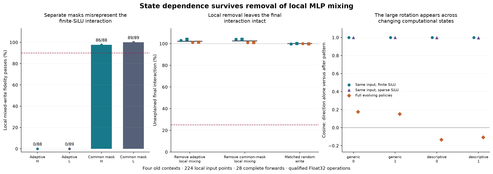

# Local mixing does not account for the final interaction

**Removing the pointwise MLP interaction at every receiving layer leaves the
final interaction intact. A separate control also catches an artifact in the
sparse approximation: accurate trajectories do not guarantee accurate local
interaction measurements.** Both results narrow the explanation; neither
identifies the learned computation behind the native Boolean response.

These are retrospective results on the same four old contexts, one checkpoint
and dependent templates. There are 224 saved input points and 28 new complete
forwards, not 224 independent examples or fresh prediction confirmation.



The first panel compares each sparse local mixed write against a fully finite
SiLU control. H denotes the accurate saved forecast input, L the inaccurate
tangent input. Eligibility uses a .001 mixed-write norm guard; all ineligible
rows remain published. The second panel shows every continuation case; 100%
means the final interaction is unchanged, 25% is the frozen error tolerance.
The third compares final-MLP same-input effects with full evolving-policy
effects. It is a contrast of defined interventions, not an identified circuit.

## The question left by the normalization experiment

[261–264](261-264-mlp-normalization-origin.md) found that nonlinear MLP input
normalization matters to the forecast. Its exact smooth remainder splits into
P, a rescaling of the existing pattern, and D, a rescaling of the projected
displacement. The dominant term alone improves the vector but misses behavior.
The final effect of D differs depending on whether P is present.

That did not establish why. The two final effects, D−L and H−P, were measured
through **different evolving states**. A local gate–up interaction and later
state dependence could both produce a global contrast. We now hold the MLP
input fixed while crossing the same four normalization policies: tangent L,
pattern P, direction D, and both H.

## The immediate mixed write needs more than the cross product

At every saved H and L input, all 28 layers and all four contexts, reconstruct
the learned gate/up projections, public SiLU and products. Use either a shared
H mask at all four corners, or each corner's own adaptive ranked mask. The
shared mask still varies with layer and input; it is not globally fixed.

For the shared mask, the product interaction decomposes exactly into a
gate-side mixed change, two gate–up cross products, up-path arithmetic
nonadditivity and explicit product/projection rounding vectors. These are
coordinate-defined quantities, not learned semantic features.

The cross product has a large median signed projection on the mixed write,
about 83%. **It still fails the registered vector account:** only 3/88 eligible
whole inputs at H and 2/89 at L meet 25% relative error and .95 cosine, far below
the required 90%. Median error is 38.7% and 38.1%. The gate-side nonlinear
change is also needed. A large signed share again does not establish complete
vector accuracy. The scope and all secondary components are retained in
[the local records](../../results/local-mlp-mixing-265-266/local-mixing-265/).

## Direct removal rejects local sufficiency

At each continuation MLP's own current input, calculate the four corner
products. Replace H's product by **product_P + product_D − product_L**. This
removes the pointwise mixed interaction while leaving the incoming state free
to evolve. One arm uses each corner's adaptive mask; a second uses a common H
mask. A matched control subtracts a seeded random write with the same per-row
norm as the actual local removal at the control's own input.

Compare the resulting final state with the old additive endpoint r_P+r_D−r_L.
The endpoint's verdict is evaluated with the **finite head**; scalar margins
are not added. The frozen account requires 25% interaction-vector error,
.95 cosine at whole and verdict scopes, and a separately specified finite
margin bound in at least 3/4 cases, with the random control passing at most 1/4.

Both local-removal arms pass **0/4**. The random control also passes 0/4. Their
median unexplained whole-interaction errors are **102.2%, 102.6%, and 100.0%**,
respectively. Removing the local interaction slightly *increases* the distance
from the additive endpoint in every case. The removed term's signed vector
effect opposes the full interaction under these interventions.

Nevertheless **every H/removal/control forecast still passes the original
native residual/verdict/margin criterion, 4/4**. No arm hits the stability
guard. Source, zero-edit, ordinary False/True and old H replay controls are
exact. All [16 complete outcomes and signed effects](../../results/local-mlp-mixing-265-266/local-mixing-continuation-265/)
are retained.

This does not make MLP normalization irrelevant: P, D, the nonlinear baseline
MLP and their state-dependent responses remain present. Only their defined
same-input mixed product is removed. The result rejects that local term as a
sufficient account of the global policy interaction. It does not distinguish
which earlier reads, changing correction fields or propagation effects generate
the remaining interaction, nor does it imply two competing learned mechanisms.

## The sparse selector creates misleading local interactions

The local mask contrast was large enough to require a control. Repeat the
same-input factorial with **actual finite SiLU at every neuron**, holding the
inputs, normalization corners and learned projections fixed.

The adaptive sparse rule matches this finite mixed-write vector in **0/88 H
and 0/89 L eligible whole-input checks**. Median relative errors are 188% and
149%. That primary fidelity hypothesis fails. Reusing the same H mask across
corners gives **86/88 and 89/89** passes, with 10.8% and 11.4% median error.
This is a passing secondary control, not a rescued primary hypothesis.

Changing which coordinates receive finite SiLU therefore introduces a large
local contrast of its own. The native transformer does not contain this
ranked 1% selection operation. We should not interpret that adaptive-mask
contrast as native gate–up curvature. This finding does **not** invalidate
258's recorded trajectory-forecast accuracy; it demonstrates that a different,
derivative-like counterfactual measurement need not inherit that accuracy.
[All finite-control comparisons](../../results/local-mlp-mixing-265-266/finite-silu-interaction-266/).

The same-input direction effects remain nearly parallel. With finite SiLU,
their median whole-vector cosine is about **.9996** on both H and L inputs,
with minima above .988. At the last MLP's H verdict input the four cosines are
.99998, .99998, .99961 and .99968. Adaptive sparse local effects are also closely
aligned. The corresponding full-policy cosines were .176, .151, −.134 and −.107.
The large rotation therefore requires an account across changing computational
states; it is not reproduced by the immediate same-input MLP read tested here.

## What remains of the mechanism

The useful distinction is between a **local mixed response** and the
**interaction of computations composed across depth**. A pointwise additive
MLP policy can still have a nonadditive final effect: earlier writes alter the
inputs on which later baseline operations and correction fields are evaluated.
Our removal experiment leaves those dependencies present. It does not yet tell
us which learned direction or reader is responsible for their sign and size.

The next discriminating question is whether changing states mainly change the
generation of the P/D correction fields or their later transmission. That
requires controlled same-input versus different-input finite comparisons and
then a direct intervention on the identified dependency. It should precede
another approximation sweep. General Question B remains open, and the current
results do not reduce the successful forecast's substantial finite budget.

## Numerical qualification and reproduction

All 224 old H/L MLP reconstruction controls are exact at the original full
sequence shape. 265's local audit passes 3,824 checks; its continuation audit
passes 16,952, including exact node installation/replay and separately checked
smooth RMS derivatives. 266 passes 1,120 exact old-node and mixed-write replay
checks. There are no new complete forwards in either local stage.

**Raw CPU64 comparisons still fail their original 10⁻⁴ bound:** 120/3,584 in
the local factorial, 115/5,712 in the continuation audit, and 141/2,688 in the
finite control. Every such failure is retained. Component roundoff vectors
are explicitly measured, not a predicted correction. These are qualified
publicFloat32/component results, not a whole-model real-arithmetic or Jacobian
certificate. Older derivative disputes, invalid replacement-agent claims and
all earlier failed checks retain their original status.

Source/protocols were frozen separately before 265 and 266 calculations.
266 was designed after the 265 outcomes were known. Every case, excluded-by-
norm-guard record, primary failure, secondary result, raw-array hash and exact
runtime/input seal is in the [release](../../results/local-mlp-mixing-265-266/README.md).
No private article or local handoff is included.

Follow the [model/tensor commands](../../research/README.md#local-product-mixing-and-finite-activation-control)
to regenerate from the public synthetic inputs. For public-file verification:

```sh
python -S research/boolean_coupling/verify_transmission.py
```

This verifies source/data hashes, complete coverage, original criteria and
figure inputs. It does not rerun omitted tensors or independently replicate
the model. All four scientific CLI stages ran directly in the pinned MPS
environment; repository CI remains evidence verification, not model replication.
