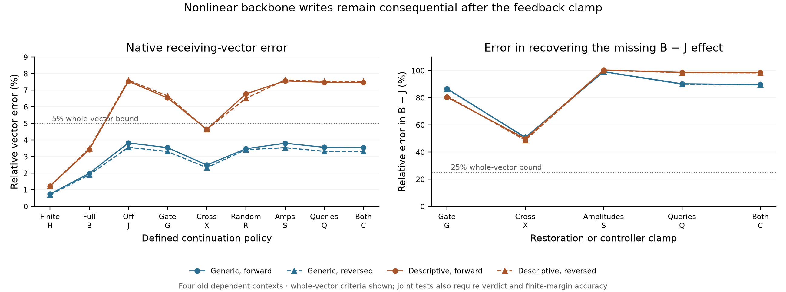

# What the successful forecast still computes

**The shared MLP backbone supplies consequential nonlinear writes that the two
correction amplitudes and receiving queries do not explain by themselves.**
Removing its gate remainder and gate–up cross term reduces native-response
accuracy from 4/4 to 2/4 on four old contexts. Supplying the successful forecast's
later amplitudes and queries leaves 94.02% median error in the missing whole
receiving-vector effect, with 0/4 registered restoration successes.

This constrains the explanation of the earlier successful forecast. It does
not invalidate 269's 32/32 sealed fresh predictions, or identify a learned
circuit. Both new primary hypotheses fail. They are retrospective causal tests
of defined approximate policies, with the same four dependent synthetic inputs.

[270 protocol](../experiments/270-backbone-curvature-feedback.md) ·
[271 protocol](../experiments/271-amplitude-query-mediation.md) ·
[Every record](../../results/backbone-feedback-270-271/README.md) ·
[Reproduce](../../research/README.md#backbone-curvature-and-feedback-270271)



## The distinction we needed to test

269 restricts how a normalization correction changes. An extra approximate L
forecast supplies correction directions and local MLP operating points. Two
signed coefficients per receiving row and layer then adapt from the current
forecast state. Its finite correction writes are evaluated along those fixed
axes. This is a useful restriction of the correction geometry.

The rest of the state is still a full 1536-dimensional vector at each row.
Attention and the shared MLP backbone continue to generate it. The successful
rule therefore does not imply that the model's response is a two-dimensional
process. Its coefficients are calculated from a state produced by substantial
learned computation.

We tested whether that remaining MLP computation could be replaced by transport
linearized around L. Earlier 265 removed interaction *between normalization
corrections*, while 267 froze the corrections' MLP operating point. These new
interventions concern the **common backbone**, as it leaves its own L anchor.

## Separate the finite backbone terms before removing them

At a receiving MLP, cache L's gate g*, up u*, SiLU f* and product p*. At the
current input define dg=g-g*, du=u-u*, df=f-f*. The product has the ledger:

```
linear = p* + SiLU'(g*) * dg * u* + f* * du
gate   = (df - SiLU'(g*) * dg) * u*
cross  = df * du
product = linear + gate + cross + arithmetic
```

These are operation-defined vectors. The finite gate term includes a measured
SiLU arithmetic discrepancy; it is compared with smooth curvature separately.
The derivative is the SiLU primitive's checked derivative. dg and du are public
projection differences, not an asserted whole-block Jacobian.

B keeps the full product and exactly reproduces 269's amplitude-only rule on
these old contexts. J removes both gate and cross; G retains gate but removes
cross; X retains cross but removes gate. Each uses the actual public down
projection and the same live-amplitude, fixed-axis normalization correction
rule at its **own** evolving inputs. All retain the same measured arithmetic
remainder at a common input. R instead removes a seeded random write with the
same row norm as the B-to-J removal at R's own state.

The primary claim that J preserves native accuracy fails: B and the finite
reference H pass 4/4, while J,G,X and R each pass 2/4. The failures are the two
descriptive-schema cases; both generic cases pass. Median whole receiving
errors are B2.70%, J5.68%, G5.04%, X3.56% and R4.99%. A whole-vector number
alone does not establish a joint pass: the original rule also checks verdict
vector error/cosine and an actual finite-head margin. X, for example, fails
both descriptive cases despite their whole errors being below 5%.

At fixed B inputs, both terms have signed effects on the receiving write.
Across 108 eligible whole-input points, median signed projections onto the
missing write are .293 for gate and .707 for cross. Cross alone still has
50.28% median vector error. These projections are not fractions of a circuit;
nonorthogonal terms need not provide an accurate vector account individually.

The same distinction survives complete continuations. Neither G-J nor X-J
recovers the final B-J effect under the registered whole/verdict/finite-margin
rule: both pass 0/4. Median whole errors are83.81% and50.26%. R's 2/4 native
result supplies no unique learned-direction conclusion. We retain the complete
factorial interaction and every local signed vector, including arithmetic.

## Test the two proposed feedback paths directly

A backbone write might matter chiefly because it changes the next correction
coefficients or receiving queries.271 tests that possibility with a controller
from B, the successful **approximate forecast**, not native True.

All mediation arms keep J's backbone removal. S supplies B's alpha/k at every
receiving MLP; Q supplies B's receiving query input; C supplies both. The
common MLP input, residual carry, keys, values, softmax and projections retain
the intervened arm's own computation. Neither clamp copies a complete B state
or attention output. B's extra forecast is explicitly part of this diagnostic's
cost; its controller is not a free prospective input.

The primary target is the missing effect B-J. We compare S-J, Q-J and C-J
against it, with the same 25% vector/.95 cosine and finite common-anchor margin
criterion. All three pass 0/4. Median whole errors are S99.70%, Q94.39%,
C94.02%; C's verdict error is 98.38%. Its whole errors are89.70%,89.51%,98.66%
and 98.34% across generic-forward/reversed and descriptive-forward/reversed.
Every mediation arm still passes only the two generic native-response cases.

An additional zero-model-call check confirms that B and C have identical
receiving query tensors at all 112 layer/context points and identical P/D
correction-curve nodes: 224 nodes, 1344 field-hash comparisons. Source and prefix
states also match exactly. The surviving discrepancy therefore cannot be
ascribed to a failed installation of those two clamps.

Other receiving-state paths remain different. Residual carry can transmit a
changed vector directly; changed keys/values can alter what an unchanged query
receives; subsequent backbone computation can transform it again. The test
rejects sufficiency of these particular amplitude/query controllers for B-J.
It does **not** uniquely apportion the surviving error among the other paths,
or show that query adaptation is unimportant for the original native response.
A saved finite state-increment ledger closes exactly, but is accounting rather
than a causal identification of those remaining primitives.

## Numerical scope and computation budget

The checkpoint remains Qwen2.5-1.5B-Instruct, pinned revision
`989aa7980e4cf806f80c7fef2b1adb7bc71aa306`, MPS Float32/eager. Both source freezes
precede their own new calculations.270's freeze is `f7fe93a`;271's `39ee9ca`
comes after270's qualified result. No scientific source or failed check was
changed after execution.

270 completes 40 forwards in 47.19 seconds; its separate primitive audit takes
66.77 seconds.271 completes 36 in 43.67 seconds and audits in 64.44 seconds.
Times include process/model loading and saving. The original counts retain
2576/2464 extra MLP evaluations and 448 extra down projections per study.
The posthoc clamp ledger performs no model calls. All 76 forwards finish;
there are no guards, excluded examples or storage-aborted attempts this round.

All declared checks pass: 34,152 in 270 and 32,808 in 271. Each includes 560 CPU64
SiLU derivative comparisons against torch.func.jvp and 1120 central finite
differences, plus 2240 smooth RMS AD/independent-cubic checks and 4480 RMS finite
differences. Public full-shape component nodes, installed writes, receiving
residual additions and40/36 actual finite public heads replay exactly.
The largest declared-check error is1.606e-7.

Smooth gate attribution is separately qualified at 108/108 whole-input points
with gate norm>=.001: finite/smooth write discrepancies are below 1% of the gate
effect. At the verdict only 69 points exceed that gate-norm guard, and all 69
qualify; the smaller effects remain recorded, not silently counted as passes.
These local qualifications do not certify a whole-model derivative identity.

**169/6720 and 161/6384 raw CPU64 projection comparisons still fail their original
1e-4 tolerance.** Both studies retain every comparison. CPU64 finite-head bridges
pass 40/40 and 36/36 within their original .005 bound; these are distinct from the
exact public Float32 replay. Earlier whole-block derivative disputes remain
unresolved. Shared producer/auditor helpers are documented; this is not an
independent model implementation or independent research-team replication.

The interventions still execute finite SiLU witnesses, including the measured
arithmetic remainder, full attention/source/KV work, dense MLP projections,
finite correction curves, an extra L forecast and an unmodified final head.
271 additionally supplies B's forecast-derived controllers. These diagnostics
neither establish a speedup nor validate an inexpensive replacement algorithm.

## What this adds to Question B

We have constrained a tempting compression of the explanation. Restricting the
normalization correction to two adaptive coefficients works at the earlier
fresh prediction budget, but the backbone producing those coefficients also
makes consequential nonlinear vector changes. Restoring those coefficients
and the receiving queries alone does not recover the lost vector effect.

The remaining task is to explain and predict those backbone writes and their
transport through the other state paths without computing an accurate B
trajectory as an extra supplied controller. A candidate needs a concrete
False-plus-edit rule, a declared smaller budget and a sealed fresh test. Another
output-only correction sweep would not establish that mechanism. General
Question B, broader templates/checkpoints and learned circuit identity remain
open;204 stays qualified retrospective and invalid replacement-agent claims
stay invalid. No literature priority or deployment-verifier claim is made.
