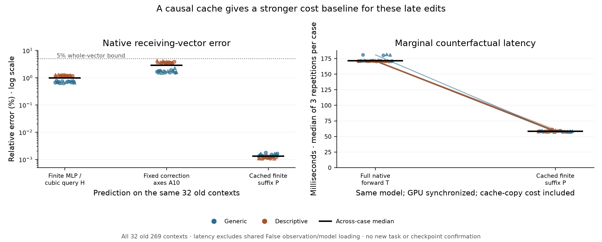

# A causal baseline changes how I assess Question B

**The recent work has partly drifted toward explaining our approximations.**
The latest planned experiments finished; the record also preserves older failed
attempts and partial qualifications. Finishing a run, passing its numerical
checks and supporting its scientific hypothesis are different things.

A missing computational baseline makes that distinction concrete. On all 32
old 269 contexts, reusing the observed False prefix's key/value cache and
recomputing the affected suffix passes the native residual/verdict/margin test.
It uses at most **3.59% of a full forward's learned dense matrix MACs**, with
**2.94× median measured speedup** on this Mac. Median whole receiving-vector
error is **0.00131%**, and median margin error is **0.0000153 nats**.

This is finite execution of the affected native computation, using standard
causal reuse. It supplies a useful predictive reference for these late edits.
It neither identifies a learned circuit nor completes the broader mechanistic
Question B. Its value here is to establish what another predictor needs to
improve upon, and to prevent another surrogate contrast becoming the goal.

[272 protocol](../experiments/272-causal-prefix-budget-baseline.md) ·
[Every case, raw check and timing](../../results/causal-prefix-budget-272/README.md) ·
[Reproduce](../../research/README.md#causal-prefix-budget-baseline-272)



## What I revisited

I reread the active experiment index, the recent handoffs and reports, the
original 93-slot research synthesis locally, and the saved recent audits. A
posthoc machine inventory records **57 published design artifacts** and their
associated status/audit/failure records. That is an artifact count, not 57
independent experiments: it includes preserved attempts and forecast snapshots.
It is not a fresh audit of every archived line of code or a rerun of all earlier
experiments. The full existing release verifiers remain the integrity checks.

The latest 269 forecasts/native observations and the 270/271 batches are all
complete. Older stopped attempts remain failed or explicitly qualified in their
reports; they are not an outstanding queue that should be relaunched blindly.
The [inventory](../../results/causal-prefix-budget-272/research-review.json)
records literal schema fields. A missing `status` or `cases` field in an older
schema is not automatically a failed audit or a cohort with zero examples.

Several parts of the program earned their next experiment:

- **225–227 and 229–234** separated conditional local mechanisms and tested some
  local forecasts on held-out literals. Their targets were local intervention
  effects or attention-2 displacements, with declared native/oracle work. They
  did not yet explain the full edited response.
- **228 and 235–243** showed that selected local repairs and additive error
  accounts did not close the native forecast. Inaccurate incoming states,
  distributed omissions and state-dependent propagation mattered. Those failures
  constrain the proposed few-site explanations.
- **244–250** added native causal constraints on source communication, receiving
  context and residual carry. These are useful restrictions on an explanation;
  they are not replaced by a later approximation's success.
- **251–260** progressed from fixed-reader failures to qualified cubic-query and
  selective-SiLU forecasts. The successful native tests are real bounded results
  on new literals. Much source, attention, normalization and dense MLP work
  remained finite, on one checkpoint and dependent templates.
- **261–271** investigated the corrections left inside those forecasts. They
  often clarified a defined policy contrast, but repeatedly failed stronger
  accounts. The last several factorials reused four old contexts. They add
  causal constraints, not an expanding set of independent native discoveries.

The target drift is visible in specific examples. In 258, a selective
approximation has a more accurate scalar margin but a less accurate vector
than its finite reference. In 266, adaptive sparse masks misrepresent local
mixed-write contrasts, even though the earlier native predictor succeeds.
In 268, amplitude-only adaptation passes native prediction but fails the
policy-interaction account. In 271, the target is the vector lost by a backbone
ablation, not the original Boolean-induced native displacement.

Those distinctions were documented in their reports. My reassessment is that
we should give them more weight when deciding whether another run advances
Question B. One more explanation of an approximation's error is not automatically
a new explanation of the native learned computation.

## Why the suffix is enough in this setup

The 269 prompts contain 169–177 tokens. The single edited Boolean is only
5–6 tokens from the end, counting the edited token. Every block is causal, so
positions strictly before it have the same residual states, keys and values
under False and True. The edit preserves input length and absolute positions.

A single ordinary False run records its per-layer KV cache. To predict True,
copy only cache positions before the edit, discard the edited position and
all later cached positions, then run the known edited suffix through all 28
blocks. Supply the original global positions and complete attention-mask length.
The old prefix remains available as keys/values, while every potentially
changed suffix operation is evaluated finitely.

This follows directly from the causal computational graph. It is exact as a
real-arithmetic dependency argument; the two Float32 execution shapes are not
bit-identical. It does not require a query approximation, a normalization
correction, an L seed or an observed native True receiving state.

The observed information is substantial: **one complete False computation's
prefix KV trace**, not one final residual vector. The retained prefix requires
8.97–9.35 MiB here. Some earlier banks retained only receiving anchors; this
baseline additionally retains the prefix cache during that same False run.
Its storage and copy costs are part of the stated budget. If only a terminal
False vector were available, this cache would not be directly available.

The saving is also input-dependent. Moving the edit near the beginning makes
most of the network affected and can remove almost all of this advantage.
No universal cheap counterfactual algorithm is claimed.

## What actually ran

The source/helper/auditor/protocol freeze is
`4dfc06458e6a45f1d492b03c05391a17b20be893`, before any new 272 study computation.
The cohort is all 32 already-observed 269 literal pairs. This is a retrospective
reference and timing test, not another fresh confirmation.

Each case executes five profiled paths:

- **F:** the single observed full False run and its cache.
- **P:** correct cropped prefix and the edited suffix, the tested predictor.
- **Z:** correct cropped prefix and unchanged False suffix, a zero-edit replay.
- **S:** deliberately retain the False bit in a stale cache, then run the
  unchanged following tokens. This is an invalid edit treatment and should
  reproduce False. It checks why the edited cache entry must be discarded.
- **T:** ordinary full True computation with no reused cache, the reference.

F/T full-sequence endpoints and scores exactly replay their archived 269
counterparts. The unchanged-prefix residuals match at all 896 layer/context
points. There are 7,168 exact prefix-KV equality checks, including the cached
prediction paths. The source False cache is unchanged after the calls.

The profiled paths comprise 64 full forwards and 96 suffix calls. Three paired
unprofiled timing repetitions per case add 96 full and 96 suffix calls. Thus
352 calls completed, comprising **160 full and 192 suffix calls**, not 352
independent experiments. Producer wall time was 61.93 seconds and its separate
auditor 15.74 seconds, including process/loading/bookkeeping. Large KV tensors
are regenerated from F rather than saved; trajectories, hashes and timings
remain inventoried.

P passes **32/32** under the unchanged 5% whole/verdict vector error, .99 cosine,
.10-nat finite-margin rule. Median whole relative error is 1.31e-5; worst is
1.80e-5. Median verdict relative error is 8.26e-6. Median margin error is
1.53e-5 nats; worst is 6.10e-5. Z and S each have 0/32 native passes, as expected
when the edited bit's effect is absent. Their small numerical deviations from
False remain in the raw checks below.

## Work and latency are measured separately

Passive hooks record every learned linear input shape and attention Q/K length.
The separate auditor checks them against the pinned config's independent
matrix-count formula. All 960 formula comparisons agree.

Compared with a full True forward, P's learned dense MAC fraction is
2.97–3.59%, median 3.27%, **including the unchanged one-token vocabulary head**.
Adding dense QK/PV attention MACs gives almost the same ratio. This is a
matrix-operation count; it omits memory movement, cache construction, nonlinear
operation costs and kernel overhead. The number of learned dense calls remains
197 in both paths. No layer or affected nonlinear operation is skipped.

Timing uses the same loaded model, pre-created GPU inputs, no capture hooks,
GPU synchronization, three repetitions and alternating order. Cache cloning
is inside P's timer. Shared False observation, tokenization and model loading
are excluded from both marginal measurements. Across-case median times are
about 171 ms for full T and 58 ms for P. The median ratio of per-case medians
is 2.94×; all 32 cases are faster. The preregistered material-latency secondary
also passes. These are measurements on this machine, not a hardware-independent
speedup claim or an extrapolation from the roughly 30× matrix-work reduction.

There is no instrumented apples-to-apples latency comparison with 269's entire
implementation here. Its extra L forecast and finite correction evaluations
remain declared work. Prefix caching could also optimize those methods; this
baseline does not establish optimality against every possible optimized
approximation. It establishes a concrete native reference for the next budget.

## Numerical limits that stay visible

The original **1e-4 absolute residual-coordinate check fails 299/2,688**
layer/context/arm comparisons: P108/896, Z98/896 and S93/896. The largest is
.000809 in P; zero-edit Z reaches .000755. These failures are retained, not
turned into exact-coordinate passes by the successful relative-error criterion.
Different tensor shapes execute the same causal graph with small Float32
discrepancies; the no-edit replay demonstrates that such discrepancies arise
even without an input change. We do not supply a primitive-by-primitive rounding
proof or an independent real-arithmetic whole-model reconstruction.

All 160 same-executed-shape finite RMS/head replays are exactly equal. All 192
unprofiled timing outputs exactly equal their corresponding profiled outputs.
The original .005 finite-head bridge therefore passes as well. Actual public
head scores, not a linearized readout, determine the margin result.

No derivative is used by this baseline. It does not resolve or recertify the
older whole-block derivative disagreements or CPU64 projection failures.
204 remains qualified retrospective and invalid replacement-agent conclusions
remain invalid. The checkpoint, dependent synthetic templates, supplied-prefix
score measurement and failed grounding controls still limit the project.

## The answer I would now give to Question B

For these equal-length late edits, **a complete False KV observation, the known
edit and weights support an accurate, useful-cost prediction by finite suffix
recomputation**. That is a concrete computational answer under an explicit
information and work budget. The existence of the computation follows from
causal architecture; this is not a discovery of a learned mechanism.

The particular vector still comes from learned attention and MLP maps acting
on the changed state. Even an MLP has the finite identity, with False gate g,
up u and their changes dg,du:

```
dphi = SiLU(g + dg) - SiLU(g)
dwrite = Wdown [dphi * u + SiLU(g) * du + dphi * du]
```

The trained projections determine dg,du and how these neuron products are
written back; attention then changes later state-dependent reads. This explains
why a fixed local slope or two correction coefficients need not capture the
finite vector. Writing the identity alone does not identify which learned
representations or paths explain the Boolean/schema dependence.

I would pause the current correction-factorial sequence. A subsequent experiment
should either identify a native learned path that predicts new conditions under
causal tests, or give a frozen predictor that improves on the affected-suffix
accuracy/work tradeoff. It should use the original native displacement/margin
target, state every supplied computation, and test broader templates or a
second checkpoint. Another surrogate-policy contrast would need a direct reason
it discriminates one of those claims.

That is the remaining research problem. The bounded predictions and causal
constraints are useful; the broader learned explanation of Question B is open.
