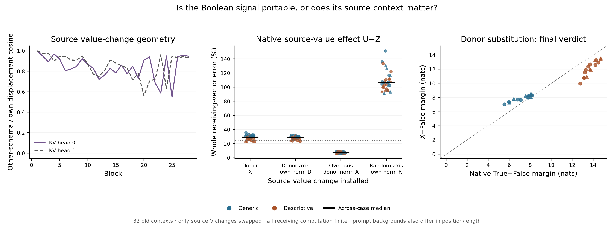

# The source signal's direction depends on context, and that difference matters

**The strong portable-signal hypothesis fails.** On all 32 old 269 contexts,
replacing the Boolean source's value changes with a matched other-schema donor
accounts for the native source-value effect in only **5/32** cases. Matching the
recipient's value-change magnitudes gives **4/32**. Keeping the recipient's
directions and borrowing the donor's magnitudes gives **32/32** on this defined
effect test. These last two controls were specified before execution; they do
not turn the failed primary into a successful one.

This returns to a primitive of the **native** Boolean computation. It does not
explain a discrepancy between Taylor or correction policies. It also does not
complete Question B: every non-self substitution has **0/32** passes on the
original, stricter full native residual/verdict/margin criterion.

[Frozen protocol](../experiments/273-native-source-value-interchange.md) ·
[Every case and numerical check](../../results/native-value-interchange-273/README.md) ·
[Reproduce](../../research/README.md#native-source-value-interchange-273)



## Why this is a different mechanistic question

250b showed that continued source-value communication sustains much of the
native response. Later receiver-query forecasts demonstrated useful prediction
under substantial finite budgets. Neither establishes where the context-specific
information resides. One plausible account was a largely reusable Boolean value
signal, interpreted differently by the receiving context.273 tests that strong
account directly.

For each layer, compute the source value difference

```
dV = V(source True) - V(source False)
   = Wv [RMSNorm(source True) - RMSNorm(source False)]
```

Pair generic/descriptive cases with the same passage family, assignment, target
and order. In a recipient's actual attention value product, replace only the
source V row by `recipient VFalse + donor dV`. Preserve the recipient's source
keys and original source computation. Only queries after the source receive the
changed value; all receivers then evolve through finite attention, MLPs and the
actual final normalization/full vocabulary head.

This is an artificial value-path interchange between **whole prompt backgrounds**.
The prompts differ in instruction wording, field tokens, positions and length.
It does not isolate semantic field meaning, imply that any hybrid is on-manifold,
or identify a learned Boolean feature.

## The source calculation does not borrow unknown receiving states

One full False observation per case supplies the complete False trajectory.
Starting with the known True embedding, calculate the source through all 28
blocks. Before each block restore every other row to its observed False state;
carry only the generated source row. Discard generated receiving outputs. Causal
masking permits this source calculation without a native True receiver.

The full-shaped implementation deliberately spends a complete dense block on
each source step. It avoids a changed-shape control confound, rather than aiming
for efficiency. An interchange additionally needs its donor's False observation
and source calculation. This is not prediction from one terminal residual vector
or a cheap single-case algorithm.272 remains the affected-suffix cost reference.

The generated source exactly matches every native source coordinate at all 28
blocks. Source K/V are unchanged across the True intervention arms. Self
substitution U exactly replays the native True trajectory and both scores;
zero-edit FZ exactly replays False. Full F/T replay the old 272 arrays exactly.
These checks strengthen the interpretation of the interchange while leaving
the older derivative and raw-coordinate failures untouched.

## What the interventions show

The primary target is the final **native source-value effect U-Z**, where Z
removes the source value change but retains native source keys and lets receivers
adapt. This is conditional on that defined intervention background; it is not an
additive fraction of the complete native Boolean response.

The frozen test requires both receiving-vector scopes to have at most 25% error,
cosine at least .95, material targets, and a finite margin-effect error bound.
The primary X needs 24/32 passes and 6/8 per schema/order stratum. It obtains5/32:
0/8,0/8 for generic orders;2/8,3/8 for descriptive. Thus the primary fails.

- **X, donor changes:** median whole effect error29.08%, verdict24.16%,
  margin-effect error1.172nats;5/32 joint effect passes.
- **D, donor directions with recipient norms:** whole28.52%, verdict24.06%,
  margin.803nats;4/32. Merely matching per-KV-head input magnitudes does not rescue
  the donor directions under these interventions.
- **A, recipient directions with donor norms:** whole7.56%, verdict6.28%,
  margin.409nats;32/32 on the looser effect test. The exact amplitude schedule is
  less restrictive here than the direction information. It is not unnecessary.
- **R, random directions with recipient norms:** whole106.66%, verdict96.75%,
  margin9.696nats;0/32. This input-norm control does not establish that random
  perturbations are on-manifold or that their output-write norms are matched.

These are medians of separate case-level quantities. Large signed projections
are insufficient: X retains median94.44% of the value effect's signed verdict
projection while still having24.16% verdict-vector error and1.172-nat margin
error. The displaced vector has consequential components outside that projection.

The original native target remains `T-F`, with5% error in both vector scopes,
cosine at least .99 and margin error at most .10nat. U passes 32/32 exactly; X,D,A,Z,R
each pass 0/32. A's median native whole error is7.75%, verdict6.68%, margin.409nats.
Its looser32/32 result is not a full native prediction success.

Removing source value changes at every layer (Z) leaves a median−.00424 signed
verdict projection relative to the full native response, and7.45% of its signed
margin response. This extends250b's late-region clamp to all 28 layers, but does
not imply that the remaining complete vector is negligible. Direct reads and
relays both remain inside the finite continuation.

## A source-origin boundary, without a learned-circuit claim

At attention1, both prompt backgrounds have **exactly the same** source dV:
the Boolean embeddings, input RMSNorm and V projection are shared, before the
source has read any context. By attention2 the paired direction cosine has
median .96075. It becomes substantially lower at several later blocks; for
example, median .76943 at 20, before returning to .94053 at 28. The figure shows the
across-case median separately for each of the two KV heads. These geometric
profiles are descriptive, not causal rankings of blocks.

Thus a context-dependent direction is generated after the initial token map,
as the source reads its prefix and passes through its residual and MLP updates.
The full intervention supplies the further causal constraint: the resulting
context-specific direction information cannot simply be exchanged while retaining
the tested native value-path effect. The matched-magnitude control rules out
a magnitude-only rescue of this exchange. It does not show which individual
head, neuron or semantic representation generated the direction.

At each native attention input, a separate fixed-input diagnostic measures the
full signed receiving write for native T, removed Z and donor X source values.
The median local donor-versus-native effect error is47.32% over all receiving
rows and47.76% at the verdict. All 896 targets in each scope exceed .001. Their
downstream effects are tested by the actual intervention arms, rather than a
linear projection or sum of local influences. Neither the local profile nor
the global interchange uniquely allocates the cause to source attention,
MLP curvature, normalization or interactions among them.

The next discriminating source question is whether context-sensitive source
attention reads generate the needed directions, or whether source MLP responses
to a largely shared incoming change do so. A useful test would change that
source primitive, recalculate its emitted V differences from False and the known
edit, and test them against the same native value-path and full-response targets.
An accurate source proxy would still need a fresh-context test and an explicit
budget. No such next experiment is frozen or claimed here.

## Numerical qualification and actual work

The scientific freeze is `55d1ad343bafe8a8b35d16a800edf2c32391ba1c`, before
any new273 study computation. All 32 cases completed. The separate audit passes
**4,544** declared checks; maximum bounded error3.59e-5. All 1,792 source V
projections replay exactly in matched full-sequence MPS Float32 shape. Their
separate CPU64 raw checks all pass the unchanged1e-4 bound; maximum1.89e-5.

At blocks1/10/28 of every case,96 complete attention witnesses support public
QK-to-softmax/PV/output replay and separate CPU64 softmax/PV checks. All 288
same-shaped actual finite heads replay exactly, with CPU64 bridges within .005.
This is component qualification, not an independent full-model implementation.
It does not add a new raw-logit comparison or recertify any old raw-logit failure.
No whole-block derivative or disputed Jacobian is used.

Actual study work:288 full forwards,896 extra full-shaped source blocks,6,272
intervention PV calls,1,792 diagnostic PV calls and2,688 diagnostic output
projections. These are computational calls, not independent experiments.
Producer wall time177.33s; audit34.83s, including loading/save/hash overhead.
The64 raw case/witness NPZ files total479,774,804bytes and remain local with
public sizes/hashes and regeneration code. No speedup is claimed.

This is one pinned Qwen2.5-1.5B-Instruct checkpoint and32 already-observed,
dependent contexts. The native behavior, failed grounding controls and old
numerical qualifications remain as documented.204 stays a qualified retrospective
diagnostic; invalid replacement-agent claims remain invalid. No fresh forecast,
novelty priority, learned circuit or complete solution to Question B is claimed.
