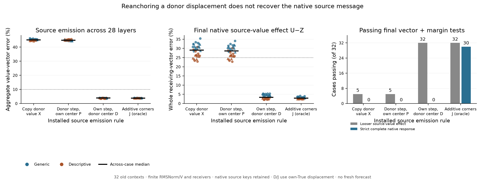

# Normalization reanchoring does not explain the nonportable source message

**The sufficient reanchoring account fails: 0/32 combined primary passes.**
Moving a paired donor's residual displacement to the recipient's False state
before finite RMSNorm and V projection gives only5/32 native value-effect passes,
the same count as copying the donor's post-normalization value change. In the
opposite control, retaining the recipient's residual displacement while exchanging
the False background gives32/32 emission and looser value-effect passes.

This locates consequential context dependence upstream of the source's input
RMSNorm/V emission map in these interventions. It does not identify the source
attention or MLP operation responsible, establish a learned feature, or solve
general Question B. All cases are old, native source keys are retained, and the
recipient-displacement controls use its old True information.

[Frozen protocol](../experiments/274-source-residual-reanchoring.md) ·
[Every case](../../results/source-residual-reanchoring-274/README.md) ·
[Reproduce](../../research/README.md#source-residual-reanchoring-274)



## What the test separates

273 showed that post-normalization source value changes are not freely portable
between matched whole prompt backgrounds. That observation alone does not
establish nonportability of the underlying residual displacement. Even a common
step can have different normalized directions around different backgrounds.

For recipient False source residual x and native residual change h, define

```
M(x,h) = Vproj(RMSNorm(x+h)) - Vproj(RMSNorm(x)).
```

The paired other-schema case supplies False residual y and change k. The primary
P is M(x,k), whereas the failed old exchange X is M(y,k). D=M(y,h) keeps the
recipient step and changes its center. U=M(x,h) is the exact native self-control.

Pairs match passage family, assignment, target and order. Wording, field tokens,
positions and sequence lengths differ. This is not an isolated field-semantics
test. All32 old269/273 cases remain, with one fixed reference selected by case
order before new computation, rather than by its results.

Every map executes actual full-sequence-shaped Float32 public RMSNorm/V nodes.
Differences use CPU64 values of those public outputs. Installation casts
`recipient False V + candidate change` once to Float32. Only source values read
by later query rows change. Source computation and keys remain native; receivers,
queries, other keys/values, MLPs and final full-vocabulary head evolve finitely.
These are conditional native interventions, not inexpensive full False-only
forecasts. Donor trajectories are old calibrated information.

## Primary outcome and all controls

The frozen combined criterion requires aggregate source-emission error<=10%,
cosine>=.995, at least24/28 layers meeting those bounds, and the separate final
value-effect criterion. That latter target is U-Z, where Z removes source value
changes. It requires<=25% error and>=.95 cosine in both whole receiving and verdict
vectors, material targets and the declared actual margin-effect error bound.
At least24/32 combined cases and6/8 in every schema/order stratum are required.

P obtains **0/32 combined**, including0/8 in all four strata. Its median aggregate
emission error is44.88%, cosine.89882; median passing layers1/28. Merely applying
the donor residual change around the observed recipient background is insufficient.

The prespecified controls remain controls:

- **U, self:**32/32 emission, effect and strict native passes, with exact replay.
- **X, old donor emission:**0/32 combined,5/32 effect and0/32 strict native;
  median aggregate emission error45.13%, whole effect29.08%, margin1.172nats.
- **P, reanchored paired donor step:**0/32 combined,5/32 effect and0/32 strict;
  median whole effect28.60%, verdict23.82%, margin.888nats.
- **D, own step at donor center:**32/32 combined/effect but0/32 strict native;
  median emission3.94%, whole effect3.38%, verdict2.44%, margin.186nats.
- **C, one fixed old reference step:**6/32 combined,19/32 effect and1/32 strict;
  median emission28.48%, whole effect23.88%, verdict16.92%, margin.624nats.
  That reference includes one self case. It is neither a fresh result nor a
  rescue of the failed paired-reanchoring primary.
- **E, unchanged embedding step at every layer:**0/32 combined/effect/strict;
  median emission99.97%, whole effect99.19%, margin9.813nats. Evolution beyond
  the initial embedding difference matters under this control.
- **R, random hidden displacement with donor input norm:**0/32 at all three
  endpoints. Norm matching occurs before normalization, not in the output write.
- **J=P+D-X, additive corner control:**32/32 combined/effect and30/32 strict;
  median emission3.83%, whole effect2.92%, verdict1.92%, margin.0212nats.
  J uses the recipient True step through D, so it is an oracle diagnostic.
- **Z, no source value change:**0/32 effect/strict; False zero-edit FZ replays F
  exactly. Native F/T and old X/Z replay their273 arrays exactly.

The original complete native criterion remains distinct:<=5% vector errors,
cosine>=.99 and actual margin error<=.10nat. The two J failures meet both vector
criteria but miss the margin bound at.10461 and.10183nats. They remain failures.
No looser effect pass is substituted for strict native accuracy.

## What the result says about geometry

There is a strong asymmetry between exchanging the step and exchanging its
background. With the native step retained, D reproduces the emitted directions
and defined value effect within their looser tolerances. With only the recipient
background retained, P does not. The missing information is therefore not
adequately supplied by a False center plus the tested portable step.

This is not evidence that RMS geometry is irrelevant. D still misses every
strict complete-response case, and J's finite corner correction improves that
endpoint. The finite four-corner contrast is conditional on these states and
execution shapes; archived X was computed at the donor length. It is not a
pure learned interaction, a unique allocation of all response components, or
an explanation of where h originated. No layer importance is inferred from
emission-vector errors alone.

The next unresolved generator question is source attention reweighting of the
unchanged prefix versus transmission of the changed source value, together with
the finite MLP response. A useful diagnostic should intervene on that primitive
inside a causally generated source trajectory and test both emitted vectors and
their actual downstream effect. It should not rely on another correction-policy
contrast or call an old own-True trajectory a free prospective input.

## Numerical qualification and work

Freeze `c780ca39baee5ae035c3fe5cd930d72caf302e29` precedes all new274 study
computation. All32 cases complete. The separate auditor passes **24,192** declared
checks, maximum bounded error7.39e-6. All **21,504** separate CPU64 raw RMSNorm/V
coordinate checks pass their original1e-4 tolerance: maximum RMS error3.00e-6,
V error2.12e-5. Every same-shaped public primitive and all384 actual finite heads
replay exactly; the independent CPU64 head bridges pass.005.

The auditor reconstructs operands from hash-bound273 arrays and checkpoint
embeddings without using the producer's geometry/map functions. Exact self,
zero-edit, source/prefix and archived trajectory/score controls support the
defined intervention. This remains component validation within one investigation,
not an independent complete model or research team. No disputed block derivative
is used or recertified. Original raw-coordinate and derivative failures remain
as documented;204 stays qualified and invalid replacement-agent claims stay invalid.

Actual work:384 full forwards,8,960 extra full-shaped PV calls,10,752 source RMS
and10,752 source V projection calls, plus auditing. Producer wall time341.96s;
audit45.18s, including process/loading/save/hash overhead. The32 raw NPZ files
total497,897,030bytes; sizes/hashes are public, arrays remain local and regenerate.
There is no speedup claim. This is one pinned small Qwen checkpoint and dependent
synthetic templates, without fresh confirmation or a novelty-priority assessment.
