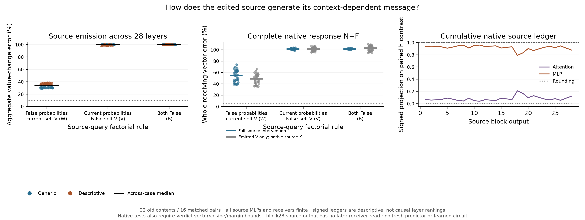
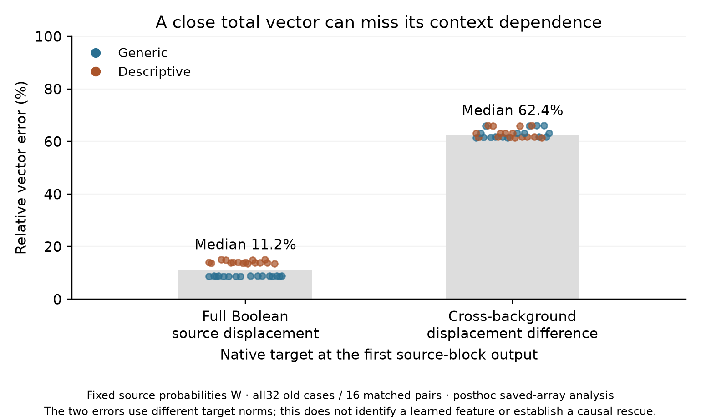

# Source reading alone does not reconstruct the native message

**The reading-only hypothesis fails.** Freezing the source's self-value read while
allowing its attention probabilities to adapt gives **0/32** combined source-emitter/
value-effect passes. Freezing only its attention probabilities also gives0/32.
All full and value-only non-self arms have0/32 strict complete native-response
passes. This is a native primitive intervention, with all source MLPs and receiving
computation finite. It does not isolate a query circuit or solve Question B.

There is a strong asymmetry. Removing the changed self-value nearly destroys
the source signal; retaining that value with fixed probabilities preserves much
more, but still misses consequential context-dependent directions. A first-block
posthoc comparison shows why a large vector can conceal the relevant dependence:
fixed probabilities give only11.24% source-vector error, but62.42% error in the
matched cross-background source contrast. Similar total direction and magnitude
do not guarantee an accurate context-dependent component.

[Frozen protocol](../experiments/275-source-attention-reading.md) ·
[Every case, control and signed ledger](../../results/source-attention-reading-275/README.md) ·
[Reproduce](../../research/README.md#source-attention-reading-275)



## The question and the two attention dependencies

An earlier Boolean token is the source; later tokens receive its keys and values.
The Boolean edit is explicitly irrelevant to the later verdict task.273 showed
that its context-dependent value directions matter under native interchange.
274 showed that reanchoring donor residual steps at the recipient False center
does not explain those directions. The source residual step itself contains
consequential information before the emission norm/V map.

At the source token, attention both reweights existing information and reads
its own value. The candidate account was that reweighting the unchanged prefix,
followed by finite MLP processing, might be sufficient without the source's
changed self-value read.275 directly tests that account.

Observe one False computation. At every layer change **only the source query
row's** attention result, using the following factorial:

- **N:** current probabilities and current source self-value, the native control.
- **W:** observed False probabilities and current self-value.
- **V:** current probabilities and observed False self-value; the primary candidate.
- **B:** both observed False probabilities and False self-value.
- **FB:** False input with B clamps, an exact zero-edit control.

Receiver query rows still read their actual current source K/V, and every MLP
and subsequent receiving operation remains finite. Probability adaptation includes
both query and source-key changes; this does not isolate a query mechanism.
The source query here is different from the later receiving queries studied
in earlier forecast experiments.

Full factorial arms use the known edit, complete False observation and weights,
without inserting native True hidden states. They still execute expensive full
counterfactual forwards. They are not compact forecasts. All32 cases were already
observed; there is no new pre-native confirmation or semantic field isolation.

## Emitted vectors, conditional effect and complete behavior

For every full arm, save all28 emitted source value changes. Test those fields
again in a separate native True continuation, changing only the source V read
by later queries. These value-only arms retain native source K/computation and
finite receivers. They distinguish value communication from other source paths;
they are conditional interventions, not complete False-only predictions.

The frozen primary requires V to pass both the emitter10%/.995/24-layer test
and the final source-value-effect U-Z25%/.95/finite-margin test in>=24/32 cases,
>=6/8 per schema/order, while W passes<=8/32. Both obtain0/32. V has0/8 in every
stratum. Neither the primary nor a partial accuracy claim is rescued by medians.

All non-self arms also fail every original strict native test, which requires
both whole receiving and verdict vectors<=5% error,>=.99cosine and actual finite
margin error<=.10nat. Native and zero-edit controls replay exactly.

Separate across-case medians:

- **W:** aggregate emission error34.47%, cosine.93862; value-effect whole47.66%,
  verdict46.69%, margin4.426nats. Full native whole54.55%, verdict56.26%,
  margin4.735nats. Value-only strict native whole48.71%, margin4.426nats.
- **V:** emission100.01%, cosine.05251; value-effect whole100.62%, verdict100.49%,
  margin9.592nats. Full native whole101.14%, verdict101.46%, margin9.956nats.
- **B:** emission100.43%, cosine−.01545; value-effect whole101.97%, verdict102.96%,
  margin9.811nats. Full native whole101.32%, verdict102.39%, margin10.434nats.

W retains much more than V, but34% emitter error and roughly48% downstream
value-effect error do not establish sufficient generation. The two removals
show joint dependence under these clamps. They do **not** show that the explicit
bilinear probability–value interaction itself is necessary; parallel paths and
their later state-dependent processing can also make both removals consequential.

## Signed native attention and source-state accounting

At each native source-attention input the saved finite corners give

```
attention change = reweight + self-value + mixed
reweight  = output(current P, False V) - output(False P, False V)
self-value= output(False P, current V) - output(False P, False V)
mixed     = output(current P,current V) - the other three signed corners.
```

These are actual signed source-write vectors, stored in the raw arrays, with
every layer reported in `local-attention.csv`. At block1 the self-value component
has median.9973 signed projection onto the native attention change, reweight.0134
and mixed−.0107. At block2 the projections are approximately.430,.609 and−.039.
Separate medians need not sum exactly. They are not additive fractions of the
final response or evidence for learned features.

The native source ledger also closes the Float32 identity at every layer:

```
h_next = h + delta attention write + delta MLP write + rounding.
```

Cumulatively subtracting the paired other-schema ledgers reconstructs their
source-displacement contrast. At the first block, MLP writes have median.9336
signed projection onto that contrast, attention writes.0664. At block27 these
are.9113 and.0887. This locates where vectors are written along the native
trajectory; it does not identify what caused the MLP to write them. Changing
an earlier attention input also changes the subsequent MLP response. The source
block28 output has no later receiver read, so its ledger cannot rank influence
on the final verdict. Rounding stays explicit throughout.

## A smaller source-origin puzzle exposed by the first block

The following analysis is **posthoc, descriptive and uses no new model calls**;
it is separately source/hash-bound in `first-source-provenance.json`.

The known embedding difference has norm.9562. By the first source block, median
attention-write change is9.536, MLP-write change9.400, and output displacement
14.383. These separate vector norms do not add. Removing self-value changes
already leaves only14.93% of the native source-displacement norm, with cosine.1598
and98.73% error. This is more than a small reduction in amplitude.

Freezing probabilities looks much better on the **total** first-block displacement:
11.24% error, cosine.9934,99.87% of its norm. But compare the matched generic versus
descriptive source-displacement **difference** instead:62.42% error and.7949cosine.
Removing self-value gives85.78% error on this paired contrast; both frozen99.99%.
Neither a large native direction cosine nor the MLP's large ledger projection
explains this context-dependent component.



This gives a sharper next causal question: how does the first source MLP transform
the large self-value-induced displacement together with the smaller attention
reweighting change, around its context-dependent False input? Is the missing
paired contrast mainly a background-dependent transformation, an interaction
between those inputs, or later propagation of their errors? That needs an actual
primitive/site intervention and downstream test. These ledgers do not answer it.
No next experiment is claimed as executed by this report.

## Qualification, work and retained boundaries

Scientific freeze `32d1d75f2a045f35c3e2e09c95b80e457b832e81` precedes all275 study
computation. All32 cases complete. The separate auditor passes **74,080** required
checks; maximum bounded error7.47e-6. All **26,880** CPU64 original1e-4 raw checks
pass: maxima RMS2.71e-6, V1.97e-5, softmax1.49e-5, PV5.76e-6, output4.39e-5.

Source norm/Q/K/V/RoPE, carry/addition identities and finite MLP replays from
recorded mid inputs match exactly. Restored-prefix public attention primitive
checks pass their frozen1e-4 bound. All416 actual full-vocabulary finite heads
replay exactly and CPU64 bridges pass.005. Native/F source and receiving arrays,
source K/V and the original273 source-value removal replay exactly; full FB and
value-only FZ zero edits match False. Actual prefix hashes and source-query-only
installation checks pass at every layer.

This is separate operand reconstruction without producer factorial helpers,
not an independent complete implementation or research team. No whole-block
Jacobian is used. Old derivative/raw-logit failures are not recertified;204 stays
qualified and invalid replacement-agent conclusions stay invalid.

Actual work:416 full forwards,3,584 extra source-intervention PV calls,2,688 native
corner PV plus2,688 corner output projections,5,376 value-intervention PV, plus
auditing. Producer156.95s; audit392.41s, including loading, transfers, saving and
hashing.32 raw NPZ files total1,015,184,122bytes and remain local with public
sizes/hashes and regeneration code. No speedup is claimed;272 remains the affected
suffix baseline. One small checkpoint, old dependent synthetic templates and
whole-background position/length differences constrain generalization. There
is no new priority, learned-circuit or complete Question B claim.
