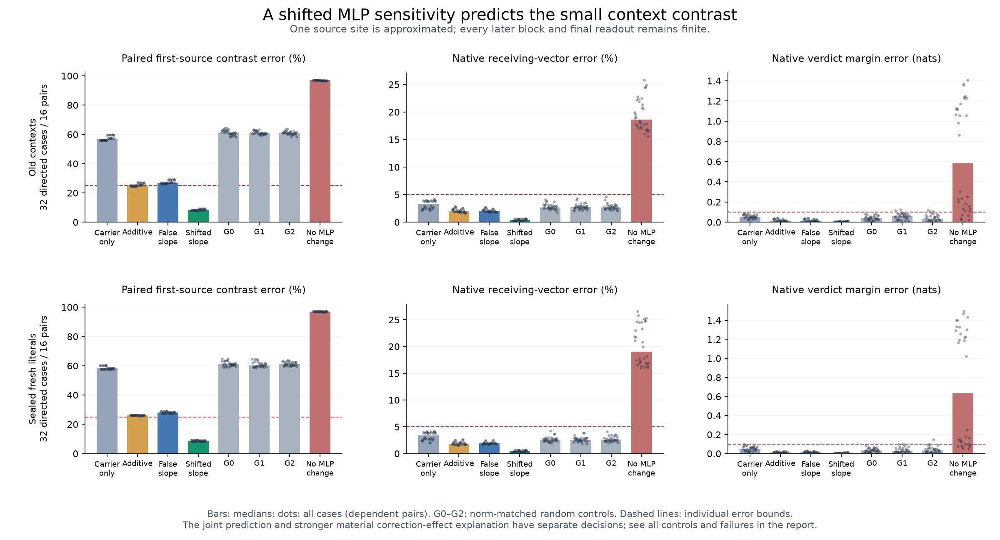

# Predicting the small read at the state the large change creates

**A fixed local rule predicts the context-dependent source contrast on 32 fresh
literal contexts. The stronger causal explanation still fails.** At the first
source MLP, use the sensitivity at the state created by the large input change,
rather than the original False sensitivity. This reduces the median paired
source-contrast error from **27.96% to 8.70%** on fresh examples. The registered
joint prediction passes32/32; False sensitivity, carrier-only, additive and all
three matched random controls pass0/32. All other model computation stays finite.

That joint test includes a new paired source target. On the original complete
native-response test alone, carrier-only, additive and False-sensitivity controls
already pass32/32. The separate material correction-effect explanation passes
only6/32, below its24/32 requirement. A more accurate local prediction is therefore
supported; a necessary native behavioral mechanism or learned circuit is not.

[276 frozen protocol](../experiments/276-first-source-mlp-gain.md) ·
[277 frozen fresh protocol](../experiments/277-sealed-first-source-mlp.md) ·
[Old cases and failures](../../results/first-source-mlp-gain-276/README.md) ·
[Fresh cases and receipt](../../results/first-source-mlp-forecast-277/README.md) ·
[Reproduce](../../research/README.md#first-source-mlp-276277)



## Which question this addresses

273 found consequential context dependence in emitted source-value directions.
274 rejected the sufficient account that a freely portable residual step is
merely normalized around different recipient backgrounds.275 then separated the
source's attention probability changes from its changed self-value read. The
large self-value read dominates the first attention write. Yet freezing the
probabilities misses much of the smaller cross-background source contrast.

The first source MLP writes most of that contrast in a descriptive ledger. This
does not tell us what caused it: the MLP receives the changed attention state.
The new question is whether its response to the smaller read change can be
predicted by moving the point at which we calculate sensitivity.

This concerns the Boolean token producing a message, not a claim that a reliable
verifier was disabled. The historical grounding controls failed. It also concerns
only the first MLP;275's28-layer clamping failures are broader interventions.

## The local computation, with every input declared

Let x be the source's observed False input to MLP1, and let e be the known
True-minus-False embedding change. In first attention, define aV as the write
with False source-query probabilities and current source self-value, minus the
write with both operands False. Choose the actual Float32 carrier point

```
xc = Float32(x + e + aV)
r  = Float64(current first-attention midpoint) - Float64(xc)
```

The smaller r includes attention reweighting, its probability/value interaction,
and the declared cast/residual rounding. These are defined vectors, not learned
features. M is the complete first MLP: input RMSNorm, gate/up projections, SiLU,
gate–up product and down projection.

The candidates are:

- **C, carrier-only:** M(xc).
- **A, finite additive:** M(xc) + M(Float32(x+r)) - M(x).
- **L, False sensitivity:** M(xc) + J(x)r.
- **S, shifted sensitivity:** M(xc) + J(xc)r, the primary rule.
- **G0/G1/G2:** L plus deterministic random output-write directions with the same
  norm as S-L.
- **Z:** M(x), removing the entire first-MLP write change.

276 additionally retains exact native self-installation U, read-only R, a
mixed-only change I, ordinary F/T references and False zero-edit FZ. They are
available in every-case records. Native-dependent controls are not predictor
inputs. The actual source MLP primal for S/L/C/A/G is evaluated at xc. Only its
output write is replaced. The outer residual stays at the current attention
midpoint, every other row is unchanged, and every later block and final readout
remains finite.

J here is the derivative of the explicitly defined smooth CPU64 MLP at a
Float32 anchor. It is not the derivative of discrete Float32 execution or an old
disputed whole-block Jacobian. It includes normalization, gate and up sensitivity;
using it successfully does not yet separate those operations causally.

## Retrospective discovery, then a prospective test

276 uses all32 old275 cases and native source-attention inputs. Its source and
protocol were frozen at `9010338c40a8daec0f0838cc9cf1c779337b4239` before new276
computation. It is a retrospective single-site diagnostic. S passes32/32 joint
predictions,8/8 in each stratum. C/L/random each pass0/32; A passes8/32. The
stronger gain explanation fails8/32. These outcomes are not reclassified.

277 uses the identical S rule on32 new literal contexts,16 dependent pairs from
the same templates. Their64 input hashes are absent from1,920 cataloged historical
sequences. This is literal freshness, not fresh task families or independent trials.
The scientific freeze is `7ba122831dcb0a48d90ba34a116de4804853d6f9`.

For277, the source attention operands are regenerated from the known edited
embedding and the unchanged False prefix; no old native True source archive is
loaded. No native True MLP1 source primal is evaluated during prediction. All32
forecasts and their numerical qualification were sealed and pushed at
[the pre-native receipt commit](https://github.com/romrom-20/counterfactual-traces/commit/7a398a580bbe879ef051e76e70af9769d51008d6)
before ordinary native True measurements. The native stage verifies that public
commit and the array/source seals. It then confirms the prepared first source
attention operands exactly against native measurements.

## What passed, and why the added target matters

The unchanged joint primary requires original native receiving AND verdict
vectors<=5% relative error and>=.99cosine, actual final margin error<=.10nat;
paired first-source and paired final-verdict displacement contrasts<=25% error
and>=.95cosine; and the registered material-vector/finite paired-margin checks.
Success requires>=24/32 and>=6/8 in each schema/order stratum. Whole receiving
suffixes have different lengths across backgrounds; only their verdict vectors
are aligned between schemas. No arbitrary whole-suffix subtraction is used.

S passes **32/32 fresh joint tests,8/8 in every stratum**. C/A/L/G0/G1/G2/Z each
pass0/32. The failure of the simpler accurate-native controls is at the first
source contrast; it is not evidence that all of them fail the final verdict
contrast. This distinction prevents a representation target from becoming a
claim of native behavioral necessity.

Across-case medians, stated separately:

- Paired first-source contrast: C58.11%, A26.16%, L27.96%, S8.70% error.
- Original whole receiving response: C3.395%, A1.839%, L1.919%, S0.420% error.
- Original verdict-vector response: C2.897%, A1.308%, L1.412%, S0.286% error.
- Actual final margin: C0.05305, A0.01134, L0.01323, S0.00412nat absolute error.
- Paired verdict contrast: C4.385%, A2.051%, L2.155%, S0.556% error.

On the original native criterion alone, C/A/L/S/G0/G1 each pass32/32, G2 passes
31/32, and Z0/32.276 similarly has C/A/L/S/G0 at32/32, G1 at30, G2 at29 and
R/I/Z at0. Thus most of the complete response tolerates omitting or inaccurately
predicting this small first-site read contribution. The shifted rule improves
precision and the source contrast; it does not establish necessity at that tolerance.

## The stronger explanation fails on both sets

The registered stronger account tests whether S-L predicts the native-minus-L
missing write and its actual downstream receiving/verdict effect, with25%/.95
vector bounds, a material native-minus-L margin>=.02nat, a finite margin-error
bound, and at least two of three matched random directions failing. Its threshold
is again24/32 and6/8 per stratum. Ineligible effects count as failures.

It passes **8/32 old and6/32 fresh**, with0/8 in both descriptive strata on each
set. The frozen `generative_account_passes` field is false in both audits.
This is not merely a bookkeeping issue about small margins:

- Old S: local missing-write criterion28/32, downstream-vector criterion16/32,
  material-margin criterion10/32, finite margin bound21/32; their joint account8/32.
- Fresh S: local20/32, downstream vectors16/32, material margin10/32, finite margin
  bound22/32; joint6/32.

Components overlap; their counts cannot be added. Exact native self-controls also
fail the material criterion when the target effect is too small. Every such case
is retained. There is no relaxed posthoc endpoint that upgrades the failed account.

## Numerical qualification and what it does not repair

276 passes6,112 required numerical checks and all768 recorded raw primitive
checks at the original1e-4 bound.277 passes5,376 pre-native required checks and
all768 recorded raw checks. The latter include first-attention softmax/PV/output
and F/C/R MLP operands. Its post-native audit adds608 exact first-attention/MLP
operand equalities, exact native source addition and public finite-head replay,
with CPU64 final-head bridges<=.005. All new recorded raw failures are zero.

Every one of the128 False/carrier derivative anchors across the two studies is
checked against a separate Torch Double JVP, two central finite differences, and
two standard reverse contractions. Largest JVP coordinate error is1.25e-16;
largest central-difference error7.02e-11. Public finite MLP write bridges remain
within the original1e-4 bound. Exact source installations, unchanged prefixes,
False zero edits and available native self-replays pass.

These are separate numerical code paths within one investigation. They are not
an independent research team or independent whole-model implementation. They do
not reconcile the old derivative disagreements, retroactively pass earlier raw
logit failures, or revive invalid replacement-agent conclusions.204 remains only
its qualified retrospective diagnostic.

## Cost and the remaining mechanistic question

276 executes448 full forwards,128 extra full-shaped first-MLP finite maps and64
CPU64 MLP tangents (320 learned matrix-vector products), plus audit.277 executes
32 full False observations and288 forecast forwards before the seal,32 first
attention calls with64 extra corner PV/output maps,96 additional first-MLP maps,
64 tangents/320 matrix-vector products, then32 native references and audit.
Producer timings are108.82s for276,77.51s for277 forecasts and13.31s for277 natives
on the pinned MPS setup; they include instrumentation/storage and are not marginal
latency benchmarks. Raw arrays stay local with public hashes and regeneration code.

This rule executes almost the whole finite counterfactual model. It is not an
efficiency advance over272's standard affected-suffix cache baseline. Nor does
it identify the learned reason a schema produces particular gate/up changes.

What we can now predict prospectively is more precise: the smaller first-source
context contrast is better captured after moving the local MLP operating point
to the state created by the large change. The next discriminating local question
is which changes in RMSNorm sensitivity, SiLU slopes and gate–up coefficients
produce that improvement, under actual source-product/write interventions.
That primitive decomposition has **not been run here**. The broad Question B,
a compact whole-network explanation, and novelty priority remain open.
