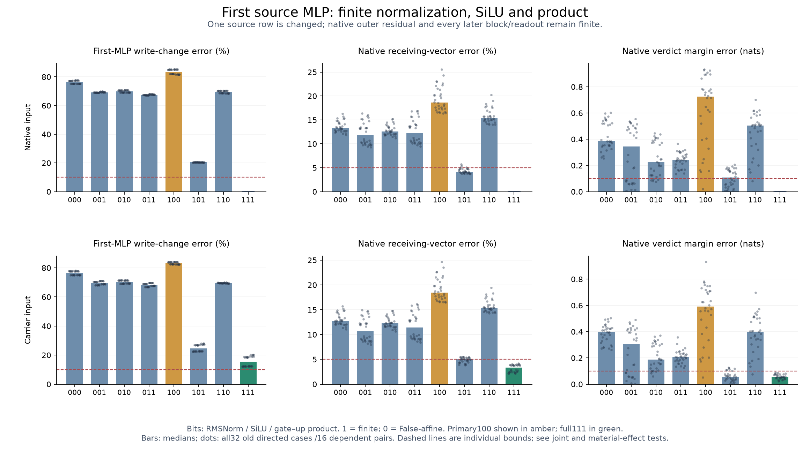
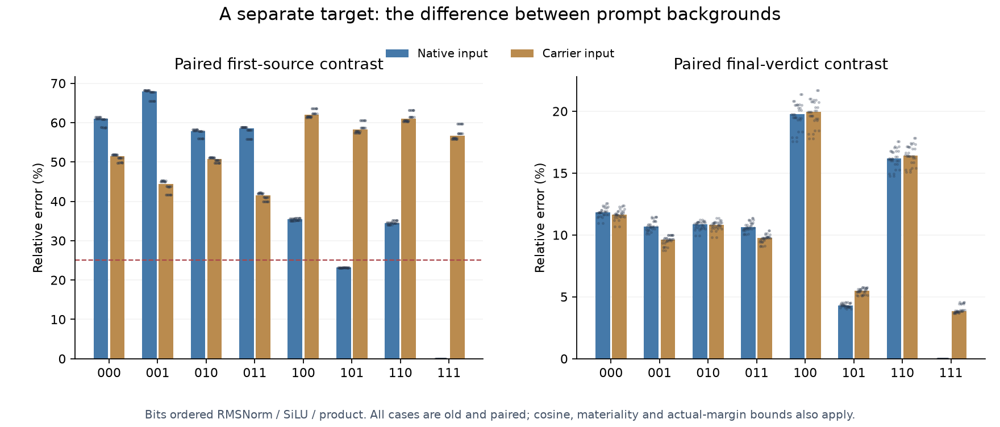

# Normalization's effect depends on multiplication

**Finite normalization alone fails to explain the first source MLP write.**
It makes the native receiving-vector prediction worse in all 32 old cases when
the gate–up product stays False-affine. With the product finite, restoring finite
normalization improves that vector prediction in all 32. This reversal holds
with either finite or False-affine SiLU. It is a measured conditional effect
of defined primitive interventions, not evidence of a learned semantic circuit.

The normalization-only primary fails 0/32. No nontrivial native or carrier corner
passes the full registered sufficient-account criterion. Finite normalization
and product with affine SiLU gives 11/32 original native passes, while all three
finite operations recover 32/32 exactly. Activation curvature is still needed
for the full source-write target. All failed controls remain attached.

[Frozen protocol](../experiments/278-source-mlp-primitives.md) ·
[Every case and signed ledger](../../results/source-mlp-primitives-278/README.md) ·
[Reproduce](../../research/README.md#source-mlp-primitives-278)



## Why test the large write instead of the small gain correction?

276/277 predict a small context-dependent source contrast more accurately by
moving the local MLP sensitivity point. The stronger gain explanation fails
8/32 old and 6/32 fresh, while simpler controls already meet the original native
response tolerance. Explaining that small correction alone risks drifting from
the behavior we want to explain.

Removing the whole first-source MLP write change instead causes about 19% median
receiving-vector error and 0.6 nat margin error. 278 asks which nonlinear operations
generate that larger material write. It is a source-generation question at one
site. Every later block and receiving computation remains finite.

## The intervention and its information

Use all 32 OLD 276 cases,16 dependent matched-background pairs. Freeze code/protocol
at `828706083a0c8e0eaecf088379a902a4ec41c9b8` before new 278 computation. This is a
retrospective primitive test, not a fresh predictor or new independent tasks.

At the first source MLP, independently choose finite versus False-affine:

- **RMSNorm:** actual normalized input, or observed False output plus its smooth
  CPU64 directional derivative at the False parent.
- **SiLU:** actual activation, or observed False activation plus its smooth False
  gate slope times the gate change.
- **Product:** actual current gate activation times current up, or the False
  product plus the two False-coefficient first-order terms.

Bits are ordered RMSNorm/SiLU/product:1 finite,0 False-affine. Learned gate/up/down
projections stay finite. Affine maps use observed Float32 False primitive outputs,
CPU64 derivatives and one Float32 installation. They are explicit primitive
surrogates, not a whole-block Float32 Jacobian.

Run every corner with either the native attention midpoint (**N**) or 276's
carrier branch input (**C**). The outer residual always stays at the native
attention midpoint. Only the source row's primitive outputs change; other rows,
27 later blocks/source dynamics/queries/receivers and the final full-vocabulary
readout remain finite. C111 must reproduce the earlier carrier-only intervention.
N111/T, all local False zero edits and FZ/F must be exact.

Three matched random output-write directions are added to N000, with norms
matching the whole native nonlinear write remainder N111-N000. These are actual
source-write controls; they do not match neuron products or on-manifold structure.

## A direct causal interaction in the receiving vector

Compare the same incoming native state with and without finite normalization,
holding the other two primitive choices fixed. Across all 32 cases:

- Product affine, SiLU affine: N100 versus N000 makes receiving and verdict
  vector errors worse 32/32. Median receiving error rises 13.30% to 18.65%.
- Product affine, SiLU finite: N110 versus N010 also worsens both vectors 32/32.
- Product finite, SiLU affine: N101 versus N001 improves both vectors 32/32.
- Product finite, SiLU finite: N111 versus N011 improves both vectors 32/32,
  recovering the native response exactly.

These are posthoc comparisons of the preregistered corners, retained case by case
in `ablation-comparisons.csv`. They do not count as 32 independent discoveries.
Their outcome is vector accuracy; margin improvement is not universal. For example,
N101 versus N001 improves actual margin error 27/32, not 32/32.

Holding finite normalization fixed, restoring finite product (N100->N101) reduces
median whole receiving error 18.65% to 4.154%, verdict-vector error 14.23% to 3.293%,
and actual margin error 0.7248 to 0.1091 nat. Both vectors improve 32/32 and margin
improves 31/32. Still, N101 has only 11/32 strict native passes and 0/32 full sufficient
accounts. A favorable median is not a passed hypothesis.

## The product supplies a specific missing displacement

In smooth arithmetic let the False activation/up values be phiF,uF and their
changes dphi,du. The current product change contains

```
uF * dphi + phiF * du + dphi * du.
```

The False-affine product drops the last term. Correcting input normalization
changes both downstream operands. Keeping their old linear product response
therefore omits a particular new vector, not merely a scalar gain adjustment.
With affine SiLU this term is quadratic in the changed normalized input, through
the learned gate/up projections and down projection. Actual Float32 anchor and
installation rounding is retained in the recorded policies; the smooth identity
is not asserted to be bit-exact Float32 arithmetic.

This gives a concrete way to understand the conditional result. A more accurate
normalized input does not guarantee a more accurate downstream write when its
multiplicative response is held at the False point. The measured normalization/
product interaction is consistent with this known architecture. It does not
establish a new architectural principle, unique attribution or learned feature.

## Absolute response and context contrast can separate in either direction

N101 passes 32/32 paired first-source/final-verdict contrast tests, but only 11/32
original native tests. Its median first-MLP write-change error is 20.43%, above
10%/.995 required. Its median paired source-contrast error is 23.13%.

C111 has the complementary pattern:32/32 original native passes but 0/32 paired
contrast passes, with 56.70% paired source-contrast error. Its source-write error
is 15.44%, so it also fails the registered local write target. This comparison
concerns different operational targets; it does not name a common/contrast
feature or prove that either component is independently represented.



## All registered sufficient accounts fail

The primary N100 must pass original native response, local source-write
10%/.995/material, whole-first-MLP-path T-Z 25%/.95/material/finite-margin, and
paired first-source/final-verdict contrast criteria. At least 24/32 and 6/8 in each
schema/order stratum are required. It obtains 0/32, 0/8 every stratum.

Every nontrivial N/C candidate also obtains 0/32 combined. N111 and unhooked T
obtain 32/32. No alternate arm rescues the primary. The separate material nonlinear
restoration account N100-N000 versus N111-N000 also fails 0/32; matched random
controls each obtain 0/32 restoration passes. C111 obtains 14/32 on that conditional restoration endpoint
but still 0/32 combined sufficient accounts. This is not a fresh source rule.

N101 passes 14/32 whole-first-MLP-path effect tests. C111 passes 17/32. These are
different from the original native criterion and the paired contrast. Every
numerical and scientific endpoint is separately available in the all-case records.

## Signed ledgers do not replace interventions

The frozen analysis decomposes the 8 corners into seven signed Mobius terms at
the source write and final receiving/verdict states. Every case reconstructs
111-000 within 1e-10. A supplemental zero-model analysis retains actual signed
margins and a paired first-source ledger, including incoming midpoint, affine MLP,
all seven nonlinear terms and Float32 addition rounding.

For native-input verdict vectors, median projections onto 111-000 include product
0.581 and RMS/product interaction 0.324; other terms include negative contributions.
Medians need not add, and large projections can conceal vector error. Final-state
factorials include finite downstream feedback, rather than independently
transporting local terms through a fixed reader. These are defined ledgers, not
unique mechanistic shares or competing learned processes.

## Numerical qualification and cost

All 21,600 required checks pass.448 smooth False primitive derivative directions
are independently checked with Torch Double JVP, two finite differences and two
standard reverse contractions. Largest JVP discrepancy 8.89e-16; central-difference
error 6.05e-9. Every public primitive policy and actual site installation replays
exactly. All 4,608 recorded CPU64 raw comparisons pass the original 1e-4 bound.

The frozen protocol allowed surrogate raw intermediate failures to remain
qualified diagnostics if public replays/primitive derivatives passed; none occurred
here. Fully finite F/C/N111 whole-MLP output bridges pass 1e-4. All 736 actual finite
heads replay exactly and CPU64 bridges pass.005. Unhooked native controls,
all-layer unchanged prefixes, zero edits, native-source addition, C111/oldC and
Z/oldZ replays are exact. Separate numerical paths remain within one investigation,
not an independent team or independent whole-model implementation.

No old block 28 derivative or raw-logit failures are recertified.204 remains its
qualified retrospective diagnostic; invalid replacement-agent claims remain
invalid. Historical grounding failures preclude a competent-verifier shutdown
or deployment failure claim.

736 full forwards and 768 additional full-shaped source MLP maps ran in 180.31 s;
the separate audit took 26.27 s in the pinned Qwen 1.5B/MPS environment. These include
instrumentation/storage and are not marginal latency measurements. Raw arrays
375,665,311 bytes stay local with public hashes and regeneration code. No efficiency
or compact whole-network predictor is established;272 remains the cost baseline.

## What this leaves open

The normalization-only hypothesis is rejected. A defined normalization/product
interaction materially affects how the first source write propagates, while
activation curvature is needed for the full local write and strict response.
A prospective test must now predict that curvature from False-state information,
not borrow native source activations. 279 freezes such a cubic-activation test
separately; it cannot retroactively rescue 278. This does not explain the complete
learned generator or solve general Question B.
