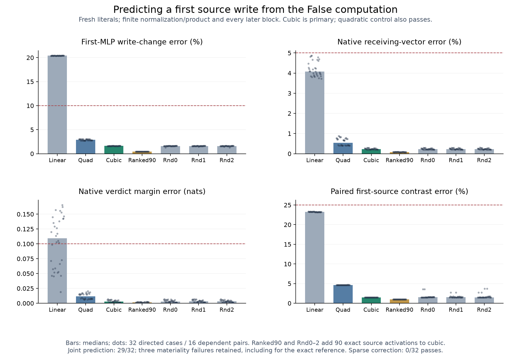

# A False-state polynomial predicts the first source write

**The preregistered cubic source rule passes its fresh prediction test:29/32
full joint cases, with 32/32 accurate source writes and original native responses.**
The quadratic control also passes. The three joint failures have first-MLP margin
effects below the frozen materiality cutoff; the exact native reference fails
those same cases. They remain failures in the denominator of 32.

This is a local generative calculation: False activation coefficients, the known
edit and model weights predict the first source MLP write without evaluating its
complete native True activation. Finite source normalization, gate/up projections,
multiplication, attention and every later block remain. It is not a compact
whole-network predictor, learned semantic circuit or complete answer to Question B.

[Protocol](../experiments/279-sealed-source-activation.md) ·
[All cases and pre-native receipt](../../results/source-activation-forecast-279/README.md) ·
[Preceding causal test](278-source-mlp-primitives.md) ·
[Reproduce](../../research/README.md#source-activation-forecast-279)



## What the primitive experiment suggested

278 rejected normalization alone. Restoring finite source input normalization
made the receiving-vector prediction worse when the product stayed False-affine,
and better when multiplication was finite. Linear SiLU with finite norm/product
recovered much more, but still missed the full source write. This suggested a
specific missing computation: activation curvature multiplying the changed up
values, rather than one portable Boolean displacement.

279 tests that idea prospectively at the same first-source site. It does not
rescue the failed 278 normalization-only or 277 material gain accounts.

## The update, stated as a calculation

Let xF be the observed False input to MLP1. Regenerate the changed source attention
midpoint using the known edited embedding and unchanged False causal prefix.
Evaluate its input RMSNorm and gate/up projections, yielding current g,u. Observe
False gF,uF,phiF from the one False computation; let dg=g-gF and du=u-uF.

For primary cubic C, form

```
A(dg) = phi'(gF) dg + phi''(gF) dg^2 / 2 + phi'''(gF) dg^3 / 6
phi_hat = phiF + A(dg)
write_hat = down_projection(Float32(phi_hat) * current_up)
```

All coefficients are smooth CPU64 derivatives evaluated at the False gates.
The actual product and learned down projection execute finitely. The quadratic
control Q omits the cubic term; L keeps only the first derivative.

In smooth arithmetic the predicted write displacement includes

```
down_projection(phiF * du + uF * A(dg) + A(dg) * du).
```

The last term retains the joint change of the operands. Normalization makes
the input changes state-dependent; learned gate/up projections turn those into
coordinate changes, and down-projection columns combine their products into a
particular residual direction. The False gate coefficients are context-dependent
too. This describes a concrete local generator without naming a learned feature.
Observed Float32 anchors, casts and projection rounding are retained in code;
the displayed smooth identity is not asserted to be bit-exact Float32 arithmetic.

“Quadratic” and “cubic” here refer to the **activation** polynomial, not the whole
transformer. Multiplication by changed up values raises the polynomial degree
of the write in the changed normalized input. Normalization and attention are
finite nonlinear maps.

## No native True source activation supplied to the forecast

The source MLP branch inside each full forecast actually runs at its observed
False input/primal. Its output is replaced by the predicted absolute write.
The outer residual remains at the regenerated current attention midpoint. Every
other first-MLP row and every later operation stays finite.

The optional S candidate uses cubic plus 90 selected finite source activation
coordinates. Rank by |dg|^4*|current up|*||down-column||, with deterministic index
ties; all inputs to that ranking are available before the native measurement.
Three random 90 masks use the same finite-coordinate budget. Only selected current
gates are passed to the masked activation maps; all other source gates stay False.
90/8960 is 1.0045% rounded up, not 1% of model work. No complete current source
activation primal is evaluated before the seal. C/Q/L use zero current finite
source SiLU coordinates, with every later source activation still finite.

## A genuinely prospective local test, with a narrow generalization claim

The 32 apatite/peridot literal contexts have 64 hashes absent from 1,984 cataloged
historical inputs. They use the same dependent synthetic templates:16 matched
background pairs, not 32 independent trials or new task families. Backgrounds
differ in instructions, token positions/lengths and field names; no pure semantic
field-name effect is isolated.

Scientific code/protocol/cases were frozen at
`f8120436877c213441d189bd399190949cdd4308` before checkpoint execution on them.
All 32 forecasts and their separate numerical qualification were committed and
pushed in [receipt 519f4e8](https://github.com/romrom-20/counterfactual-traces/commit/519f4e857c1448662e0d914bccbedb495df4d4a1)
BEFORE ordinary native True measurements. The native stage verifies the pushed
commit and immutable source/array seals before running. It then confirms the
prepared source attention/norm/gate/up operands and selected activations exactly.

## Frozen results and all three materiality failures

Primary C must jointly pass original native receiving/verdict 5%/.99/.10 nat,
source-write change 10%/.995/material, whole-first-MLP-path T-Z 25%/.95/material/
finite-margin, and paired source/final-verdict 25%/.95/material/finite-margin tests.
The threshold is>=24/32 and>=6/8 per schema/order stratum. The added write and
paired targets never replace the original native response.

C obtains **29/32 joint**, strata 8/8,8/8,6/8,7/8. Its original native, local write
and paired tests each pass 32/32. Q, S and each random 90 candidate have the same
29/32 joint and 32/32 original/local/paired outcomes. L has 13/32 original native,
0/32 local write and 0/32 joint; Z has 0/32. Every result and eligibility failure is
retained, including the exact T reference's 29/32 joint.

The three exact-reference material T-Z margin effects are−0.002213,+0.012672 and
−0.003151 nat, below the required absolute.02 nat. The corresponding original
native/write/paired predictions still pass, but these cases are not discarded
or relabeled as 29/29. Cubic C and S pass the other vector and margin-error
components in all 32 cases. Quadratic Q additionally misses the tight T-Z
margin-error bound on these same three below-materiality cases; its joint count
is unchanged. `eligibility.csv` identifies both failure flags explicitly.

Separate across-case medians:

- **Linear L:**20.416% source-write error,4.084% whole receiving error,
  0.10923 nat margin error,23.229% paired source-contrast error.
- **Quadratic Q:**2.885% source-write error,0.5433% whole error,
  0.01172 nat margin error,4.630% paired source-contrast error.
- **Cubic C:**1.611% source-write error,0.2254% whole error,
  0.002819 nat margin error,1.472% paired source-contrast error.
- **Cubic+ranked 90 S:**0.4439% source-write error,0.08141% whole error,
  0.001616 nat margin error,1.004% paired source-contrast error.

Random 90 controls remain near the cubic baseline, about 1.604% source-write error.
These refinements affect precision; they do not establish necessity of the selected
finite activations at the frozen prediction tolerance. Quadratic already passes.
C here names the cubic rule, not the carrier input C in 278.

## The stronger sparse correction account fails

The separately registered account tests S-C against the missing native T-C local
write and actual downstream effect, with 25%/.95/material vector and actual-margin
criteria and at least two random-mask controls failing. It obtains **0/32**,
0/8 every stratum. All restoration counts, including the exact native reference,
are zero. Cubic-to-native margin differences are below.02 nat in every case
(maximum 0.007061 nat); some S correction-vector bounds also fail.

Do not turn better precision into a necessary learned mechanism, or substitute
a relaxed posthoc target. This failed account is distinct from the successful
primary cubic and secondary sparse prediction tests.

## Numerical qualification and work budget

Before native True, all 4,928 required checks pass. All 32 False gate anchors have
first/second/third coordinate derivatives checked by independent Torch Double
autograd and two central-difference steps:96 coefficient vectors. Maximum AD
error 2.78e-16, maximum finite-difference error 1.10e-9. All 672 recorded CPU64 raw
phi/product/write comparisons pass the original 1e-4 bound. Public source operand,
predicted product/down projection, False branch primal, installation, zero edit
and full-vocabulary head checks pass. Final-head CPU64 bridges remain<=.005.

The post-native audit adds 832 exact prepared/native/selected-activation operand
checks plus native first-source addition and finite-head replay. This is separate
numerical code within one investigation, not an independent team or whole-model
implementation. No old whole-block derivative/raw-logit failure is retroactively
passed.204 and invalid replacement-agent qualifications remain unchanged.

Before the seal:32 full False observations and 288 full forecasts,32 extra first
attention calls,32 source norm/gate/up maps,128 padded masked SiLU maps across four
masks and 224 source product/down maps, plus audit.32 native references follow.
The experiment's padded/masked maps still perform work at unselected False
coordinates. Every later activation/dense computation is finite. No meaningful
whole-model efficiency improvement over 272's causal-cache baseline is claimed.

Producer timings on pinned Qwen 1.5B/MPS:73.07 s forecast,12.45 s preaudit,14.62 s native,
7.92 s outcome audit. These include loading/instrumentation/storage, not a marginal
latency benchmark. Forecast arrays 81,675,881 bytes and native arrays 16,003,156 bytes
stay local with public hashes/regeneration. The published-literal repetition
helper separately recomputed 32 native references from reused original forecasts,
reproducing every native/joint count; it is explicitly not new fresh support.

## What part of Question B is answered?

There is now a tested local answer: finite normalization and joint gate/up
transmission, with activation curvature computed at the False state, predict the
first source write and its continued behavior on fresh literal contexts. Exact
native activation at that site is unnecessary for the registered accuracy bounds.
The first-order activation misses the source write; adding curvature succeeds.

This is not an explanation of every later source/query displacement, training
origins, semantic features or an efficiently predicted whole trajectory. First
attention, normalization, projections, multiplication and 27 later blocks still
execute. The particular source input is regenerated using the known edit and
False prefix, rather than explained as a compact learned semantic path. General
Question B remains open. Historical grounding controls failed, so no reliable
verifier shutdown or deployed-agent failure rate follows. No novelty priority
or direct attribution-patching comparison is established.
