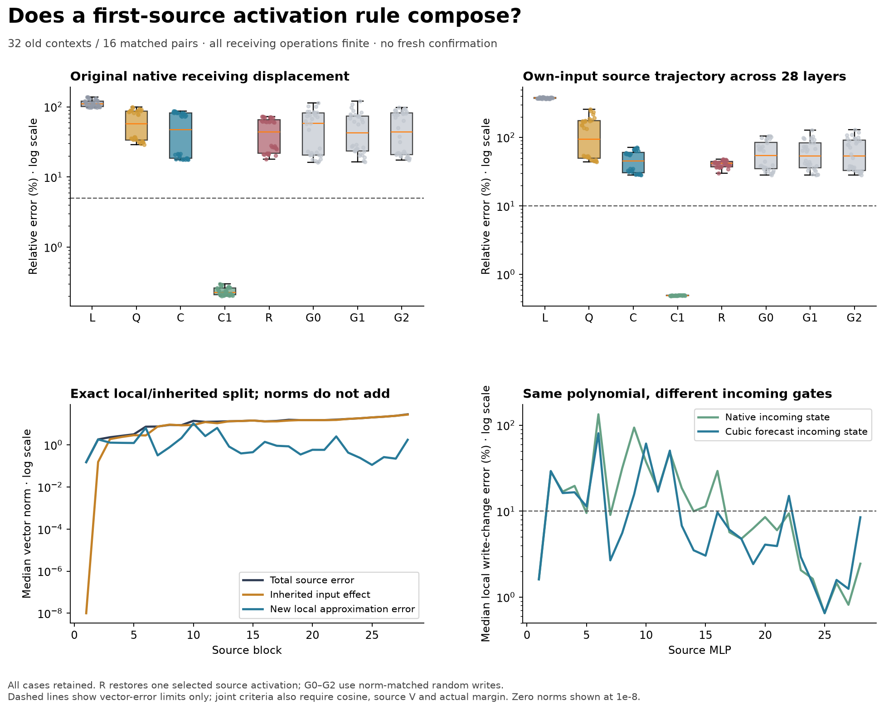

# A first-source rule does not compose uniformly

**The cubic source rule fails when applied at all 28 source MLPs: 0/32 complete
native-response, source-trajectory and joint passes.** Keeping cubic only at the
first source MLP retains 32/32 original native and trajectory passes. The first
new breakdown is already at source MLP2, including at its native incoming state.

Removing the single largest local discrepancy does not recover the response:
0/32, with the stronger missing-effect account also 0/32. This rejects one uniform
extension of 279, not counterfactual prediction generally. These are 32 OLD
contexts; no fresh confirmation or learned-circuit discovery is claimed.

[Original protocol](../experiments/280-source-composition.md) ·
[Storage qualification](../experiments/280b-storage-continuation.md) ·
[All evidence and retained failure](../../results/source-composition-280b/README.md) ·
[Reproduce](../../research/README.md#source-composition-280b)



## The question this actually tests

279 predicted one first-source write using cubic activation coefficients at the
observed False gates. Attention, normalization, projections, products and every
later block stayed finite. Its fresh primary passed 29/32 joint tests, with all
three materiality failures retained. That result did not establish that the same
update would work as its own approximated source states fed later layers.

280 tests exactly that extension. At each source MLP the current gates come from
the forecast's own evolving state, with finite attention/norm/projections. The
activation is expanded about that layer's observed False gates, then multiplied
by the current up values and projected down. Receivers always compute finitely.
Causal masking prevents later receiving rows from influencing the source.

Before each approximated activation, the actual source gate row is replaced by
its False value. Its actual SiLU primal must equal the observed False activation;
only then is the polynomial installed using the captured current gate. C does
not secretly evaluate finite current source SiLU at any layer. Other rows and
all other operations remain finite, including the final vocabulary readout.
This is a full-shaped, expensive calculation, not a small-work predictor.

## Fixed controls and original targets

C is the all-source cubic PRIMARY; Q and L are fixed quadratic/linear controls.
C1 uses cubic only at source MLP1; it must replay 279 C's source1/final/scores
exactly. T/F are native arithmetic with observational hooks, and FZ is a False
zero edit under the cubic policy. Every prefix/source K/V-prefix hash is exact.

Original native whole-receiving and verdict vectors must each pass 5% relative
error, .99 cosine and material norm, plus actual margin error at most .10nat.
The added all-28 source-trajectory and emitted-value targets require 10%/.995
and material norm. The joint primary requires at least 24/32 and six per eight-
case schema/order stratum. Q/L cannot rescue a failed C primary.

All C/Q/L original native, trajectory and joint counts are **0/32**. C1 and T
have **32/32** on those endpoints. C1's new joint criterion is different from
279's additional material whole-first-MLP-path effect criterion; its 32/32 here
does not erase 279's three joint failures.

Separate across-case medians:

- C: 47.15% whole receiving error, 42.53% verdict error, 3.375nat margin error;
  45.11% source-trajectory error and 39.41% emitted-value error.
- Q: 57.23% whole error, 2.693nat margin error, 94.38% source-trajectory error.
- L: 109.46% whole error, 6.328nat margin error, 376.43% source-trajectory error.
- C1: .2254% whole error, .002819nat margin error, .4931% source-trajectory error.

Cubic improves some vector medians over quadratic but has worse median margin
error. Neither passes. One favorable metric does not establish a better complete
behavioral forecast.

## The first failure is newly generated, not just inherited

At each layer, form x by replacing C's source MLP write with the finite write at
C's SAME attention midpoint. The saved native source t and forecast source c obey

```
t - c = (t - x) + (x - c).
```

The second vector is the new local activation approximation discrepancy. The
first is the finite block's response to an inaccurate incoming source state,
with its unchanged causal prefix. This is an exact accounting identity with
Float32 source additions and Float64 subtraction; no block Jacobian is used.
All 896 layer/case closures pass 1e-10. Norms and median projections do not add.

At MLP1 the inherited term is exactly zero and the local write prediction passes
32/32, with 1.61% median error. At MLP2 the local prediction fails 32/32 even when
evaluated at the native incoming gates: 28.89% median error. At C's own gates it
has 29.34% median error. Median new source error norm is 1.836, versus .156 for
the inherited term. The new term's signed projection on total source error lies
between .99343 and .99525. This is a defined projection, not a universal causal
percentage or an identified circuit.

Both later new errors and inherited input effects remain. MLP6 and MLP10 produce
large local discrepancies; many later layers' total errors are mostly inherited.
The native-input local cubic error at MLP6 is 134.17%, even larger than at C's
incoming state. The uniform first-site rule is not locally accurate everywhere.

## An inaccurate trajectory can hide a local approximation problem

At MLP8 the same cubic formula has 31.65% local error at native input but only
5.58% at C's own input. The absolute missing-write norm also falls, from 5.086
to .779, so this is not only a changed denominator. Yet the source state remains
wrong, with a large inherited error.

This is a retrospective matched-function comparison on different inputs. It does
not identify a flat learned feature or a new mechanism. It shows why testing
local approximation quality only along a forecast can be misleading: the
forecast may have moved away from the native computation we wanted to explain.

## One actual local removal, with matched controls

After base forecasts, evaluate finite local writes at all 28 C source inputs.
Select the largest missing-write norm, using no native True or final-response
information. It selects block10 in 16 cases, block6 in eight, block12 in seven
and block18 in one. This selection spends 28 finite local maps per case.

R makes only that selected activation finite; later source states and receivers
adapt normally. Its incoming state/gates/up and earlier source states match C
exactly, and the selected local finite write/source state replay exactly. G0–G2
instead add seeded random source writes of the same pre-rounding norm at that
same layer. Their inputs and installation checks also pass.

R improves whole-vector error in 17/32 cases, verdict-vector error in 19/32 and
margin error in 24/32. It still has **0/32** original native, trajectory and joint
passes. Median whole error is 43.91%, source error 41.81%, margin error 2.941nat.
Some random controls also improve individual metrics; G1's median whole error is
42.52%, lower than R's. There is no selective full-response rescue.

The stronger R-C versus missing T-C vector/margin account obtains **0/32**, below
24/32 required. Its failures and every random control remain. Removing a large
local discrepancy is not a sufficient explanation of the complete failure.

## A posthoc gate clue, not a causal neuron result

A zero-model saved-array calculation decomposes the native-input MLP2 omission
into the down-projected products `(finite_phi - cubic_phi) * up`, with the
Float32 product/projection rounding residual kept separately. The median gate
change norm is 89.83 across 8,960 coordinates; maximum coordinate change is 4.479.
Only 12 coordinates cross zero at the median, but these account for 67.69% of
the sum of individual omitted-vector energies before cross-neuron cancellation.
The 90 largest target-aware energies account for 99.37% of that energy and
reconstruct the omitted vector to 8.08% median relative error. The rounding
residual is 1.52e-5 of target norm at the median.

These masks use native omissions, so they are retrospective concentration
measurements, not a False-only selector or a neuron intervention. Sign regimes
are not learned features. Crossing neurons alone are not the complete account.
A next targeted test can ask whether an input/False-state-derived selection
predicts these consequential products and survives direct product interventions.
No such test is reported here; no broader correction sweep follows from a
concentrated retrospective norm alone.

## Numerical qualifications and retained storage failure

Original science froze at bf937b04b749d6732115174b9082d6a5703e9558 before checkpoint
execution. It stopped before case29 at its 768MiB disk reserve; the raw cap was
also insufficient for the estimated completed output. All 28 completed arrays,
original source/protocol and failure remain unchanged.

Storage-only 280b froze at 8d2eebb26b57e655eaa7418c50d35e49fed7b1ca before the four
remaining cases. It hardlinks the 28 originals, changes storage limits explicitly,
and executes four more cases. The ORIGINAL audit280 and all scientific/numerical
bounds remain unchanged. A first 280b launch also rejected its initial reserve
before checkpoint execution or output creation. Only regenerable workspace
bytecode was cleared; no scientific evidence was deleted or recompressed.

All 32,064 required numerical checks pass. All 896 False gate anchors have
2,688 first/second/third derivative vectors checked by independent TorchDouble AD
and two central differences. Maximum AD error 8.89e-16; FD error 1.10e-9. All 11,648
full-shaped public down-projection replays and 352 finite vocabulary heads are
exact, including product hashes and intervention installations. CPU64 final-head
bridges pass .005; maximum required-check error is 9.34e-6.

**260 of 31,360 raw CPU64 comparisons fail their original 1e-4 absolute bound.**
All are write bridges, including fully finite F/T controls; maximum error .000477.
They remain failed diagnostics under the prespecified component qualification.
Do not call all raw comparisons passed, infer bit-exact independent arithmetic,
or recertify earlier whole-block derivatives/raw logits. This is separate code
within one investigation, not an independent research team or whole-model proof.

352 total full forwards and 1,792 extra local product/down maps ran across the
original and continuation producers; 896 of those local maps evaluate finite
SiLU. The audit adds explicit public replays. Producer times: 149.16s original,
31.04s continuation; audit 71.11s. Loading/instrumentation/storage are included,
so these are not marginal latency measurements. Raw arrays total 1,422,656,845
bytes; the 28 original hardlinks do not duplicate their disk blocks.

General Question B remains open. The first-source local success survives; this
uniform extension fails. Native source/query generation and its compact
prediction still need further causal tests. Historical grounding controls failed,
so no competent-verifier shutdown follows. No priority, efficiency or learned-
circuit claim is established.
