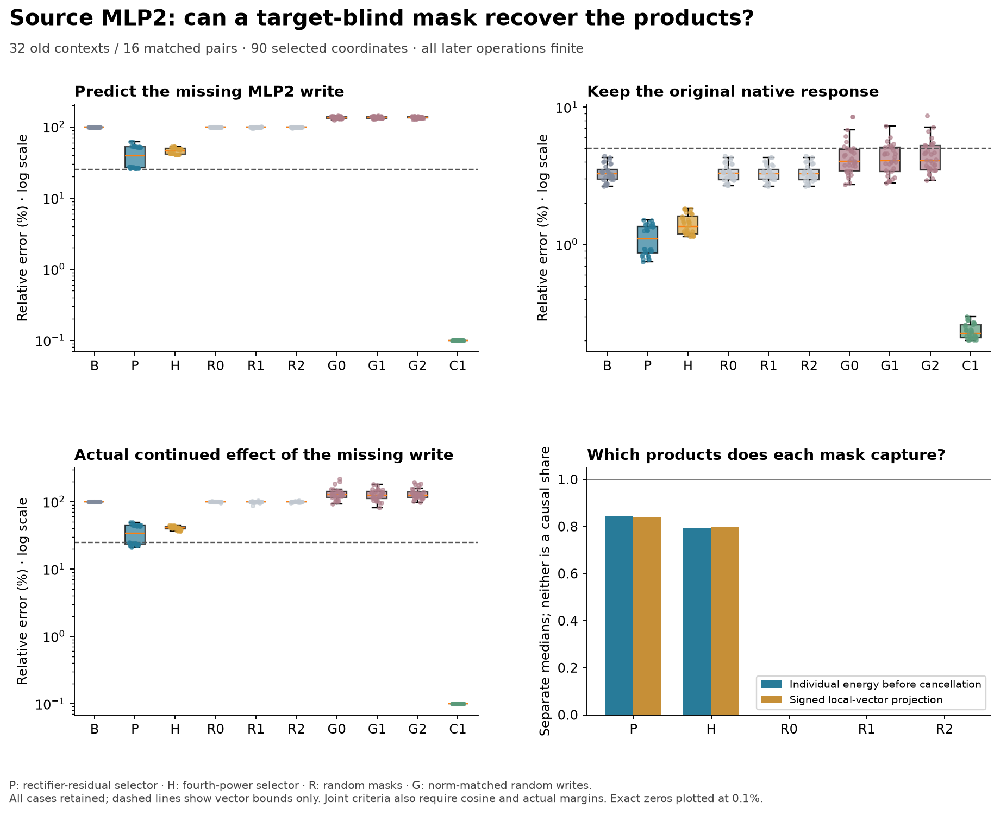

# Recovering the verdict does not recover the missing source write

**The preregistered source-MLP2 product account fails: 0/32 joint passes.** Two
target-blind selections of 90 coordinates nevertheless recover the original
native residual/verdict/margin criterion in 32/32 old contexts, versus 16/32 for
the two-site cubic baseline. This is a bounded prediction improvement. It is not
a sufficient explanation of the missing local write or its continued effect.

A saved-array geometry check explains why these statements coexist: the missing
effect is small relative to the complete native displacement. The two masks'
different effects remain distinguishable after propagation. There is no evidence
here that a common downstream circuit erases them. A separate exact SiLU identity
locates an approximation term missed by the primary selector; it is a mathematical
ledger, not a newly identified learned mechanism.

[Frozen protocol](../experiments/281-source2-products.md) ·
[Execution qualifications](../experiments/281d-resume-binding.md) ·
[Numerical qualification](../experiments/281e-random-control-order.md) ·
[Every case, failure and audit](../../results/source2-products-281d/README.md) ·
[Reproduce](../../research/README.md#source2-products-281d)



## What is supplied and what is predicted

Use the same 32 old contexts as 279/280, with 16 dependent matched background
pairs, one pinned Qwen2.5-1.5B checkpoint and the original fixed decoder. These are
not fresh contexts. False means the observed earlier-bit computation; True is
the ordinary edited run, not a correctness label. All candidates use the known
edit, model weights and full False observation, without native True activations.

B applies False-coefficient cubic SiLU at source MLP1 and MLP2, with every later
operation finite. Its own MLP2 gates, up values and cubic activations supply the
selection input. P, the primary, ranks

```
abs(phiFalse + ReLU(gCurrent) - ReLU(gFalse) - phiCubic)
    * abs(upCurrent) * norm(downColumn).
```

H is a fixed comparator ranking `abs(gCurrent-gFalse)^4 * abs(upCurrent) *
norm(downColumn)`. Each selects the top 90 of 8,960 coordinates, with deterministic
ties. R0–R2 select seeded random masks of the same size. Only selected current
gates enter finite SiLU; unselected actual source gates are clamped to their
False values before polynomial installation. The complete current MLP2 activation
is not secretly evaluated for these candidates.

D restores the selected neuron products directly and must reproduce P exactly.
G0–G2 add random output writes with the same pre-rounding norm as P's correction.
FZ is a zero-edit control. Only after the candidates, C1 makes source MLP2 fully
finite while leaving MLP1 cubic. A removes P's finite-minus-cubic products from
C1; A0–A2 remove random-mask products. Native T is measured last. Calibration C1
and T are not used to choose masks. Archive replays are checked after execution.

The budget includes a preparatory B forward. All other 26 source activations,
all receivers, attention, normalization, learned projections, products and final
full-vocabulary heads remain finite. These full-shaped forwards do substantial
model work; there is no demonstrated efficiency improvement over the
[affected-suffix cache baseline](272-research-review-and-causal-baseline.md).

## Three fixed targets, with every failure retained

The primary requires all three, in at least 24/32 cases and six per eight-case
schema/order stratum:

- Original native T-F whole receiving and verdict displacements: material norms,
  at most 5% relative error, cosine at least .99, actual margin error at most .10nat.
- Local P-B source-MLP2 write versus C1-B: material norm, at most 25% error and
  cosine at least .95.
- Actual continued P-B versus C1-B receiving/verdict effects: material vectors,
  25%/.95, a margin effect of at least .02nat, and margin error at most
  `.005 + .25 * abs(target margin effect)`.

P obtains **32/32 native, 0/32 local, 7/32 effect and 0/32 joint**. H obtains
**32/32 native, 0/32 local/effect/joint**. Every primary stratum is 0/8. There are
no below-materiality margin cases; the local vector account actually fails.
H does not rescue P's preregistered primary.

Separate across-case medians make the different targets visible:

- B: 3.28% native whole-vector error and .1043nat margin error.
- P: 1.10% native whole error and .02286nat margin error, but 39.40% missing-write
  error, .9101 local cosine and 33.90% missing-effect whole error.
- H: 1.35% native whole error and .05331nat margin error, but 45.70% missing-write
  error, .8892 local cosine and 41.10% missing-effect whole error.
- C1: .2254% native whole error and .002819nat margin error; its local/effect
  self-comparisons pass 32/32.

Every B case already meets the native vector bound. All 16 generic-schema cases
fail its .10nat margin bound; all 16 descriptive cases pass. P/H recover the
generic margins. Removing P's products from C1 leaves only 18/32 native passes
(two generic, all descriptive), showing a consequential intervention but not
the complete causal account. Random restoration masks each retain B's 16/32;
random output writes pass 17, 16 and 14. Random product removals retain 32/32
native passes. All controls remain in the public CSVs.

Selective restoration, controlled removal and the stronger behavioral-necessity
accounts each obtain **0/32**. The latter also requires B to damage the original
behavior; that guard passes only 16/32 and fails the registered pooled/stratified
threshold. An improvement in precision does not establish necessity.

## What the signed product and geometry ledgers show

P and direct-product D reproduce source writes, final states and scores exactly.
Their input midpoints, gates and up values match B, and their first source state
is unchanged. Thus this is an actual intervention on the selected products,
with subsequent computation adapting, not merely a score attribution.

P captures a median 84.54% of summed individual omitted-product vector energies;
H captures 79.51%. These are before cross-neuron cancellation. Their signed local
projections onto the missing vector are .8409 and .7967. Neither number is a
causal share. Their median mask overlap is only 13.5 of 90 coordinates.

The posthoc geometry check uses the saved interventions without another model
forward. P/H local corrections have .9051 median cosine. Their difference is
39.63% of the missing local write; after propagation it is still 39.23% of the
missing receiving effect, with .9129 median cosine between continued corrections.
That difference is only 1.35% of the complete native displacement. The whole
missing C1-B effect itself is 3.31% of the native norm at the median.

These are separately computed case medians, not an additive identity between
medians. They explain why native-response tolerances can pass while a substantial
fraction of the smaller causal contrast remains wrong. They do not establish
downstream filtering, redundant learned features or a common circuit.

## Why the rectifier proxy misses products

An exact scalar identity is useful here:

```
SiLU(g) = ReLU(g) - q(g),       q(g) = abs(g) / (1 + exp(abs(g))).
```

P's proxy retains the change in ReLU and the False activation, while omitting the
change in this smooth, bounded term. The finite-minus-cubic activation equals
the proxy plus `q(gFalse)-q(gCurrent)`, plus the explicitly retained False-primal
rounding correction. Multiply by the same up values and learned down columns;
keep current product/projection rounding separate. All 96 full/unselected P/H
signed vector ledgers close within 1e-10; scalar identities pass 1e-12.

Over all coordinates, the proxy has median signed projection 1.0291 onto the
missing write and the q change -.0291. But among the coordinates P leaves
unselected, their projections onto the remaining error are -.4265 and 1.4265.
For H's unselected error they are .2212 and .7788. Rounding-vector relative norms
are about 4.04e-5 and 3.29e-5. Thus the globally small-looking smooth correction
is consequential in the selector's remaining error. This is exact accounting
of known SiLU geometry, not evidence of two competing learned mechanisms.

A target-aware top-90 diagnostic on these same incoming states reconstructs the
missing write to 8.03% median error and captures 99.38% of individual energy.
It uses measured finite omissions and is not a forecast, causal intervention or
replacement success for P. The remaining failure is not evidence that 90
coordinates are intrinsically insufficient; the tested target-blind rankings
do not find a sufficient set under the frozen criteria.

This explains a particular approximation failure. It does not explain why the
learned source attention and normalization produce these particular gate/up
movements. A new native gate-generation intervention is needed before another
correction sweep or fresh confirmation of a revised rule.

## Numerical scope and execution failures

The original scientific sources froze at e96526f before checkpoint execution.
The producer stopped on a baseline bookkeeping error before a completed case.
Separately frozen 281b fixed storage order only, then stopped at the original
64MiB cap after 30 sealed cases and a complete unsealed 31st array. 281c raised
storage to 80MiB but failed a resume-variable binding check in its synthetic
preflight. It was inadvertently launched despite that failed preflight and
failed the same binding check. That gating mistake and all artifacts remain.

281d fixes only that binding, after both cold-32 and resumed-30+2 CPU fixtures
pass with identical array hashes. It reuses 30 original sealed cases, regenerates
the orphan 31st exactly, and runs case32. No scientific endpoint or bound changes.
Completed arrays total 71,405,398 bytes. There are 576 completed-study full
forwards, 38 additional failed-attempt forwards, 614 checkpoint producer forwards
in total; audit replays and synthetic fixtures are separate.

The original audit281 then fails an exact random-write reconstruction by
2.78e-17 against its zero bound: multiply-then-divide in the generator versus
divide-first in the auditor. Its failed check stays failed. Separately frozen
281e matches the generator's operation sequence, retaining the exact zero and
1e-10 norm bounds and all other checks. It binds the completed data and failed
audit before rerunning. This is an explicit numerical qualification, not a
silently passed original audit.

Qualified 281e passes all **6,816 required checks**, with maximum error 9.57e-6.
Independent Double AD and two finite differences qualify 192 derivative vectors
at 64 False anchors. All 768 public down, 192 norm/gate/up input, 1,152 actual
primal and 576 full-vocabulary head replays pass; public heads are exact and
CPU64 head bridges meet .005. All **2,304 raw comparisons pass their original
1e-4 bound in this study**. Older raw-write, raw-logit and whole-block derivative
failures remain unchanged. Separate audit code is not an independent team or
independent whole-model replication.

General Question B remains open. We have better old-context response prediction
and an explicit explanation of the selector's limitation. We do not have a
compact whole-network generator, learned circuit, new fresh result or novelty
priority. Historical grounding controls failed; no competent-verifier shutdown
claim follows.
