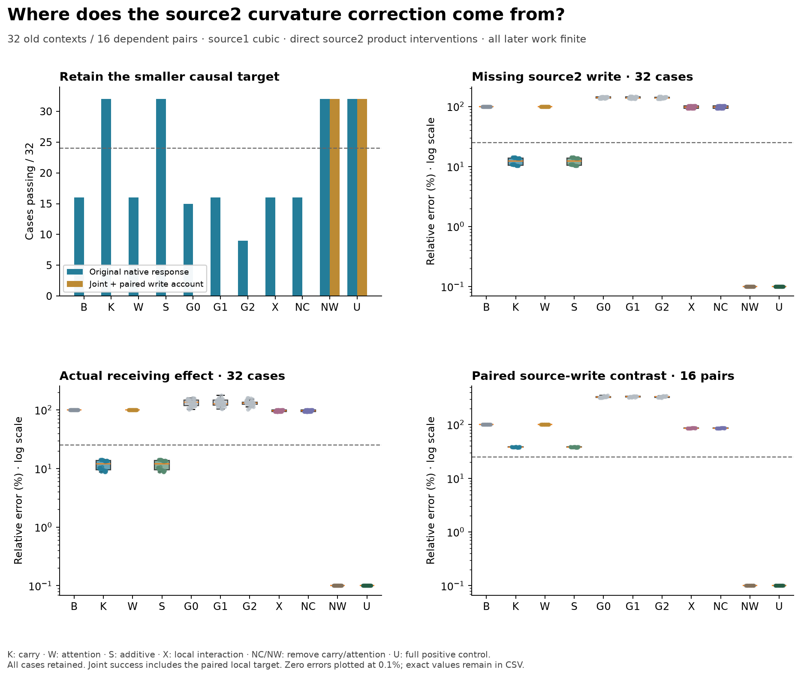
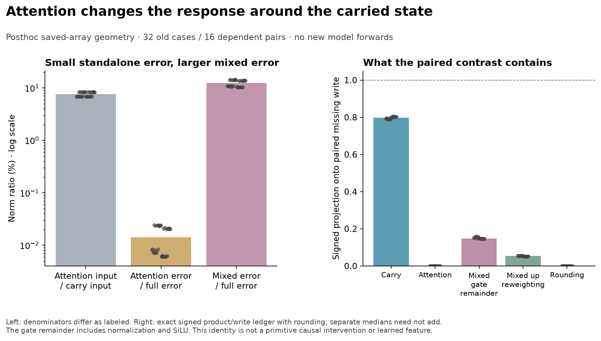

# Carry generates most of the correction; attention changes its context contrast

**The carry-only primary fails:0/32 joint cases.** It nevertheless recovers the
original native response, missing local write and actual continued-effect tests
32/32 each. Its failure is specific:0/16 paired schema-write contrasts. Adding
the attention-only correction does not repair that contrast. Retaining the mixed
correction does, in an explicitly full-calibration diagnostic.

This is a qualified **retrospective** study of32 old contexts/16 dependent pairs.
It explains a source-MLP2 approximation discrepancy under a specified incoming
computation, not the complete native source generator or a learned circuit.
The original numerical audit remains failed; qualifications below narrow its
scope explicitly. [Frozen protocol](../experiments/282-source2-gate-origin.md) ·
[All evidence](../../results/source2-origin-282/README.md).

## What was held fixed

The earlier [product test](281-source2-products.md) repaired native accuracy with
two different masks while failing to reconstruct the smaller missing effect.
Here we test its upstream origin without another selection sweep.

F is native False. B uses False-coefficient cubic SiLU at source MLP1 and MLP2.
C1 keeps only source MLP1 cubic; T is fully native True. At the second MLP's
input, split B-F into carried post-block1 state c and attention2 write change a:

`Bmid = xF + c + a`.

That Float64 identity closes within1e-10. At each input corner F=xF,
C=Float32(xF+c), A=Float32(xF+a), U=actualBmid, evaluate finite normalization,
gate/up projections and finite versus False-cubic activation products. Let
R(corner) be their Float32 product difference, subtracted in Float64. R(F)=0
exactly. R measures the cubic approximation's missing product, not the entire
MLP's native write change.

All direct interventions use B's **same actual incoming midpoint, gate and up**;
only the defined product correction is installed. K adds R(C), W adds R(A),
S adds R(C)+R(A). G0–G2 add random output-write directions matched to K's local
write norm. Only after these candidates are executed do we evaluate full R(U),
then U adds R(U), X adds R(U)-R(C)-R(A), NC removes R(C) from full, and NW removes
R(A) from full. U must reproduce C1 exactly. Native T comes last.

No native True activation or final-response score selects K/W/S. These are still
old-context diagnostics; their ordering does not make them fresh forecasts.
NW and X explicitly use full calibration, and cannot be promoted to prospective
rules. All other26 source activations, all receiving computation, attention,
normalization, projections, products and final readouts remain finite.

## The discriminating outcome

- K carry: native32/32, local32/32, actual effect32/32, paired local0/16, joint0/32.
- W attention: native16/32, local/effect0/32, paired local0/16, joint0/32.
- S additive: native/local/effect32/32, paired local0/16, joint0/32.
- X mixed-only: native16/32, local/effect0/32, paired local0/16, joint0/32.
- NC full minus carry: native16/32, local/effect0/32, paired local0/16, joint0/32.
- NW full minus attention-only: native/local/effect32/32, paired local16/16,
  joint32/32. Full U/C1 are32/32 controls.
- Each matched random write has0/32 local/effect/joint passes; native counts are
  15,16,9. Baseline B has16/32 native passes, all descriptive-schema cases.

All denominators and schema/order strata remain. K has0/8 joint passes in each
stratum. The threshold was>=24/32 with>=6/8 per stratum; no secondary rescues K.
There are16 dependent paired backgrounds, not32 independent contrast tests.

K's median missing-write error is12.304%, cosine.99394. Its actual continued
receiving-effect error is11.935%; original native receiving error is.4524%, with
.00433-nat margin error. Those are real bounded prediction successes under this
finite budget. They do not pass the added generative contrast: its paired write
error is38.369%, cosine.92616. S has essentially the same limitation.

NW's paired-write error is.0453%. This says the full correction can lose the
attention-only remainder while preserving the tested contrast; it retains the
mixed term and uses R(U). It is not a successful False-only replacement for K.

The carry removal is consequential. U-NC recovers the full U-B missing local
and actual continued effect within the frozen25%/.95 bounds32/32; median receiving
error12.06%. Removing attention-only or the mixed term does not reproduce that
whole missing effect. The selective-restoration account still fails0/32 because
K fails the primary contrast. Baseline damage is only16/32, so the separate
universal-damage/necessity account fails. Do not call carry universally necessary
for the original verdict criterion.

## Why a tiny standalone term can matter in combination

The measured input attention change has median norm7.554% of the carry change.
Its standalone missing write has norm.000261, or.01434% of the full missing
write; every standalone write is below the.001 materiality guard. The mixed
write has12.303% of the full missing-write norm. These are different functions
of the input: a small error around xF does not bound the error change around
xF+c. In particular a cubic remainder can be tiny for a small step a while its
variation around the large step c is appreciable. This is ordinary nonlinear
geometry, not an architectural discovery.

The frozen signed ledgers show carry's median projection.97324 onto the complete
missing write, attention.00000273 and mixed.02676. They measure direction, not
causal fractions, and separate medians need not add. The mixed norm can be
substantial while its projection along the full write is small.

An additional **posthoc, zero-forward** product ledger sharpens the next test.
Let e(q)=finitePhi(q)-cubicPhi(q), u(q)=up(q). Since e(F)=0, the mixed product,
up to explicit Float32 product rounding, is exactly

`[e(U)-e(C)-e(A)]*u(U) + e(C)*[u(U)-u(C)] + e(A)*[u(U)-u(A)]`.

After the fixed learned down projection, the mixed-gate-remainder and up-change
parts have median signed projections.71368 and.28632 onto the mixed write.
Neither alone reconstructs it: their median errors are44.53% and79.04%. The
rounding norm is about.000229% of that target. The identity uses saved full U
operands; these parts have **not** been separately causally installed.

For the paired missing-write contrast, signed projections are carry.79828,
attention.00000667, mixed gate remainder.14830 and mixed up reweighting.05308,
plus explicit rounding. The gate remainder includes normalization and SiLU
jointly. This does not isolate which primitive generates it or name a feature.

The prospective hypothesis suggested by this evidence is specific: calculate
the missing-product map's response to a at the carried state xF+c, instead of
adding its tiny standalone response around xF. Its local derivative splits into
a gate-remainder term times current up and a remainder times changed up. A new
test should qualify those derivatives, freeze one such update, test each part
with direct product interventions and matched controls, and retain native,
missing-effect and paired-write targets. This formula has **not** been evaluated
here; no new end-to-end sweep or fresh confirmation is claimed.

## Numerical qualification and unavailable secondary

Original282 audit fails CPU64_U_up:.00010400542640809363 versus.0001. All256
posthoc gate/up bridges show28 chained up failures, maximum.000215621. Using the
actual consumed Float32 normalized input leaves27 up failures, maximum.000204691;
normalization error alone does not explain them.

[282b](../experiments/282b-public-up-qualification.md), frozen before its rerun,
changes the validation scope only for this up bridge. Exact public Float32 maps
and a conservative dimension-derived rounding envelope are required; the
original1e-4 up comparisons remain FAILED. The maximum envelope ratio is.004825.
That envelope is much looser than1e-4 and does not prove the GPU's reduction
algorithm or independently reconcile its projection. Required CPU64 norm/gate/
SiLU/polynomial and derivative checks keep their original bounds.

282b then completes all32 numerical checks but fails on a secondary paired
whole-receiving subtraction: schemas have different token lengths. Original282's
equal-length tiny fixture missed this. [282c](../experiments/282c-paired-secondary-accounting.md)
marks that original secondary UNAVAILABLE, zero evaluable pairs for every arm.
It invents no token correspondence and changes no primary source-write target.
A separate common verdict-row/margin diagnostic passes16/16 for K/S/NW/U; this
is not a pass of the original whole-vector secondary, nor proof that the local
mixed term is necessary for the final margin.

Qualified282c passes7,328 required checks, including exact public replays,
64 False anchors/192 SiLU coefficient vectors using independent DoubleAD and two
finite differences,128 public corner maps,768 public down maps,256 public primal
maps and480 finite full-vocabulary head replays. CPU64 head error is at most
8.24e-6 against.005. All896 raw comparisons remain recorded:28 fail, all up maps.
This scope does not recertify older whole-block Jacobians/raw logits/projections.
Separate code within this investigation is not an independent research team.

## Execution, reproduction and limits

The original producer stopped at its448MiB free-space guard after23 sealed cases.
After free space recovered, an unchanged cold retry completed32 cases in109.80s,
reproducing all23 old arrays AND metadata exactly. Guards and source code were
unchanged. Completed-study work is480 full forwards,128 extra finite local maps
and256 local down maps;345 failed-attempt full forwards make825 producer forwards
in total. Audits and tiny CPU fixtures are additional. New arrays occupy33,692,459
bytes with lossless aliases to byte-identical281d data. No old evidence was deleted
or recompressed.

The initial unsealed qualified CPU audit also had a name-shadowing bug; it was
fixed before its passing fixture and freeze. The unequal-length CPU producer
then reproduced the shape failure and passed the corrected complete audit before
282c freeze. Every failure and source seal remains in the evidence chain.

[Reproduction instructions](../../research/README.md#source2-origin-282) regenerate
public-input arrays; [stdlib verification](../../research/boolean_coupling/verify_source_origin.py)
checks release integrity without model imports. Neither is independent model
replication. The information budget includes additional finite corner maps and
substantial finite source/receiving work; no efficiency improvement over the
[causal-cache baseline](272-research-review-and-causal-baseline.md) is established.

This is one small checkpoint, old dependent templates and a specified surrogate
incoming state. Historical singleton grounding controls failed. There is no
reliable-verifier shutdown, deployed-agent failure rate, learned-circuit,
priority or general Question B closure claim. The advance is narrower: the
large correction is generated mainly by carry, while attention's state-dependent
mixed response matters for its local schema contrast. Which normalization and
activation operations predict that mixed response remains the next causal test.
