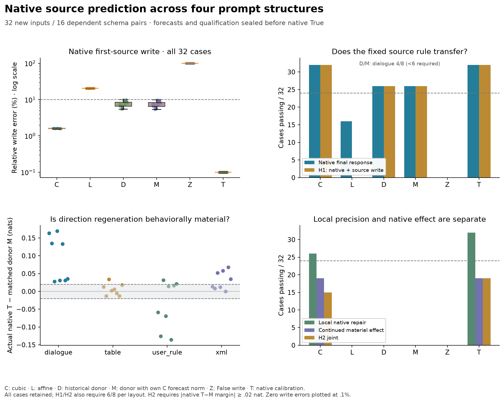

# A source prediction transfers across layouts; the borrowed direction mostly does too

**The frozen False-state rule predicts the native first-source write and final
response in all 32 new structural cases.** Both historical donor controls pass
26/32, but fail the required per-layout threshold. Their six failures concern
finite score margins: their local, receiving and verdict vector criteria all
pass. The stronger native-repair hypothesis remains **failed, 15/32**. This is
structural transfer under an explicit finite budget, not a complete native
mechanism or evidence that each case requires a unique direction.

[Protocol](../experiments/285-native-structure.md) ·
[All cases and retained decisions](../../results/native-structure-285/README.md) ·
[Pre-native public seal](../../results/native-structure-285/pre-native/forecast-seal.json)

## Why this test was worth running

The previous result explained a small correction to a chosen cubic approximation
at its own incoming state. A retrospective control then showed that much of its
direction could be borrowed from another literal in the same template. Another
correction sweep would not distinguish an actual transferable source calculation
from that template redundancy.

This test returns to the **native first-source MLP write**, not the error of a
second-source approximation. It changes the causal prefix before the Boolean in
four ways: a table, instructions moved into the user message, an extra dialogue
exchange, and XML-style fields. Facts and output meanings stay fixed. Each layout
has eight cases crossing schema, fact order and question target. All 64 complete
False/True input hashes are absent from the 2,112-sequence historical catalog.
Source positions span 173–199 and sequence lengths 178–205. Assignment is fixed;
these are 16 dependent schema pairs in a related synthetic task, not independent
task or checkpoint replication. Historical grounding controls remain failed.

## What the predictor knows and computes

C observes the current False computation and knows the Boolean edit and weights.
At the first source MLP, attention, input RMSNorm and gate/up projections remain
finite. It predicts SiLU using False gate derivatives through cubic order, then
uses finite multiplication and the learned down projection. The source gate is
replaced with its False value **before** the actual activation call, followed by
installation of the polynomial output. No complete edited first-source SiLU is
evaluated for the forecasts. All 27 later source MLPs and all receiving work stay
finite and adapt to the installed write.

L uses only the affine activation term. D installs the current False write plus
a fixed historical mean update. That mean comes solely from two sealed 279
**forecast** writes in the matched schema/order/question group, never native
observations. M uses the same direction rescaled to the current C forecast's
magnitude. M therefore spends the C calculation; it tests direction specificity
conditional on that magnitude, not computational efficiency. Z installs the
current False write; FZ is an exact False-input zero control.

The finite budget is substantial. This tests the first-source calculation under
otherwise finite continuation, not a cheap substitute for the whole network.
The formula is ordinary activation curvature and product computation. It does
not identify semantic features or establish novelty priority.

## The two frozen questions

H1 requires C's native first-source write prediction at 10% relative error/.995
cosine, plus the original native receiving and verdict vector bounds of 5%/.99
and actual candidate-margin error at most .10 nat. Material vector norms must
reach .001. At least 24/32 and six of eight in **every** layout must pass jointly.

H2 separately asks whether C-minus-M predicts native T-minus-M at the source write,
all receivers and final verdict. Its vector bounds are 25%/.95, with .001 norm
materiality. The actual margin effect must reach .02 nat and its prediction error
must be at most `.005 + .25*abs(effect)`. The same 24/32 plus six-per-layout rule
applies. Ineligible cases remain failures. H1 cannot rescue H2, and no comparator
can rescue the C primary. Full receiving vectors are compared only within cases;
no alignment across differently sized prompts is invented.

## Results: better margin fidelity, with a strong shared direction

C passes H1 **32/32**, eight in every layout. L passes the native-response criterion
16/32 but the source-write criterion 0/32, so its H1 count is zero. D and M both
pass H1 26/32, distributed as table 8, user-rule 6, dialogue 4 and XML 8. Their
aggregate exceeds 24, but dialogue falls below six: neither meets the full frozen
transfer requirement.

Both donors nevertheless pass **all 32 local-write, receiving-vector and
verdict-vector criteria**. Their six failures are exclusively margin errors
above .10 nat, in the same six generic-schema cases. M errors there range
.126–.170 nat; D .119–.168. This is not failure to transfer a reasonably aligned
write direction. It is a limit on the precision of its actual continued score
response.

C's median source-write error is **1.61%**, versus 20.43% for affine L, 7.47% for
raw donor D and 7.42% for matched donor M. Median native verdict-vector error is
.208% for C versus 1.208% for M; median finite-margin error is .00608 versus
.03120 nat. Donor median write cosine is about .99725; C's is .99987. Most of the
write direction is already shared across these layouts. Matching its magnitude
does not repair the six confidence errors.

## The stronger account fails, and why

C passes H2 **15/32**, below both the population threshold and several layout
thresholds: dialogue 8, table 1, user-rule 2 and XML 4. Exactly **19/32** native
T-minus-M margin effects reach .02 nat; exact T calibration therefore also has
only 19 H2 passes. All thirteen ineligible cases remain failures.

C predicts the continued receiving/verdict/margin effect within the frozen bounds
in **all 19 material cases**. Its local-write repair passes 26/32 overall. Four
eligible user-rule cases fail that local bound: relative error .285–.299 exceeds
.25, while their cosines .954–.959 pass. The intersection is 15. The known
approximation can predict the continued effect more accurately than this finer
local repair criterion in those cases. We retain the failed joint result rather
than revise its denominator or remove its local condition.

A separate answer-agreement check is especially limiting. Among the **two
recorded True/False candidate logits**, T, C, L, D, M and even Z all prefer True
in all 32 cases. Z still fails H1 throughout. These are not full-vocabulary
decoded answers or correctness measurements. Agreement on that candidate winner
cannot establish the necessity of the first-source update, successful grounding
or verifier competence. The useful differences here concern residual vectors
and conditional score margins, including hidden preference changes with the same
candidate winner.

## Qualification, chronology and reproducibility

The nine scientific files and their inherited dependencies were frozen at
`813f1619b5175f875e836df05ff56a04f057d2ba`, after a full unequal-length tiny CPU
pipeline and independent code/array review. Its 224 forecasts, 32 native calls
and 32 unhooked audit calls passed 4,288 forecast and 992 native checks. Premature
native, wrong seal and corrupted audit/CSV/NPZ/JSON tests rejected before any
forward. Synthetic scientific outcomes were not required to pass.

Real forecasts completed 224 full forwards in **88.86 s**, followed by the separate
forecast audit in **15.41 s**. All **4,288 required checks**, 96 derivative vectors
at 32 False anchors, 224 finite full-vocabulary head replays and **320 raw 1e-4
diagnostics** pass. Scope is the defined False coefficients and exact public
Float32 operations, not rounded whole-block derivatives or independent model
implementation validation. Older numerical failures remain unchanged.

All forecasts and qualification records were committed and pushed in
`17eafe8847b69568c467a36cec01bdb9d934bba9`; its 21-check repository CI passed
before native entry. The receipt verifies that exact public seal and branch tip,
plus all 32 current array/metadata hashes, sources, bank and CSV/audit/status
hashes before the first native call. The seal time precedes native start. The
immutable forecast manifest remains unchanged after measurement.

Native production completed **32 full forwards in 22.98 s**. Its separate audit
passed **992 required checks**, 256 finite head replays and **32 ordinary unhooked
True forwards** in **19.14 s**. No numerical qualification or failed checkpoint
retry was needed. Forecast arrays occupy 69,512,921 bytes; native hashes/sizes
are inventoried separately and arrays remain local.

An independent read-only audit recomputed every recorded vector metric exactly,
all endpoint decisions, donor installations and all 55 source hashes. That is
another check within this investigation, not an independent research team. One
publication-only verifier assumed device string `mps` rather than actual `mps:0`;
its initial source/error is preserved, and the narrowly corrected accepted device
spelling changes no scientific source, bound, data or seal.

[Reproduction instructions](../../research/README.md#structural-native-source-test-285)
keep actual publication receipts distinct from reruns of now-known inputs.

## What this answers in Question B

The first-source nonlinear update is predictively constrained across changed
prefix structures: False coefficients plus finite attention/norm/projection/
product computation yield the native write and final response within declared
bounds. The affine alternative is insufficient here. This does not uniquely
require cubic rather than another nonlinear approximation; the prior quadratic
control already succeeded in a narrower test.

Most of the direction still transfers from historical forecasts. Regeneration
improves confidence fidelity in six cases, and predicts the continued material
contrast in nineteen, but its stronger population-level repair claim fails. The
remaining Question B work concerns composing accurate updates while replacing
more of the finite source/receiver computation. Another small local correction
sweep or a feature name inferred from a sign pattern would not resolve that gap.
