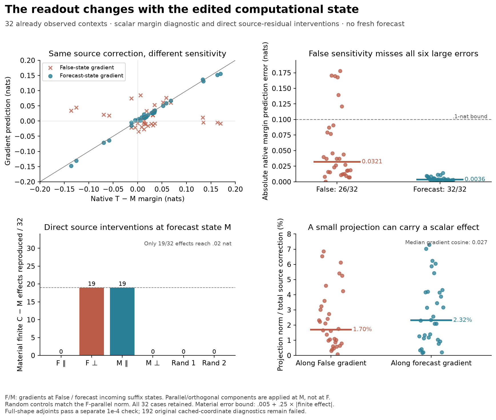

# A source correction matters through a state-dependent readout

**The False-state readout misses all six large donor margin errors. Recomputing
the readout at a False-derived edited forecast predicts all six.** Direct
source-residual interventions support that distinction: a small component along
the forecast gradient preserves the finite correction's material margin effects;
the component along the False gradient does not. This is a retrospective scalar
diagnostic on 32 previously measured contexts. It constrains a fixed-readout
explanation without identifying the operation that changes the readout.

[Frozen design](../experiments/286-false-readout.md) ·
[Full-shape numerical qualifier](../experiments/286b-full-shape-adjoints.md) ·
[Every case and failed diagnostic](../../results/false-readout-286/README.md) ·
[Reproduction](../../research/README.md#state-dependent-readout-286)

## The puzzle after structural transfer

The [previous sealed experiment](285-native-structure.md) predicted the native
first-source write across four prompt layouts. A historical direction, matched
to the current forecast's magnitude, also passed every local and final vector
criterion. Its six failures were exclusively score margins: a very close vector
could still miss confidence by .13–.17 nat. Counting the preferred True/False
candidate missed all these differences.

One possible account was that the small vector difference pointed along an
already important False-state readout direction. That would let one observed
False computation tell us which otherwise small source discrepancies matter.
The alternative was that the Boolean edit also changed the network's sensitivity
to those source directions. This experiment tests that distinction, rather than
trying another end-to-end correction rule.

## What is observed, varied and predicted

Use the same 32 contexts: eight table, user-rule, dialogue and XML examples, with
16 dependent schema pairs. All native outcomes are already known. The checkpoint
is pinned Qwen2.5-1.5B-Instruct, Float32 MPS/eager. Failed grounding controls and
the limitation to a synthetic task in one checkpoint remain unchanged.

The intervention node is the edited token's residual **after block 1**. C is the
earlier cubic first-source forecast; M is its historical-direction control,
matched to C's predicted write magnitude. Both are calculated from False, the
known edit, weights and sealed historical forecasts. Let

\[
d=s_C-s_M.
\]

This difference includes the original Float32 residual addition. C and M have
identical first-block suffix states except at that source row. Their subsequent
computation therefore differs only because of this installed source correction.

Let \(m\) be the actual finite True-candidate logit minus False-candidate logit.
The two predictions of the old native margin error \(m_T-m_M\) are

\[
\widehat y_F=g_F^\top d,\qquad \widehat y_M=g_M^\top d.
\]

Here \(g_F\) is the source-residual gradient of the finite downstream margin at
the ordinary False state. \(g_M\) is the same gradient at the edited M forecast.
**The complete incoming suffix differs between F and M.** This comparison does
not isolate a source-only state change from changed receiving rows.

Both gradients execute all 27 later source and receiving blocks and the finite
full-vocabulary head. Their unchanged causal prefix uses False keys/values.
Here “readout” means that complete downstream computation, not only the final
linear output projection.
Each call gets a fresh cropped cache. The M first-block regeneration replaces
the source gate with its False value *before* SiLU, verifies that actual input
and output, then installs the sealed M write. No native True gradient is used.

This is much more computation than consulting a saved False vector. The extra
M gradient is a state-conditioned control, not a compact predictor. Although
these rule inputs are False-derived, reusing known native outcomes makes this
study retrospective, not a prospective or fresh-context confirmation.

## Prediction: the False readout does not identify the six errors

Using the original .10-nat scalar accuracy bound, \(g_F^\top d\) passes **26/32**,
the same count as uncorrected M. It predicts none of the six actual errors above
.10 nat: **0 true positives, 6 false negatives**, with no false positives. Its
median absolute prediction error is **.03210 nat**, maximum .17782.

The M-state gradient passes **32/32**, identifying all six large errors without
false positives. Median error is **.003585 nat**, maximum **.014080**. With the
stronger .02-nat materiality guard and `.005 + .25*abs(target)` error bound,
the counts are **6/32 for F** and **19/32 for M**. Only 19 native effects are
eligible; the other thirteen remain failures. These are new scalar endpoints,
not a revision or rescue of the previous failed 15/32 joint repair hypothesis.

The median cosine between the two source gradients is **.02736**, ranging from
−.22568 to .21931. They are nearly orthogonal in this measurement. That describes
a changed output sensitivity; it does not establish a discrete switch, semantic
feature, or separate circuit.

## Direct interventions: size is a poor measure of scalar importance

For each gradient, split the same correction into its Euclidean parallel and
orthogonal components. Install each component separately at the **M** source
state, then execute the finite suffix and readout. Nothing is installed into an
unobserved native receiving state.

The component along \(g_M\) has only **2.32%** of the correction's norm at the
median, yet it reproduces the finite C-minus-M material margin effect in **19/32**
cases—all nineteen eligible cases. Its orthogonal complement passes **0/32**.
The component along \(g_F\) has median norm fraction **1.70%** and passes **0/32**;
its orthogonal complement passes **19/32**. Two seeded random controls, matched
to the F-parallel norm, each pass **0/32**. They are not separately norm-matched
to the M-parallel component. Every case remains in these denominators.

The median absolute effects are .02696 nat for M-parallel and .00367 for its
orthogonal complement, versus .00223 for F-parallel and .02702 for its complement.
Finite nonadditivity is small here: at most .00237 nat for the M split and
.00145 for F. The unpartitioned finite correction is the calibration target;
agreement with the native target also includes C's remaining source error.

This is stronger than noting a gradient correlation, because the defined
components were actually installed. It is still deliberately local. A parallel
projection is chosen to preserve a scalar's first-order effect, and a small
norm fraction is ordinary high-dimensional projection geometry. Neither fact
alone discovers sparse learned features or a unique mechanism. The empirical
constraint is that the *forecast-state* projection succeeds in the actual finite
continuation while the False-state projection and these controls do not.

## Why this narrows the explanation

At fixed M receiving rows, the finite C-minus-M effect is the integral of the
source gradient along the short M-to-C path. A gradient at M approximates it
well in these cases. The gradient at the different False computation does not.
The decomposition

\[
(m_T-m_M)-\widehat y
=(m_T-m_C)+[(m_C-m_M)-\widehat y]
\]

keeps the source forecast's error distinct from scalar transport error. It is
an exact accounting identity, not evidence of two competing mechanisms.

Thus a shared source direction can satisfy vector tolerances while its small
discrepancy is important under the *changed* downstream sensitivity. Predicting
the source displacement alone does not make the original False gradient a
reliable importance metric. This agrees with the earlier query-adaptation
constraints, but it does not identify which query, normalization, attention or
MLP operation generates this gradient change.

A discriminating next question is whether the readout change is generated mainly
by the changed source trajectory, the changed receiving trajectory, or their
interaction. That requires crossed states or block-level derivative interventions
with fixed controls, rather than interpreting an adjoint norm peak as a causal
localization. It has not been answered by this study.

## Numerical qualification and retained failures

Scientific source freeze **1dc4fdcfe592d61752f7cc0d8de9ea48525ea607** binds 61
files. Production completed in **127.88 s**: 32 ordinary False observations,
32 first-block regenerations, **1,664 suffix forwards and 64 backwards**. The
separate saved-array audit passed **2,592 required checks**, including 960
direction/step records for projected automatic differentiation versus central
finite differences and step halving. Directions include the actual correction,
its F-parallel/orthogonal split and two seeded coordinates at both anchors.
The saved plus/minus logits let the audit reconstruct those finite differences.
The public candidate head is independently replayed in CPU64 within .005.

**All 192 original cached-versus-full 1e-4 coordinate diagnostics fail.** The
largest error is .00077057. They pass the separately frozen .002 cached-coordinate
bound and 1e-4 relative bound; maximum candidate-score replay error is .00011444,
below .001. These are execution-shape discrepancies, not retroactive raw passes.

After seeing the result, a separate numerical-only protocol was frozen at
**44ba857**. It re-executes full-sequence shapes, then propagates the scalar
adjoint backward one full block at a time. A tiny CPU full-model/full-tape
comparison passed before freeze. On all 32 checkpoint cases, its **512 required
checks pass** at the original 1e-4 bound. Maximum source-adjoint coordinate
disagreement, across every saved source coordinate at every block 2–28, is
**6.8203e-5**; maximum source-direction dot-product disagreement is **3.6359e-6
nat**. Full-shape primal replays also pass. Its 70.93-s run adds 32 False
observations, 32 first blocks, 1,728 full-shape block forwards and 1,728 reverse
block recomputations/VJPs, plus 64 head VJPs.

This rules out a large cached-execution artifact in the tested adjoints. Both
reverse executions still use the same library primitives. These are scalar
reverse adjoints, not full Jacobians or derivatives of the bitwise-rounded
program; the finite differences independently qualify only their stated
projections. No older derivative failure is recertified.

Pre-freeze CPU development retains the initial inherited fixture's storage-guard
stop and an audit-field collision, fixed before the successful frozen run.
Real 286 and 286b runs required no source, threshold or runtime correction.
Arrays stay local with sizes/hashes published. CI checks records and source seals,
not a fresh model run or independent research-team replication.

## Question B remains bounded

We can now explain why these close source vectors can have unexpectedly different
margin fidelity: their difference is read through a state-dependent sensitivity,
and the sensitivity from the original False computation is inadequate here.
That is an evidence-backed local constraint. It does not explain why training
produced this particular computation, locate its responsible learned operations,
predict the full native displacement with less work, or solve general Question B.
There is no priority or attribution-patching comparison claim.
