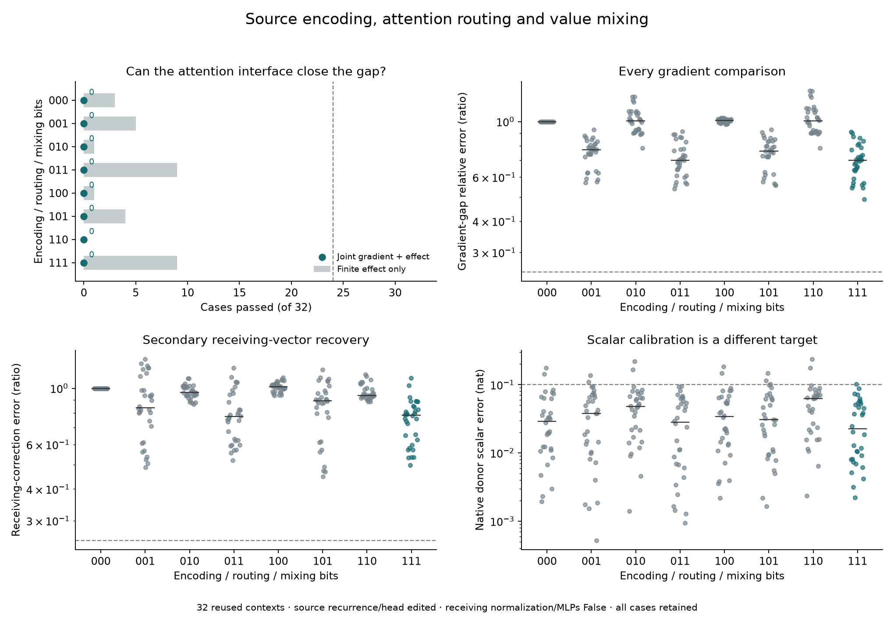

# The edited attention interface is insufficient

**All eight attention-interface variants fail 0/32 joint cases.** Restoring
source key/value input normalization, query–key/softmax routing and
probability–value mixing does not recover the remaining sensitivity shift
while receiving-row normalization and gated MLP response stay at False.
This rules out the specified sufficient account. It does not make attention
irrelevant or identify the remaining primitive mechanism.

[Protocol](../experiments/289-attention-interface.md) ·
[Evidence](../../results/attention-interface-289/README.md) ·
[Targeted receiving follow-up](290-receiving-nonlinearity.md)

## What is changed

The previous response-map factorial found that source recurrence and receiving
response had to be composed to recover the tested sensitivity shift. Its
receiving factor combined message encoding, attention and local processing.
This test moves inside that factor.

F is the ordinary False anchor. E is the source-only edited forecast MF after
block1, not the full MM forecast or native True trajectory. Source recurrence
and the final head use E throughout; other receiving-block parents initially
use F. The baseline is288's101. All variants preserve exactly the same E
zero-displacement trajectory. The intervention is the old small C-minus-M
source correction d, not the large Boolean edit.

Eight arms cross three bits, in this order:

- Source input RMSNorm in the receiving branch's source K/V construction.
- Query–key bilinear scores and softmax, grouped as routing.
- Probability–value bilinear mixing.

Each primitive is an actual finite recentered function. The source normalizer
is not a change to receiving rows' own normalization. Attention factors cover
all receiving rows and include communication between receiving positions.
Native linear projections, rotations, residual additions and learned output
maps are retained. Receiving MLP response and receiving-row normalizer response
remain F even in 111. Thus111 is the proposed attention explanation, not a
complete E reconstruction by construction.

## All failures remain in view

Every arm fails the gradient-vector criterion in every case. Full 111's median
relative error is 69.9%, with median cosine.727. Its finite signed effect passes
only 9/32, giving0/32 joint. The separate receiving-correction vector criterion
also fails 0/32, with 78.4 %median relative error. Source encoding normalization
alone is not sufficient; routing alone is not sufficient; mixing alone is not
sufficient. No smaller variant rescues the primary.

Twenty-four remaining finite contrasts reach .02 nat materiality. All eight
smaller cases remain in the denominator. The target is the remaining difference
between unmodified E and the baseline101; it is not288's original full F/E shift.

Scalar-only calibration would obscure this. Variant011 passes the loose native
.10 nat scalar-error bound32/32 despite failing every conditional gradient and
receiving-vector comparison, and identifying none of the six large old donor
errors. These secondary scores use the original M margin baseline. They do
not certify native residual fidelity.

## Numerical qualification

All **21,216 required records pass**:1,632 replay/boundary/head/source checks,
2,304 projected derivative/halving records and17,280 primitive records. Both
full-tape and blockwise source gradients agree; all 6,912 intermediate trace
diagnostics pass. All64 narrow1e-4 finite-coordinate controls pass in this study.
Original287/288 failures remain unchanged.

Primitive checks use the actual cached tensor shapes. Source RMSNorm VJPs are
checked at F/E across all coordinates for one source-row cotangent. One seeded
head per layer probes QK, softmax and probability–value derivatives; saved
parents and adjoints are checked against explicit Float64 CPU formulas. Maximum
primitive error is3.04e-6. Actual modified-function FDs use unit d and two seeded
coordinates at.05/.025; maximum saved derivative/halving error is.000457764.
This is selected derivative qualification, not independent AD of every primitive
coordinate, the full Jacobian, or the bitwise rounded program.

The final tiny CPU test passes652 required records, all 512 source-coordinate
FD checks across eight arms/four unequal lengths, and three coherent tamper
rejections. All 84 scientific sources were committed at
`7ee9be3cfbd4db17e1bd06153cef707c58578083` before checkpoint execution.

## Budget and next inference

Producer598.44s; saved-array audit6.53s.32 archives total70,435,822 bytes, below
96 MiB.384/256 MiB reserve guards pass. The run uses32 full False observations,
32 first blocks,64 anchor suffixes,32 finite native-E calibrations,32 pure-E
gradient reference forwards/backwards,3,584 interface forwards with193,536 cached
block calls,256 full-tape backwards,6,912 blockwise VJPs,51,840 extra encoding
normalizations,1,728 native-shape norm VJPs,5,184 attention-primitive VJPs and
1,728 anchor QK recomputations. Count all work; there is no efficiency claim.

The failure motivates a specific follow-up: receiving normalization versus
gated MLP response, with the attention interface now supplied. That follow-up
does not retroactively turn this failed account into a passing one.

All 32 contexts are already observed, from one checkpoint and related templates
with dependent schema pairs. No new True call or True gradient is made. The
False-derived E anchors require substantial finite computation. This is a
retrospective conditional diagnosis, not a compact native predictor, learned
circuit, novelty-priority result, or general Question B answer. Public CI verifies
records and seals; it does not independently reproduce omitted arrays/model.
