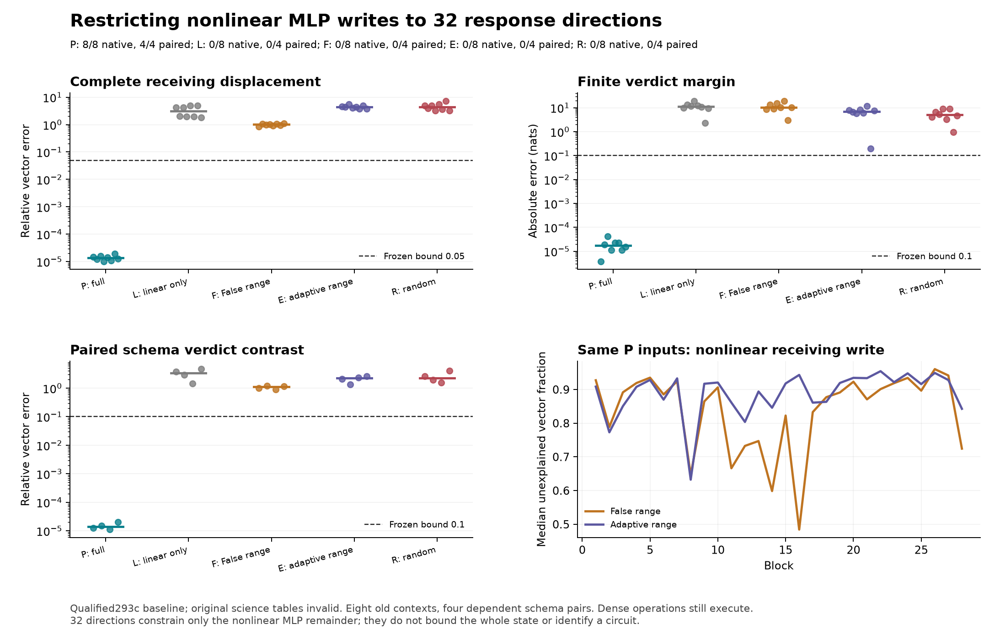

# Strong local response directions do not supply this nonlinear-write account

**The tested 32-direction account fails.** Restricting every affected MLP's
nonlinear write to a randomized response range gives **0/8 native passes and
0/4 schema-contrast passes**, whether the range is fixed at False or adapted
from the candidate's own state. The full 292 control passes 8/8 and 4/4.

These are qualified, retrospective results under **293c**. Original 293b science
tables are INVALID because a condition named F overwrote the saved False
baseline. All candidate arrays remain unchanged. A separately frozen read-only
qualification restores the actual baseline, named B0, from immutable 292 arrays.
The original tables and failed storage attempt remain visible in the evidence.



## Why this was a useful next question

292 predicts the native response very accurately, but mostly reruns the dense
network with a near-exact activation surrogate. Repeating activation/product
ablations would not identify a simpler learned computation. This test instead
asks whether a specified small set of learned response directions can carry
the nonlinear part of each MLP write through the full evolving computation.

There are eight previously observed292 contexts: one matched schema pair in
each of four layouts, with fact order and question target fixed. They are four
dependent pairs, not new tasks or held-out predictions. One False observation,
the known edit, weights and each candidate's own states determine the updates.
Native292 targets are used for retrospective scoring. No new checkpoint True
forward is performed.

## What is restricted

For a current predicted MLP input, compute the same rational activation as292,
actual gate/up projections, joint products and full down projection. Preserve
the False-linear product contribution

```text
linear_product = uF*SiLU'(gF)*(g-gF) + phiF*(u-uF)
l = public_down(Float32(linear_product))
n = current_MLP_write - False_write - l.
```

The finite-operation remainder n includes explicit cast/projection rounding;
it is not claimed to be pure ideal-real curvature. Install
`False_write + l + Q Q^T n`, leaving the False-linear contribution unrestricted.
Do this at every source and receiving MLP, across all 28 blocks. Attention,
normalization, projections, activation approximation and products remain dense.
This is a restriction of output directions, **not a saving in computation**.

The response operator used to construct Q is the ordinary smooth local MLP map
at its normalized input:

```text
J(v) = Wd[(u*slope)*(Wg v) + phi*(Wu v)].
```

Thirty-two seeded Gaussian directions are mapped through J, with two power
iterations and orthogonalization. This produces a randomized response range,
not an exact SVD or the optimal 32-dimensional subspace.

Five conditions retain all cases:

- **P:** the unmodified292 rational control, all nonlinear writes retained.
- **L:** omit the remainder; retain only the False-linear product contribution.
- **F:** project onto a range built from False coefficients and cached once.
- **E, primary:** adapt the range using the candidate's current up value,
  predicted activation and coherent surrogate slope.
- **R:** an isotropic random range, rescaled to match the retained E-range
  correction norm at R's own input. The adaptive-range work still counts.

No candidate receives another candidate's trajectory. The actual SiLU calls
receive False gates before execution, as in292. Current edited native SiLU is
not evaluated. The same-input local diagnostic at P is separate from these
actual interventions through independently evolving states.

## Qualified outcomes and what they distinguish

The original native criterion requires receiving and verdict displacements
within 5% relative error and .99 cosine, norms>=.001 and actual finite margin
error<=.10 nat. The schema-pair criterion additionally checks the first-source
and final-verdict displacement contrasts within 10% and .995 cosine, plus paired
finite-margin error<=.10 nat. P passes all tests. E, F, L and R pass none.

Across the eight cases, median receiving relative errors are:

- P: 0.00137%; margin error 0.0000172 nat.
- L: 310%; margin error 11.369 nat.
- F: 100%; margin error 10.318 nat.
- E: 443%; margin error 6.968 nat.
- R: 440%; margin error 5.008 nat.

A smaller scalar error does not make E or R an adequate internal account. E's
median paired verdict-vector error is 225%; its first-source contrast error is
74%. The corresponding F errors are 110% and 85%. All original denominators and
material/norm checks remain in the qualified tables. Neither an alternative
arm nor a favorable summary rescues the primary.

The same-input measurements explain a limitation of the proposed directions
before global feedback is invoked. At the identical P inputs, all 224 receiving
case/layer remainders are eligible. The False-derived range leaves 88.1% median
relative vector error; the adaptive range leaves 90.8%. Median signed projection
fractions are .223 and .176. For an orthogonal projection these also equal the
retained fraction of the squared norm, up to checked arithmetic. They are not
fractions of the final behavioral effect. Source and verdict rows are reported
separately, with the same unfavorable pattern.

Thus the proposed adaptation does not even improve typical local capture here.
The final failure is not adequately described as merely a small local error
amplified by depth. A large portion of the defined remainder is absent from
these selected directions at the same input. This does not locate a uniquely
responsible layer or neuron.

## What this means for Question B

The result rejects one concrete compression of the generator: the tested
instantaneous response ranges do not carry enough of the finite nonlinear
write. It does **not** prove that the displacement is intrinsically high rank,
that every 32-direction construction must fail, or that no efficient predictor
exists. Any single vector spans a one-dimensional subspace; the scientific
content is the restricted rule for constructing the directions without using
the remainder itself as a basis axis.

A useful next distinction is total local response versus its change along the
edit. In ideal smooth arithmetic,

```text
f(zF+d)-f(zF)-J(zF)d
  = integral from 0 to 1 of [J(zF+t*d)-J(zF)]d dt.
```

This standard identity suggests why a range dominated by J's largest responses
need not capture the remainder. A range derived from changed response or
curvature along the edit is a distinct hypothesis. **It has not been tested by
293.** The identity is a reasoning aid, not an asserted exact identity for the
rounded public ledger, a learned-circuit discovery or a novelty claim.

The general Question B remains open. We now have both an expensive accurate
native forecast and a failed, explicitly restricted direction account. The
next test should target that difference rather than increase accuracy at the
same full-computation budget.

## Numerical and bookkeeping qualifications

All 53,832 original primitive/installation/zero checks pass. They qualify the
recorded computations, not the original science tables. Fixed probes at blocks
1/15/28, source/verdict rows, reconstruct J and J-transpose with independent
CPU64 operands, qualify the response range, and compare smooth local derivatives
against Double AD and two finite differences. No whole-model Jacobian is used;
older disputed derivative/raw-coordinate checks remain failed.

The F label collision was discovered before accepting any scientific conclusion.
Original F condition arrays overwrote baseline fields; native/paired comparisons
therefore used the wrong subtraction point. Original pass counts happened to
match the corrected counts, but original vector errors and targets are invalid.
Do not use them. The tiny fixtures had missed this alias: their numerical checks
and intentionally corrupted-basis rejection were insufficient safeguards.

293c freezes a separate namespace qualification before corrected scoring.
It verifies all candidate archive/metadata hashes, restores B0 from292's sealed
False archives, verifies unchanged native targets against292, and recomputes
vectors and finite margins independently. All eight added CPU64 baseline-head
checks pass the unchanged .005 bound. A tiny fixture observes False independently,
keeps B0 distinct from condition F, preserves all candidate arrays, and rejects
a coherently corrupted baseline. Production correction performs zero model calls.
This is an explicit qualification, not a silently successful original audit.

## Storage, cost and reproduction

Original 293 stopped at its 256 MiB cap after seven cases. Frozen293b changes only
four resource literals to allow 384 MiB, retaining 512 MiB initial/384 MiB per-case
headroom requirements. AST comparison confirms no computation changes. All 237
arrays and metadata in each of the seven original cases replay exactly before
case 8. Original sources, archives and failure remain unchanged. The completed
eight archives total 318,901,559 bytes and stay local.

The completed producer uses 88 full forwards: 8 False, 40 candidates, 40 zero edits.
The stopped run adds 77 repeated forwards, so 165 checkpoint forwards actually
ran. Numerical operator/QR/AD/FD work is additional and fully counted in
`cost.json`. The completed resident producer/audit takes 139.87 s, the stopped
attempt 98.63 s; these are instrumented run times, not speedup measurements.
293c adds no model calls. Raw arrays and private articles are excluded from Git.

[Protocols](../experiments/293-response-subspace.md) ·
[Namespace qualification](../experiments/293c-baseline-namespace-qualification.md) ·
[All qualified and invalid original evidence](../../results/response-subspace-293/README.md) ·
[Reproduce](../../research/README.md#response-subspace-293)

Public CI verifies source seals, the resource AST restriction, baseline/score
provenance, record arithmetic and frozen decisions. It does not independently
regenerate omitted basis/state arrays or rerun the checkpoint. These are eight
old contexts in one small model, not a fresh or independent-team replication.
Historical grounding failures still preclude a competent-verifier shutdown
claim; novelty priority and direct attribution-patching comparisons remain open.
