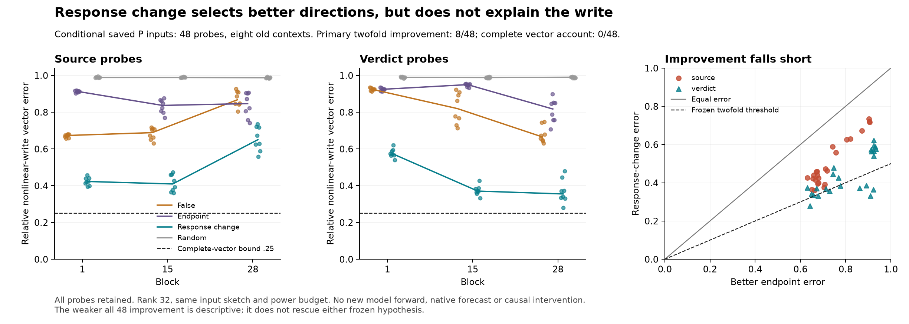

# Better directions from response change, but no sufficient account

**Both preregistered hypotheses fail.** At 48 saved probe inputs, a rank-32
range constructed from the *change* in MLP response reaches the required
twofold error reduction at **8/48** points: zero source and eight verdict
points. The required population was 36/48, including 18/24 in each scope.
The separate complete-vector criterion passes **0/48**. All **1,824** required
numerical checks pass. Question B remains open.

There is nevertheless a consistent weaker result: the change-derived range
has lower nonlinear-write vector error than **both** endpoint-derived ranges
at **48/48** points. Median error divided by the better endpoint error is
**0.61564**, about 38.4% lower. This is a descriptive, posthoc comparison;
it does not replace the failed frozen tests. The 48 points come from eight
old, dependent contexts, not 48 independent replications.

## Why test a change in response?

[Qualified 293c](293-response-subspace.md) found that the tested 32-direction
endpoint-response ranges captured little of the missing nonlinear MLP write,
even at identical supplied inputs. The full dense control worked; its
restricted counterparts failed. That left a specific possibility: the largest
responses to arbitrary perturbations might differ from the directions in
which the response itself changes during this edit.

For a smooth ideal-real map, ordinary calculus gives

\[
f(z_F+d)-f(z_F)-J_Fd
=\int_0^1 [J(z_F+td)-J_F]d\,dt.
\]

The right side depends on the changing operator **and its particular input
drive**. It motivates looking at response changes, but does not say that the
high-response range of the endpoint difference captures the integral. Nor is
this an exact identity for the saved rounded execution ledger.

294 tests just that endpoint-difference range. It does not integrate the path,
test an input-drive-specific construction, or repair a native trajectory.

## Matched construction and information budget

Eight previously observed contexts supply the same P-control probe inputs
from 293: blocks 1, 15 and 28, at the source and verdict rows. These are the
**48** available probes. Intermediate receiving rows are not silently added.
P is the full dense rational-activation control, not a new ordinary True run.
Its saved endpoint coefficients and nonlinear target write are supplied to
this retrospective diagnostic. Projection also uses the target vector itself;
only **basis orientation** is constructed without that target.

The defined normalized-input local operator is

\[
J(v)=W_d\{a\odot(W_gv)+b\odot(W_uv)\}.
\]

Use recorded False and P-endpoint coefficients to define \(J_F,J_E\), and
\(D=J_E-J_F\). All four bases use the exact same saved Gaussian input sketch,
rank 32 and CPU Float64 arithmetic. Each learned range uses two power
iterations; the random range is the orthonormalized input sketch:

- **False:** randomized output range of \(J_F\).
- **Endpoint:** randomized output range of \(J_E\).
- **Response change:** randomized output range of \(D\), the primary condition.
- **Random:** dimension-matched random range, without a norm or manifold match.

These are randomized ranges, not optimal truncated SVDs. The target is the
saved P finite-operation nonlinear MLP remainder after its False-linear write;
it includes explicit casting/projection rounding. The experiment measures
signed full-vector projections, not just a verdict scalar. An orthogonal
projection's nonnegative target dot product follows from geometry; it is not
evidence of an excitatory learned feature.

## Frozen results and their limits

H1 required response-change relative error at most **half the better** False
or endpoint error, at 36/48 points and 18/24 in each scope. It passes 8/48:
6/8 verdict probes at block 15 and 2/8 at block 28. All other strata pass zero.

H2 separately required norm at least .001, relative error at most .25 and
cosine at least .95, with the same population rule. It passes zero. All 48
targets exceed the norm guard; no low-norm exclusions shrink the denominator.
Neither controls nor H2 can rescue H1.

For descriptive scale, median response-change error at source blocks 1/15/28
is **.423/.409/.650**; at verdict blocks it is **.574/.371/.355**. The minimum
individual error is .279. Thus even the most favorable probe misses the
complete-vector bound. The all-point improvement is worth retaining, but
leaves a substantial unexplained vector component.

The evidence supports a narrow distinction: for this construction, changes
in local response select more relevant output directions than total endpoint
sensitivity does. It does **not** show why the learned model produces its
specific schema-dependent displacement. In particular, it does not distinguish
finite-path variation from the selection of directions by the actual input
displacement. Those remain competing reasons that a rank-32, isotropically
sketched endpoint-difference range can miss the target.

No new end-to-end correction sweep follows from these failed sufficient-account
tests. A future test would need to separate those two reasons at fixed inputs
before claiming a prospective repair. No such test was run here.

## Numerical qualification, history and work

The 112 scientific source files were frozen in commit
`ca367a67cd5e81f6cfd92d68d0604b62ddc904b7` before checkpoint tensor access.
All previous 107 source files are unchanged. Three pinned MLP weight sets are
read directly; no model is instantiated, no model forward runs and no native
True observation is added. Dense projections, operator applications, QR and
independent validation still count as work. This is not a speedup.

The separate Torch Double reconstruction checks operator/transpose differences,
complete power ranges, projections, closure, orthogonality, Pythagorean and
signed-vector identities. Operator bounds are 1e-8 absolute; independently
reconstructed range distance is bounded by 1e-6. Recomputed endpoint bases
must match the old 293 spans within 1e-3. This is span agreement, not bitwise
replay or independent qualification of every historical derivative.

All 1,824 checks pass. The prior unequal-shape CPU fixture passes 152 checks,
with both sign-corrupted and coordinate-permuted range fixtures rejected at
each of two shapes. These qualify a defined local operator based on recorded
coefficients. They do not resolve earlier whole-block derivative disagreements.

293's original F-condition/baseline alias remains documented and its invalid
tables remain preserved. 294 uses only unaffected P probe targets and local
coefficients, never that F_final subtraction. Qualified293c is explicitly
bound as a reference. Historical failed numerical checks, grounding controls
and failed broader prediction accounts remain failed.

The run finished with eight archives totaling **145,638,705 bytes**, within
the frozen 192 MiB archive cap. Producer wall time was approximately 31.7s on
the recorded machine; this includes the in-run independent checks and is not
a comparative performance benchmark. [Cost records](../../results/response-change-294/cost.json)
state calculated loop counts rather than claiming instrumentation.

## Reproduction and public evidence

[Protocol](../experiments/294-response-change.md) ·
[All records and omitted-array inventory](../../results/response-change-294/README.md) ·
[Regeneration instructions](../../research/README.md#response-change-294).

The public stdlib verifier checks frozen-source ancestry, record hashes,
complete denominators, signed sufficient statistics, scientific decision
arithmetic, cost declarations and figure provenance. It does not independently
reconstruct omitted vectors, weights or model trajectories. Regeneration uses
the pinned checkpoint and the preceding saved 293 probes. Repetition of these
old contexts is numerical reproduction, not fresh confirmation or novelty
priority. No learned circuit or general solution to Question B is established.
