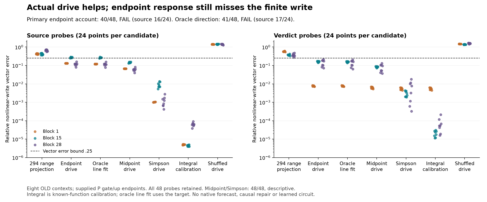

# The actual drive helps; endpoint response still misses the finite write

**The primary endpoint account fails its frozen population rule:40/48 points,
including16/24 source points against the required18/24.** The oracle endpoint-line
account also fails:41/48, source17/24. All **936** required numerical checks pass.
Midpoint and Simpson calculations each meet the local vector criterion at48/48,
as do the integral calibration. The shuffled-drive control passes0/48.

This closes the specific ambiguity left by294. Conditioning on the actual local
gate/up drive gives much better capture than the tested isotropic output range.
But an endpoint-only direction is insufficient at some source probes, even with
an amplitude fitted to the target. Evaluating the changing response inside the
finite path improves the conditional reconstruction.

**This is supplied-state local calculus, not a learned-circuit discovery or a
native forecast.** It does not solve general Question B. The broader
[research reassessment](research-direction-review-295.md) explains where the
program made progress and where it started explaining its own approximations.
The preregistered stopping rule closes this local line after295; it does not
launch another global repair, rank search or quadrature sweep.

## What changed relative to294

294's rank32 response-change range had lower error than both endpoint ranges
at all48 points, but passed none of the complete-vector tests. It selected
directions using random input probes rather than the particular input change.
A failure of that construction is not a lower bound on intrinsic dimension.

Here the supplied False and P gate/up endpoints define dg and du. With the
same coherent False-anchored rational activation psi used in292, interpolate

    g(t)=gF+t*dg, u(t)=uF+t*du
    k(t)=[u(t)*psi'(g(t))-uF*sF]*dg + [psi(g(t))-phiF]*du.

This is a straight path in **local gate/up coordinates**. It is not an observed
native trajectory or an independently validated normalization path. Given these
endpoints, the smooth local nonlinear write is

    Wd [uF*(psi(gE)-phiF-sF*dg) + (psi(gE)-phiF)*du].

The integral of Wd*k(t) over t from0 to1 equals that expression by ordinary
calculus. Reproducing it by quadrature is expected numerical calibration,
not a new explanation of how the model generated its endpoints.

The coefficients here are the coherent smooth proposal, rather than bytewise
replays of294's rounded compound coefficients. The supplied gate/up differences
are also not asserted to be an exact common normalized-input direction through
the original Float32 gate/up projections. The explicit rounded-target bridge
bounds this local comparison; it does not make it an exclusive intervention
on only one aspect of the original294 operator.

The fixed endpoint rule is Wd*k(1)/2; midpoint uses Wd*k(.5), Simpson uses
Wd*[k(1)+4*k(.5)]/6. The coefficient1/2 is fixed before calculation, not fitted.
The separate oracle direction projects the target onto the endpoint prediction's
line; its signed scale can use the target and reverse a prediction. It is an
orientation/amplitude diagnostic, never a prospective predictor.

## All candidates and frozen decisions

The vector criterion requires norm>=.001, relative error<=.25 and cosine>=.95.
Population success needs36/48 overall AND18/24 in each scope. Every target is
eligible; no difficult or small case is dropped.

- **Endpoint drive (primary):40/48; source16, verdict24; FAIL.** Median error
  .1313, maximum .2929. All eight failures are source/block15 probes.
- **Oracle endpoint line:41/48; source17, verdict24; FAIL.** Median error .1204,
  maximum .2900. Fitting scale cannot remove all endpoint-direction error.
- **Midpoint drive:48/48; descriptive.** Median error .06687, maximum .1579.
- **Simpson drive:48/48; descriptive.** Median error .003176, maximum .01780.
- **Integral16:48/48; calibration.** Median error .0000271, maximum .00637.
- **Shuffled drive:0/48.** Median error1.431. It jointly shifts dg/du by one
  neuron at fixed endpoint coefficients and matches the endpoint output norm.
  This is a coordinate-alignment control, not a model-input-manifold control.
- **Saved294 change-range projection:0/48.** Median error .4335. It observes
  the target during projection, whereas endpoint/midpoint/Simpson do not.

The48 probes are three blocks, two rows and eight old contexts: dependent
measurements, not48 independent discoveries. Missing receiving rows are not
invented. No final native residual, margin or causal installation is measured
by295, and no new ordinary True computation runs.

The result supports both qualifications: using the actual drive matters for
this comparison, and finite-path response variation still improves the local
write beyond the endpoint direction. It does not prove that those are unique
causal explanations, identify important learned neurons or establish a cheaper
predictor. A nearly exact integral of a supplied local function spends dense
work and does not generate the supplied endpoints.

## Numerical scope and preserved development failures

The117 scientific sources were committed at the recorded freeze before direct
checkpoint access. All preceding112 sources are byte-identical. Only three
pinned down-projection tensors are read, promoted from publicFloat32 to
CPUFloat64. No model is instantiated or forwarded.

An independent TorchDouble value implementation and AD slope reconstruct
endpoint/midpoint/Simpson products, smooth remainder and down projections.
They check saved P activation/slope replay, unchanged drives/targets/294
projection, shuffled norm matching and the oracle projection. Integral16 is
checked against the analytic smooth remainder in product and residual space
and against32-node quadrature. Bounds are1e-8 absolute+1e-10 relative.

The saved rounded293 target differs from the smooth product calculation.
Explicit bridges require1e-4 absolute plus1e-5 of the saved P/False/linear write
scale, and norm error<=1% of max(targetnorm,.001). All pass. The integral's
remaining .637% maximum target error is therefore a retained rounded-ledger
difference, not evidence of a new nonlinear mechanism. These checks do not
recertify disputed whole-block Jacobians or bitwise Float32 derivatives.

Before freeze, the first tiny fixture stopped because a reused proposal helper
expected unused second/third derivative fields. A dedicated equivalent rational
response removed that incidental interface dependency. The next tiny attempt
showed that splitting quadrature only at clipping crossings was insufficient
for a deliberately large -30-to30 gate step. Fixed gate partitions of width4
inside the active interval were added **before** the final qualification and
freeze; no production measurement or tolerance guided that change. Both
unfrozen source versions and the failed numerical log remain local.

The final unequal-shape CPU fixtures pass90 checks, including explicit products,
AD/central finite differences at two steps, clipping crossings, zero-drive
identities and sign/drive-corruption rejection at both shapes. Production
checks pass936/936; no frozen tolerance was changed and no continuation was
needed. Earlier failed checks and invalid293 original comparisons remain intact.
The local code never uses F_final as a False baseline.

## Budget, evidence and stopping point

The producer finished in15.91s on the recorded Mac. Eight raw archives total
**25,811,249 bytes**, below the frozen32MiB cap. Initial512/per-layer384MiB
headroom guards pass. This is not a performance comparison: dense host rational
kernels, down products and independent AD/validation count as work. The
[calculated cost record](../../results/finite-drive-295/cost.json) labels loop
counts as calculated rather than instrumented.

[Protocol](../experiments/295-finite-drive.md) ·
[All records](../../results/finite-drive-295/README.md) ·
[Reproduction](../../research/README.md#finite-drive-295).

The stdlib verifier checks frozen sources/ancestry, record identities, complete
denominators, signed sufficient statistics, population decisions, controls,
cost and figure provenance. It does not independently reconstruct omitted
vectors or checkpoint arithmetic. Regeneration requires the pinned weights and
preceding293/294 probes. Repeating these old contexts is not fresh confirmation.

The useful outcome is a boundary on interpretation: a poor randomized range
can coexist with a good single drive-conditioned vector, and even that vector
can need response information inside the finite path. Neither observation
identifies why the model learned this Boolean/schema coupling. The next major
study must target a native learned-path claim or a useful restricted prediction
budget, as specified in the reassessment. No296 is implemented or launched here.
