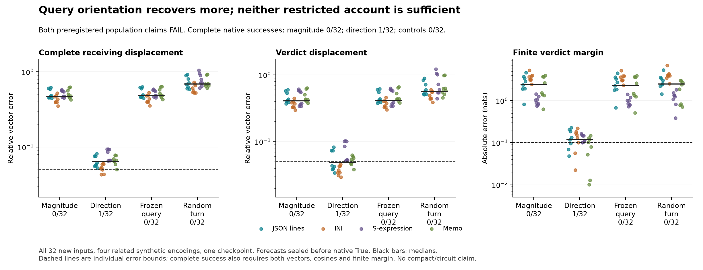

# Query orientation recovers more; neither restricted account is sufficient

**Both preregistered sufficient accounts fail.** Magnitude-only query feedback
passes **0/32** complete native tests; direction-only passes **1/32**. Frozen
queries and a matched random-turn control each pass **0/32**. The one direction
success is in the INI encoding; the required population was24/32 and6/8 in
every encoding. Neither claim comes close to that population threshold.

There is a useful quantitative distinction despite those failures. Median
receiving-vector error is **47.44%** with magnitude-only feedback and **6.45%**
with direction-only feedback. Median verdict error falls from **40.83% to4.87%**;
median finite-margin error falls from **2.419 to.119 nats**. Rescaling the False
query is insufficient even while source computation, keys, values and MLPs adapt.
Preserving the candidate's changing query direction recovers much more, but
still misses complete accuracy.

**General Question B remains open.** This is a test of the actual native Boolean
response on sealed new inputs, rather than another reconstruction of an
approximation's error. It constrains query feedback; it does not identify the
learned messages that generate its direction, a semantic circuit or a compact
counterfactual predictor. All39,704 required checks pass under the numerical
boundary below;56/168 original raw-logit diagnostics remain failed.

## The question this adds

[252](252-source-driven-attention-result.md) found that adaptive receiver queries
recover much more of the native response than fixed queries. It did not separate
a change in query magnitude from a change in orientation. At fixed keys, positive
rescaling multiplies every logit in that head/query row by the same factor,
preserving their rank and changing softmax sharpness. A change of direction
can change which keys are preferred. This is ordinary attention geometry; the
native quantitative comparison is the empirical question.

The [295 reassessment](research-direction-review-295.md) closed the preceding
endpoint/path diagnostic line because supplied-state calculus was drifting
away from the learned generator. This study returns to a competing account of
native behavior, with forecasts sealed before their True references.

## What each candidate actually computes

Observe one ordinary False run, retaining its post-RoPE receiver queries qF at
every head/layer. Supply the known input token edit. At each candidate's own
current state let q be its newly computed query:

- **A, primary magnitude-only:**qF multiplied by norm(q)/norm(qF).
- **D, direction-only:**q multiplied by norm(qF)/norm(q).
- **B, neither:**qF.
- **R, angular control:**keep q's component parallel to qF and the length of its
  orthogonal component, but replace that component's orientation by a seeded
  random direction orthogonal to qF. It preserves norm and angle to qF at its
  OWN input; it is not an on-manifold or semantic-feature control.

Only receiving queries strictly after the edited Boolean are replaced. Source
and earlier query rows are protected. Keys and values are live, including source
and receiving keys; a magnitude-only arm does not freeze all rankings globally.
Every normalization, softmax, attention output, MLP, residual update and the
full-vocabulary final head stays finite and adaptive.

Each arm generates its own trajectory. D's direction is its current candidate's
direction, not an oracle native direction. The arms therefore differ in later
incoming states as well as the current query map. Their effects are not unique
additive percentages or a decomposition at a shared native operating point.

The complete current query and original attention output still execute before
replacement. This is an expensive native-path intervention forecast, not a
speedup or an explanation of how to generate the query with less work. No True
hidden state, True score, True gradient or accurate edited trajectory is supplied
to the forecast. No whole-block derivative is used.

## New inputs, public seal, then native outcomes

32 exact input pairs cross four additional evidence encodings—JSON lines, INI,
S-expressions and memo blocks—with two schemas, two fact orders and two targets.
Literal substitutions and encodings are fixed before computation. All64 complete
input hashes are absent from the available2,240-hash catalog. These remain
related synthetic templates and dependent pairs in one pinned checkpoint;
syntax and literals both change, so this is not causal isolation of field meaning
or a new task domain. Earlier failed grounding controls still preclude a
competent-verifier shutdown claim.

The125 scientific sources were frozen at
`002a3177e165ea5a388b30b6a636edd1c6b562e5`. An append-only progress qualification
was frozen separately at `9609447d2f910e1715bf75737643436811960136`, without changing
those125 source bytes or any geometry rule, criterion or numerical bound.

All32 forecasts, zero controls and their independent audit were completed
before the global seal was pushed in commit
[`1334508`](https://github.com/romrom-20/counterfactual-traces/commit/13345088bd5485992e2e4cd13cf472ba09d2f94d).
The native phase verified the remote branch head, public seal bytes, all local
array/metadata hashes and current source/runtime identities before its first
ordinary True measurement. The receipt and measured timestamps are preserved.

The strict original native test requires receiving rows after the source AND
the verdict displacement within5% relative error and.99 cosine, native target
norms>=.001, plus actual finite-margin error<=.10nat. All32 remain in every
denominator. Minimum target norm is36.66; no low-norm case is removed.

H1 required A sufficient at24/32 and6/8 per encoding, while D and R had<=8/32.
H2 separately required D sufficient under the analogous restrictions on A/R.
Both fail. H2 cannot rescue H1, and a favorable median cannot rescue either.

## The whole response matters

Direction-only passes the receiving-vector test in **2/32**, the verdict-vector
test in **17/32**, and the margin test in **9/32**. Only **1/32** passes all three
with the cosine/norm guards. Its median verdict error is below5%, yet that does
not establish a complete response. This preserves a central lesson of the
[scalar-response diagnostic](291-receiving-coefficients.md).

Magnitude-only, frozen queries and random turns pass none of those three
individual criteria. Frozen queries have48.07% median receiving error and
2.310-nat margin error; random turns have68.63% and2.481nats. A generic turn
with matched norm and angle does not reproduce the directional arm's recovery.
Those controls support the consequence of the chosen orientation under these
interventions, not a named learned feature.

The result rejects the tested sufficient explanation in which query feedback
is merely a rescaling of a fixed preference. It also rejects treating the
changing direction with False magnitudes as fully sufficient. It does not
establish universal necessity of every head, assign semantic meaning to a
geometric component, or locate which source messages created the turn.

## Numerical qualifications and retained failures

The first tiny CPU run passes1,132 required checks across four unequal sequence
lengths. It executes forecast and native/calibration phases on a random small
Qwen, checks independent query geometry, norm/angle preservation, composed
attention and finite heads, exact zero edits and source/prefix protection.
Coherent wrong-map and corrupted-source records are rejected in each case.
These are fixtures, not checkpoint discoveries.

Production pre-audit passes **33,640/33,640** checks. The final audit passes
**39,704/39,704**, including those prechecks and6,064 additional records. Exact
installation, protected-row and prefix hashes, all zero final states/scores,
T/O calibration, and all28 source-row hashes between native and forecast arms
pass. The independent attention reconstruction covers eight fixed cases (both
schemas, order0,target0 in each encoding), blocks1/15/28:120 forecast kernels
and48 native/calibration kernels. It is not a complete independent implementation
of every attention operation.

Independent query-map bounds are1e-5; CPU64 composed attention probability and
weighted-value output bounds are1e-4; finite-head bridges are.005. The separate
raw-logit1e-4 diagnostic fails **40/120** pre-native and **56/168** combined,
so16/48 new native comparisons fail. All remain failures. The probability/output
qualification was declared before these runs; it does not retroactively pass
raw checks, historical Jacobian disputes or every internal primitive.

The actual public finite head determines every margin. It is not replaced by
a linear readout. Saved-array checking in the same investigation is not an
independent research team or checkpoint replication.

## Preserved stop, exact continuation and work

Original296 stopped after two saved forecast cases: its second progress write
attempted to overwrite an immutable shared JSON basename. It adds16 full
forwards and no ordinary True observation. Sources, arrays, failure and log
remain intact. The separately frozen296b wrapper routes only progress payloads
to case-count-specific filenames, preserving the original immutable writer for
all other files. Its filesystem contract and replay-corruption fixture pass.

A new run replays both case archives, witnesses and metadata **exactly** before
starting the third case. It then completes all32. These sixteen replay calls
are not fresh confirmation. Nothing in the model rule or scoring changes.

Actual model work:16 stopped plus256 completed forecast calls plus64 native/
calibration calls = **336 full checkpoint forwards**, with7,560 additional
full-shape QK/softmax/PV operations each and183 extra witness QK products.
The64 native-phase calls comprise32 ordinary True and32 current-query calibration
calls. Independent numerical auditing adds host work and no model replay.

The completed forecast producer takes138.45s; native production43.18s on the
recorded Mac. Forecast and native audit take5.48s and5.61s. The original stop
adds25.33s. These timings include process/loading/bookkeeping and are not a
performance benchmark. Raw forecast/witness archives total95,433,768bytes;
native/witness archives27,624,974bytes. Guards pass; no evidence was deleted or
recompressed. [272's causal-prefix baseline](272-research-review-and-causal-baseline.md)
remains the useful-cost reference; this experiment does not improve its budget.

## Where I would continue, and where I would stop

The native test was worth running: it discriminates rescaling a fixed query
from preserving a changing orientation, and both sufficient claims could fail.
It gives an additional native constraint rather than another approximation-error
repair. Geometry splitting alone now reaches a useful stopping point.

The unresolved question is sharper: **which learned source-to-receiver messages
produce the consequential query turn? Does that turn matter through rereading
the changed Boolean source, through reweighting other context, or both?**
250b's source-value clamps and this query-geometry test do not separate those
query-specific routes. That would require a distinct primitive routing test
with explicit controls and transfer, not another norm/direction threshold sweep.
No297 is coded or launched here, and no general Question B solution is claimed.

[Protocol](../experiments/296-query-geometry.md) ·
[Progress-only qualification](../experiments/296b-append-only-progress.md) ·
[All evidence](../../results/query-geometry-296/README.md) ·
[Reproduce](../../research/README.md#query-geometry-296).
